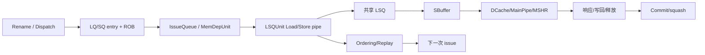
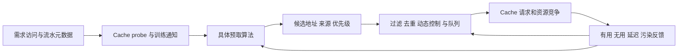

# 架构、数据结构与核心算法

## 1. LSU 在 O3 后端中的位置

Rename/dispatch 为一条指令分配 ROB 状态，并在需要时分配 LQ 或 SQ 槽。IssueQueue 根据操作数、依赖和资源决定何时发射。IEW 将访存操作送入 Load/Store pipe。每个线程拥有一个 `LSQUnit`；所有线程共享 `LSQ`、SBuffer 和 DCache 端口。Commit 负责按序提交、精确异常和部分内存顺序边界。



## 2. 状态对象及所有权

|对象|关键字段|创建者|释放/失效边界|
|---|---|---|---|
|`DynInst`|seqNum、PC、LQ/SQ 索引、replay bits、fault、saved request|Rename/dispatch 路径|ROB 提交或 squash；请求对象可更晚释放|
|`SQEntry`|instruction、地址、数据、write mask、addr/data ready、canWB、split status|`insertStore()`|`completeStore()`、squash 或异常清理|
|`LSQEntry`/`LoadQueue`|instruction、request、执行/完成状态|`insertLoad()`|Load commit、squash 或请求完成后的槽释放|
|`LSQRequest`|translation/request/fault 状态、fragments、packets、byte enables、outstanding count|Load/Store issue path|本地释放且 outstanding packet 数归零|
|`StoreBufferEntry`|块地址、byte data、validMask、sending、vice、request|SQ 向 SBuffer handoff|miss 接受并保存独立快照后可提前释放；hit/旧模式通常在最终响应释放|
|IssueQueue waiter|deferred/cache/STLF/MDP/blocked/PSQ 条目|失败 attempt|对应释放事件或 squash|
|RAR/RAW replay entry|等待中的 `DynInstPtr`|Load 顺序检查|completed index、容量或 squash|

源码入口：

- `src/cpu/o3/dyn_inst.hh:93`
- `src/cpu/o3/lsq_unit.hh:169`
- `src/cpu/o3/lsq.hh:164`
- `src/cpu/o3/lsq.hh:331`

## 3. LQ/SQ 的年龄与槽复用

LQ/SQ 是 age-ordered circular queues。队列 head 表示最老且仍被跟踪的访存操作，提交和释放必须从老端推进。槽号会在尾部插入时复用，因此不能把 `lqIdx`/`sqIdx` 当作永久响应 ID。

一个迟到响应可能属于已经 squash 的指令，也可能同一索引已经被新指令使用。回包必须依赖 `LSQRequest`、Packet sender state 或保存的指令指针确认 owner。

|事件|从队列角度发生什么|还需要什么条件|
|---|---|---|
|Dispatch|在尾部分配槽，建立相对年龄|ROB 必须已有对应条目|
|Commit Load|最老 Load 达到退役边界|指令完成、异常已解决|
|Commit Store|普通 Store 获得写回资格|ROB 顺序和请求完成状态|
|SQ→SBuffer|commit-authorized Store 数据交给共享 LSQ|空格、资源和 split 进度|
|Squash|删除比恢复点更年轻的槽|取消本地请求、保留外部 outstanding owner|

## 4. Store 地址、数据与写使能

Store 不是一个“整条数据立即可见”的事件。下列是需要识别的状态，STA 与 STD 允许不同到达顺序，不是严格串行的硬件时间线：

```text
SQ allocated
  -> address/translation ready (STA)
  -> data and byte mask ready (STD)
  -> pipeline executed
  -> ROB canWB authorization
  -> SBuffer entry accepted
  -> Cache request accepted/completed
  -> request and SBuffer state released
```

地址 ready 不代表数据 ready，执行完成也不代表已提交。split Store 还要记录哪些 fragment 已完成、哪些被 SBuffer 接收、哪些因资源不足需要重试。

## 5. Load 地址、数据来源与完成

Load 需要先形成请求、完成翻译，再选择数据来源：

- 完全由更老 SQ/SBuffer 字节覆盖：可能直接 forward；
- 没有可用本地数据：发送 Cache 请求；
- SQ 只有部分覆盖：当前实现 reschedule；SBuffer 部分覆盖可以记录字节并与 Cache 返回数据组装，split 路径另按片段处理；
- 更老 Store 地址未解析、RAR/RAW 资源不足：登记等待者。

从 Cache 返回数据也不等于 Load 已经提交。数据要先写回物理目标并唤醒依赖者，最终仍由 ROB 按序提交。

## 6. Byte-mask forwarding 算法

核心入口：`checkStoreLoadForwardingRange()`（`src/cpu/o3/lsq_unit_forward.cc:84`）。

SQ 从当前 Load 的边界向更老端扫描，先检查最近的更老 Store。SQ 转发和 SBuffer 转发的部分覆盖处理不同，不能写成一个通用的逐字节拼接算法：

```text
SQ: scan from the youngest older store toward the writeback frontier
    full eligible coverage -> record SQ bytes and finish this search
    overlapping store with data not ready -> STLF wait
    partial or masked/split overlap -> reschedule this Load
if SQ did not stop the attempt:
    try eligible non-split SBuffer byte forwarding
    partial SBuffer bytes can overlay Cache data during assembly
```

必须避免以下错误：

- 地址相等就认为完整覆盖；
- 一个年轻 partial Store 遮住更老完整 Store；
- 把同线程 SQ 投机转发和 Store 全局可见性混为一谈；更老但未提交的 Store 可以在合法条件下向 Load 转发；
- 未跟踪旧请求 owner 就删除部分覆盖的前缀数据。

## 7. SBuffer 数据结构与字节合并

`StoreBufferEntry` 保存一个线程、一个 Cache block 的 committed bytes：

- `blockVaddr`、`blockPaddr`：地址和 Cache block 归属；
- `blockDatas`：保存实际字节；
- `validMask`：每个字节是否有效；
- `sending`：请求是否在 Cache 端口阶段；
- `inDcacheMainPipe`：是否占用了建模的 MainPipe 资源；
- `replayQueued`：是否在原地等待重新进入；
- `vice`：原 entry 已有请求快照时保存同块新数据；
- `request`：对应共享 LSQ 请求/回包状态。

合并入口：`StoreBufferEntry::merge()`（`src/cpu/o3/lsq.cc:122`）。

```text
for each incoming byte:
    if incoming mask is true:
        update blockDatas[offset+i]
        set validMask[offset+i]
```

当已有 Packet 的 mask 是快照时，旧 entry 不能再接受会改变语义的新字节。新 Store 需要通过 `createVice()`（`src/cpu/o3/lsq.cc:362`）形成新的 entry/request 关系。

## 8. SBuffer 容量与替换

SBuffer 同时维护：

- 全局大小限制；
- 每线程容量/已用数量；
- block 地址索引，用于 forwarding 和合并；
- free list，用于 O(1) 找到空 entry；
- LRU 顺序，用于选择 eligible eviction；
- pending miss 集合，用于同块合并和迟到响应。

容量判断不是简单的“vector size”。线程配额、flush 域、发送状态和 pending miss 是否释放都会影响能否接收新 Store。

## 9. Cache MainPipe 与 MSHR 资源模型

共享 LSQ 在 SBuffer/refill 请求进入 Cache 前检查：

- Cache set 是否正被占用；
- 需要的 bank mask 是否冲突；
- MSHR 是否可用；
- 是否存在同 block pending miss；
- refill 是否需要更高优先级；
- 请求是否能进入 modeled MainPipe stage。

这些检查提供性能模型中的资源竞争和反压。它们不是 correctness shortcut；请求被拒绝后返回 retry/replay，不能当作已经完成。

## 10. `LSQRequest` 生命周期算法

一条 `LSQRequest` 可能对应一个或多个 Packet。主要状态是 `NotIssued`、`Translation`、`Request`、`Fault` 和 `PartialFault`，并带有 translation、sent、retry、writeback、discard、LSQ released 等 flags。

关键生命周期规则：

```text
LQ/SQ entry release -> release(LSQEntryFreed)
outstanding packet count > 0 -> request remains orphan
last packet response -> packetReplied()
writeback scheduled/done -> separate flags
all owners released -> delete request
```

如果 Packets 仍在 TLB 或 Cache 中，本地槽可以被复用，但 request 不能析构。迟到回包必须找到原 request owner。

## 11. RAR/RAW Replay 算法

LSQUnit 保存 RAR/RAW 两个有序等待队列。处理时受每周期 quota 和 tracking 容量限制，分四阶段收集：

1. completed index 已越过的 RAR；
2. completed index 已越过的 RAW；
3. 新释放的 RAR tracking 容量；
4. 新释放的 RAW tracking 容量。

全部收集完成后再统一执行 callback；这样 callback 不会在遍历同一队列时修改当前 batch。cause、clear、统计和 `retryMem()` 顺序都不能单独修改。

源码入口：`processReplayQueues()`（`src/cpu/o3/lsq_unit_replay.cc:304`）。

## 12. 内存依赖预测与值预测

内存依赖预测和值预测都会让后端更早做决定，但二者预测的对象不同：

|机制|预测什么|错误后的恢复对象|不能替代什么|
|---|---|---|---|
|StoreSet|某个 Load 与哪些 Store PC 经常形成依赖|重发 Load 或处理 RAW violation|真实地址/字节冲突检查|
|PHAST|`Load PC + path history` 对应的 SQ 动态距离|重发 Load、squash 或训练新 distance|SQ 动态槽映射和地址比较|
|direct-value predictor|Load 本次可能读到什么值|值预测错误后的 redirect/squash|真实 Load 和内存可见性检查|
|Memory Renaming|Load 的可能 producer/Value File 索引|Producer/Cache 回包验证|当前实现尚未完成的 Value File 值注入|

### 12.1 StoreSet 基线

StoreSet 仍保留为 MDP 的对照实现。它根据 Load PC 维护依赖集合，可选择等待明确 producer，也可在真实 RAW violation 后更新依赖。`EnablePHASTMDP=False` 时，`MemDepUnit` 走 StoreSet 路径。

StoreSet 的输出是保守等待或 violation 训练信息。它不能证明两个访问一定重叠，也不能取消 LSU 中已有的地址、mask、年龄和 Cache 检查。

### 12.2 PHAST 使用的 key 与动态距离

PHAST 的核心 key 是：

```text
Load PC + 该 Load 之前的路径历史
```

路径历史按 `seqNum < load_seq_num` 过滤，避免把 Load 之后的分支带入查表。当前默认 history length 是：

```text
0, 2, 4, 6, 8, 12, 16, 32
```

查表从最长 history 开始，命中后立即停止。每个表项保存两个可能的 SQ distance、tag、confidence 和 LRU 信息。distance 不是 Store PC，也不是 Store seqNum，而是“从当前 Load 的 SQ 位置向前走多少个更老 Store”。

源码入口：

- `PHAST::filteredHistory()`（`src/cpu/o3/phast.cc:97`）；
- `PHAST::makePathHash()`（`src/cpu/o3/phast.cc:111`）；
- `PHAST::checkInst()`（`src/cpu/o3/phast.cc:132`）。

### 12.3 从 distance 映射到动态 Store

PHAST 命中只说明预测表给出了相对距离。`MemDepUnit` 还必须把 distance 映射成当前 Store Queue 中真实存在的动态 Store：

```text
current load SQ position - (distance + 1)
    -> 检查 iterator 是否 dereferenceable
    -> 检查 SQ entry 是否有效
    -> 检查 Store seqNum 是否比 Load 更老
    -> 去重并记录 producing store
```

映射失败会增加 `phastDropInvalidSQDistance`，并通过 `invalidSQDistance()` 降低对应表项的 confidence。只有成功建出具体 producer 的预测才计为 effective prediction。

集成入口：

- `MemDepUnit::insert()` 的 PHAST 查表和 distance 映射（`src/cpu/o3/mem_dep_unit.cc:309`）；
- mapping failure 反馈（`src/cpu/o3/mem_dep_unit.cc:355`）。

### 12.4 PHAST 训练与 confidence

PHAST 采用 violation-driven training。发生真实 RAW violation 时：

1. 根据 Load 和 violating Store 的 seqNum 过滤出真实路径及可用历史长度；
2. 用 violating Store 的 SQ distance 更新该路径表项；
3. 如果之前命中过长历史表但没有预测到实际路径，同时降低旧预测的 confidence；
4. Load 在没有 violation 的情况下 commit 时，用真实 Load/Store 地址范围检查预测 producer 是否确实重叠，并更新 confidence。

commit-time overlap 检查支持配置的地址压缩 shift。整个流程把“预测是否指向正确生产者”和“实际内存范围是否重叠”分开处理。

源码入口：

- `PHAST::violation()`（`src/cpu/o3/phast.cc:162`）；
- `PHAST::commit()`（`src/cpu/o3/phast.cc:202`）；
- `MemDepUnit::violation()`（`src/cpu/o3/mem_dep_unit.cc:708`）；
- `MemDepUnit::commit()`（`src/cpu/o3/mem_dep_unit.cc:761`）。

主要参数与当前默认值：

|参数|默认值|作用|
|---|---:|---|
|`EnablePHASTMDP`|true|BaseO3CPU 默认启用；实际配置脚本可以覆盖|
|`phast_num_rows`|64|每张 history table 的行数|
|`phast_associativity`|4|每行路数|
|`phast_tag_bits`|16|tag 位宽|
|`phast_max_counter`|16|confidence 最大值|
|`phast_counter_threshold`|1|允许发预测的最小 confidence|
|`phast_counter_increment`|0|0 表示正确反馈恢复到最大 confidence|
|`phast_counter_decrement`|1|错误反馈的减量|
|`phast_selected_target_bits`|5|参与路径 hash 的低 target 位数|
|`phast_history_lengths`|[0,2,4,6,8,12,16,32]|多历史长度表|
|`phast_second_target_max_distance`|0|0 表示使用虚拟 SQ 容量的一半|

`BaseO3CPU.py` 的 `EnablePHASTMDP` 默认值为 true；`kmhv3.py` 显式关闭 PHAST，`idealkmhv3.py` 显式开启。描述实验结果时必须同时写出配置文件，不能只写参数类默认值。

### 12.5 direct-value predictor 框架

值预测框架的公共接口由 `VPUnit` 定义：

- `predict()`：在 Fetch 阶段产生 `VPPredictionCandidate`；
- `update()`：在 Commit 阶段用真实值、misprediction 和反馈训练；
- `specUpdate()`：为需要投机更新私有状态的 predictor 预留；
- `squash()`：清除错误路径上的私有 in-flight 状态。

公共请求只携带 `pc`、`seqNo`、`tid`，更新只携带真实值等稳定字段。predictor 特有信息通过扩展对象传递：

```text
VPPredictRequestExtension  -> Fetch-time extra inputs
VPUpdateInfoExtension      -> Commit-time extra inputs
VPPredictionRecord         -> predictor-private state across predict/update
VPFeedback                 -> selected/applied/offered/correct feedback
```

Fetch 只对满足 `canLVP()` 的标量 Load 发起预测；推测结果挂在 `DynInst` 上。IEW 可在 dispatch 后唤醒依赖者，并在真实 Load 结果与预测不符时触发值预测恢复。Commit 是训练点，此时真实值、fault 状态和 producer 信息已经确定。

关键入口：

- `VPUnit::valuePredict()`（`src/cpu/valuepred/valuepred_unit.cc:31`）；
- Fetch 预测点（`src/cpu/o3/fetch.cc:3546`）；
- IEW 唤醒点（`src/cpu/o3/iew.cc:1577`）；
- Commit 训练点（`src/cpu/o3/commit.cc:2386`）。

### 12.6 CompositeValuePredictor

Composite 是组合框架，不是算法本身。它依次调用 child predictor，保存每个 child 的候选和 private record，再通过 arbiter 选择最终值。当前 arbiter 包括 fixed-priority、random、round-robin 和 confidence-based。

Commit 时 Composite 将统一反馈扇出给每个 child，并分别记录：

- child 是否给出预测；
- child 是否被选中；
- 如果给出的预测被使用，是否会正确。

当前 Composite 明确拒绝 `MemoryRenaming` child，因为 Memory Renaming 的输出还没有作为 direct speculative value 接入主路径。

源码入口：

- Composite 构造和 child 限制（`src/cpu/valuepred/composite_value_predictor.cc:12`）；
- Composite predict/select（`src/cpu/valuepred/composite_value_predictor.cc:46`）；
- arbiter 策略（`src/cpu/valuepred/composite_value_predictor_arb.cc:13`）。

### 12.7 Memory Renaming 的当前实现边界

当前 XS-GEM5 的 `MemoryRenaming` 已实现 Store-Load Cache 和训练框架：

- 以 Load PC 查多路 Store-Load Cache；
- 表项保存 tag、Value File index、confidence、useful 和 producer Store PC；
- 用 in-flight window 跟踪尚未完成的 Load/Store 关系；
- Commit 时接收 `ProducerInfoExt`，相同 producer 增加 confidence，producer 变化则降 confidence 或重分配；
- squash 时清空 in-flight window。

关键入口：

- `MemoryRenaming::doPredict()`（`src/cpu/valuepred/memory_renaming.cc:158`）；
- `MemoryRenaming::predict()`（`src/cpu/valuepred/memory_renaming.cc:208`）；
- `MemoryRenaming::doUpdate()`（`src/cpu/valuepred/memory_renaming.cc:223`）；
- `MemoryRenaming::update()`（`src/cpu/valuepred/memory_renaming.cc:349`）。

当前默认 SLC 是 3 路、每路 128 项、16-bit tag；inflight window 默认使用完整 PC key。`logStoreLoadValueFileEntries` 只描述预留的索引空间，不能据此推断 Value File 数据通路已经实现。

必须特别说明当前边界：`doPredict()` 返回 `speculative=false`，Value File index 目前作为 sideband 信息使用，尚未从 Value File 注入真正的 speculative value。因此它目前属于 Memory Renaming 基础设施和训练实现，不能描述成已经完成完整 memory-renaming 加速闭环。

完整算法目标应是：

```text
Load PC -> Store-Load Cache -> producer/Value File index
        -> Value File speculative value
        -> Load 正常访问内存并校验
        -> 正确则提交，错误则恢复
```

### 12.8 correctness boundary

依赖预测和值预测都不能越过真实执行校验：

- MDP 不能把“可能依赖”改成架构 fault；
- PHAST distance 必须映射到更老且存在的动态 Store；
- direct-value prediction 必须保留真实 Load、Cache 响应和 fault；
- Memory Renaming 的 producer 或 Value File 命中不能跳过内存可见性和一致性检查；
- 所有错误预测的私有一致性状态都必须在 squash 时清理。

## 13. 关键统计的语义

|统计名称|含义|不要误解为|
|---|---|---|
|`sbufferNewline`|新分配 SBuffer entry 的次数|Cache miss 次数|
|`sbufferMerge`|同块字节合并次数|完整覆盖的 Load forward 次数|
|`sbufferFull`|Store handoff 因 SBuffer 满受阻|Store 架构 fault|
|`RARQueueReplay`|RAR 等待者被重发次数|RAR 架构异常|
|`RAWQueueReplay`|RAW 等待者被重发次数|内存一致性违规次数|
|MDP replay 统计|预测/等待协议触发|实际地址是否重叠|
|`loadReplayEventsFromIssueQueue`|从 IssueQueue 入口看到的 Replay|所有重试尝试的祖先|

## 14. 必须保持的不变量

1. 队列 age order、每周期 quota 和 callback 顺序不可被重构改变。
2. 槽释放后，外部 request/Packet 仍必须有 owner。
3. 有效数据和 valid mask 必须一致。
4. 请求快照建立后，不能再被同块后续 Store 原地修改。
5. split Store 的成功片段不能重复发送。
6. Replay waiter 必须有且只有一条最终释放路径。
7. 架构 fault 只能由 ROB 边的首错发布。
8. drain 必须覆盖 SBuffer 和 pending Store misses。

## 15. 代码阅读入口

- LQ/SQ：`insertLoad()`（`src/cpu/o3/lsq_unit_queue.cc:116`）、`insertStore()`（`src/cpu/o3/lsq_unit_queue.cc:176`）
- Store 完成边界：`commitStores()`（`src/cpu/o3/lsq_unit_queue.cc:400`）
- SBuffer handoff：`offloadToStoreBuffer()`（`src/cpu/o3/lsq_unit_store_pipe.cc:562`）
- SBuffer merge：`merge()`（`src/cpu/o3/lsq.cc:122`）
- forwarding：`checkStoreLoadForwardingRange()`（`src/cpu/o3/lsq_unit_forward.cc:84`）
- Replay：`processReplayQueues()`（`src/cpu/o3/lsq_unit_replay.cc:304`）
- drain：`isDrained()`（`src/cpu/o3/lsq.cc:802`）

## 16. 最新 `xs-dev` 设计在本拆分中的保留

本 PR 不是把旧版 LSQUnit 覆盖到最新代码上，而是从最新 `xs-dev` 的原始 `lsq_unit.cc` 生成拆分文件。因此最新版本新增的 TEA、MLP predictor 和 SMT 动态借用逻辑必须继续存在。

### 16.1 TEA 事件归因

TEA（Timing Event Attribution）是 attached to the functional ROB 的旁路性能归因器。它采样 ROB 状态，把执行停顿归因到已提交、已 flush 或正在等待的指令事件。LSU 为它补充三类事实：

1. TLB miss 被识别时设置 `ST_TLB`；
2. Cache 响应记录 `cacheAccessDepth`，并对 cacheable miss 设置 L1/LLC 事件；
3. 外部 snoop 导致 Load 必须重新执行时设置 `FL_MO`。

关键入口：

- `Tea::cacheMiss()`（`src/cpu/o3/tea.cc:180`）；
- `LSQUnit::recvTimingResp()` 中的 response-depth 与 TEA 更新（`src/cpu/o3/lsq_unit_completion.cc:127`）；
- `LSQUnit::completeDataAccess()` 中的 Cache 深度保留（`src/cpu/o3/lsq_unit_completion.cc:148`）；
- snoop memory-order replay 标记（`src/cpu/o3/lsq_unit_order.cc:181`）。

TEA 只观察和归因，不是 Load/Store correctness owner。拆分后的 completion/order/load-pipe/store-pipe 文件保留相同调用点，不改变事件时机。

### 16.2 MLP predictor 的 LSU 输入

最新 MLP-aware Fetch predictor 使用三类状态：

- miss-pattern table：判断某个 Load PC 是否可能成为 long-latency Load；
- MLP distance table：预测为暴露并行访存所需要的 lookahead distance；
- Long-Latency Shift Register：在 Commit 后按体系结构槽推进，并用实际间隔训练 distance。

该 predictor 本身位于 `mlp_predictor.cc`/`fetch.cc`/`commit.cc`。LSU 的责任是把真实 Cache 访问深度可靠保存到 `DynInst::cacheAccessDepth`。Replay packet 的 depth 可能为 0，因此 completion 使用 `max` 保留之前观察到的更深 miss，避免 replay 把真实深度覆盖掉。

当前 long-latency 判定阈值由 `mlpLongLatencyCacheDepth` 配置；Fetch 只有在 predictor 被使能时才执行 MLP-aware 决策。拆分 PR 不改变该接口，也不把 host 侧 Replay scratch 当作 MLP predictor 状态。

### 16.3 SMT LQ/SQ DynamicBorrowing

最新 `LSQ` 增加 `SMTQueuePolicy::DynamicBorrowing`：

- shared capacity 仍是全局 LQ/SQ 上限；
- 每个线程保留 base quota；
- busy thread 可以使用 donor 暂未占用但必须保留的恢复容量之外的空间；
- donor reservation 和 hold cycle 防止一个线程长期饿死；
- 统计分别记录 Base/Donor 状态、切换时已用/空闲 entry 和每周期状态组合。

入口包括 `borrowingLimitLQ()`（`src/cpu/o3/lsq.cc:2440`）、`borrowingLimitSQ()`（`src/cpu/o3/lsq.cc:2474`）和 donor 状态更新（`src/cpu/o3/lsq.cc:2508`）。这些逻辑位于 shared `LSQ`，不在被拆分的 LSQUnit 实现文件中；拆分测试保留相同 LQ/SQ 容量行为和 `se_smt` 控制用例。

### 16.4 其它最新设计边界

最新代码还包含 Decode fusion compaction、Hybrid ROB 和 MLP Fetch throttling。它们不属于本次 `lsq_unit.cc` 文件拆分或 Replay scratch 修改，因此本 PR 不改变其接口和配置。测试基线必须保留这些设计，不能把本补丁应用回旧 Decode/ROB 版本。

## 17. 从零理解：为什么访存需要这么多状态

### 17.1 寄存器重命名为什么解决不了内存依赖

整数指令的源、目的寄存器在译码后就能确定，Rename 可以建立生产者关系。Load/Store 的地址却需要执行地址计算，有时还要等待 TLB/PTW。两条使用不同基址寄存器的指令，最后可能访问同一个物理地址；相同虚拟地址也必须结合地址空间和权限理解。

访存依赖因此有两层：预测层决定现在是否值得执行，实际地址层决定执行结果是否合法。StoreSet/PHAST 减少错误尝试，SQ、RAR/RAW、snoop 检查保留真实冲突的发现和恢复能力。

例如程序顺序为 Store A、Load B。B 地址先就绪，A 地址未知。B 先执行后，若 A/B 最后发现重叠，B 可能读到旧值，必须恢复。若等待所有 Store 完成，虽然保守，却损失本可并行的无关访问。这是预测、投机和纠错并存的原因。

### 17.2 三种顺序及五种完成事件

|概念|含义|例子|
|---|---|---|
|程序顺序|同线程指令的年龄关系|seqNum 和队列位置判断谁更老|
|执行顺序|何时算地址、发请求、收数|年轻 Load 可以比老 Store 更早算好地址|
|可见性顺序|其他访问何时能观察到 Store 数据|进入 SBuffer 不等于其他核已看到新值|

地址就绪、Load 写回、ROB 退役、Store 转交 SBuffer、最终写响应是五件不同的事。阅读 trace 必须标注看到的是哪个事件，否则容易把正确的异步重叠误认为乱序错误。

### 17.3 离散事件模型与请求对象

tick 是模拟时间单位，Cycles 是 CPU 周期表示，wall time 是宿主实际耗时。事件通过 schedule 安排到未来 tick，TimeBuffer 保存跨周期流水内容。一次 C++ 调用结束，不代表被模拟的内存访问结束。

Request 保存地址、大小、访问属性和字节使能；Packet 携带命令、数据指针和 sender state 在端口间传输；LSQRequest 组织动态访存指令的翻译、子请求、回包和生命周期。三者不能互相替代。

## 18. LQ/SQ、物理窗口和状态条件

### 18.1 Load 分配时为什么保存 SQ 边界

insertLoad 将 load_inst->sqIt 设为当时的 storeQueue.end，表示该 Load 之前的 Store 边界。转发从这里向更老端扫描，不能取之后才分派的年轻 Store。insertStore 同时保存 LQ 边界，使 Store 地址解析后能够检查更年轻的 Load。

源码：`src/cpu/o3/lsq_unit_queue.cc:116`、`src/cpu/o3/lsq_unit_queue.cc:176`。这两个交叉边界连接了转发和事后的违例检测。

### 18.2 逻辑容量与物理窗口

逻辑 SQ 容量由 SQEntries × StoreQueueMultiple 得到，SQEntries 配置物理容量。分配逻辑槽只表示已跟踪此 Store；STA/STD 写入物理窗口还检查：

```text
store_idx - storeQueue.head() < physicalSQEntries
```

这是单调队列位置上的窗口判定，不能拿环形数组的模后槽号相减。StoreQueueMultiple 必须为非零二次幂，构造时检查溢出及容量。源码：`src/cpu/o3/lsq_unit_queue.cc:266`、`src/cpu/o3/lsq.cc:625`。

例如物理窗口 2、逻辑容量 4，S0/S1/S2/S3 都可有逻辑记录，但初始只有前两项能写物理窗口。头项释放后窗口推进。窗口外 Store 的重试不是再次申请逻辑槽，也不是 Page Fault。

### 18.3 SQEntry 的 ready、finish 与完成

|字段/条件|说明|不能推导什么|
|---|---|---|
|addrReady|地址状态已写入 SQ|STD 已完成|
|dataReady|Store 数据已准备|地址已翻译好|
|canForwardToLoad|地址和数据都 ready|已经架构提交|
|staFinish/stdFinish|对应执行路径到达完成点|Cache 已完成写事务|
|splitStoreFinish|STA/STD 两路径均完成|所有跨行 fragment 已被 SBuffer 接收|
|canWB|允许进入 Store 写出路径|已经发送到 Cache|
|completed|SQ 侧完成条件成立|内存系统没有在途 Store|

字段定义：`src/cpu/o3/lsq_unit.hh:169`。split Store 需要区分地址/数据拆分和跨多个 fragment 两种含义：前者由 STA/STD 状态位管理，后者由 LSQRequest 子请求进度管理。

## 19. 算法成本与性能因果关系

|算法/结构|当前行为|维护时的取舍|
|---|---|---|
|SQ forwarding|扫描更老且未写出的 Store，split 情况还比较 fragment 组合|保留年龄、覆盖和数据 ready 判断，不是逐门复制硬件 CAM|
|SBuffer map/free list|按线程和 block 查主项，用 free list 找空项|同块合并与容量分配分离，不按 Store 指令数计容量|
|eligible LRU eviction|从较老候选中检查线程和序号范围|flush 不能误清其他线程或范围外条目|
|pending miss forwarding|按行索引，在该行列表中从新到旧找字节|避免全局扫描，保留同线程逐字节新旧关系|
|RAR/RAW waiter|按 seqNum 插入 list，扫描收集并受配额限制|能跳过未满足条件项，不等于纯 FIFO|
|Replay scratch|复用容量，活动批次仍局部保存|降低宿主分配，不能改变模拟配额|
|PHAST|多历史表查 tag/confidence，再映射当前 SQ producer|预测命中与有效动态依赖分开|

典型性能链：下级 miss 延迟增加 → Store target 在途更久 → MSHR/target 竞争 → SBuffer S2 受阻 → SQ 交接受阻 → dispatch 停顿。提前释放 SBuffer 改变一个资源的寿命，不会令下级响应凭空变快。

另一条链：老 Store 地址慢 → RAW/MDP 等待 → Load 不能推进 → 依赖者和 ROB 停顿。只看总 IPC 不能区分 TLB、SQ、SBuffer、MSHR 与依赖预测瓶颈。

## 20. 参数、配置覆盖与实际生效

以下为固定源码中的类默认及 kmhv3.py 显式设置。其他配置可以不同，实验以 config.ini 为准。

|参数|BaseO3CPU 默认|kmhv3 显式设置|作用|
|---|---|---|---|
|LQEntries|72|120|逻辑 LQ 容量|
|SQEntries|56|64|物理 SQ 容量|
|StoreQueueMultiple|1|2|逻辑/物理倍率，此配置逻辑容量 128|
|LdPipeStages/StPipeStages|4/5|沿用|级数；宽度还来自 scheduler|
|RARQEntries/RAWQEntries|72/32|96/56|顺序跟踪容量|
|RARDequeuePerCycle/RAWDequeuePerCycle|4/4|4/4|队列处理配额|
|LoadCompletionWidth/StoreCompletionWidth|8/4|8/4|连续完成位置推进宽度|
|SbufferEntries|16|16|物理项数|
|SbufferEvictThreshold|7|8|未发送项超过阈值后写出|
|sbufferReleaseOnMiss|true|此处未覆盖|miss 接受后释放物理项|
|EnableLdMissReplay|true|true|普通 Load miss 的重试处理|
|sbufferBankWriteAccurately|false|true|写的 bank 竞争建模|
|EnablePHASTMDP|true|false|依赖预测路径|

定义：`src/cpu/o3/BaseO3CPU.py:229`、`src/cpu/o3/BaseO3CPU.py:295`。配置覆盖：`configs/example/kmhv3.py:82`、`configs/example/kmhv3.py:159`。

修改参数后应确认正确 CPU 实例、生成配置和目标事件计数，再对同输入比较。传入参数不等于目标分支实际执行。

## 21. 本篇阅读完成标准

应能说明：老 Store 未提交为何可以向年轻 Load 转发，却不能直接向别的线程发布；逻辑 SQ 仍有空位为何 STA 会被物理窗口阻塞；SBuffer 物理占用为零为何 fence 仍等待；增加 MSHR 为什么不保证所有负载性能单调提高。具体路径见 `02-store-load-sbuffer-flows.md`，等待与恢复见 `03-replay-exception-recovery.md`。

## 22. StoreSet 与 MemDepUnit 不是只靠一个预测表

StoreSet 中 SSIT 将静态 PC 映射到 Store Set ID，LFST 记录集合里近期动态 Store。当前实现使用 LFSTLarge，每个集合可以保留多个 Store 候选，不应套用“每集合只有一条最后 Store”的教科书简版。真实 violation 会分配、关联或合并集合关系；insertStore 更新动态记录，issued/squash 清理相应候选，周期清理避免旧关系永久保留。

源码入口：`src/cpu/o3/store_set.cc:155`、`src/cpu/o3/store_set.cc:258`、`src/cpu/o3/store_set.cc:309`、`src/cpu/o3/store_set.cc:399`。

MemDepUnit 接收这些动态 producer 后还要构建实际依赖。常规模式将消费者接到 producer 的 dependInsts，memDeps 未解除时不能按普通 ready 发射；replay-based MDP 模式则可先标记 IQ 依赖完成，允许 Load 尝试，到 LSU 地址阶段发现 producer/前沿未满足时登记 MDP waiter。因此“预测有依赖”可能表现为发射前等待，也可能表现为执行后 Replay，必须看 EnableReplayBasedMDP 与 strict 配置。

集成入口 `src/cpu/o3/mem_dep_unit.cc:230`，实际 read 的地址等待在 `src/cpu/o3/lsq_unit_forward.cc:229`，pipeDone 与 producer 唤醒见第 3 篇。PHAST 替换的是预测 producer 的方法，不替换这整条状态管理链。

## 23. 真实访存顺序检查、snoop 与模型边界

### 23.1 同周期 nuke 与已执行 Load 的违例

pipeLineNukeCheck 在 Load/Store 流水的指定阶段比较年龄和地址范围，遇到重叠可让当前 Load attempt 重试，避免使用尚未发布完整地址/数据的 Store 状态。它不同于已执行 Load 之后才被发现的 RAW violation，后者需要记录 memDepViolator 并让 IEW/Commit 恢复。

checkViolations 扫描年龄有序 LQ，排除无有效 request、地址未就绪或 strictly ordered 等情况；按 fragment 地址范围和 depCheckShift 判断重叠，并处理 skipRawCheck、已 nuke 等特殊状态。这里的范围检查有保守性，不应把它说成与每个 Store byte-enable 完全一致的精确 CAM。

源码 `src/cpu/o3/lsq_unit_order.cc:86`、`src/cpu/o3/lsq_unit_order.cc:303`。LSQDepCheckShift 压缩地址时可扩大保守冲突范围，因此参数不只影响宿主计算量，也可能影响模拟重试和性能。

### 23.2 为什么两个 Load 也需要跟踪

年轻 Load 可能早于更老 Load 执行，如果期间观察到对应缓存行 invalidation，两个 Load 观察到的内存次序可能不合法。代码使用 possibleLoadViolation 与 hitExternalSnoop 记录关系，条件满足时置 ReExec。needsTSO 开启时还会扩大后续恢复范围，不能默认所有配置都采用 TSO。

本地其他 SMT 线程的 Store 最终可见时，notifyOtherThreadsStoreVisible 调用相应检查；它与外部一致性 snoop 共享部分目的，但一个按可见 Store 字节判断，另一个按 invalidate/缓存行及相关状态处理，不能写成完全相同事件。入口 `src/cpu/o3/lsq_unit_order.cc:122`、`src/cpu/o3/lsq_unit_order.cc:245`。

### 23.3 fence 与 RVWMO

RISC-V 的访存顺序不是“所有 Load/Store 一律串行”。转发、乱序执行和 miss 并行需要与屏障、原子、依赖和一致性条件协作。当前模型用 Commit 屏障路径、LSQ flush、RAR/RAW、nuke 与 snoop 等维护相关条件；解释这些机制不等于已形式证明完整 RVWMO。

优化不能只看某条指令最终值相同，还要考虑 Store 可见时机、其他线程观察值和 fault/interrupt 边界。完整多核 litmus 与全部一致性协议覆盖仍是独立验证任务。

## 24. bank、set、alias 和端口不是同一种冲突

### 24.1 先区分地址上的四层信息

|对象|用来回答什么|模型中的使用位置|
|---|---|---|
|字节 offset 和 mask|访问哪些具体字节，哪些可转发/更新|SQ、SBuffer、Packet byte-enable|
|bank|同周期是否竞争同一数据阵列子资源|loadBankConflictedCheck 与 MainPipe readBanks/writeBanks|
|set/index|是否映射同组，以及当前流水是否占据该组|LSQ setKey 与 Cache tag/index 策略|
|物理 line/tag|是否为同一实际缓存行、miss 或一致性对象|MSHR、物理 block 索引和 snoop|

两个请求落在同一 bank 不代表地址相同；同一 set 也不代表命中同一 tag。virtual alias 则是不同虚拟映射对应同一物理行时索引/上下文不兼容的问题，不能当作普通 Cache miss 或字节冲突。当前 LSQ 的同行 Store 合并同时检查物理行、线程和 virtual set；classic Cache 继续检查 MSHR predecessor 资格。

### 24.2 多 bank Load 要先检查，再统一占用

loadBankConflictedCheck 枚举访问范围触及的 bank、div 和 key，先探测全部目标，再统一修改占用。如果前面一个 bank 已被写占用、后面才发现冲突，就会让失败请求留下虚假资源占用；当前实现避免这种部分提交。recentlyloadAddr 还提供同 key 的模型处理，不能简单概括为“同 bank 两个 Load 必定冲突”。源码 `src/cpu/o3/lsq.cc:1319`。

例如 bank 粒度 2 字节，连续 8 字节可能触及四个 bank。请求起点不在 bank 边界时，循环先处理首段再推进，不能只用地址低位算一个 bank 就认定完成检查。

### 24.3 为什么部分 Store 还会占读资源

makeStoreBufferMainPipeRequest 从 validMask 推导实际写 bank；若某 bank 并未被完整覆盖，还将该 bank 加入读集合，用于建模部分写相关的数据阵列读需求。全 bank 写与稀疏 byte Store 因而不一定有相同资源成本。refill 则有自己的 tag/data 写需求与可选读需求。

相关入口：`src/cpu/o3/lsq.cc:1042`、`src/cpu/o3/lsq.cc:1081`、`src/cpu/o3/lsq.cc:1117`。sbufferBankWriteAccurately=false 时写 bank 采用更保守的全置位抽象；该开关会改变资源竞争，不是只改变 debug 输出。

### 24.4 配置为什么要同步 Cache 几何

configs/common/LSQBankConflict.py 从 DCache size、assoc、line size 推导 DcacheSetBits。若只改 Cache 容量或索引而 LSQ 仍用旧 set/bank 参数，功能数据可能仍正确，但资源冲突与模拟性能会不一致。Caches.py 中的 VIPT tag/index、way predictor、替换策略又是不同机制：way prediction 提前猜路，最终仍需 tag/权限等真实检查；替换策略只决定要驱逐谁，不能代替命中判断。

本轮 PR01/PR02 没有修改这些参数和算法。文件拆分的验证关注同输入下事件与统计保持；不能将上游已有的更精细 bank 设计计为本轮新增收益。

## 25. 共享队列策略怎样影响一条线程的可用容量

|策略|分配含义|要小心的地方|
|---|---|---|
|Independent 模式|每线程逻辑资源按该模式管理|不能把 shared policy 公式直接套上|
|Shared + Partitioned|根据活动线程分配比例份额|活动线程数变化会影响份额|
|Shared + Dynamic|允许使用共享池中可用空间|仍受全局容量与物理窗口约束|
|Shared + Threshold|多个活动线程时应用 LQ/SQ 阈值|RAR/RAW 不经同一阈值入口，非法配置有检查|
|Shared + DynamicBorrowing|保留其他线程所需份额，再借出可恢复容量|donor 状态、hold 周期、已用量与 reserve 都影响当前上限|

例如 borrowingLimitLQ 对其他线程累计 max(reserve, used)，再从全局 LQEntries 扣除；other 是 donor 时使用 donor 恢复份额，否则使用 base 份额。这不是直接按“别人空多少我拿多少”分配，也不是凭 donor 标签创造额外物理容量。SQ 有独立参数和状态。源码 `src/cpu/o3/lsq.cc:2380`、`src/cpu/o3/lsq.cc:2440`、`src/cpu/o3/lsq.cc:2474`。

此外 Store→SBuffer 的每周期 offload quota 是另一个共享仲裁：它限制交接带宽，不等于 SBuffer 容量，也不等于一个 MSHR 能放多少 target。评估 SMT 性能应分别观察 dispatch 空位、物理 SQ full、offload 预算、SBuffer full 和 Cache 拒绝，避免把所有 backpressure 都归为“LSQ 满”。

## 26. 预取器与访存正确性路径如何协作

### 26.1 需求访问和预取请求的目的不同

程序 Load/Store 必须完成其架构语义；预取尝试提前把可能使用的数据带入缓存，可以被节流、丢弃或判定无用。预取器命中某个模式不表示当前程序 Load 已读到正确值，也不能绕开权限、顺序与真实执行校验。

一般接口链为 Cache/probe 观察事件 → Base/Queued 组织训练信息 → 具体算法产生候选地址和来源 → 过滤/排队/必要翻译 → Cache 请求 → useful/unused/污染等反馈。当前组合与 worker、forwarder 又可把训练/发送分配到其他对象，具体实例以 PrefetcherConfig 和 config.ini 为准。



入口 `src/mem/cache/prefetch/base.cc:209`、`src/mem/cache/prefetch/queued.cc:772`、`src/mem/cache/prefetch/queued.cc:955`。表项和候选算法的目录在 04 第 24 节逐文件列出；它们不是全部启用，也不是全部经过本轮功能/性能验证。

### 26.2 Store 训练与 LLDP 元数据

Store prefetch train 是显式可配置入口。Load-load 依赖预取还可通过 XsDynInstMeta 的 seqNum、PC、context 和依赖链信息训练，相关类型在 src/cpu/o3/dyn_inst_xsmeta.hh、src/mem/lldp.hh。只携带元数据不等于在执行中投机改 Load 的结果；LLDP 候选与前述值预测是不同技术。

### 26.3 为什么性能回归必须固定预取配置

预取会使用 Cache/MSHR/带宽并影响替换：有时减少需求 miss，有时带来污染、重复访问和资源竞争。因此打开更多预取不保证性能更高。做拆分或 Replay 容量复用 A/B 时必须固定预取器及反馈配置；若顺便调预取参数，就无法把统计差异归因到纯重构。

本套文档介绍 LSU 与预取的接口、作用和资源因果；每种可选预取器的完整研究与性能调参属于扩展学习。源码目录列出算法入口，未将仅存在的可选实现描述成当前使用或完整验证。
