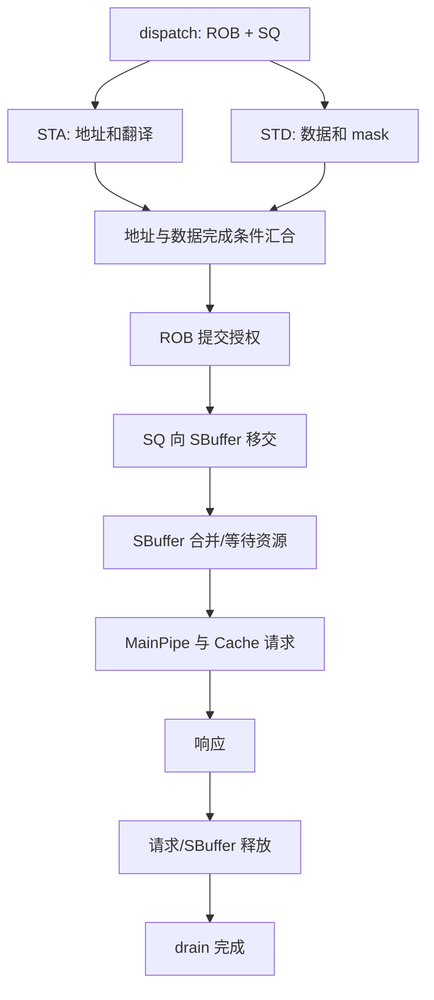
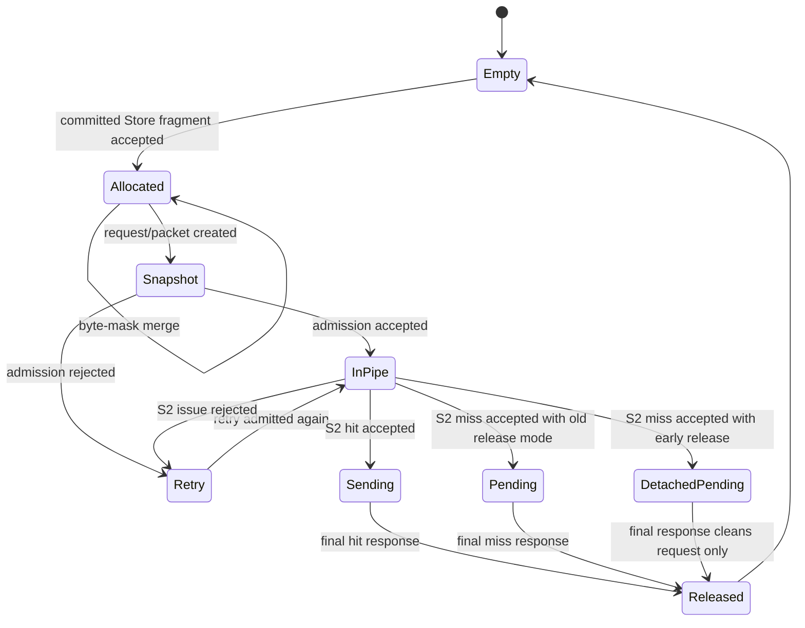
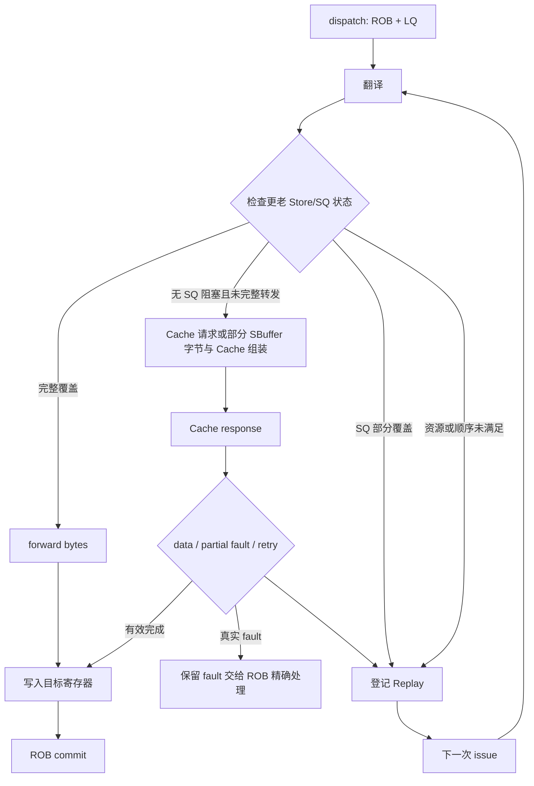
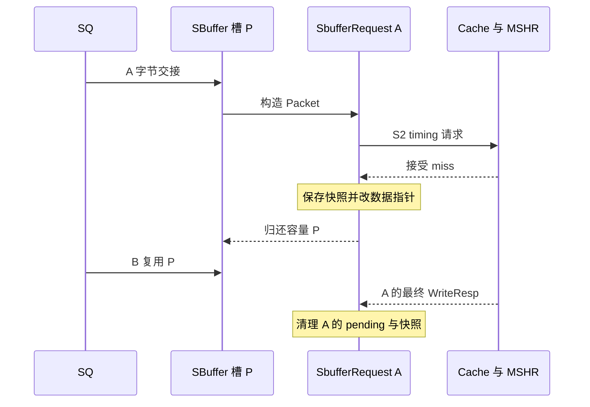
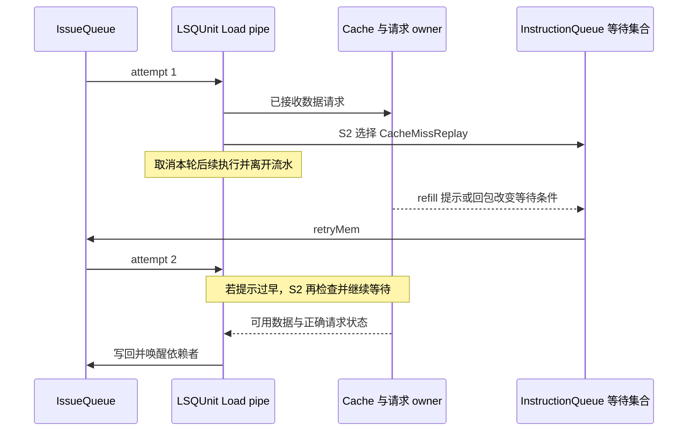

# Store、Load 与 SBuffer 完整流程

本文分别跟随一条普通 Store、一条 split Store 和一条普通 Load，从 dispatch 走到最终提交或异常，并解释 SBuffer、forwarding、Cache 响应和 drain 的控制关系。

## 1. Store 总流程



|阶段|关键事实|常见误解|
|---|---|---|
|dispatch|分配 ROB 和 SQ，建立年龄顺序|有 SQ 槽就表示 Store 可以写内存|
|STA|计算虚拟地址并翻译|地址 ready 就表示数据和 mask 也 ready|
|STD|产生数据和写使能|Store 一条指令只能对应一个完整 packet|
|执行完成|后端已知 store 结果|执行完成就表示已提交|
|ROB commit|普通 Store 获得写回授权|授权就表示 Cache 已更新|
|SBuffer handoff|committed bytes 进入共享 LSQ|SQ 释放后 Store 数据立即消失|
|Cache response|请求事务得到结果|响应后整个队列立即为空|
|drain|SBuffer/pending miss 排空|SQ empty 等价于全局 Store visible|

总图是普通 Store 的因果骨架；miss 提前归还物理槽和独立请求的生命周期在第 7、19 节分开表示。单条事务响应也不保证整个 LSU 此时已 drain。

## 2. Dispatch 和 SQ 分配

IEW 的 dispatch 路径通过 `insertStore()`（`src/cpu/o3/lsq_unit_queue.cc:176`）分配逻辑 SQ 槽。SQ entry 至少描述：

- instruction/sequence number；
- 虚地址、物理地址；
- 数据和 write mask；
- 地址、数据、执行和完成状态；
- ROB 是否已经授权写回；
- split Store 的 fragment 进度。

SQ 的索引是循环槽，不等于 transaction ID。后续异步 response 必须使用 request/packet owner，不能只看当前槽内容。

## 3. STA 与 STD 分离

Store address 由 STA 路径计算和翻译；Store data 由 STD 路径准备。二者可以不同时到达。地址或翻译失败会生成 instruction fault，但数据路径是否已经执行仍需保持幂等，重试时不能重复已经成功的内存副作用。

正常 Store pipeline 的关键入口：

- `issueToStorePipe()`（`src/cpu/o3/lsq_unit_store_pipe.cc:86`）；
- `storeDoTranslate()`（`src/cpu/o3/lsq_unit_store_pipe.cc:104`）；
- `storeDoWriteSQ()`（`src/cpu/o3/lsq_unit_store_pipe.cc:126`）；
- `executeStorePipeSx()`（`src/cpu/o3/lsq_unit_store_pipe.cc:223`）。

## 4. Store 为什么必须等 ROB

Store 是带有不可逆内存副作用的操作。即使地址和数据已经算好，也不能在错误路径直接写可见内存。Commit 按程序顺序授权普通 Store；`commitStores()`（`src/cpu/o3/lsq_unit_queue.cc:400`）只推进已提交前缀。

```text
younger speculative stores
  -> may execute and wait in SQ
  -> cannot publish before ROB commit
committed old prefix
  -> may offload to SBuffer
```

## 5. Split Store

当一条 Store 跨多个 packet、Cache line 或被实现分成多个 fragment 时，每个 fragment 可能独立 accepted/blocked。必须保存：

- 哪些 fragment 已完成；
- 哪些 bytes 已经交给 SBuffer；
- 哪些 bytes 仍需发送；
- fault 情况及片段边界；PartialFault 对 Store 的实际限制见第 22.2 节；
- 下一次 retry 从哪一部分继续。

错误实现常见后果：

- 重复写已成功 fragment；
- SBuffer full 时丢弃 accepted bytes；
- 一个 fragment 失败后错误释放整个 SQ；
- partial fault 前缀在 trap 时未完成；
- 从 faulting element 重新开始时覆盖更早元素。

## 6. SBuffer handoff

`offloadToStoreBuffer()`（`src/cpu/o3/lsq_unit_store_pipe.cc:562`）负责把 authorized Store bytes 和 mask 交接给 shared LSQ。是否接受受以下条件影响：

- SBuffer 全局容量；
- per-thread 配额；
- 同 block 已有 entry 是否还能 merge；
- 当前请求是否已经拥有 Packet snapshot；
- 同周期共享 offload 配额；
- flush 选择域及 SQ 当前状态。

Cache/MainPipe/MSHR 是输出写出端的资源，主要通过 SBuffer 占用和重试间接影响输入交接，不是 insertStoreBuffer 每次直接检查的同一组条件。

握手成功和 SQ 完成不是同一件事。`completeStore()`（`src/cpu/o3/lsq_unit_completion.cc:389`）必须区分 accepted prefix、需要继续发送的 fragment 和真正的 request completion。

## 7. SBuffer entry 生命周期



该图联合描述物理项与请求；DetachedPending 时原物理项已经 Empty，可被复用，图中等待的是独立请求。vice 是主项旁边的另一物理项，不是同一物理项从 Allocated 变成的一种状态。

### Entry 内容

- `blockVaddr`/`blockPaddr`：block 地址；
- `blockDatas`：byte-level data；
- `validMask`：每字节是否有效；
- `sending`：是否正在 Cache port；
- `inDcacheMainPipe`：是否占用 modeled pipeline；
- `replayQueued`：是否等待重新进入；
- `vice`：同 block 新数据无法合入当前快照时的辅助 entry；
- `request`：共享请求和响应状态。

### Hit、miss accepted 与最终响应的区别

以下三种事件不能混为一个“Store 完成”：

|事件|是否已经释放 SBuffer 物理容量|写数据是否已对 Cache 完成|请求 owner 是否可销毁|
|---|---|---|---|
|进入 fake MainPipe S0/S1|否|否|否|
|S2 命中，请求被 Cache 接受|否，仍等原响应路径|请求已进入 Cache 处理|否|
|S2 miss 被 L1D/MSHR 接受，`sbufferReleaseOnMiss=true`|是|否|否|
|最终 WriteResp 到达|已提前释放或此时释放|是，沿用 Cache 模型可见性|最后 packet 回包后可析构|
|S2 被 MainPipe/MSHR/端口拒绝|否|否|否，必须保存并 retry|

`sbufferReleaseOnMiss` 默认开启。关闭后回到旧合同：SBuffer 物理 entry 等最终响应到达时再释放。这个参数改变的是资源占用和阻塞趋势，不改变架构 Store 数据。

### Miss accepted 后为什么能提前释放物理槽

`SbufferRequest` 原先通过 `dataStatic()` 指向 SBuffer entry 的 `blockDatas`。若 S2 miss 被接受后立即归还物理 entry，新 Store 可能复用该槽并覆盖尚未完成的旧请求数据。

当前实现先在 `release_sbuffer_miss_entry()` 中复制一份稳定 entry 快照：

```text
SbufferRequest::releasedEntry = copy(physical SBuffer entry)
Packet data pointer -> releasedEntry.blockDatas
physical entry -> storeBuffer.release()
request/releasedEntry -> stay alive until final response
```

因此提前释放的是“SBuffer 容量 token”，不是写请求、数据或响应 owner。源码入口为 `release_sbuffer_miss_entry()`（`src/cpu/o3/lsq.cc:1920`）。

这一步只在 S2 握手成功且请求是 miss 时发生。MainPipe admission 失败、MSHR 不可用、同行顺序冲突或 Cache port 拒绝都走 replay，不能提前释放。

### Pending miss 的索引与 forwarding

已释放物理槽的请求仍保存在 `sbufferMissRequests` 中。索引键是物理 Cache line 地址，每个值保存该行尚未完成的请求，用于：

- 最终响应匹配；
- per-thread pending seqNum；
- drain/fence 等待；
- 对更年轻 Load 提供已接收 miss 的数据 forwarding。

同地址后续 Store 最多合并到一个仍可合并的 predecessor。不同 SMT 线程或 virtual alias 不直接合并；映射兼容但仍无法安全合入时，保守地重新进入 S2。由此避免旧 Store 在新 Store 之后覆盖主存。

Load forwarding 查询顺序应理解为：

```text
对每个所需字节：live SBuffer vice 优先
    -> live SBuffer 主项
    -> 同线程 accepted pending miss snapshots，按接收顺序从新到旧
```

旧请求快照的返回顺序和 per-thread youngest-eligible-byte 规则必须保持，不能把所有 pending miss 当作同一个 entry。

### Merge 算法

`merge()`（`src/cpu/o3/lsq.cc:122`）只更新 mask=true 的字节。它不是整个 Cache line 的 last-writer replace。相同 block、相同 thread 和兼容状态才允许直接 merge。

### Vice 算法

Packet 创建后，byte-enable mask 是当时快照。如果之后再有同 block Store，先检查 evictionInProgress，包括 request 已构造但尚未接收的情况：

```text
if not entry.evictionInProgress():
    merge into current entry
else:
    allocate vice entry for younger bytes
```

`createVice()` 是 `src/cpu/o3/lsq.cc:362`。Vice 不是额外的 DCache 行，而是保护两个不同批次的 SBuffer 物理项，占用 SBuffer 容量。

## 8. SBuffer 容量、替换和 miss

SBuffer 同时维护：

- global size/capacity；
- per-thread allocation；
- block 地址 map；
- free-list；
- LRU/eligibility；
- sending/pending state；
- outstanding same-block miss。

容量满时，Store handoff 可能返回 blocked，等待后续释放。`sbufferFull` 统计的是实际资源阻塞，并不代表发生架构异常。

`storeBuffer.size()`、全局 capacity 和 per-thread capacity 只统计仍占用物理 entry 的 Store。`sbufferReleaseOnMiss=true` 时，已接受 miss 的快照由独立 request 保存，不再占用 SBuffer 容量，但 `storeBufferEmpty()` 仍会同时检查 pending miss，因此 flush/drain 不会把“容量已释放”误认为“写已完成”。

同块 miss 处理：

1. 查找 `sbufferMissRequests`；
2. 判断地址、线程、mask 和事务模式是否兼容；
3. 可合并则向现有 classic MSHR 增加一个独立 target，每个 target 仍有自己的 SbufferRequest；
4. 不兼容则等待、创建 vice 或重新进入资源路径；
5. 回包时删除对应的 `sbufferMissRequests` owner；物理 entry 若已提前释放则不能再次 release。

## 9. MainPipe 和 Cache 发送

SBuffer 在发送前检查：

- Cache set 是否被同周期占用；
- byte address 对应的 bank mask；
- fake MainPipe S0→S4 的资源；
- MSHR slot；
- 同块 pending refill；
- Cache port ready/retry。

SBuffer 发送必须在 fake MainPipe S2 才真正调用 classic Cache。S0/S1 admission 不会提前制造 MSHR 或判定 hit/miss。拒绝不等于完成；issueSbufferPacketFromDcacheMainPipe 将失败请求排到相应重试路径。LSQUnit::trySendPacket 是 Load/直接 Store 的另一入口，不是 SBuffer S2 的发送函数。Retry 不能重复制造已接受的副作用。

关键入口：

- S2 Cache 发送与 miss-accepted 判定（`src/cpu/o3/lsq.cc:1825`）；
- 物理 entry 提前释放和稳定快照（`src/cpu/o3/lsq.cc:1920`）；
- per-line pending miss 存储（`src/cpu/o3/lsq.hh:1505`）。

## 10. Store Cache 响应与 drain

`completeSbufferEvict()`（`src/cpu/o3/lsq.cc:1946`）根据响应完成 Cache 可见性、pending owner 或物理 entry：

```text
final response
  -> update forwarding visibility/golden memory model
  -> if releasedEntry exists: remove snapshot from sbufferMissRequests
  -> else: release physical SBuffer entry
  -> make the request eligible for destruction
```

SBuffer entry 可以合并多个 Store 的字节；进入 MSHR 的不同 SBuffer 请求仍各有 target 和响应 owner，不能混为同一个请求。已经提前释放的物理槽不能被最终响应再次归还。

`isDrained()`（`src/cpu/o3/lsq.cc:802`）和 `storeBufferEmpty()`（`src/cpu/o3/lsq.hh:1202`）只有在：

- LQ/SQ 不需要继续跟踪；
- SBuffer entry 已清空；
- pending Store miss 已释放；

时返回成功。per-thread 和按 seqNum 的版本同样同时检查 pending miss。Checkpoint、reset、fence 或需要完整可见性的边界不能只看 ROB/SQ 或 SBuffer 物理 occupancy 是否为空。

## 11. Load 总流程



关键入口：

- `insertLoad()`（`src/cpu/o3/lsq_unit_queue.cc:116`）；
- `issueToLoadPipe()`（`src/cpu/o3/lsq_unit_load_pipe.cc:86`）；
- `loadDoTranslate()`（`src/cpu/o3/lsq_unit_load_pipe.cc:129`）；
- `loadDoSendRequest()`（`src/cpu/o3/lsq_unit_load_pipe.cc:158`）；
- `loadDoRecvData()`（`src/cpu/o3/lsq_unit_load_pipe.cc:255`）；
- `loadDoWriteback()`（`src/cpu/o3/lsq_unit_load_pipe.cc:419`）。

## 12. Load forwarding 决策

```text
SQ: 从最近的更老 Store 向更老端扫描
    完整合法覆盖 -> 保存全部 SQ 字节，不发送新 Cache 请求
    地址重叠但 STD 不就绪 -> STLF 等待
    部分覆盖、masked 或 split overlap -> RescheduleReplay
SQ 未阻塞时，非 split、非预取 Load 才尝试 SBuffer
    所需字节全部覆盖 -> fullForward
    只覆盖部分 -> 保存字节，Cache 返回后覆盖对应位置
```

需要特别处理的场景：

- 最老 Store 只有部分 mask，但更老 Store 覆盖剩余字节；
- 同地址 Store 地址已 ready，data 未 ready；
- 同地址 Store 已 executed，但尚未 commit：同线程更老 SQ 项仍可按合法条件转发，不应误等全局可见；
- SBuffer entry 已经建立 Packet snapshot；
- vector split Load 只有部分 fragment/mask 完成。

`checkStoreLoadForwardingRange()` 是 `src/cpu/o3/lsq_unit_forward.cc:84`。

## 13. RAR/RAW 与 Load 顺序

Load 地址顺序判断可能遇到：

- RAR：两个 Load 的地址关系尚未完全解析；
- RAW：更老 Store 的地址/提交前沿尚未满足；
- MDP：预测可能有依赖，需要更保守的等待；
- RAR/RAW tracking queue 自身容量不足。

这些情况把 Load 放入 replay waiter，而不是设置 architectural fault。实际地址掩码冲突才进入 violation 检测和 squash/replay。

## 14. Cache 响应、fault 和 writeback

`recvTimingResp()`（`src/cpu/o3/lsq_unit_completion.cc:113`）接收 Cache 响应，`completeDataAccess()`（`src/cpu/o3/lsq_unit_completion.cc:148`）处理：

- 正常数据；
- partial data + fault；
- 延迟 writeback；
- 请求重试或丢弃；
- 已 squash 的迟到响应。

`writebackReg()`/`WritebackRegEvent` 将结果写回目标物理寄存器并唤醒依赖者。Writeback 仍不等于架构 commit。

## 15. Store 和 Load 的最终提交

Commit 在 ROB 头检查：

- Load 的 fault/依赖/结果状态；
- nonSpec、屏障、strictly ordered 等路径及 fault 所需的老 Store 排空条件；普通 Store 退役不等于每次先全量 drain；
- first fault 和精确 trap 顺序；
- interrupt 的合法边界；
- memory-order violation 是否需要 squash。

Commit 是所有架构转换的最终 owner。LSQUnit completion、Cache response 或 replay 结束都不能绕过 Commit。

## 16. 通用排障表

|现象|首先检查|不要直接假设|
|---|---|---|
|Store 不写入|SQ commit、SBuffer handoff、MainPipe、Cache response|看到 SQ 释放就是写完|
|Load 数据错误|老 Store 年龄、mask、可见性、Packet 快照|同地址就能 forward|
|SBuffer full|per-thread/global capacity、LRU、pending miss|设置小容量就代表命中 full|
|Replay 不结束|waiter owner、release index、pipeDone、quota|统计名为 replay 就是 fault|
|Load 写回后结果错|ROB alignment/squash/old physical register|writeback 就是 commit|
|Cache 回包丢失 owner|request saved pointer、outstanding count、slot reuse|LQ/SQ index 永久有效|

## 17. 读完本文应能回答的问题

- SQ 中的 Store 何时获得 ROB 写回授权？
- Store 地址 ready 和数据 ready 有什么区别？
- 一个 split Store 如何避免重复写前一片？
- SBuffer 的 byte mask、vice、pending miss 分别处理什么？
- Load 的完整/部分 forwarding 如何判定？
- Cache 响应、writeback 和 ROB commit 分别发生在哪里？
- 为什么 SQ empty 不能证明 Store 已经完全 drain？

## 18. 一条普通 Store 的逐事件演练

以下例子为同线程、普通可缓存 RAM、地址对齐、不跨行、不发生 fault 的 8 字节 Store，数据为 V。事件编号只描述因果先后，不是实测周期数。STA 和 STD 可以并行或逆序到达。

|事件|函数和状态|数据由谁保存|接下来谁推进|
|---|---|---|---|
|E0 分派|insertStore 分配 SQ，并记录年龄和 LQ 边界|DynInst 与 SQEntry|IssueQueue 等待操作数|
|E1 地址执行|issueToStorePipe 后，S0 调用 storeDoTranslate/initiateAcc|LSQRequest 保存 VA、大小和 mask；TLB 填入 PA|翻译回调和 Store pipe|
|E2 写 SQ|S1 检查物理窗口；write 把数据写进 SQ；更新 AddressReady/DataReady|SQ 数据数组与 request 元数据|地址和数据两条路径的完成汇合|
|E3 执行完成|StaPipeFinish/StdPipeFinish 满足，readyToFinish 通知后端|SQ 仍持有 Store，尚不能直接发布|Commit 按程序顺序判断|
|E4 提交授权|commitStores 将相应前缀的 canWB 置位并增加 storesToWB|SQ 仍保留数据|共享 LSQ 分配本周期 offload 配额|
|E5 交接|offloadToStoreBuffer 调用 insertStoreBuffer|字节复制到新 SBuffer 项，或合并入已有项|SQ 侧 completeStore，SBuffer 独立存活|
|E6 选择写出|storeBufferWriteback 按 flush/阈值/SQ 压力/超时选 eligible 项|SbufferRequest/Packet 引用待写字节|建模 MainPipe|
|E7 实际接收|S2 调用 classic Cache 的 sendTimingReq|hit 等待原响应；miss 可保存 releasedEntry 并释放物理槽|Cache/MSHR|
|E8 最终响应|SbufferRequest::recvTimingResp → completeSbufferEvict|清理本请求的 pending 记录或物理项|packetReplied 和析构边界|

E5 之后旧 SQ 槽可以回收，E7 之后 miss 的物理 SBuffer 槽也可以回收，而 E8 仍未发生。三个对象的寿命独立，是异步访存设计的核心。

### 18.1 地址和数据两条路径如何汇合

split STA/STD 共享 SQ 记录，但不是同一个微操作反复写数据。SQEntry 中 addrReady/dataReady 用于转发资格，staFinish/stdFinish 用于执行结束汇合。STD 到达时还会与地址路径的状态协作，见 `src/cpu/o3/iew.cc:2138` 附近的 StoreData 分支。

storeDoWriteSQ 不只负责数据拷贝：它还检查物理 SQ 窗口、更新地址 ready、处理普通 Store 与 Store Conditional 的差别，并检查年轻 Load 的顺序违例。因此文件中的函数名不是所有职责的完整描述。

### 18.2 哪个失败会停在哪一层

|失败条件|当前层保留什么|恢复方式|
|---|---|---|
|TLB 尚未完成|翻译回调的 request owner 与指令|离开流水进入 deferred 等待|
|物理 SQ 窗口不足|逻辑 SQ 槽和待重试指令；清理本次翻译/request 状态|PhysicalSQFullReplay 等可写窗口|
|SBuffer 无空项且不能合并|SQ 数据、canWB 与 fragment 进度|下一次 offload 再尝试|
|SBuffer 输出被 MainPipe 拒绝|SBuffer 项及已构造请求|blocked 或 replay 队列重进 S0|
|classic Cache 拒绝 timing 请求|未被对方接收的请求和物理项|等待端口 retry 或相应资源条件|
|miss 已被接收但未响应|独立快照、MSHR target 和 pending 记录|最终响应清理，不重新生成同一副作用|

输入交接与输出写出是不同反压域：一个 eviction 受阻不表示所有 SQ→SBuffer 合并都必须停止。应分别看 insertStoreBuffer 与 retryReplayStoreBuffer 的分支。

## 19. SBuffer 专题：把容量、数据和事务分开

本节按 `sbuffer-mshr-lifetime.md` 的说明深度组织，但事实以本固定基线为准。原文的历史实验、旧 RTL 提交和数值不能自动作为本轮证据。

### 19.1 为什么不能直接从 SQ 一项一项写 Cache

连续 Store 可能只写同一行的少数字节。SBuffer 将已经获得提交授权的这些字节合并，允许 SQ 先释放，同时把写出节奏与 Cache 资源解耦。它保存部分有效的 Cache line，不是一个完整 DCache，也不按每条 Store 独立分配整行。

例子用 8 字节小块演示，实际 block 大小由 cacheLineSize 决定：

|时刻|写入|块中有效数据|valid mask|
|---|---|---|---|
|初始|无|全部未知|00000000|
|S1|偏移 0 写 A、B|A B ? ? ? ? ? ?|11000000|
|S2|偏移 1 写 C|A C ? ? ? ? ? ?|11000000|
|S3|偏移 4 写 D、E|A C ? ? D E ? ?|11001100|

未置位字节不能被当成有效值写出去。merge 只更新输入 mask 为 true 的位置；后来的 C 覆盖 B，但未涉及的 A 保留。源码 `src/cpu/o3/lsq.cc:122`。

### 19.2 数据结构与容量账本

|结构|保存内容|为什么独立存在|
|---|---|---|
|data_vec/data_vld|物理项及有效位|按固定容量分配和检查槽复用|
|data_map|线程与物理 block 到主项|快速同块查找和防止跨线程直接合并|
|free_list|空物理槽索引|取空项，不等同于 miss 已完成|
|lru_index|尚可选择写出的主项次序|输出候选、阈值与 eligibility 检查|
|vice|当前主项之后到来的同块字节|保护已建立的 request/mask 快照|
|sbufferMissRequests|每物理行已接受但未最终响应的请求列表|快照转发、响应匹配与合并窗口判断|
|sbufferMissSeqs|每线程 pending 序号 multiset|fence/flush 按线程与年龄等待|

free_list 空表示全局无槽；线程 full 判断还有保留空间约束。vice 同样占物理项数，不能当免费容量。createVice 暂不把 vice 放入主 map/LRU；主项 release 后，vice 才转正并进入 map 和 LRU。源码 `src/cpu/o3/lsq.cc:199`、`src/cpu/o3/lsq.cc:362`、`src/cpu/o3/lsq.cc:378`。

### 19.3 主项、vice 与在途快照如何选择

insertStoreBuffer 按以下分支处理：

```text
查本线程、同行主项
  没有主项 -> 有容量则分配，没容量则拒绝交接
  主项尚可修改 -> mask merge 并更新 LRU
  主项 evictionInProgress
    已有 vice -> 合并到 vice
    无 vice -> 有容量则创建 vice，否则拒绝交接
```

这里的保护条件是 evictionInProgress，不只是 sending：建立 packet、进入 MainPipe 或排队重试时也要保护快照。vice 代表更新的一批字节；转发时按所需字节先查 vice，再查主项，然后查同线程在途快照。并非先从一个来源取完整行后无条件覆盖其他来源。

### 19.4 为什么物理槽释放不等于请求结束

设物理槽 P 保存 Store A 的数据，Packet 使用 dataStatic 指向 P 的数组。如果 miss 接受后只释放 P，Store B 随即复用 P，A 的 Packet 会读到 B 数据。即使最终回包正确匹配 A，再次释放 P 也可能把 B 的有效槽错误释放。

当前代码先复制 releasedEntry，把 request 与 Packet 的数据指针切到稳定快照，登记 pending，再释放 P。最终回包只删除 A 的 pending/快照，不再释放 P。



这是当前上游已有机制，不属于本轮 split/replay 新增功能。sbufferReleaseOnMiss=false 时回到等待最终响应才释放物理项的模式；开关实验会改变占用和时序，不能作为两项行为保持修改的性能收益。

### 19.5 同行 MSHR 合并的窗口

本地 pending 表只说明旧请求尚未收到 CPU 响应，不保证旧 MSHR 仍可合并。S2 先检查线程和 virtual set 兼容，然后将 predecessor Packet 交给 classic Cache 继续核实：

- MSHR 必须是 SBuffer Store 发起的 origin。
- predecessor target 仍在当前 MSHR 的 targets 中，回填消费后不能继续借它开放窗口。
- 不允许 deferred target 或正在发生的不兼容 invalidate/downgrade 等状态。
- 端口、MSHR target 数和其他资源约束仍成立。

检查入口 `src/mem/cache/mshr.cc:400`，Cache 接口 `src/mem/cache/base.cc:3579`。合并是一个 MSHR 接收多个独立 target，不是把几个请求的生命周期合成一个指针。target 应用时还要保留 Store 新旧数据的正确顺序。

### 19.6 输出策略、MainPipe 与重试

storeBufferWriteback 优先服务已有 S2 replay，再服务 admission blocked 请求，然后选择新的 eviction。新候选的原因包括线程 flush 域、unsent 项超过阈值、SQ 将满和 inactive timeout。阈值是未发送项的触发条件，不是 SBuffer 的总容量。源码 `src/cpu/o3/lsq.cc:1651` 附近。

建模 MainPipe 在 S2 才向 classic Cache 真正发送。S2 hit 继续 S3/S4；accepted miss 离开这条 fake pipe，classic MSHR 继续跟踪；拒绝则退出并排入从 S0 重试的队列。S4 当前按 always ready 建模，不能描述为与 RTL 所有级的反压完全一致。推进实现 `src/cpu/o3/lsq.cc:899`。

refill 队列也进入资源模型，并在相应阶段释放建模 credit。classic Cache 的实际回填和 fake MainPipe credit 的释放可能不同拍，不能把 fake S4 当作所有数据真正写回的唯一时刻。

### 19.7 排空条件与性能观察

全局 storeBufferEmpty 同时检查物理项和 pending miss；线程版本检查该线程项与 pending 序号；按序号版本只等待小于边界的 Store。源码 `src/cpu/o3/lsq.hh:1202`。更年轻 Store 不应无限阻止更老 fence，但已经在域内的 miss 也不能因物理项已释放而被漏掉。

|观察值|要回答的问题|
|---|---|
|sbufferAvgEntryNum、sbufferFull|物理容量是否成为瓶颈|
|sbufferCreateVice、sbufferMerge|快照保护与字节合并是否发生|
|sbufferMissEntriesReleased、sbufferMissPending|提前归还容量后，还有多少写未响应|
|sbufferMissSameLineReplay、sbufferMissMerged|同行顺序或 target 资源是否受阻|
|sbufferMissForward|Load 是否使用在途快照数据|
|dcacheMainPipeStoreS2IssueBlocked|发送点是否遇到资源拒绝|

复杂度：按行查找通常为哈希索引，行内扫描随该行在途 target 数 T 增长；逐字节快照转发约为 bytes×T；快照拷贝按 cache-line bytes；pending 序号集合插入/删除约 log M。快照数量还受 CPU 响应排队影响，不应直接断言不超过 MSHR 项数。

## 20. 一条 Load 的三条数据路径

### 20.1 完整 SQ 转发

老 Store A 写地址 X 的 8 字节，年轻 Load B 读 X 的 4 字节。若 A 地址/数据就绪、范围完整覆盖且不是被排除的 atomic/LLSC/split/masked 情形，read 记录 SQforwardPackets 并设 fullForward。S2 调用 request->forward，再构造完整包 writeback。A 不必先提交，但必须比 B 更老。

### 20.2 SQ 部分覆盖为什么选择重试

A 只写 X+1 一个字节，B 读 X 的 4 字节。在当前 SQ 实现中，这是 PartialAddrRangeCoverage，B 被 reschedule，request 被 discard；不是把这个 SQ 字节和同轮 Cache 值立即拼成结果。split/masked Store 也保守走 partial 判断。若将其改成拼接，必须重新设计年龄、mask、pending fragment 和违例恢复，不能按文档伪代码顺手改代码。

### 20.3 SBuffer 部分覆盖与 Cache 组装

如果没有 SQ 阻塞，而已提交 Store 的字节位于 SBuffer，非 split/非预取 Load 可以记录每字节 SBforwardPackets。全部覆盖就 fullForward；部分覆盖则仍取 Cache 数据，组装时先使用返回数据，再覆盖已记录的 SBuffer 字节，随后 SQforwardPackets 如存在也按原组装顺序处理。源码 `src/cpu/o3/lsq.cc:3672`。

SQ 与 SBuffer 的 partial 行为不同，是当前模型事实，不能强行归纳成同一个转发算法。

以上 SBuffer 快速查询说明针对 read 中的非 split 路径。split Load 在 trySendPacket 中还会按 fragment 清除/重新记录对应 SBforwardPackets，即使片段有 SBuffer 覆盖也保留其原有发送和完成协议；不能说 split Load 完全不查 SBuffer。源码 `src/cpu/o3/lsq_unit_cache.cc:86`。

## 21. Load miss、早唤醒和返回数据标记

EnableLdMissReplay 开启时，普通 Load 不保证在最初请求回包里直接完成：S2 决定命中或进入 CacheMissReplay，InstructionQueue 保存等待者。Cache 回包或提示解除 waitingCacheRefill，Load 再尝试执行。

SingleDataRequest::recvTimingResp 对普通 Load 区分 cacheHit、仍在等 refill、以及需要登记 bus 的情况；bus 使用 seqNum 和地址作为返回数据已就绪的关联信息，不能把它理解为 RTL 的一条完整物理数据总线。若早唤醒时旧请求还 pending，read 设置 wakeUpEarly，S2 再次核查是否真正有可用数据；没有就继续等待，不能把提示当成有效值。

关闭 EnableLdMissReplay 或不属于普通 Load 时，响应组装路径不同；split 请求还需要等对应 packet 完成。入口 `src/cpu/o3/lsq.cc:3801`、`src/cpu/o3/lsq.cc:3876`，以及 `src/cpu/o3/lsq_unit_load_pipe.cc:255`。

## 22. 跨行、特殊访问和地址翻译

pushRequest 先做对齐检查，再按是否需要 burst 选择 SingleDataRequest 或 SplitDataRequest。每个 fragment 有自己的翻译和 byte-enable；只有有活动字节的子请求才加入。跨行 atomic 被显式禁止，不能当普通 split Store 处理。源码 `src/cpu/o3/lsq.cc:3195`。

|访问|与普通路径的区别|读代码时重点|
|---|---|---|
|TLB miss|PA 尚未取得；PTW 可能异步访问页表|翻译 owner、deferred 唤醒，不可提前发数据请求|
|LR/SC|有 ISA reservation 状态和成功/失败结果|handleLockedRead、snoop 和直接 Store 分支|
|AMO|需要原子操作 functor 与旧值结果|executeAmo、原子请求，不能当字节 merge|
|strictly ordered/uncache|要求更严格的提交执行与老 Store 排空|ROB nonSpec 授权和 directStoreToCache|
|local access|由 localAccessor 执行并安排完成事件|不走普通 DCache 发送流程|
|fence/sfence|控制顺序或翻译维护|Commit 屏障条件、flushStores、stale translation|
|向量访存|ISA micro-op、mask/元素、调度拆分、请求 fragment 多层关系|不能从一条成功标量 Load 推断向量异常协议正确|

TLB 是地址翻译缓存，DCache 保存数据，两者 miss 独立。PTW 自身会产生访存，但属于页表遍历请求，不是重新分配一条程序 Load 的 LQ 项。翻译的 CPU 入口在 initiateAcc，LSQ 通过 sendFragmentToTranslation 交给 MMU；继续阅读 `src/arch/riscv/tlb.cc` 和 `src/arch/riscv/pagetable_walker.cc`。

### 22.1 split Store 重试的具体进度

offloadToStoreBuffer 对 split request 从 _numOutstandingPackets 表示的已交接位置继续遍历；每个 insert 成功后才加一，失败后保留进度。所有 fragment 接收后才把该计数重置并调用 completeStore。此字段在该分支临时表示交接进度，不能机械地在每个调用点都解释为“仍在 Cache 中的 packet 数”。源码 `src/cpu/o3/lsq_unit_store_pipe.cc:562`。

### 22.2 向量异常不能简单套用 Store 前缀

SplitDataRequest 的 PartialFault 状态并不自动承诺 vector Store 成功前缀已写出；isMemAccessRequired 只允许 PartialFault 的 Load 继续访问。向量元素、micro-op 和 vstart 的架构协议还要结合 ISA 与 Commit，详见 `03-replay-exception-recovery.md`。

## 23. 从代码走到一次可复核实验

先读普通 Store 演练，再运行 util/lsu_regression 的 store_cold 或 store_warm。使用固定 guest、NEMU reference 与 SimpleMemory；命令和 trace flag 由 run_suite 保存。

按相同 sn/tid 串起以下记录：SQ insert → issueToStorePipe → 地址/数据完成 → canWB 授权 → SBuffer insert → eviction → S2 accepted/blocked → 对应请求 response。合并后一个 SBuffer 项可能来自多条 Store，必须同时记录 block、mask 和 request，而不能强求每个 sn 都有独立 WriteResp。

接着看 fs1 的 RescheduleReplay、fs5/fs6 的物理 SQ/SBuffer 压力、vector_pressure 的首片接受和后片阻塞。先让 trace 证明目标分支命中，再比较全部统计和自检。完整实验规则和已完成范围见 `05-rtl-and-validation.md`。

## 24. 普通 Load 从分派到退役的逐事件演练

下面以已对齐的可缓存 RAM Load 为例。它既不属于严格排序访问，也不是向量/atomic；一条指令可能有多次 attempt，不能把重复 issueToLoadPipe 当成多条架构指令。

|事件|入口与条件|读取/写入的状态|下一步|
|---|---|---|---|
|L0 分派|insertLoad 分配 LQ，保存当前 SQ 边界|LQEntry、DynInst 的 lqIt/sqIt|IQ 等寄存器与预测依赖条件|
|L1 发射|issueToLoadPipe 插入 S0，beginPipelining|当前流水槽与来源标记|loadDoTranslate|
|L2 翻译|initiateAcc→pushRequest→MMU|VA、size、mask、PA 或 fault|成功进入 S1；延迟转 deferred；真实错按 fault 路径|
|L3 访问决策|loadDoSendRequest→read|nuke/MDP、SQ 覆盖、SBuffer 字节、pending/bus|完整转发，或者发送 Packet，或者等待|
|L4 S2 检查|loadDoRecvData|miss、早唤醒数据、RAR/RAW 容量、多原因 flags|选唯一等待 owner 或准备正常完成|
|L5 写回|writebackReg/completeDataAccess|结果寄存器、执行状态、依赖唤醒、Cache depth|保持 fault 或正常 readyToFinish|
|L6 ROB 退役|Commit 确认有效路径和精确边界|架构提交与依赖预测反馈|commitLoads 回收 LQ 跟踪项|

L5 不是永远由相同一级立即调用：完整转发可在 S2 构造本地包；启用 miss replay 时可能在重试后完成；非普通访问或关闭该开关时还有响应组装分支。响应晚于指令离开流水时，writeback 需要补做相应 readyToFinish，不能假设最后一级已经处理过所有完成。

### 24.1 Cache miss 的两次尝试



提示、回包和第二次发射的相对时间有多种交错，图只给一种因果骨架。真实实现依靠 waitingCacheRefill、hasPendingCacheReq、bus 标记和 request owner 区分，不依靠固定等待若干拍就假设数据可用。

### 24.2 Load/Store 的完成事件横向比较

|事件|Load|普通 Store|
|---|---|---|
|执行主要产物|寄存器结果和 fault/顺序状态|SQ 的地址/数据/mask 和 fault 状态|
|可投机行为|合法读取、转发、写物理寄存器|地址/数据计算和向年轻同线程 Load 转发|
|不能提前做的事|错误路径结果不能成为最终架构状态|错误路径 Store 不能直接发布不可逆写|
|ROB 边界|确认结果、fault、重执行及退役|授权已完成 Store 进入写出前缀|
|局部队列释放后|迟到请求仍需 owner|SBuffer/直接 Store 请求可继续存活|
|最终外部响应|可能参与数据完成或旧请求清理|结算写事务与可见性通知，区别于 canWB 和 SQ 完成|

这里的 Store 指普通缓存 RAM Store；SC、AMO、release、strictly ordered 和 local access 不能不加区分地套用该列。

## 25. 跨文件修改前的状态交接检查表

|计划改的位置|必须同时检查的相邻代码|原因|
|---|---|---|
|LQ/SQ 索引或分配|queue、forward、order、recovery、CircularQueue|年龄、模后槽号和外部 request 身份不是同一量|
|Store ready/finish|Store pipe、IEW STD、queue commit、MemDepUnit|地址/数据分别到达与提交授权必须汇合|
|Load 收数或早唤醒|Load pipe、read、SingleDataRequest response、IQ 等待集合|数据未到时不能误完成，也不能丢 wakeup|
|SBuffer 释放|releasedEntry、pending miss、Cache target、flush/drain|容量归还不能破坏旧数据和最终响应|
|Replay 选择|DynInst flags、流水退出、waiter、retryMem、squash|必须有唯一 owner 和可达的释放事件|
|异常路径|ISA fault、Commit、LSQRequest、恢复及 CSR|发现 fault 和发布 trap 分属不同层|

这张表是代码阅读和改动设计的入口。行为变更仍需最小实验支持；本轮两项代码 PR 只分别调整实现文件组织和空容量复用，没有顺带重写表中协议。
