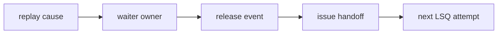
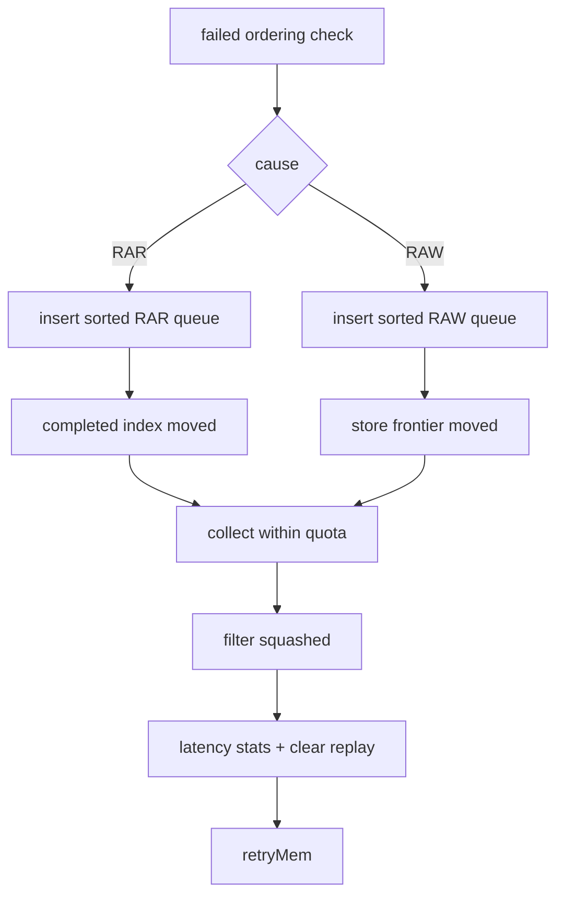
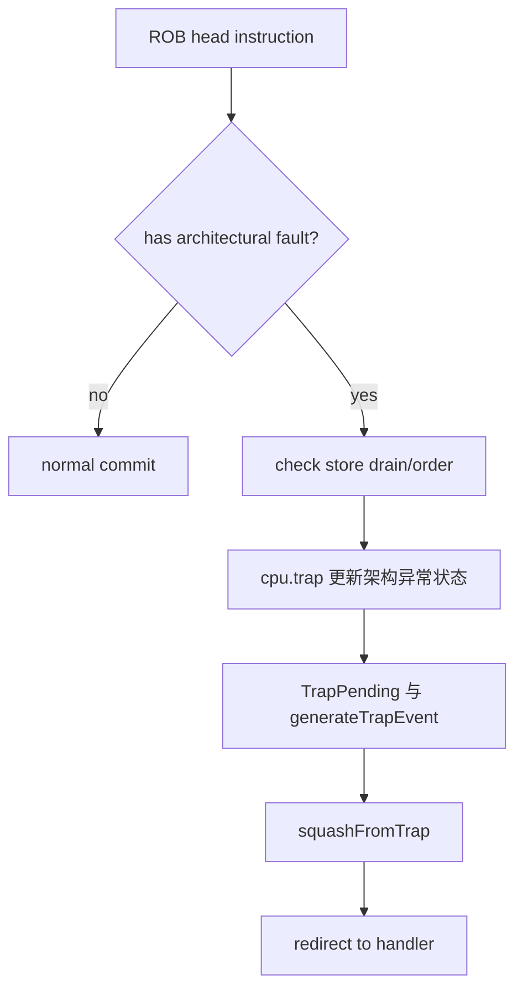
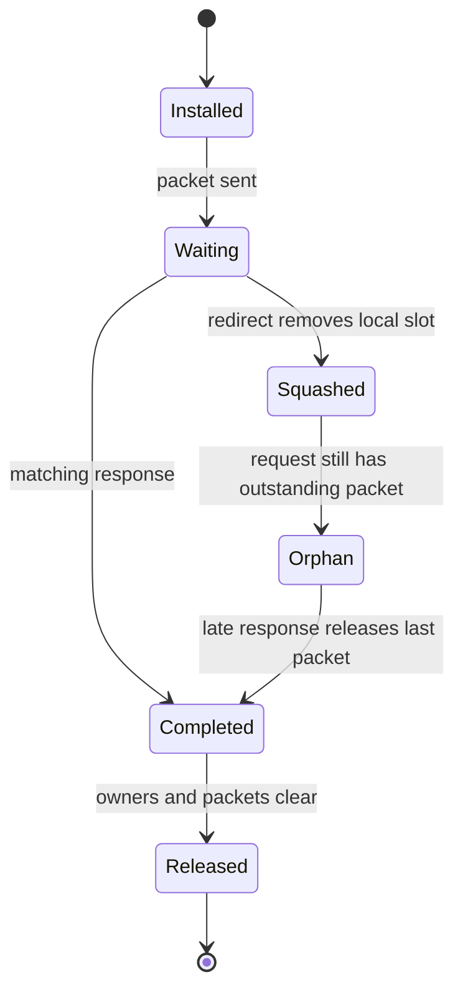
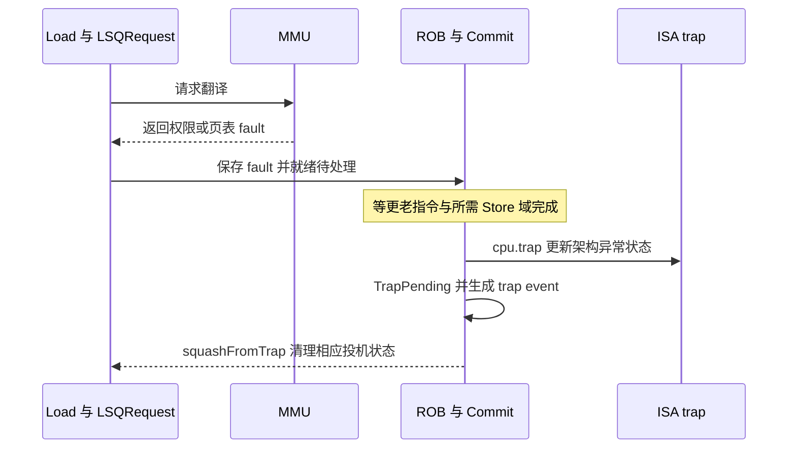

# Replay、异常与恢复

本文解释访存指令“暂时不能完成”和“产生架构异常”的区别，并给出 Replay 等待者、唤醒、fault、interrupt、squash 和迟到响应的完整设计。

## 1. 三类非成功事件

|事件|是否成为架构异常|典型原因|处理方式|
|---|---|---|---|
|Replay|否|Cache miss、资源不足、顺序未满足、MDP|保留 waiter，之后重新 issue|
|Wrong-path fault|尚未成为架构异常|投机路径上的翻译/访问错误|先保存在指令；若被更老 redirect 撤销，则不进入 handler|
|Rob-head fault/interrupt|架构 fault 或中断会，内部 ReExec 不同|ROB 头 fault 或合法边界接收的中断|Commit/ISA 处理与 trap/squash；区分内部重执行|

把 Replay 当异常会产生虚假 trap；把 wrong-path fault 当已提交会污染架构状态；丢失 request owner 会造成迟到回包访问已释放对象。

## 2. 每个 Replay 必需的四个所有者



- `replay_events.hh`（`src/cpu/o3/replay_events.hh:9`）定义 cause；
- waiter 可能在 LSQUnit RAR/RAW、InstructionQueue 专用集合或原始 IssueQueue；
- release event 可以是 completed index、容量释放、store address resolve、cache response 或 port retry；
- `IssueQue::retryMem()`（`src/cpu/o3/issue_queue.cc:978`）把已解除等待的指令放回调度入口。

## 3. Replay cause 与等待 owner

|cause|等待位置|释放/唤醒条件|维护重点|
|---|---|---|---|
|TLB miss|InstructionQueue deferred|翻译完成或 squash|不能过早发送 Cache packet|
|Cache miss|InstructionQueue cache-miss set|等待 refill 条件结束|distinguish cache response 与 refill visibility|
|Forwarding failure|STLF 等待 list|producer Store resolve|producer owner 与 successor 分离|
|MDP address|MDP waiter|地址/frontier 与 pipeDone|两个条件缺一不可|
|Cache blocked|blocked set|Cache unblocked|resend 同一个 request，不重建副作用|
|Physical SQ full|PSQ replay set|eligible committed capacity|不能误用逻辑 SQ 容量|
|RAR|LSQUnit RARReplayQueue|LQ completed index/容量|保持 seqNum 排序和 quota|
|RAW|LSQUnit RAWReplayQueue|SQ completed index/容量|store address frontier 语义|
|Bank conflict|fast replay 路径|下一次调度机会|fast replay 来源标记|
|MSHR alias|fast replay 路径|MSHR 资源/映射释放|不能把 alias 当命中|
|MSHR arbitration failure|fast replay 路径|下一次 MSHR 仲裁|资源等待不是 fault|
|Write-buffer hit|fast replay 路径|write-buffer 条件解除|避免同块旧值|
|Nuke|issue replay|squash/reissue 条件|保留请求还是丢弃需按 packet 状态|
|物理 Cache 短期阻塞|blocked/replay path|Cache ready|state 与 request 一起恢复|

## 4. RAR/RAW replay 队列

`addToRARReplayQueue()`（`src/cpu/o3/lsq_unit_replay.cc:278`）和 `addToRAWReplayQueue()`（`src/cpu/o3/lsq_unit_replay.cc:291`）把等待者按 seqNum 排序。队列不是普通 FIFO：运行时只收集已过 completed index 或获得新 tracking 容量的条目。



## 5. `processReplayQueues()` 算法

`processReplayQueues()`（`src/cpu/o3/lsq_unit_replay.cc:304`）按顺序执行：

1. 收集 `lqIdx <= loadCompletedIdx+1` 的 RAR waiter；
2. 收集 `sqIdx <= storeCompletedIdx+1` 的 RAW waiter；
3. 在 RAR tracking 容量允许时补充 RAR waiter；
4. 在 RAW tracking 容量允许时补充 RAW waiter；
5. 过滤 squashed 指令；
6. 按 queue-entry tick 记录 latency；
7. 清除 replay 类型和 need-replay 标记；
8. 调用 `IssueQue::retryMem()`。

四个阶段顺序、每周期 quota 和 callback 边界都属于模型行为，不能仅因为文件拆分而重排。

Replay storage 优化只把空的 vector capacity 放入局部 batch；callback 执行时成员 scratch 仍为空，因此重复调用和嵌套调用看到独立上下文。它不改变本算法。

## 6. MDP 的三种状态条件

MDP 地址等待至少涉及三件事：

- 预测到的 producer Store 是否已解析；
- 更老 Store front/index 是否到达；
- 当前 Load 是否已经完成自己的 pipe 阶段（pipeDone）。

```text
if producer unresolved:
    wait
else if load still in pipe:
    wait for pipeDone
else:
    eligible for replay/issue
```

原因是 producer 完成和 Load 退出当前流水可能发生在不同周期。只看其中一个条件会造成重复发射或丢失 wakeup。

## 7. 实际顺序冲突与 Replay 的区别

实际违例检查来自 `checkViolations()`（`src/cpu/o3/lsq_unit_order.cc:303`）和 snoop/local store 检查。结果可能触发 memory-order violation:

1. 找出最老实际冲突；
2. IEW 调用 memory-order squash；
3. 清理年轻 LQ/SQ/replay 状态；
4. 将需要再次执行的操作交回 issue；
5. 之后产生的 fault 才按新 attempt 处理。

预测冲突、资源不足和 Replay 都不自动升级为架构异常。

## 8. Fault 的创建与保存

翻译、权限、对齐和访问检查可以产生 instruction `Fault`，具体来源以 ISA/MMU 分支为准。split 翻译按 fragment 顺序选择首个 fault，不是按异步回调到达顺序选错。执行层还允许 `ReExec` 等内部控制结果介入，不能把所有 `Fault` 对象都解释为不可替换的架构首错。

错误路径上的 fault 仍是 speculative。若被 squash，它不应进入 handler。只有 ROB 头指令的 fault 才能生成 trap。

## 9. 精确异常流程



相关入口：

- `generateTrapEvent()`（`src/cpu/o3/commit.cc:780`）；
- `squashFromTrap()`（`src/cpu/o3/commit.cc:873`）；
- `commitHead()`（`src/cpu/o3/commit.cc:2100`）。

handler 入口前需要的 Store 可见性、异常 PC/地址和重启状态必须先冻结。

## 10. Interrupt 流程

`handleInterrupt()`（`src/cpu/o3/commit.cc:1076`）只在以下条件选择中断：

- 没有已有 trap in flight；
- 当前处于合法 commit 边界；
- 线程状态允许中断；
- 满足当前 Commit/IEW 对执行与排序边界的约束；本函数直接门控的是 canHandleInterrupts 和 instList.empty，不额外实现 SBuffer drain 循环。

中断与 fault 使用相同的精确 squash，但原因不同。一个 pending Store response 不会被本地 LQ/SQ 槽释放自动丢弃。

## 11. Squash 与外部请求

`LSQUnit::squash()`（`src/cpu/o3/lsq_unit_recovery.cc:86`）会：

- 删除比 squash boundary 更年轻的 LQ/SQ；
- 按当前分支清理 RAR/RAW/Replay waiter；混合年龄 Replay list 的即时删除限制见第 19.2 节；
- 修正 completed index；
- 标记指令 squash，由流水调度过滤本地 pipe 状态；
- 防止后续访问已失效的本地 entry。

不能直接删除已经交给 TLB/Cache 的 request。它们是外部持有的 orphan；只有最后一个 outstanding packet 回来后才能析构。

## 12. 迟到回包状态机



回包匹配至少需要：

- request/Packet owner；
- instruction identity；
- outstanding 数量；
- 当前 fault/partial-fault；
- 是否已被 squash；
- 是否需要 writeback 或 SBuffer completion。

队列 slot 当前索引不能单独用于匹配。

## 13. Flush 和 drain

`flushStores()`（`src/cpu/o3/lsq.cc:2972`）等待指定 committed Store 域；`isDrained()`（`src/cpu/o3/lsq.cc:802`）同时检查 SBuffer 和 pending miss。适用场景包括 fence、checkpoint、reset、精确 trap 和部分 interrupt 边界。

```text
architectural boundary
  -> stop younger work
  -> drain relevant committed Stores
  -> preserve outstanding request owners
  -> complete trap/redirect/checkpoint
```

## 14. 排障步骤

1. 首先确认是 Replay、wrong-path fault 还是 ROB-head fault。
2. 记录 cause、等待集合和 instruction seqNum。
3. 找到造成 release 的 completed index、资源 free 或 packet response。
4. 查找 `retryMem()` 和下一次 issue attempt。
5. 确认旧 attempt 的 replay 记录已经移除，新 attempt 有唯一 owner。
6. 若发生 squash，继续追踪 external request/packet 的 owner。
7. 对 fault，检查 first fault、completed prefix、trap PC/地址和重启 PC/`vstart`。

## 15. 测试能证明什么

本固定基线的 21 项定向测试覆盖普通 Replay、partial forwarding、fault、wrong-path、pressure 和 interrupt；最终 opt/debug 各完成完整 21 项 A/B；zeusmp 54833、mcf 1820 两条 checkpoint 各执行 20M warmup＋20M ROI。旧任务的 V26/V27 或其他基线结果不计入本轮验证。完整证据及最终重建二进制边界见 `05-rtl-and-validation.md`。

仍未穷举：全部 Replay cause 组合、多个 pending Store、异步设备中断、SMT/HTM、所有迟到响应/slot 复用组合、全部 RVV vstart/mask/fault 模式。

## 16. 同一轮出现多个 Replay 原因时怎么处理

Load 的 S0/S1/S2 可以观察到不同原因。replayFlags 保留原因位，replayType 表示选中的处理原因；NeedReplay 表示本 attempt 需要退出正常完成流程。三者不是同一个变量。

S2 在 loadDoRecvData 计算 cache miss、nuke、RAR/RAW 满等条件，然后调用 DynInst::finalizeReplayTypeFromFlags。选择使用集中优先级，较小值先：MDP 地址 2、TLB 3、STLF 4、资源类 5、Cache miss 6、Bank conflict 8、RAR 9、RAW 10、Nuke 11；其余使用 fallback。同优先级按枚举遍历次序选择。这是当前代码顺序，不能据此声称与任意 RTL 分支的全部选择等价。

源码 `src/cpu/o3/dyn_inst.hh:1244`、`src/cpu/o3/lsq_unit_load_pipe.cc:255`。一个低优先级条件被高优先级原因盖住，不代表它没有发生；TEA 等统计还可能单独记录实际 miss。故总原因计数、被选中的 cause 和最终重试次数不必相等。

### 16.1 从失败到重新发射的完整合同

|环节|需要核对的内容|常见错误|
|---|---|---|
|失败识别|本 attempt 哪个阶段发现条件|仅见某个 flags 就立即重复入队|
|旧状态处理|effAddr、翻译、LQ request、savedRequest 是否清理；外部请求是否仍在途|丢弃已发送请求的 owner|
|等待登记|哪个容器持有该指令，记录哪个 producer/地址前沿|同一指令进入多个独立最终唤醒路径|
|退出流水|loadCancel/endPipelining 与 pipeDone|指令还在流水时又送入发射|
|条件解除|翻译、refill、producer、窗口、配额或端口事件|只周期性调用 retry 而没有解除条件|
|重发|retryMem 设置入口来源并进入 replayQ|把 retryMem 当成完成写回|
|新 attempt|重新检查地址、资源与数据|误用上一轮 fault、forward 字节或 packet 状态|

loadSetReplay 不等于完整唤醒协议，它只重置部分指令/request 状态；真正的等待位置和出队代码还要一起读。currentLoadRequest 从当前槽取 request，避免盲用已失效的 savedRequest。

### 16.2 典型等待路径的代码地图

|路径|登记/取得等待者|解除条件|
|---|---|---|
|TLB|InstructionQueue::deferMemInst|翻译回调完成或指令 squash|
|Cache miss|cacheMissLdReplay/getCacheMissInstToExecute|waitingCacheRefill 清除|
|STLF|stlfFailLdReplay/getSTLFFailInstToExecute|对应 Store 的状态解析，resolved 生效|
|Cache blocked|blockMemInst/cacheUnblocked|blockedMemInsts 移入 retryMemInsts|
|物理 SQ|deferPhysicalSQFullReplay/getPhysicalSQFullReplayInstToExecute|物理窗口可写，或按配置在重试时再查|
|MDP|mdpAddrReplayRegister 或 Strict|producer 集合清空/前沿到达，并且 pipeDone|

源码区间：`src/cpu/o3/inst_queue.cc:889`、`src/cpu/o3/inst_queue.cc:975`、`src/cpu/o3/inst_queue.cc:1029`、`src/cpu/o3/inst_queue.cc:1151`。fast Replay 在退出流水时可直接交给 IssueQue::retryMem，但重新尝试仍要经过相应资源检查，不承诺下一周期必定成功。

## 17. RAR/RAW 完成位置与批次示例

loadCompletedIdx 表示从队列头连续达到执行条件的 Load 前沿；storeCompletedIdx 用 Store addrReady 或 canWB 等条件推进，不能解释成所有 Store 已写入内存。空队列用 head-1 作为哨兵，非空时从前沿后一个位置开始核查，推进宽度分别受 LoadCompletionWidth 和 StoreCompletionWidth 限制。

跟踪项清理与 waiter 唤醒又有 RAR/RAW 各自配额。processReplayQueues 先按前沿收集，再按逻辑空闲项补充，最后统一回调；两条等待队列内部按 seqNum 排序，混合批次没有再做全局排序。源码 `src/cpu/o3/lsq_unit_replay.cc:185`、`src/cpu/o3/lsq_unit_replay.cc:304`。

示例：RAR 这轮配额为 2。前沿条件先释放了 1 条 RAR waiter，即使仍有 3 个 tracking 空项，本轮补充最多仍为 1 条；RAW 有独立配额，不用 RAR 剩余额度。callback 新增等待者不能插到已经固定的局部活动批次中。

成员 replayScratch 只保存空容量，不是第三条等待队列。正常入口 swap 借容量，退出 clear 释放指令引用，再 swap 归还容量。它不改变上述四段顺序或配额，复杂细节见 PR02 的修改说明材料。

## 18. 精确 fault：发现、等待、发布与恢复

### 18.1 一条 Load 翻译失败的例子



fault 在执行时被发现不等于当时就切到 handler。若该 Load 尚未到 ROB 头，旧分支 redirect 仍可能将其撤销。只有有效路径到达精确边界后才处理架构异常。

### 18.2 Commit 实际先做什么

commitHead 对尚未执行的 nonSpec、atomic、屏障或 strictly ordered Load，可能先等待老 Store 并给出 nonSpecSeqNum，让它在提交边界执行。普通 Store 获得 canWB 与每条 Store 响应都完成是不同条件，不能说所有普通 Store 每次提交都先排空整机。

有 fault 时，commitHead 先调用 flushStores(tid, faultingSeqNum) 并要求本轮前面没有已提交指令，再保存必要状态、调用 cpu.trap、设置 TrapPending、生成 TrapEvent，后续 squashFromTrap。当前代码在 trap event 延迟完成前就更新部分架构状态，这也是模型与 RTL 时序的边界。源码 `src/cpu/o3/commit.cc:2100`。

严格说，Fault 类型还包含 ReExec 这种内部重执行控制。ReExec 不表示程序必须进入一个 ISA 异常 handler；对外报告应分清架构异常与内部恢复。

### 18.3 split 翻译怎样选择 fault

SplitDataRequest::finish 将每个子请求 fault 放到对应索引，等子翻译完成后从索引 0 向后找首错：

- 全部成功：State::Request。
- 第一个子请求就错：State::Fault。
- 前面成功、后面出错：State::PartialFault，保留有效前缀信息。

异步返回的先后不决定架构元素顺序。isMemAccessRequired 对 PartialFault 只放行 Load；这不自动实现 Store 的部分写入/重启协议。源码 `src/cpu/o3/lsq.cc:3387`、`src/cpu/o3/lsq.hh:685` 附近。

## 19. 中断、squash 与不能撤销的已提交写

### 19.1 中断路径的实际范围

propagateInterrupt 检查待处理中断并通知 Fetch/后端；handleInterrupt 再检查请求是否仍存在，在 canHandleInterrupts 且 cpu->instList.empty 时接收，调用 ISA 中断处理并生成 trap squash。当前这些函数明确围绕线程 0，不能泛化为所有 SMT 线程均有完整同等的中断路径。源码 `src/cpu/o3/commit.cc:1076`、`src/cpu/o3/commit.cc:1140` 附近。

该函数自身并未直接实现一套独立的 SBuffer drain 循环，相关顺序须结合 Commit/IEW 和 Store 排空接口检查。不能仅凭“精确中断”名词，断言所有设备、所有在途 Store 情况已动态验证。

### 19.2 squash 的边界

LSQUnit::squash 从队列年轻端移除恢复边界之后的 Load/未授权 Store，调整前沿、跟踪和 waiter；Store 的 canWB 分支受到特殊保护，已经提交或产生外部写副作用的事务不能像 wrong-path Load 一样任意撤回。

当前 RAR/RAW tracking 项用遍历删除年轻项，Replay list 的立即清理则从 front 开始，遇到非年轻项就停止。因此混合年龄列表的年轻 waiter 不保证在本函数中立刻逐个擦净，还要依赖指令 squash 状态和后续处理过滤。文档不把设计目标“撤销年轻等待者”写成当前实现已经逐项清理的保证，也不在本次文档补丁中顺手更改恢复代码。源码 `src/cpu/o3/lsq_unit_recovery.cc:86`。

## 20. 请求生命周期：槽复用之后为什么还可以安全回包

### 20.1 释放接口的实际含义

LSQRequest::release 检查还有没有 outstanding 请求：没有则可销毁，有则只标记 LSQEntryFreed 或 Discarded，由之后的回调处理生命周期。discard 还执行 detachLSQEntry/detachInflightLoad。detach 会检查当前队列槽保存的 request 是否确实等于 this，不能直接清掉已复用槽中的新请求。

recvTimingResp 对 released request 跳过正常数据处理；packetReplied 递减在途数量，最后一包到达且 owner 已释放才允许 delete。翻译中、写回事件等还有独立生命周期条件，不能将 packet 数为零单独当成任意时刻的完整销毁判据。源码 `src/cpu/o3/lsq.hh:448`、`src/cpu/o3/lsq.hh:712`、`src/cpu/o3/lsq.cc:3689`。

### 20.2 旧 Load L 的迟到响应

|时刻|旧请求 A|LQ 物理槽|正确处理|
|---|---|---|---|
|L 发请求|A outstanding=1|保存 L 和 A|等待 Cache|
|更老分支恢复|A 标记释放，仍在途|L 被清理|保留 A 的回包 owner|
|新 Load N 分配|A 仍在途|槽可能保存 N 和新请求 B|不能按槽号把 A 当成 B|
|A 回包|released 路径|槽仍属于 N/B|跳过正常旧结果，结算 A 的在途引用|

这个例子说明为什么需要 Packet senderState 和稳定请求对象；仅测试最终 checksum 无法充分检查所有交错，还要看旧结果不写新寄存器、不清新槽、不双重释放。

## 21. 向量 mask、fault-only-first 与 vstart 的边界

|概念|必须理解的设计|当前源码入口|
|---|---|---|
|元素 mask|无效元素不应产生同样的内存副作用；活动字节影响子请求|vector_mem.isa 生成逻辑与 addReq|
|micro-op/fragment|ISA micro-op 与 LSQRequest 分片是两层拆分|vector_mem.temp.isa、SplitDataRequest|
|普通 fault|按架构次序记录 fault，并在提交边界处理|SplitDataRequest::finish、Commit|
|fault-only-first|元素零 fault 与后续元素 fault 处理不同，后者可缩短 VL|vector_mem.isa、VleffEndMicroInst|
|vstart|重启位置的 CSR 与执行协议，需要读、写、异常保存和返回的一致链路|CSR 模板、向量 ISA、CPU 恢复路径|

当前 fault-only-first 生成逻辑在 `src/arch/riscv/isa/vector/base/vector_mem.isa:67`：用 fault 地址计算当前 micro-op 内成功元素数，再加 micro-op 的元素起点判断是否是架构元素零；后续元素 fault 可以被抑制，由结束 micro-op 汇总成功数更新 VL。结束处理见 `src/arch/riscv/insts/vector.cc:411`。

CSR 可访问性检查在 `src/arch/riscv/isa/formats/standard.isa:376`，包含 VS off 等条件。CSR 能读写不等于所有访存指令已具备正确的 vstart 重启协议；现有 vector_mask/vector_pressure 测试也不能证明所有元素 fault、异常前缀和重启组合。本文明确此边界，不将旧工作树的 vstart 方案或测试移植成当前基线已经具备的能力。

## 22. 一次异常排障应该留下哪些证据

记录同一 tid、seqNum、PC、VA/PA、cause 和 fragment 编号，按以下顺序分析：失败最先出现在哪里 → 是否还在有效路径 → 是否有旧 packet outstanding → 谁持有 waiter → 是否到 ROB 头 → 老 Store 域是否排空 → trap/redirect 的 PC/CSR → handler 返回后从哪里重启。

测试至少分别构造正常、wrong-path fault、真实 fault、端口拒绝后重试、squash 后迟到响应和软件中断。每个 case 先证明关键分支命中，再比较数据/退出/统计，不能只靠模拟器未崩溃。对新的设备/多核/向量 fault 组合，应另建实验，不把本轮有限覆盖当作全协议证明。
