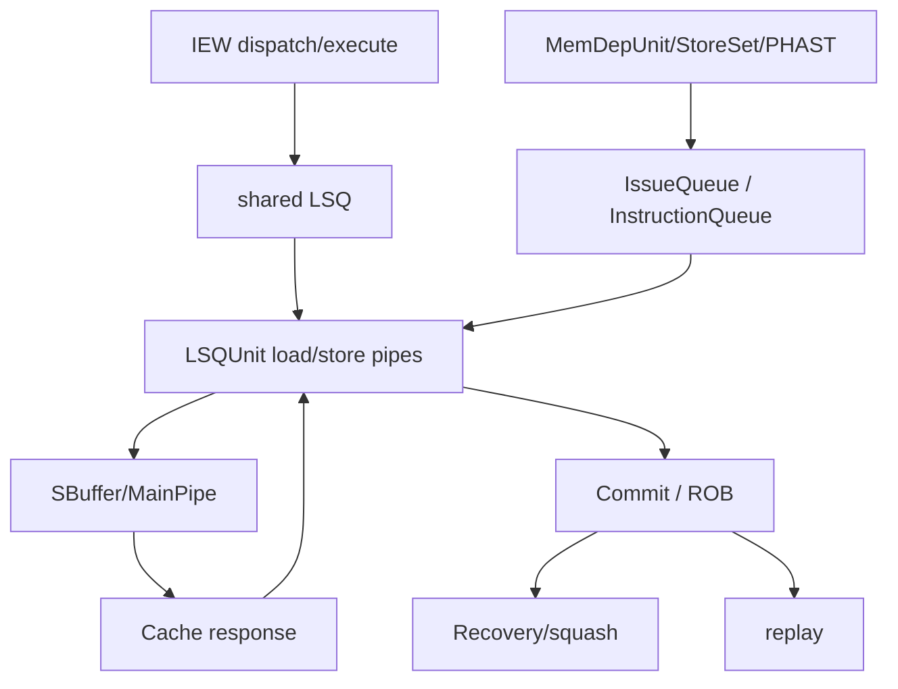
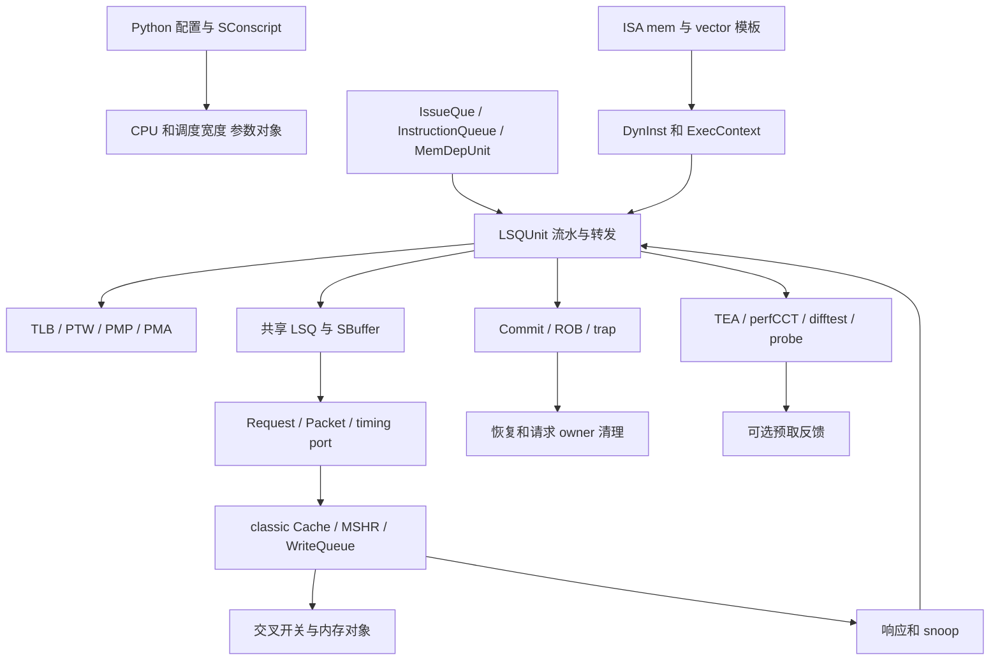

# XS-GEM5 访存关键源码指南

本文把架构概念映射到实际 C++ 文件。每个文件按“状态、入口、上下游、必须保持的行为、建议测试”说明。读完本文后，应能从一条 Store 或 Load 的 trace 定位到具体函数，并知道谁会继续处理下一步。

## 1. 源码分层

- IEW 负责 dispatch/execute 调度。
- IssueQueue 负责 ready/replay 入口。
- MemDepUnit 和预测器负责依赖管理与训练。
- LSQUnit 负责每线程 LQ/SQ 和访存流水。
- 共享 LSQ 负责 SBuffer、DCache 端口和共享资源。
- Commit/ROB 负责提交、精确异常和最终恢复。

## 2. `lsq_unit.cc`

职责：

- `LSQUnit` 构造和成员初始化；
- 建立 Load/Store pipe stage；
- reset、drain、takeover；
- 每周期调用 Load/Store pipe 推进和公共调度；
- 统计对象初始化和名称定义。

关键入口：

- `LSQUnit::LSQUnit()`（`src/cpu/o3/lsq_unit.cc:85`）；
- `LSQUnit::tick()`（`src/cpu/o3/lsq_unit.cc:149`）；
- `LSQUnit::init()`（`src/cpu/o3/lsq_unit.cc:157`）；
- `LSQUnit::resetState()`（`src/cpu/o3/lsq_unit.cc:189`）；
- `LSQUnit::executePipeSx()`（`src/cpu/o3/lsq_unit.cc:404`）。

阅读重点：这里不实现详细访存规则，而是建立入口和每周期推进顺序。修改 reset、pipe stage 或统计生命周期时要同时检查所有 split 文件持有的状态。

## 3. `lsq_unit_queue.cc`

职责：

- LQ/SQ 插入；
- 当前 request 查找；
- 逻辑槽余量；
- Store queue 写回窗口；
- address/data ready 与 replay 记录；
- committed prefix 消费；
- 队列头 seqNum 查询。

关键入口：

- `insert()`（`src/cpu/o3/lsq_unit_queue.cc:100`）；
- `insertLoad()`（`src/cpu/o3/lsq_unit_queue.cc:116`）；
- `insertStore()`（`src/cpu/o3/lsq_unit_queue.cc:176`）；
- `currentLoadRequest()`（`src/cpu/o3/lsq_unit_queue.cc:197`）；
- `currentStoreRequest()`（`src/cpu/o3/lsq_unit_queue.cc:204`）；
- `numFreeLoadEntries()`（`src/cpu/o3/lsq_unit_queue.cc:235`）；
- `numFreeStoreEntries()`（`src/cpu/o3/lsq_unit_queue.cc:243`）；
- `storeQueueWriteReady()`（`src/cpu/o3/lsq_unit_queue.cc:266`）；
- `commitLoads()`（`src/cpu/o3/lsq_unit_queue.cc:389`）；
- `commitStores()`（`src/cpu/o3/lsq_unit_queue.cc:400`）。

必须保持：

- age order；
- 槽复用和 request owner；
- commit 只看 ROB 授权前缀；
- logical capacity 与 physical window 分开；
- replay/blocked 统计只在对应决策点更新。

测试重点：Store/Load 队列压力、commit prefix、squash、slot 复用和 request 生命周期。

## 4. `lsq_unit_load_pipe.cc`

职责：

- 将 Load 插入 S0 并逐级推进；
- 计算/翻译地址；
- 查找 forwarding 数据或发送 Cache 请求；
- 接收数据/fault；
- 启动 writeback。

关键入口：

- `issueToLoadPipe()`（`src/cpu/o3/lsq_unit_load_pipe.cc:86`）；
- `loadDoTranslate()`（`src/cpu/o3/lsq_unit_load_pipe.cc:129`）；
- `loadDoSendRequest()`（`src/cpu/o3/lsq_unit_load_pipe.cc:158`）；
- `loadDoRecvData()`（`src/cpu/o3/lsq_unit_load_pipe.cc:255`）；
- `loadDoWriteback()`（`src/cpu/o3/lsq_unit_load_pipe.cc:419`）；
- `executeLoadPipeSx()`（`src/cpu/o3/lsq_unit_load_pipe.cc:426`）。

上下游：上游来自 IssueQueue/IEW，下游调用 forwarding、Cache、completion 和 ROB writeback。Translation incomplete、ordering incomplete 和 Cache response 是不同生命周期。

测试重点：普通命中、Cache miss、完整/部分 forward、page/access fault、RAR/RAW、replay 和迟到响应。

## 5. `lsq_unit_store_pipe.cc`

职责：

- Store address（STA）；
- Store data（STD）；
- SQ 地址/数据/mask 更新；
- split store fragment 进度；
- AMO/direct request 特例；
- committed Store 向 SBuffer 移交。

关键入口：

- `issueToStorePipe()`（`src/cpu/o3/lsq_unit_store_pipe.cc:86`）；
- `storeDoTranslate()`（`src/cpu/o3/lsq_unit_store_pipe.cc:104`）；
- `storeDoWriteSQ()`（`src/cpu/o3/lsq_unit_store_pipe.cc:126`）；
- `executeStorePipeSx()`（`src/cpu/o3/lsq_unit_store_pipe.cc:223`）；
- `offloadToStoreBuffer()`（`src/cpu/o3/lsq_unit_store_pipe.cc:562`）；
- `insertStoreBuffer()`（`src/cpu/o3/lsq_unit_store_pipe.cc:672`）；
- `write()`（`src/cpu/o3/lsq_unit_store_pipe.cc:775`）。

必须保持：

- 地址 ready 与 data/mask ready 独立；
- 未提交 Store 不能改变可见内存；
- split 成功片段不重发；
- SBuffer full/retry 不丢数据；
- 普通 RAM、atomic、uncache/direct 路径按各自合同处理。

测试重点：cold/warm Store、byte mask、split、SBuffer full、PMP/fault、Store conditional 和异常重启。

## 6. `lsq_unit_forward.cc`

职责：

- 按年龄查找更老 Store/SB 数据；
- 计算每个 byte 的覆盖；
- 构造 full/partial forwarding packet；
- 将无法本地满足的部分交给后续请求/Replay。

关键入口：

- `checkStoreLoadForwardingRange()`（`src/cpu/o3/lsq_unit_forward.cc:84`）；
- `makeFullFwdPkt()`（`src/cpu/o3/lsq_unit_forward.cc:170`）；
- `forwardFromBus()`（`src/cpu/o3/lsq_unit_forward.cc:219`）；
- `read()`（`src/cpu/o3/lsq_unit_forward.cc:229`）。

必须保持：年龄先于值；完整 mask 才可 assembled；partial data 不被当作完整 Load；Packet snapshot 不只按地址判断。

## 7. `lsq_unit_order.cc`

职责：

- pipeline squash 条件；
- 实际 memory dependency violation 选择；
- exclusive/coherence snoop 处理；
- local Store visibility；
- Load violation 检查。

关键入口：

- `pipeLineNukeCheck()`（`src/cpu/o3/lsq_unit_order.cc:86`）；
- `checkSnoop()`（`src/cpu/o3/lsq_unit_order.cc:122`）；
- `checkLocalStoreVisible()`（`src/cpu/o3/lsq_unit_order.cc:245`）；
- `checkViolations()`（`src/cpu/o3/lsq_unit_order.cc:303`）。

关键区别：实际冲突会触发 recovery；预测可能依赖只影响等待/调度。需要区分当前扫描首先发现的冲突、保留的 memDepViolator 与最终恢复选择，不能只凭函数名断言对所有路径都完成全局最老冲突归约。

## 8. `lsq_unit_replay.cc`

职责：

- bank/tag replay event；
- 通用 load/store replay 标记；
- completed index 推进；
- RAR/RAW replay queue；
- batch 收集和 `retryMem()` 唤醒。

关键入口：

- `bankConflictReplay()`（`src/cpu/o3/lsq_unit_replay.cc:120`）；
- `tagReadFailReplay()`（`src/cpu/o3/lsq_unit_replay.cc:126`）；
- `loadSetReplay()`（`src/cpu/o3/lsq_unit_replay.cc:146`）；
- `storeSetReplay()`（`src/cpu/o3/lsq_unit_replay.cc:164`）；
- `updateCompletedIdx()`（`src/cpu/o3/lsq_unit_replay.cc:185`）；
- `addToRARReplayQueue()`（`src/cpu/o3/lsq_unit_replay.cc:278`）；
- `addToRAWReplayQueue()`（`src/cpu/o3/lsq_unit_replay.cc:291`）；
- `processReplayQueues()`（`src/cpu/o3/lsq_unit_replay.cc:304`）。

必须保持：queue 内 seqNum 排序、quota、completed index wrap、squashed filtering、统计和 callback 顺序。

## 9. `lsq_unit_completion.cc`

职责：

- 接收 Cache timing response；
- 完成数据、fault、SBuffer 和 writeback 处理；
- `WritebackRegEvent`；
- physical destination 更新；
- Store 完成和 SQ 释放。

关键入口：

- `WritebackRegEvent::process()`（`src/cpu/o3/lsq_unit_completion.cc:95`）；
- `recvTimingResp()`（`src/cpu/o3/lsq_unit_completion.cc:113`）；
- `completeDataAccess()`（`src/cpu/o3/lsq_unit_completion.cc:148`）；
- `writebackReg()`（`src/cpu/o3/lsq_unit_completion.cc:308`）；
- `completeStore()`（`src/cpu/o3/lsq_unit_completion.cc:389`）。

必须保持：response owner、outstanding packet、fault/partial fault、squash 后的 orphan 和 writeback event 分层。

## 10. `lsq_unit_recovery.cc`

职责：

- 删除年轻 LQ/SQ；
- 按当前实现清理 RAR/RAW 与 Replay waiter，并结合后续 squash filtering；具体限制见第 3 篇；
- 回退 completed index；
- 处理 HTM/squash 辅助状态；
- 防止已删除 instruction 被再次访问。

关键入口：`squash()`（`src/cpu/o3/lsq_unit_recovery.cc:86`）。

测试重点：branch wrong path、memory-order violation、trap、interrupt 和 late response after squash。

## 11. `lsq_unit_cache.cc`

职责：

- 发送 Cache packet；
- 将端口/资源拒绝转化为 retry；
- 处理 stale translation flush；
- 检查 translation-owned request。

关键入口：

- `trySendPacket()`（`src/cpu/o3/lsq_unit_cache.cc:86`）；
- `recvRetry()`（`src/cpu/o3/lsq_unit_cache.cc:222`）；
- `startStaleTranslationFlush()`（`src/cpu/o3/lsq_unit_cache.cc:188`）；
- `checkStaleTranslations()`（`src/cpu/o3/lsq_unit_cache.cc:204`）。

必须保持：retry 不重复副作用；translation cancel 与 outstanding request owner 分离；packet 失败不当作完成。

## 12. 共享 `lsq.hh` / `lsq.cc`

`LSQ` 是所有线程共享的 owner，负责：

- SBuffer entry storage；
- Store bytes/mask merge；
- block forwarding map；
- cache set/bank/MSHR/MainPipe 约束；
- pending Store misses；
- DCache 端口与 timing response 分发；
- shared LQ/SQ capacity/borrowing；
- drain、flush 和 shared recovery。

建议阅读顺序：

1. `StoreBufferEntry` 字段和 `merge()`（`src/cpu/o3/lsq.cc:122`）；
2. `getEmpty()`、`insert()`、`getEvict()`、`release()`；
3. `createVice()`（`src/cpu/o3/lsq.cc:362`）；
4. `LSQ::tick()`（`src/cpu/o3/lsq.cc:841`）；
5. MainPipe admission（`src/cpu/o3/lsq.cc:1803`）和 S2 Cache issue（`src/cpu/o3/lsq.cc:1825`）；
6. miss accepted 后的稳定快照与物理 entry 提前释放（`src/cpu/o3/lsq.cc:1920`）；
7. `completeSbufferEvict()`（`src/cpu/o3/lsq.cc:1946`）；
8. `storeBufferEmpty()`（`src/cpu/o3/lsq.hh:1202`）和 `isDrained()`（`src/cpu/o3/lsq.cc:802`）。

## 13. IEW

文件：`src/cpu/o3/iew.cc`。

- `dispatchInsts()`（`src/cpu/o3/iew.cc:1339`）分配 LSQ 状态；
- `executeInsts()`（`src/cpu/o3/iew.cc:2101`）进入 Load/Store pipe；
- reschedule/replay/block 接口连接 IssueQueue；
- `squashDueToMemOrder()`（`src/cpu/o3/iew.cc:732`）处理实际违例后的 redirect。

IEW 不是第二个 LQ/SQ；它负责调度和把结果交还给对应 owner。

## 14. InstructionQueue 和 IssueQueue

文件：`src/cpu/o3/inst_queue.cc`、`src/cpu/o3/issue_queue.cc`。

- InstructionQueue 保存 deferred/cache/STLF/MDP/blocked/PSQ replay 等等待集合；
- `IssueQue::retryMem()`（`src/cpu/o3/issue_queue.cc:978`）把可再次尝试的指令放入 replay issue 路径；
- `is_fast_replay` 选择影响 LoadPipeSource，但不代表已经执行。

测试重点：每个等待集合的添加、清除、squash 和重复唤醒。

## 15. MemDepUnit、StoreSet 和 PHAST

文件：`src/cpu/o3/mem_dep_unit.cc`、`src/cpu/o3/store_set.cc`、`src/cpu/o3/phast.cc`。

- `MemDepUnit::insert()`（`src/cpu/o3/mem_dep_unit.cc:230`）登记访存依赖；
- `MemDepUnit::reschedule()` 重新安排失败 attempt；
- `MemDepUnit::violation()`（`src/cpu/o3/mem_dep_unit.cc:708`）消费实际冲突；
- StoreSet 维护 load/store 依赖集合；
- PHAST 用 branch history/path hash 预测 store-queue distance。

预测器输出只能影响保守等待、预测或训练；实际 byte mask/address 校验仍是最终正确性依据。

### 15.1 PHAST 源码阅读入口

按以下顺序阅读 PHAST：

1. `src/cpu/o3/phast.hh`：prediction result、SLC entry 和多 history table 状态；
2. `PHAST::filteredHistory()`（`src/cpu/o3/phast.cc:97`）：排除 Load 之后的分支；
3. `PHAST::makePathHash()`（`src/cpu/o3/phast.cc:111`）：组合 Load PC、branch PC/target/taken 信息；
4. `PHAST::checkInst()`（`src/cpu/o3/phast.cc:132`）：从最长 history 开始检索；
5. `PHAST::violation()`（`src/cpu/o3/phast.cc:162`）：用实际 RAW violation 训练 distance；
6. `PHAST::commit()`（`src/cpu/o3/phast.cc:202`）：用实际 Load/Store 地址范围更新 confidence；
7. `MemDepUnit::insert()` 中的 distance 到 SQ iterator 映射（`src/cpu/o3/mem_dep_unit.cc:309`）；
8. `MemDepUnit::commit()` 的 prediction 结果检查（`src/cpu/o3/mem_dep_unit.cc:761`）。

阅读时需要同时追踪 `DynInst::MemDepInfo`。它保存预测 Store 地址/大小、history table index、hash、violation seqNum/PC、distance 和“已经计数/已经训练”标志。没有这些字段，就无法解释同一 violation 为什么不会重复训练。

### 15.2 值预测框架源码

文件分组：

|文件|职责|
|---|---|
|`src/cpu/valuepred/valuepred_unit.hh`、`src/cpu/valuepred/valuepred_unit.cc`|`VPUnit` 接口、公共统计和 candidate 返回值|
|`src/cpu/valuepred/valuepred_metadata.hh`|request/update extension、prediction record、feedback|
|`src/cpu/valuepred/composite_value_predictor.*`|多 predictor 调用、记录和训练 fan-out|
|`src/cpu/valuepred/composite_value_predictor_arb.*`|fixed/random/RR/confidence 仲裁|
|`src/cpu/valuepred/example_value_predictor*`|新增 direct-value predictor 的最小模板|
|`src/cpu/o3/fetch.cc`|产生 `VPPredictRequest` 并保存 candidate record|
|`src/cpu/o3/commit.cc`|产生真实值/feedback 并训练 predictor|
|`src/cpu/o3/iew.cc`|值预测依赖唤醒、结果验证和错误恢复|

关键入口：

- `VPUnit::valuePredict()`（`src/cpu/valuepred/valuepred_unit.cc:31`）；
- Fetch 预测调用（`src/cpu/o3/fetch.cc:3546`）；
- IEW dispatch 后唤醒（`src/cpu/o3/iew.cc:1577`）；
- Commit 统一更新（`src/cpu/o3/commit.cc:2386`）；
- Composite child 调用和 arbiter 选择（`src/cpu/valuepred/composite_value_predictor.cc:46`）。

新增 predictor 时必须同时完成：

1. 派生 `VPUnit` 并实现 predict/update/specUpdate/squash；
2. 在 `ValuePredictor.py` 暴露 SimObject；
3. 在 `SConscript` 注册 source；
4. 若需要额外输入，定义 request/update extension；
5. 若需要跨 Fetch→Commit 私有状态，定义 `VPPredictionRecord` 子类；
6. 若加入 Composite，输出真正的 direct speculative value，并通过 arbiter。

### 15.3 Memory Renaming 当前实现

文件：`src/cpu/valuepred/memory_renaming.hh`、`src/cpu/valuepred/memory_renaming.cc`。

- `MemoryRenaming::doPredict()`（`src/cpu/valuepred/memory_renaming.cc:158`）查多路 Store-Load Cache；
- `MemoryRenaming::predict()`（`src/cpu/valuepred/memory_renaming.cc:208`）维护 in-flight window；
- `MemoryRenaming::doUpdate()`（`src/cpu/valuepred/memory_renaming.cc:223`）用 producer PC 更新 confidence/useful；
- `MemoryRenaming::update()`（`src/cpu/valuepred/memory_renaming.cc:349`）消费 `ProducerInfoExt`；
- `CompositeValuePredictor` 当前拒绝 MemoryRenaming child（`src/cpu/valuepred/composite_value_predictor.cc:23`）。

当前 `doPredict()` 返回 `speculative=false`，Value File index 只是 sideband 输出。源码阅读和文档评审时不能把它当成已经能从 Value File 注入 Load 值的完整实现。后续实现需要增加 Value File 状态、producer readiness/wakeup、真实值校验和错误恢复。

## 16. Commit

文件：`src/cpu/o3/commit.cc`。

- `commitHead()`（`src/cpu/o3/commit.cc:2100`）检查精确提交条件；
- `generateTrapEvent()`（`src/cpu/o3/commit.cc:780`）；
- `squashFromTrap()`（`src/cpu/o3/commit.cc:873`）；
- `handleInterrupt()`（`src/cpu/o3/commit.cc:1076`）。

Commit 决定“何时可见”“何时提交”“何时抛异常”。LSU 的完成回调只提供状态，不能代替这个边界。

## 17. `DynInst` 与 replay metadata

`DynInst` 保存：

- seqNum 和 PC；
- `lqIdx`/`sqIdx`；
- replay type bits；
- first fault；
- saved `LSQRequest`；
- load/store 类型和执行完成状态。

`replay_events.hh`（`src/cpu/o3/replay_events.hh:9`）定义 cause 枚举。Cause、waiting owner、release event 和 `retryMem()` 必须一起阅读。

## 18. 最新 `xs-dev` 保留的跨模块设计

### 18.1 TEA

- `src/cpu/o3/tea.hh`、`src/cpu/o3/tea.cc`：TEA 状态、事件位、ROB 状态采样和归因；
- `Tea::cacheMiss()`（`src/cpu/o3/tea.cc:180`）：记录 cache miss 深度事件；
- `LSQUnit::recvTimingResp()`（`src/cpu/o3/lsq_unit_completion.cc:113`）：在请求可能 replay/complete 前保存 `cacheAccessDepth` 并更新 TEA；
- `LSQUnit::checkSnoop()`（`src/cpu/o3/lsq_unit_order.cc:122`）：memory-order 重执行事件。

### 18.2 MLP predictor

- `src/cpu/o3/mlp_predictor.hh`、`src/cpu/o3/mlp_predictor.cc`：miss-pattern table、MLP distance table 和 Long-Latency Shift Register；
- `MLPredictorPerThread::predictLongLatency()`（`src/cpu/o3/mlp_predictor.cc:55`）；
- `MLPredictorPerThread::predictMLPDistance()`（`src/cpu/o3/mlp_predictor.cc:64`）；
- `MLPredictorPerThread::updateOnLoadComplete()`（`src/cpu/o3/mlp_predictor.cc:78`）；
- `MLPredictorPerThread::pushLLSR()`（`src/cpu/o3/mlp_predictor.cc:117`）；
- CPU 在启用参数后把 predictor 注入 Fetch/Commit（`src/cpu/o3/cpu.cc:180`）；
- Commit 使用 `DynInst::cacheAccessDepth` 产生 long-latency 训练信息（`src/cpu/o3/commit.cc:2442`）。

LSU split 对 `cacheAccessDepth` 使用 `max` 更新，避免 replay packet 的 depth=0 覆盖真实 miss depth。

### 18.3 SMT LQ/SQ DynamicBorrowing

- shared policy 选择（`src/cpu/o3/lsq.cc:2380`）；
- `LSQ::borrowingLimitLQ()`（`src/cpu/o3/lsq.cc:2440`）；
- `LSQ::borrowingLimitSQ()`（`src/cpu/o3/lsq.cc:2474`）；
- donor hold/reserve 状态更新（`src/cpu/o3/lsq.cc:2508`）；
- per-thread free entry 计算（`src/cpu/o3/lsq.cc:2595`）。

这部分属于 shared `LSQ`，本轮拆分没有改变 policy、reserve 或 statistics。

### 18.4 保留但不修改的设计

- Decode fusion compaction：`src/cpu/o3/decode.cc`；
- Hybrid ROB：`src/cpu/o3/rob_hybrid.*`；
- MLP-aware Fetch block policy：`src/cpu/o3/fetch.cc`。

这些设计与 split/replay 目标无关。测试必须使用最新 `xs-dev` 作为 base，不能把这些新状态从基线中删除。

## 19. 推荐代码阅读路线

### Store

`IEW::dispatchInsts()` → `insertStore()` → `issueToStorePipe()` → `executeStorePipeSx()` → `commitStores()` → `offloadToStoreBuffer()` → `StoreBufferEntry::merge()` → `completeSbufferEvict()`.

### Load

`IEW::dispatchInsts()` → `insertLoad()` → `issueToLoadPipe()` → `checkStoreLoadForwardingRange()` → `loadDoSendRequest()` / `loadDoRecvData()` → `recvTimingResp()` → `writebackReg()` → ROB commit.

### Replay

失败阶段 → cause 设置 → waiter 所在集合 → completed-index/资源释放 → `processReplayQueues()` 或 InstructionQueue release → `IssueQue::retryMem()`.

### Fault/recovery

first fault → wrong-path 或 ROB-head 判断 → `generateTrapEvent()` → `squashFromTrap()`/`LSQUnit::squash()` → request orphan/late response release。

## 20. 关键源码的逐步精读方法

### 20.1 读一个函数要留下什么记录

每个函数记录六项：输入来自谁、读取哪些已有状态、写哪些状态、成功后调用谁、失败由谁接管、当前对象何时可以释放。不要逐行翻译语法而丢失跨周期状态。

例如 offloadToStoreBuffer：输入是本线程 SQ 的 canWB 前缀与共享配额；读 storesToWB、storeWBIt 和 request 类型；成功把数据复制给 SBuffer 并推进 SQ；失败保留原数据与 fragment 进度；最终内存响应由独立 SbufferRequest 接管。这比“该函数把 Store 放到缓存”更准确。

### 20.2 LSQUnit 各实现文件最值得读的分支

|文件|精读分支|读完应能解释|
|---|---|---|
|lsq_unit.cc|executePipeSx 的 Load→Store→completed-index 调用顺序|重构时为何不能随意交换调用|
|lsq_unit_queue.cc|insertLoad 的 sqIt、storeQueueWriteReady、commitStores 的 squash 防护|年龄边界、物理窗口与提交授权的区别|
|lsq_unit_store_pipe.cc|TLB deferred、物理 SQ full、split offload、direct Store|不同失败为何不能统一清零重来|
|lsq_unit_load_pipe.cc|S1 nuke、S2 多原因仲裁、pipe 退出、最后一级完成|一次 Load attempt 有哪些结束方式|
|lsq_unit_forward.cc|SQ full/partial、STLF、SBuffer、early wake、bus|SQ partial 与 SBuffer partial 为什么不同|
|lsq_unit_order.cc|当前 request 判定、实际重叠、最老 violator、snoop|预测等待和真实错误恢复的差别|
|lsq_unit_replay.cc|head-1 哨兵、连续前沿、四段批次、scratch 交换|前沿不等于全局可见性，空容量不等于队列资源|
|lsq_unit_completion.cc|released request、depth max、fault 下不 completeAcc、late finish|回包并不总在原流水级内到达|
|lsq_unit_recovery.cc|canWB 保护、request 释放、前沿回退、waiter 清理方式|恢复边界及立即清理和延迟过滤的区别|
|lsq_unit_cache.cc|bank/port 失败、SB 字节重新记录、partial split 发送|拒绝和接受的所有权边界|

### 20.3 共享 lsq.cc 不宜从第一行一直读到最后

推荐按对象拆成五段：

1. StoreBufferEntry/StoreBuffer：reset、merge、recordForward、map/free list/LRU/vice/release，源码 `src/cpu/o3/lsq.cc:98`。
2. 共享资源：MainPipe 推进、set/bank 冲突、refill/Store admission，源码 `src/cpu/o3/lsq.cc:899`、`src/cpu/o3/lsq.cc:1200`。
3. Store 事务：offload 配额、eviction、S2、releasedEntry、最终响应，源码 `src/cpu/o3/lsq.cc:1570`、`src/cpu/o3/lsq.cc:1825`。
4. 队列容量与排序边界：logicalFree、DynamicBorrowing、flushStores，源码 `src/cpu/o3/lsq.cc:2440`、`src/cpu/o3/lsq.cc:2972`。
5. 指令请求：pushRequest、Single/Split 翻译、Packet 构造/发送/回包，源码 `src/cpu/o3/lsq.cc:3195`、`src/cpu/o3/lsq.cc:3387`、`src/cpu/o3/lsq.cc:3941`。

每次读一段都带一条具体事务，记录它从哪个对象移交到哪个对象。不要因定义位于同一个 lsq.cc 就把共享资源、指令请求和 SBuffer 请求混成一个状态机。

## 21. 从 ISA 语义读到 Cache 的源码链

### 21.1 普通标量 Load/Store

先看生成的指令 initiateAcc/completeAcc 使用的 ExecContext 接口，再看 DynInst 的内存访问如何到 LSQ::pushRequest。pushRequest 选择请求类型并启动翻译；Load 后续由 read 取数，Store 后续由 write 写 SQ，普通 Store 不会在地址生成时直接完成对 Cache 的可见写。

ExecContext 和 DynInst 是 ISA 指令语义与 O3 微架构之间的接口，不需要为了读一个 Store 先通读整个 decoder。动态生成代码可以帮助确认实际指令实现，但提交文档应优先指向版本控制下的模板源文件，避免依赖本地 build 路径。

### 21.2 翻译层

|文件|负责什么|阅读边界|
|---|---|---|
|src/arch/riscv/mmu.hh|RISC-V MMU 与 ITB/DTB 接口|取指与数据翻译不同入口|
|src/arch/riscv/tlb.cc|翻译查表、权限及模式相关判断|TLB 命中仍需权限和访问属性检查|
|src/arch/riscv/pagetable_walker.cc|timing 页表遍历、资源、合并和回调|PTW 内存访问有自身 owner 和端口|
|src/cpu/o3/lsq.cc|翻译完成后保存地址、fault 和 request 状态|不能假设 initiateTranslation 返回时翻译一定完成|

TLB timing 入口 `src/arch/riscv/tlb.cc:2975`，PTW start `src/arch/riscv/pagetable_walker.cc:363`。页表级数、虚拟化两阶段和预取策略属于相邻模块的扩展学习，本文覆盖它们与 LSU 的接口和失败影响，不把所有 MMU 算法压缩成一张 LSU 图。

### 21.3 Cache 层

|文件|需要追的内容|为什么 LSU 读者要看|
|---|---|---|
|src/mem/packet.hh|senderState、数据所有权、byte-enable 关联信息|理解 dataStatic 与快照不能提前释放|
|src/mem/port.hh|timing 请求、响应、retry 接口|false 返回表示尚未接收，不是事务完成|
|src/mem/cache/base.cc|接收请求、SBuffer predecessor 合并检查|LSQ pending 不等于 Cache 仍能接受合并|
|src/mem/cache/cache.cc|正常 Cache 命中、miss、回填与响应|不要把 fake MainPipe 当成全部真实 Cache 行为|
|src/mem/cache/mshr.cc|target、deferred target、合并资格、服务次序|一个 miss 可含多个不同请求 owner|

SBuffer 合并检查 `src/mem/cache/base.cc:3579`、`src/mem/cache/mshr.cc:400`。普通 Load 与 SBuffer Store 的请求入口不同；在 LSQUnit::trySendPacket 看到的是 Load/直接 Store 路径，在 LSQ::issueSbufferPacketFromDcacheMainPipe 才是 SBuffer S2 的真实 Cache 发送。

### 21.4 向量层

重点文件为 src/arch/riscv/isa/vector/base/vector_mem.isa、vector_mem.temp.isa、src/arch/riscv/insts/vector.cc、src/cpu/o3/issue_queue.cc 和 iew.cc。先分清宏指令、micro-op、调度延迟/拆分单元、LSQRequest fragment 四层，再追元素 mask、fault-only-first 成功数、VL 更新及 CSR/重启条件。

普通 scalar 对拍通过不能替代这一链路的验证，源码存在 VSTART CSR 枚举也不能证明全部访存重启正确。

## 22. 注释、命名与源码事实不一致时怎么办

有些字段在不同路径中被复用，例如 split Store offload 中的 _numOutstandingPackets 暂作已交接片段进度；也有注释将旧行为概括得过宽。阅读时以实际赋值、分支和调用为准，并记录“接口意图”“当前实现”“已测行为”三类信息。

恢复函数中的 RAR/RAW Replay list 不是无条件全量删除；当前实现还结合后续 squash filtering。已发送 request 释放也不由裸 delete 统一处理。关键限制在 `03-replay-exception-recovery.md` 中详细说明。

发现疑点时先构造最小状态和 trace，检查是否是本地模型简化、注释过时或真实缺陷。源码说明文档可以记录边界，但不能把尚未验证的算法修正夹带进本次仅文档 PR。

## 23. 给新人和评审者的五次精读任务

|顺序|具体任务|应写出的成果|
|---|---|---|
|1|追一条普通 Store，到 SQ 交接和最终响应|对象寿命图、canWB 来源、SBuffer 三种完成时刻|
|2|追一条 SQ full-forward 与一条 partial overlap Load|年龄扫描顺序、两种不同退出路径|
|3|追一条 Cache miss Load 的早唤醒和重试|waiter owner、waitingCacheRefill、pending/bus|
|4|追一条 wrong-path fault 和一条 ROB-head fault|为何一个不进 handler，一个等待老 Store 后 trap|
|5|追一个 SBuffer miss 释放后槽复用|快照地址、pending target、旧响应不释放新槽的证据|

每次先画 5—10 个因果事件，再用函数与源码行号核实，最后选 `05-rtl-and-validation.md` 中对应 case 验证。完成这些任务后再考虑改算法；做纯拆分时，应先证明函数定义和调度次序保持。

<!-- LSU_SOURCE_ATLAS_BEGIN -->
## 24. 源码全景目录：先定义范围，再核对是否遗漏

本目录依据固定 xs-dev 基线加 PR01/PR02 的真实文件生成。表中每一个路径都相对 GEM5 项目根目录，均为版本控制源码；没有本机目录、网页链接或 build 中随机器变化的生成文件。

“全部相关文件”不能定义为整个项目的传递 include 闭包，否则会将标准库、全部设备和不同 ISA 混入 LSU。这里作可检查的范围约定：A 完整枚举 O3 顶层源码及构建/配置文件，B 完整枚举值预测目录；D/E 枚举当前 RISC-V 数据访存、翻译、异常、向量和 CSR 的语义入口；F 枚举 classic Cache 顶层实现；G/H 包含主要协议/内存/容器/事件依赖；I 为当前配置与回归；J/K 完整列出可选预取、tag/index、替换目录；L 列 trace 输入与观测；M 补齐 LSQ、LSQUnit、MemDepUnit、PHAST、StoreSet 的全部项目内直接 include。列表覆盖面与“每个算法已深入验证”是两回事。

A/B/J/K/L 中的完整枚举包括未启用的变体；读者必须看角色、输入路径和 config.ini，不能认为表中每个文件都会在普通 Store 中执行。完整压缩算法目录、Ruby 协议、全部设备和其他 ISA 等扩展不在这个主干文件闭包内；表中部分 compressed tag 接口只是其相邻入口；遇到配置启用它们，应另从实际配置拓展目录，而不是声称本轮已覆盖。

### 24.1 文件、功能与关系

#### A O3 与 LSU

|项目内文件|功能和状态职责|流程关系与边界|
|---|---|---|
|`src/cpu/o3/BaseO3CPU.py`|CPU 参数、队列容量、Replay/SMT 开关|Python 配置实例化 CPU/LSQ，再把参数传到构造函数|
|`src/cpu/o3/BaseO3Checker.py`|可选 O3 checker 参数|由 CPU 配置选择性连接 checker，非默认必经数据路径|
|`src/cpu/o3/FuncScheduler.py`|IssueQue/端口/调度和执行宽度配置|kmhv3 选择 scheduler → 建立 IQ、端口和执行宽度|
|`src/cpu/o3/FuncUnitConfig.py`|功能单元类型与延迟配置|功能单元类型 → 调度资源/延迟 → 发射能力|
|`src/cpu/o3/SConscript`|编译单元、SimObject 和调试标志注册|注册编译各 TU；不是运行时函数调用|
|`src/cpu/o3/bpu_update.hh`|分支更新类型，关联路径历史；声明、字段和接口|供分支/路径历史更新使用，属于访存预测器的相邻输入|
|`src/cpu/o3/checker.cc`|可选指令结果复核，不等同于外部 NEMU difftest；实现和状态转换|在配置启用时验证结果，经 CPU/Commit 联络|
|`src/cpu/o3/checker.hh`|可选指令结果复核，不等同于外部 NEMU difftest；声明、字段和接口|在配置启用时验证结果，经 CPU/Commit 联络|
|`src/cpu/o3/comm.hh`|跨流水阶段的 forward/backward 通信结构；声明、字段和接口|携带跨周期分派、提交授权、nonSpec 和 squash 消息|
|`src/cpu/o3/commit.cc`|ROB 按序提交、nonSpec/fence、fault、trap、中断与预测器训练；实现和状态转换|结果到 ROB 头 → nonSpec/fault/order 判断 → 退休、Store 授权或 trap|
|`src/cpu/o3/commit.hh`|ROB 按序提交、nonSpec/fence、fault、trap、中断与预测器训练；声明、字段和接口|结果到 ROB 头 → nonSpec/fault/order 判断 → 退休、Store 授权或 trap|
|`src/cpu/o3/cpu.cc`|CPU 顶层时钟、流水连接、共享 LSQ、端口和上下文；实现和状态转换|连接 Fetch/Decode/Rename/IEW/Commit；调度 LSQ tick 和响应端口|
|`src/cpu/o3/cpu.hh`|CPU 顶层时钟、流水连接、共享 LSQ、端口和上下文；声明、字段和接口|连接 Fetch/Decode/Rename/IEW/Commit；调度 LSQ tick 和响应端口|
|`src/cpu/o3/cpu_def.hh`|CPU 类型/定义依赖；声明、字段和接口|为 CPU 模板/类型提供编译期定义|
|`src/cpu/o3/decode.cc`|译码和融合边界，非本轮修改对象；实现和状态转换|决定指令分类/融合与语义边界；本轮不改译码算法|
|`src/cpu/o3/decode.hh`|译码和融合边界，非本轮修改对象；声明、字段和接口|决定指令分类/融合与语义边界；本轮不改译码算法|
|`src/cpu/o3/dep_graph.hh`|消费者依赖关系辅助结构；声明、字段和接口|记录生产者/消费者，用于唤醒，不替代内存地址依赖检查|
|`src/cpu/o3/dyn_inst.cc`|动态指令内存接口、fault、Replay flags 和执行状态；实现和状态转换|ISA ExecContext 调用 → LSQ pushRequest；保存跨周期指令状态|
|`src/cpu/o3/dyn_inst.hh`|动态指令内存接口、fault、Replay flags 和执行状态；声明、字段和接口|ISA ExecContext 调用 → LSQ pushRequest；保存跨周期指令状态|
|`src/cpu/o3/dyn_inst_ptr.hh`|动态指令引用计数指针类型；声明、字段和接口|被 ROB、LQ/SQ、IQ、请求与事件持有；引用释放与队列槽释放分开|
|`src/cpu/o3/dyn_inst_xsmeta.hh`|LSU 与预取 probe 共享的动态指令元数据；声明、字段和接口|由动态执行产生，交给预取 probe/依赖训练消费者|
|`src/cpu/o3/fetch.cc`|取指、路径历史及值/MLP 预测器入口，非 LSU 数据访问流水；实现和状态转换|路径历史/value/MLP 预测的上游；数据 Load 仍走 LSU|
|`src/cpu/o3/fetch.hh`|取指、路径历史及值/MLP 预测器入口，非 LSU 数据访问流水；声明、字段和接口|路径历史/value/MLP 预测的上游；数据 Load 仍走 LSU|
|`src/cpu/o3/free_list.cc`|物理寄存器空闲集合与回收；实现和状态转换|Rename 分配，退役/恢复回收，影响访存目的寄存器资源|
|`src/cpu/o3/free_list.hh`|物理寄存器空闲集合与回收；声明、字段和接口|Rename 分配，退役/恢复回收，影响访存目的寄存器资源|
|`src/cpu/o3/fu_pool.cc`|执行单元和端口资源；实现和状态转换|scheduler/IEW 占用和释放执行资源，限制每周期发射|
|`src/cpu/o3/fu_pool.hh`|执行单元和端口资源；声明、字段和接口|scheduler/IEW 占用和释放执行资源，限制每周期发射|
|`src/cpu/o3/iew.cc`|分派/执行、STA/STD 完成汇合、LSQ 与提交/调度间联络；实现和状态转换|接 IQ 的发射、接 Commit 的授权/恢复，调用共享 LSQ/LSQUnit|
|`src/cpu/o3/iew.hh`|分派/执行、STA/STD 完成汇合、LSQ 与提交/调度间联络；声明、字段和接口|接 IQ 的发射、接 Commit 的授权/恢复，调用共享 LSQ/LSQUnit|
|`src/cpu/o3/inst_queue.cc`|跨 IssueQue 的内存依赖与 deferred/cache/STLF/MDP/PSQ 等待集合；实现和状态转换|与 MemDepUnit/IssueQue 协作；保存不适合立即发射的内存等待者|
|`src/cpu/o3/inst_queue.hh`|跨 IssueQue 的内存依赖与 deferred/cache/STLF/MDP/PSQ 等待集合；声明、字段和接口|与 MemDepUnit/IssueQue 协作；保存不适合立即发射的内存等待者|
|`src/cpu/o3/issue_queue.cc`|具体发射、Replay 入队、向量延迟/拆分资源和取消；实现和状态转换|调度/数据 ready 和 Replay 入队 → 执行端口 → IEW|
|`src/cpu/o3/issue_queue.hh`|具体发射、Replay 入队、向量延迟/拆分资源和取消；声明、字段和接口|调度/数据 ready 和 Replay 入队 → 执行端口 → IEW|
|`src/cpu/o3/limits.hh`|线程、数据大小等 O3 实现边界；声明、字段和接口|队列/指令实现使用的静态界限，不是运行时可调资源|
|`src/cpu/o3/lsq.cc`|共享队列策略、SBuffer/MainPipe 和 Single/Split/SbufferRequest 生命周期；实现和状态转换|上接 LSQUnit 和 CPU 端口，下接 Cache，持有共享 SBuffer 与容量策略|
|`src/cpu/o3/lsq.hh`|共享队列策略、SBuffer/MainPipe 和 Single/Split/SbufferRequest 生命周期；声明、字段和接口|上接 LSQUnit 和 CPU 端口，下接 Cache，持有共享 SBuffer 与容量策略|
|`src/cpu/o3/lsq_unit.cc`|LSQUnit 构造、初始化、统计和公共流水调度|由共享 LSQ 按线程持有；调用拆分成员函数，类状态声明位于 lsq_unit.hh|
|`src/cpu/o3/lsq_unit.hh`|线程内 LQ/SQ 类型和核心构造/每周期调度；声明、字段和接口|由共享 LSQ 按线程持有；声明各拆分文件共同访问的状态|
|`src/cpu/o3/lsq_unit_cache.cc`|Load/直接 Store 的 timing 发送、拒绝和翻译刷新；实现和状态转换|LSQRequest send 调用；与 shared LSQ/Cache 端口及 retry 回调协作|
|`src/cpu/o3/lsq_unit_completion.cc`|回包、Load 写回与 SQ Store 完成；实现和状态转换|端口回包 → request 子类或写回事件 → 结果/完成状态交后端|
|`src/cpu/o3/lsq_unit_forward.cc`|SQ 范围覆盖、SBuffer 字节转发、bus 与内存读分支；实现和状态转换|Load read 调用；查询更老 SQ、共享 SBuffer 与返回数据标记|
|`src/cpu/o3/lsq_unit_load_pipe.cc`|Load 的翻译、发送、S2 原因仲裁与流水退出；实现和状态转换|IQ/IEW 发射 → 翻译/read → 完成或 Replay owner|
|`src/cpu/o3/lsq_unit_order.cc`|nuke、RAW/RAR 违例、snoop 和线程间可见性检查；实现和状态转换|Store 地址解析、Load 发出或 snoop/本地可见性触发，结果交 IEW 恢复|
|`src/cpu/o3/lsq_unit_queue.cc`|槽分配、年龄边界、物理窗口、commit 和释放；实现和状态转换|Dispatch 分配，Commit 传授权/退休边界，完成和恢复路径回收槽|
|`src/cpu/o3/lsq_unit_recovery.cc`|年轻指令 squash、前沿回退和等待项清理；实现和状态转换|Commit/IEW 恢复边界 → 清理年轻状态，外部请求继续按 owner 结算|
|`src/cpu/o3/lsq_unit_replay.cc`|重试状态重置、完成前沿、有序等待和局部批次；实现和状态转换|流水失败交接与完成前沿更新 → 选本轮 waiter → IssueQue retryMem|
|`src/cpu/o3/lsq_unit_store_pipe.cc`|STA、SQ 数据、AMO、split offload 和 SBuffer 交接；实现和状态转换|STA/STD 就绪 → SQ → canWB 前缀 → SBuffer 或直接 Store|
|`src/cpu/o3/mem_dep_unit.cc`|动态 producer 依赖图、屏障与 MDP 集成/训练；实现和状态转换|接 StoreSet/PHAST producer → IQ 依赖/LSU 地址等待 → violation/commit 训练|
|`src/cpu/o3/mem_dep_unit.hh`|动态 producer 依赖图、屏障与 MDP 集成/训练；声明、字段和接口|接 StoreSet/PHAST producer → IQ 依赖/LSU 地址等待 → violation/commit 训练|
|`src/cpu/o3/mlp_predictor.cc`|长延迟模式、距离表与 LLSR，使用 LSU Cache 深度；实现和状态转换|Commit 用 cacheAccessDepth 训练，Fetch 使用预测控制 lookahead|
|`src/cpu/o3/mlp_predictor.hh`|长延迟模式、距离表与 LLSR，使用 LSU Cache 深度；声明、字段和接口|Commit 用 cacheAccessDepth 训练，Fetch 使用预测控制 lookahead|
|`src/cpu/o3/perfCCT.cc`|指令位置与访存延迟/Replay 调试记录；实现和状态转换|流水和 Commit 记录位置/延迟，消费事件而不替代结果|
|`src/cpu/o3/perfCCT.hh`|指令位置与访存延迟/Replay 调试记录；声明、字段和接口|流水和 Commit 记录位置/延迟，消费事件而不替代结果|
|`src/cpu/o3/phast.cc`|路径历史、相对 SQ distance 预测与反馈；实现和状态转换|PC/历史 → SQ distance → MemDepUnit 映射动态 Store|
|`src/cpu/o3/phast.hh`|路径历史、相对 SQ distance 预测与反馈；声明、字段和接口|PC/历史 → SQ distance → MemDepUnit 映射动态 Store|
|`src/cpu/o3/regfile.cc`|物理寄存器值与向量寄存器访问；实现和状态转换|Store 取数据源；Load 写物理结果，提交映射决定架构可见|
|`src/cpu/o3/regfile.hh`|物理寄存器值与向量寄存器访问；声明、字段和接口|Store 取数据源；Load 写物理结果，提交映射决定架构可见|
|`src/cpu/o3/rename.cc`|重命名、分派反压与 LSQ 容量检查；实现和状态转换|检查队列反压并分配寄存器，向后端分派且保留恢复关系|
|`src/cpu/o3/rename.hh`|重命名、分派反压与 LSQ 容量检查；声明、字段和接口|检查队列反压并分配寄存器，向后端分派且保留恢复关系|
|`src/cpu/o3/rename_map.cc`|体系结构到物理寄存器映射与恢复；实现和状态转换|Rename 查询/更新，Commit/恢复路径维护架构与投机映射|
|`src/cpu/o3/rename_map.hh`|体系结构到物理寄存器映射与恢复；声明、字段和接口|Rename 查询/更新，Commit/恢复路径维护架构与投机映射|
|`src/cpu/o3/replay_events.hh`|访存重试原因枚举与统计名；声明、字段和接口|DynInst 原因位、优先级选择和统计共用同一枚举|
|`src/cpu/o3/rob.cc`|ROB 接口、指令年龄与恢复进度；实现和状态转换|接 Rename 分配与执行完成，向 Commit 提供最老可处理指令|
|`src/cpu/o3/rob.hh`|ROB 接口、指令年龄与恢复进度；声明、字段和接口|接 Rename 分配与执行完成，向 Commit 提供最老可处理指令|
|`src/cpu/o3/rob_hybrid.cc`|可选压缩 ROB 的条目/槽和恢复接口；实现和状态转换|由 ROB policy 选择，改变分组/恢复接口，不是另一套 LSU|
|`src/cpu/o3/rob_hybrid.hh`|可选压缩 ROB 的条目/槽和恢复接口；声明、字段和接口|由 ROB policy 选择，改变分组/恢复接口，不是另一套 LSU|
|`src/cpu/o3/scoreboard.cc`|寄存器就绪状态；实现和状态转换|调度判断操作数 ready，Load 结果到来后更新依赖就绪|
|`src/cpu/o3/scoreboard.hh`|寄存器就绪状态；声明、字段和接口|调度判断操作数 ready，Load 结果到来后更新依赖就绪|
|`src/cpu/o3/smt_sched.hh`|SMT 调度辅助接口；声明、字段和接口|共享线程间的调度辅助，不等于共享 LQ/SQ 容量算法|
|`src/cpu/o3/store_set.cc`|SSIT/LFSTLarge 依赖集合预测、违例训练和清理；实现和状态转换|MemDepUnit 查询和训练；动态 LFST 候选映射回生产者|
|`src/cpu/o3/store_set.hh`|SSIT/LFSTLarge 依赖集合预测、违例训练和清理；声明、字段和接口|MemDepUnit 查询和训练；动态 LFST 候选映射回生产者|
|`src/cpu/o3/tea.cc`|时序事件与停顿归因；实现和状态转换|LSU 提交观测事件与 cache depth，ROB 采样归因|
|`src/cpu/o3/tea.hh`|时序事件与停顿归因；声明、字段和接口|LSU 提交观测事件与 cache depth，ROB 采样归因|
|`src/cpu/o3/thread_context.cc`|ThreadContext 与 O3 状态/CSR 访问适配；实现和状态转换|ISA/MMU/调试器访问 O3 寄存器和 CSR 的适配入口|
|`src/cpu/o3/thread_context.hh`|ThreadContext 与 O3 状态/CSR 访问适配；声明、字段和接口|ISA/MMU/调试器访问 O3 寄存器和 CSR 的适配入口|
|`src/cpu/o3/thread_state.cc`|线程状态、提交计数和上下文；实现和状态转换|CPU 和 Commit 维护每线程执行/统计状态|
|`src/cpu/o3/thread_state.hh`|线程状态、提交计数和上下文；声明、字段和接口|CPU 和 Commit 维护每线程执行/统计状态|

#### B 值预测

|项目内文件|功能和状态职责|流程关系与边界|
|---|---|---|
|`src/cpu/valuepred/SConscript`|值预测器构建注册|Fetch 产生候选，IEW 可能使用和校验，Commit 反馈；是否启用看配置；详见 01 第 12 节|
|`src/cpu/valuepred/ValuePredictor.py`|SimObject 类型与参数|Fetch 产生候选，IEW 可能使用和校验，Commit 反馈；是否启用看配置；详见 01 第 12 节|
|`src/cpu/valuepred/composite_value_predictor.cc`|调用 child 并聚合候选与反馈；实现和状态转换|Fetch 产生候选，IEW 可能使用和校验，Commit 反馈；是否启用看配置；详见 01 第 12 节|
|`src/cpu/valuepred/composite_value_predictor.hh`|调用 child 并聚合候选与反馈；声明、字段和接口|Fetch 产生候选，IEW 可能使用和校验，Commit 反馈；是否启用看配置；详见 01 第 12 节|
|`src/cpu/valuepred/composite_value_predictor_arb.cc`|fixed/random/round-robin/confidence 仲裁；实现和状态转换|Fetch 产生候选，IEW 可能使用和校验，Commit 反馈；是否启用看配置；详见 01 第 12 节|
|`src/cpu/valuepred/composite_value_predictor_arb.hh`|fixed/random/round-robin/confidence 仲裁；声明、字段和接口|Fetch 产生候选，IEW 可能使用和校验，Commit 反馈；是否启用看配置；详见 01 第 12 节|
|`src/cpu/valuepred/enhanced_stride.cc`|可选 EnhancedStride 值预测器实现；实现和状态转换|Fetch 产生候选，IEW 可能使用和校验，Commit 反馈；是否启用看配置；详见 01 第 12 节|
|`src/cpu/valuepred/enhanced_stride.hh`|可选 EnhancedStride 值预测器实现；声明、字段和接口|Fetch 产生候选，IEW 可能使用和校验，Commit 反馈；是否启用看配置；详见 01 第 12 节|
|`src/cpu/valuepred/es_metadata.hh`|EnhancedStride 私有预测/训练元数据；声明、字段和接口|Fetch 产生候选，IEW 可能使用和校验，Commit 反馈；是否启用看配置；详见 01 第 12 节|
|`src/cpu/valuepred/example_value_predictor.cc`|新增预测器接口示例，非默认执行保证；实现和状态转换|Fetch 产生候选，IEW 可能使用和校验，Commit 反馈；是否启用看配置；详见 01 第 12 节|
|`src/cpu/valuepred/example_value_predictor.hh`|新增预测器接口示例，非默认执行保证；声明、字段和接口|Fetch 产生候选，IEW 可能使用和校验，Commit 反馈；是否启用看配置；详见 01 第 12 节|
|`src/cpu/valuepred/example_value_predictor_metadata.hh`|示例预测器私有扩展；声明、字段和接口|Fetch 产生候选，IEW 可能使用和校验，Commit 反馈；是否启用看配置；详见 01 第 12 节|
|`src/cpu/valuepred/ideal_constant_lvp.cc`|可选理想常量 Load 值预测器；实现和状态转换|Fetch 产生候选，IEW 可能使用和校验，Commit 反馈；是否启用看配置；详见 01 第 12 节|
|`src/cpu/valuepred/ideal_constant_lvp.hh`|可选理想常量 Load 值预测器；声明、字段和接口|Fetch 产生候选，IEW 可能使用和校验，Commit 反馈；是否启用看配置；详见 01 第 12 节|
|`src/cpu/valuepred/memory_renaming.cc`|SLC、producer confidence 与 inflight window；尚未完成 speculative value 注入；实现和状态转换|Fetch 产生候选，IEW 可能使用和校验，Commit 反馈；是否启用看配置；详见 01 第 12 节|
|`src/cpu/valuepred/memory_renaming.hh`|SLC、producer confidence 与 inflight window；尚未完成 speculative value 注入；声明、字段和接口|Fetch 产生候选，IEW 可能使用和校验，Commit 反馈；是否启用看配置；详见 01 第 12 节|
|`src/cpu/valuepred/valuepred_metadata.hh`|候选、私有 record、扩展请求和统一 feedback；声明、字段和接口|Fetch 产生候选，IEW 可能使用和校验，Commit 反馈；是否启用看配置；详见 01 第 12 节|
|`src/cpu/valuepred/valuepred_unit.cc`|predict/update/specUpdate/squash 接口；实现和状态转换|Fetch 产生候选，IEW 可能使用和校验，Commit 反馈；是否启用看配置；详见 01 第 12 节|
|`src/cpu/valuepred/valuepred_unit.hh`|predict/update/specUpdate/squash 接口；声明、字段和接口|Fetch 产生候选，IEW 可能使用和校验，Commit 反馈；是否启用看配置；详见 01 第 12 节|

#### C CPU 公共接口

|项目内文件|功能和状态职责|流程关系与边界|
|---|---|---|
|`src/cpu/base.cc`|CPU 通用端口、事件与统计接口|DynInst/CPU/ISA/LSQ 之间的公共支持；不代表新增 LSU 算法|
|`src/cpu/base.hh`|CPU 通用端口、事件与统计接口|DynInst/CPU/ISA/LSQ 之间的公共支持；不代表新增 LSU 算法|
|`src/cpu/difftest.cc`|对接 NEMU 的架构结果对拍|DynInst/CPU/ISA/LSQ 之间的公共支持；不代表新增 LSU 算法|
|`src/cpu/difftest.hh`|对接 NEMU 的架构结果对拍|DynInst/CPU/ISA/LSQ 之间的公共支持；不代表新增 LSU 算法|
|`src/cpu/exec_context.hh`|ISA 执行语义与 CPU 的读写内存抽象接口|DynInst/CPU/ISA/LSQ 之间的公共支持；不代表新增 LSU 算法|
|`src/cpu/golden_global_mem.cc`|多线程参考可见内存与 Store 可见性复核|DynInst/CPU/ISA/LSQ 之间的公共支持；不代表新增 LSU 算法|
|`src/cpu/golden_global_mem.hh`|多线程参考可见内存与 Store 可见性复核|DynInst/CPU/ISA/LSQ 之间的公共支持；不代表新增 LSU 算法|
|`src/cpu/inst_seq.hh`|动态指令序号类型|DynInst/CPU/ISA/LSQ 之间的公共支持；不代表新增 LSU 算法|
|`src/cpu/reg_class.cc`|寄存器类别、RegId 与物理/架构操作数|DynInst/CPU/ISA/LSQ 之间的公共支持；不代表新增 LSU 算法|
|`src/cpu/reg_class.hh`|寄存器类别、RegId 与物理/架构操作数|DynInst/CPU/ISA/LSQ 之间的公共支持；不代表新增 LSU 算法|
|`src/cpu/static_inst.cc`|静态指令分类和 initiateAcc/completeAcc 接口|DynInst/CPU/ISA/LSQ 之间的公共支持；不代表新增 LSU 算法|
|`src/cpu/static_inst.hh`|静态指令分类和 initiateAcc/completeAcc 接口|DynInst/CPU/ISA/LSQ 之间的公共支持；不代表新增 LSU 算法|
|`src/cpu/static_inst_fwd.hh`|静态指令前向声明和指针类型|DynInst/CPU/ISA/LSQ 之间的公共支持；不代表新增 LSU 算法|
|`src/cpu/timebuf.hh`|跨周期 TimeBuffer|DynInst/CPU/ISA/LSQ 之间的公共支持；不代表新增 LSU 算法|
|`src/cpu/translation.hh`|CPU 翻译回调辅助状态|DynInst/CPU/ISA/LSQ 之间的公共支持；不代表新增 LSU 算法|
|`src/cpu/utils.hh`|CPU 公用辅助接口|DynInst/CPU/ISA/LSQ 之间的公共支持；不代表新增 LSU 算法|

#### D RISC-V 翻译与异常

|项目内文件|功能和状态职责|流程关系与边界|
|---|---|---|
|`src/arch/riscv/O3CPU.py`|RISC-V 相关对象参数、绑定或构建入口|从 Python 实例确认 MMU/TLB/PMP/中断类，继续阅读同名 C++|
|`src/arch/riscv/PMAChecker.py`|RISC-V 相关对象参数、绑定或构建入口|从 Python 实例确认 MMU/TLB/PMP/中断类，继续阅读同名 C++|
|`src/arch/riscv/PMP.py`|RISC-V 相关对象参数、绑定或构建入口|从 Python 实例确认 MMU/TLB/PMP/中断类，继续阅读同名 C++|
|`src/arch/riscv/RiscvCPU.py`|RISC-V 相关对象参数、绑定或构建入口|从 Python 实例确认 MMU/TLB/PMP/中断类，继续阅读同名 C++|
|`src/arch/riscv/RiscvDecoder.py`|RISC-V 相关对象参数、绑定或构建入口|从 Python 实例确认 MMU/TLB/PMP/中断类，继续阅读同名 C++|
|`src/arch/riscv/RiscvISA.py`|RISC-V 相关对象参数、绑定或构建入口|从 Python 实例确认 MMU/TLB/PMP/中断类，继续阅读同名 C++|
|`src/arch/riscv/RiscvInterrupts.py`|RISC-V 相关对象参数、绑定或构建入口|从 Python 实例确认 MMU/TLB/PMP/中断类，继续阅读同名 C++|
|`src/arch/riscv/RiscvMMU.py`|RISC-V 相关对象参数、绑定或构建入口|从 Python 实例确认 MMU/TLB/PMP/中断类，继续阅读同名 C++|
|`src/arch/riscv/RiscvTLB.py`|RISC-V 相关对象参数、绑定或构建入口|从 Python 实例确认 MMU/TLB/PMP/中断类，继续阅读同名 C++|
|`src/arch/riscv/SConscript`|RISC-V 相关对象参数、绑定或构建入口|从 Python 实例确认 MMU/TLB/PMP/中断类，继续阅读同名 C++|
|`src/arch/riscv/decoder.cc`|指令译码及生成 ISA 入口|LSQRequest 翻译和 Commit trap 的下游；SE/FS、权限与虚拟化模式依配置变化|
|`src/arch/riscv/decoder.hh`|指令译码及生成 ISA 入口|LSQRequest 翻译和 Commit trap 的下游；SE/FS、权限与虚拟化模式依配置变化|
|`src/arch/riscv/faults.cc`|RISC-V fault、trap 值及异常状态更新|LSQRequest 翻译和 Commit trap 的下游；SE/FS、权限与虚拟化模式依配置变化|
|`src/arch/riscv/faults.hh`|RISC-V fault、trap 值及异常状态更新|LSQRequest 翻译和 Commit trap 的下游；SE/FS、权限与虚拟化模式依配置变化|
|`src/arch/riscv/interrupts.hh`|中断控制与待处理状态|LSQRequest 翻译和 Commit trap 的下游；SE/FS、权限与虚拟化模式依配置变化|
|`src/arch/riscv/isa.cc`|CSR 与 ISA 状态读写|LSQRequest 翻译和 Commit trap 的下游；SE/FS、权限与虚拟化模式依配置变化|
|`src/arch/riscv/isa.hh`|CSR 与 ISA 状态读写|LSQRequest 翻译和 Commit trap 的下游；SE/FS、权限与虚拟化模式依配置变化|
|`src/arch/riscv/mmu.hh`|RISC-V MMU 选择 ITB/DTB 的接口|LSQRequest 翻译和 Commit trap 的下游；SE/FS、权限与虚拟化模式依配置变化|
|`src/arch/riscv/page_size.hh`|页大小常量|LSQRequest 翻译和 Commit trap 的下游；SE/FS、权限与虚拟化模式依配置变化|
|`src/arch/riscv/pagetable.cc`|TLB/页表项表示和辅助操作|LSQRequest 翻译和 Commit trap 的下游；SE/FS、权限与虚拟化模式依配置变化|
|`src/arch/riscv/pagetable.hh`|TLB/页表项表示和辅助操作|LSQRequest 翻译和 Commit trap 的下游；SE/FS、权限与虚拟化模式依配置变化|
|`src/arch/riscv/pagetable_walker.cc`|timing 页表遍历、请求合并、提示和翻译回调|LSQRequest 翻译和 Commit trap 的下游；SE/FS、权限与虚拟化模式依配置变化|
|`src/arch/riscv/pagetable_walker.hh`|timing 页表遍历、请求合并、提示和翻译回调|LSQRequest 翻译和 Commit trap 的下游；SE/FS、权限与虚拟化模式依配置变化|
|`src/arch/riscv/pcstate.hh`|指令/micro-op PC 状态|LSQRequest 翻译和 Commit trap 的下游；SE/FS、权限与虚拟化模式依配置变化|
|`src/arch/riscv/pma_checker.cc`|物理内存属性判断|LSQRequest 翻译和 Commit trap 的下游；SE/FS、权限与虚拟化模式依配置变化|
|`src/arch/riscv/pma_checker.hh`|物理内存属性判断|LSQRequest 翻译和 Commit trap 的下游；SE/FS、权限与虚拟化模式依配置变化|
|`src/arch/riscv/pmp.cc`|物理内存保护权限检查|LSQRequest 翻译和 Commit trap 的下游；SE/FS、权限与虚拟化模式依配置变化|
|`src/arch/riscv/pmp.hh`|物理内存保护权限检查|LSQRequest 翻译和 Commit trap 的下游；SE/FS、权限与虚拟化模式依配置变化|
|`src/arch/riscv/process.cc`|SE 地址空间和进程初始化|LSQRequest 翻译和 Commit trap 的下游；SE/FS、权限与虚拟化模式依配置变化|
|`src/arch/riscv/process.hh`|SE 地址空间和进程初始化|LSQRequest 翻译和 Commit trap 的下游；SE/FS、权限与虚拟化模式依配置变化|
|`src/arch/riscv/tlb.cc`|翻译缓存、权限、地址模式和异步翻译入口|LSQRequest 翻译和 Commit trap 的下游；SE/FS、权限与虚拟化模式依配置变化|
|`src/arch/riscv/tlb.hh`|翻译缓存、权限、地址模式和异步翻译入口|LSQRequest 翻译和 Commit trap 的下游；SE/FS、权限与虚拟化模式依配置变化|
|`src/arch/riscv/types.hh`|ISA 基础类型|LSQRequest 翻译和 Commit trap 的下游；SE/FS、权限与虚拟化模式依配置变化|
|`src/arch/riscv/utility.hh`|ISA 公共辅助操作|LSQRequest 翻译和 Commit trap 的下游；SE/FS、权限与虚拟化模式依配置变化|
|`src/arch/riscv/vecregs.hh`|向量类型和寄存器支持|LSQRequest 翻译和 Commit trap 的下游；SE/FS、权限与虚拟化模式依配置变化|

#### E ISA 访存与向量

|项目内文件|功能和状态职责|流程关系与边界|
|---|---|---|
|`src/arch/riscv/insts/amo.cc`|原子内存指令和操作类型|ISA initiateAcc/completeAcc → DynInst → LSQ；与 micro-op/fragment 层分开|
|`src/arch/riscv/insts/amo.hh`|原子内存指令和操作类型|ISA initiateAcc/completeAcc → DynInst → LSQ；与 micro-op/fragment 层分开|
|`src/arch/riscv/insts/compressed.cc`|压缩指令类，访存译码的相邻入口|ISA initiateAcc/completeAcc → DynInst → LSQ；与 micro-op/fragment 层分开|
|`src/arch/riscv/insts/compressed.hh`|压缩指令类，访存译码的相邻入口|ISA initiateAcc/completeAcc → DynInst → LSQ；与 micro-op/fragment 层分开|
|`src/arch/riscv/insts/fusion.cc`|融合指令的访存分类与异常回退|ISA initiateAcc/completeAcc → DynInst → LSQ；与 micro-op/fragment 层分开|
|`src/arch/riscv/insts/fusion.hh`|融合指令的访存分类与异常回退|ISA initiateAcc/completeAcc → DynInst → LSQ；与 micro-op/fragment 层分开|
|`src/arch/riscv/insts/mem.cc`|标量内存指令基类|ISA initiateAcc/completeAcc → DynInst → LSQ；与 micro-op/fragment 层分开|
|`src/arch/riscv/insts/mem.hh`|标量内存指令基类|ISA initiateAcc/completeAcc → DynInst → LSQ；与 micro-op/fragment 层分开|
|`src/arch/riscv/insts/standard.cc`|标量标准指令实现|ISA initiateAcc/completeAcc → DynInst → LSQ；与 micro-op/fragment 层分开|
|`src/arch/riscv/insts/standard.hh`|标量标准指令实现|ISA initiateAcc/completeAcc → DynInst → LSQ；与 micro-op/fragment 层分开|
|`src/arch/riscv/insts/static_inst.cc`|RISC-V 静态指令公共接口|ISA initiateAcc/completeAcc → DynInst → LSQ；与 micro-op/fragment 层分开|
|`src/arch/riscv/insts/static_inst.hh`|RISC-V 静态指令公共接口|ISA initiateAcc/completeAcc → DynInst → LSQ；与 micro-op/fragment 层分开|
|`src/arch/riscv/insts/vector.cc`|向量 micro-op、FOF 汇总与 VL 更新|ISA initiateAcc/completeAcc → DynInst → LSQ；与 micro-op/fragment 层分开|
|`src/arch/riscv/insts/vector.hh`|向量 micro-op、FOF 汇总与 VL 更新|ISA initiateAcc/completeAcc → DynInst → LSQ；与 micro-op/fragment 层分开|
|`src/arch/riscv/isa/bitfields.isa`|指令字段提取|源码模板是稳定阅读入口；生成的 decoder/build 文件不作为唯一文档地址|
|`src/arch/riscv/isa/decoder.isa`|标量访存、原子、CSR、fence/sfence 的译码分支|源码模板是稳定阅读入口；生成的 decoder/build 文件不作为唯一文档地址|
|`src/arch/riscv/isa/formats/amo.isa`|atomic 指令代码生成|源码模板是稳定阅读入口；生成的 decoder/build 文件不作为唯一文档地址|
|`src/arch/riscv/isa/formats/formats.isa`|指令格式组织入口|源码模板是稳定阅读入口；生成的 decoder/build 文件不作为唯一文档地址|
|`src/arch/riscv/isa/formats/matrix_mem.isa`|可选矩阵访存模板，非本轮已验证能力|源码模板是稳定阅读入口；生成的 decoder/build 文件不作为唯一文档地址|
|`src/arch/riscv/isa/formats/mem.isa`|标量 load/store 代码生成与内存接口|源码模板是稳定阅读入口；生成的 decoder/build 文件不作为唯一文档地址|
|`src/arch/riscv/isa/formats/standard.isa`|CSR 访问权限与普通指令模板|源码模板是稳定阅读入口；生成的 decoder/build 文件不作为唯一文档地址|
|`src/arch/riscv/isa/includes.isa`|生成代码 include 集合|源码模板是稳定阅读入口；生成的 decoder/build 文件不作为唯一文档地址|
|`src/arch/riscv/isa/main.isa`|ISA 生成入口|源码模板是稳定阅读入口；生成的 decoder/build 文件不作为唯一文档地址|
|`src/arch/riscv/isa/operands.isa`|寄存器/CSR/访存操作数定义|源码模板是稳定阅读入口；生成的 decoder/build 文件不作为唯一文档地址|
|`src/arch/riscv/isa/vector/base/decoder.isa`|向量访存及 FOF 的译码分支|源码模板是稳定阅读入口；生成的 decoder/build 文件不作为唯一文档地址|
|`src/arch/riscv/isa/vector/base/vector_conf.isa`|向量配置、VL/VTYPE 和相关 CSR 更新|源码模板是稳定阅读入口；生成的 decoder/build 文件不作为唯一文档地址|
|`src/arch/riscv/isa/vector/base/vector_mem.isa`|向量访存、mask/FOF 代码生成|源码模板是稳定阅读入口；生成的 decoder/build 文件不作为唯一文档地址|
|`src/arch/riscv/isa/vector/base/vector_mem.temp.isa`|向量 initiateAcc/completeAcc 与字节/元素处理模板|源码模板是稳定阅读入口；生成的 decoder/build 文件不作为唯一文档地址|
|`src/arch/riscv/regs/float.hh`|架构寄存器编号、CSR 或向量/整数/浮点寄存器定义|用于追踪 CSR、物理寄存器写回及异常恢复，非 LSU 队列|
|`src/arch/riscv/regs/int.hh`|架构寄存器编号、CSR 或向量/整数/浮点寄存器定义|用于追踪 CSR、物理寄存器写回及异常恢复，非 LSU 队列|
|`src/arch/riscv/regs/misc.hh`|架构寄存器编号、CSR 或向量/整数/浮点寄存器定义|用于追踪 CSR、物理寄存器写回及异常恢复，非 LSU 队列|
|`src/arch/riscv/regs/renameable_misc.hh`|架构寄存器编号、CSR 或向量/整数/浮点寄存器定义|用于追踪 CSR、物理寄存器写回及异常恢复，非 LSU 队列|
|`src/arch/riscv/regs/vector.hh`|架构寄存器编号、CSR 或向量/整数/浮点寄存器定义|用于追踪 CSR、物理寄存器写回及异常恢复，非 LSU 队列|

#### F classic Cache

|项目内文件|功能和状态职责|流程关系与边界|
|---|---|---|
|`src/mem/cache/Cache.py`|Cache SimObject、延迟、MSHR/target 参数|LSQ 真正发送的下游；不属于本轮代码修改；MSHR target 和 fake MainPipe credit 不同寿命|
|`src/mem/cache/SConscript`|classic Cache 编译入口|LSQ 真正发送的下游；不属于本轮代码修改；MSHR target 和 fake MainPipe credit 不同寿命|
|`src/mem/cache/base.cc`|timing 端口、资源拒绝、SBuffer predecessor 合并入口；实现和状态转换|LSQ 真正发送的下游；不属于本轮代码修改；MSHR target 和 fake MainPipe credit 不同寿命|
|`src/mem/cache/base.hh`|timing 端口、资源拒绝、SBuffer predecessor 合并入口；声明、字段和接口|LSQ 真正发送的下游；不属于本轮代码修改；MSHR target 和 fake MainPipe credit 不同寿命|
|`src/mem/cache/cache.cc`|命中、miss、回填和响应的功能路径；实现和状态转换|LSQ 真正发送的下游；不属于本轮代码修改；MSHR target 和 fake MainPipe credit 不同寿命|
|`src/mem/cache/cache.hh`|命中、miss、回填和响应的功能路径；声明、字段和接口|LSQ 真正发送的下游；不属于本轮代码修改；MSHR target 和 fake MainPipe credit 不同寿命|
|`src/mem/cache/cache_blk.cc`|缓存行状态与数据；实现和状态转换|LSQ 真正发送的下游；不属于本轮代码修改；MSHR target 和 fake MainPipe credit 不同寿命|
|`src/mem/cache/cache_blk.hh`|缓存行状态与数据；声明、字段和接口|LSQ 真正发送的下游；不属于本轮代码修改；MSHR target 和 fake MainPipe credit 不同寿命|
|`src/mem/cache/cache_probe_arg.hh`|Cache probe/预取器通知参数；声明、字段和接口|LSQ 真正发送的下游；不属于本轮代码修改；MSHR target 和 fake MainPipe credit 不同寿命|
|`src/mem/cache/eviction_policy.cc`|缓存行驱逐策略接口；实现和状态转换|LSQ 真正发送的下游；不属于本轮代码修改；MSHR target 和 fake MainPipe credit 不同寿命|
|`src/mem/cache/eviction_policy.hh`|缓存行驱逐策略接口；声明、字段和接口|LSQ 真正发送的下游；不属于本轮代码修改；MSHR target 和 fake MainPipe credit 不同寿命|
|`src/mem/cache/mshr.cc`|一个 miss 的多个 target、顺序、合并窗口与回填服务；实现和状态转换|LSQ 真正发送的下游；不属于本轮代码修改；MSHR target 和 fake MainPipe credit 不同寿命|
|`src/mem/cache/mshr.hh`|一个 miss 的多个 target、顺序、合并窗口与回填服务；声明、字段和接口|LSQ 真正发送的下游；不属于本轮代码修改；MSHR target 和 fake MainPipe credit 不同寿命|
|`src/mem/cache/mshr_queue.cc`|MSHR 池的分配、仲裁与释放；实现和状态转换|LSQ 真正发送的下游；不属于本轮代码修改；MSHR target 和 fake MainPipe credit 不同寿命|
|`src/mem/cache/mshr_queue.hh`|MSHR 池的分配、仲裁与释放；声明、字段和接口|LSQ 真正发送的下游；不属于本轮代码修改；MSHR target 和 fake MainPipe credit 不同寿命|
|`src/mem/cache/noncoherent_cache.cc`|可选非一致性 Cache；不是当前 classic coherent 路径等价替身；实现和状态转换|LSQ 真正发送的下游；不属于本轮代码修改；MSHR target 和 fake MainPipe credit 不同寿命|
|`src/mem/cache/noncoherent_cache.hh`|可选非一致性 Cache；不是当前 classic coherent 路径等价替身；声明、字段和接口|LSQ 真正发送的下游；不属于本轮代码修改；MSHR target 和 fake MainPipe credit 不同寿命|
|`src/mem/cache/queue.hh`|Cache 请求队列通用模板；声明、字段和接口|LSQ 真正发送的下游；不属于本轮代码修改；MSHR target 和 fake MainPipe credit 不同寿命|
|`src/mem/cache/queue_entry.hh`|队列项共同接口；声明、字段和接口|LSQ 真正发送的下游；不属于本轮代码修改；MSHR target 和 fake MainPipe credit 不同寿命|
|`src/mem/cache/write_queue.cc`|缓存写缓冲与写回队列；实现和状态转换|LSQ 真正发送的下游；不属于本轮代码修改；MSHR target 和 fake MainPipe credit 不同寿命|
|`src/mem/cache/write_queue.hh`|缓存写缓冲与写回队列；声明、字段和接口|LSQ 真正发送的下游；不属于本轮代码修改；MSHR target 和 fake MainPipe credit 不同寿命|
|`src/mem/cache/write_queue_entry.cc`|写缓冲条目的 pending/发送状态；实现和状态转换|LSQ 真正发送的下游；不属于本轮代码修改；MSHR target 和 fake MainPipe credit 不同寿命|
|`src/mem/cache/write_queue_entry.hh`|写缓冲条目的 pending/发送状态；声明、字段和接口|LSQ 真正发送的下游；不属于本轮代码修改；MSHR target 和 fake MainPipe credit 不同寿命|

#### F2 XS L2 wrapper

|项目内文件|功能和状态职责|流程关系与边界|
|---|---|---|
|`src/mem/cache/xs_l2/CacheWrapper.cc`|Cache wrapper 公共接口与参数；实现和状态转换|CacheConfig 配置为 aligned L2 时实例化；与 LSU fake L1 MainPipe 不同，不是同名同一个流水|
|`src/mem/cache/xs_l2/CacheWrapper.hh`|Cache wrapper 公共接口与参数；声明、字段和接口|CacheConfig 配置为 aligned L2 时实例化；与 LSU fake L1 MainPipe 不同，不是同名同一个流水|
|`src/mem/cache/xs_l2/CacheWrapper.py`|Cache wrapper 公共接口与参数|CacheConfig 配置为 aligned L2 时实例化；与 LSU fake L1 MainPipe 不同，不是同名同一个流水|
|`src/mem/cache/xs_l2/L2CacheSlice.cc`|slice 级队列与 Cache 连接；实现和状态转换|CacheConfig 配置为 aligned L2 时实例化；与 LSU fake L1 MainPipe 不同，不是同名同一个流水|
|`src/mem/cache/xs_l2/L2CacheSlice.hh`|slice 级队列与 Cache 连接；声明、字段和接口|CacheConfig 配置为 aligned L2 时实例化；与 LSU fake L1 MainPipe 不同，不是同名同一个流水|
|`src/mem/cache/xs_l2/L2CacheWrapper.cc`|L2 多 slice 总包装、路由与接口；实现和状态转换|CacheConfig 配置为 aligned L2 时实例化；与 LSU fake L1 MainPipe 不同，不是同名同一个流水|
|`src/mem/cache/xs_l2/L2CacheWrapper.hh`|L2 多 slice 总包装、路由与接口；声明、字段和接口|CacheConfig 配置为 aligned L2 时实例化；与 LSU fake L1 MainPipe 不同，不是同名同一个流水|
|`src/mem/cache/xs_l2/L2MainPipe.cc`|L2 建模流水和占用/反压；实现和状态转换|CacheConfig 配置为 aligned L2 时实例化；与 LSU fake L1 MainPipe 不同，不是同名同一个流水|
|`src/mem/cache/xs_l2/L2MainPipe.hh`|L2 建模流水和占用/反压；声明、字段和接口|CacheConfig 配置为 aligned L2 时实例化；与 LSU fake L1 MainPipe 不同，不是同名同一个流水|
|`src/mem/cache/xs_l2/PipelineResources.hh`|流水资源描述；声明、字段和接口|CacheConfig 配置为 aligned L2 时实例化；与 LSU fake L1 MainPipe 不同，不是同名同一个流水|
|`src/mem/cache/xs_l2/RequestArbiter.cc`|slice 内请求仲裁；实现和状态转换|CacheConfig 配置为 aligned L2 时实例化；与 LSU fake L1 MainPipe 不同，不是同名同一个流水|
|`src/mem/cache/xs_l2/RequestArbiter.hh`|slice 内请求仲裁；声明、字段和接口|CacheConfig 配置为 aligned L2 时实例化；与 LSU fake L1 MainPipe 不同，不是同名同一个流水|
|`src/mem/cache/xs_l2/RequestBuffer.cc`|待处理请求缓冲；实现和状态转换|CacheConfig 配置为 aligned L2 时实例化；与 LSU fake L1 MainPipe 不同，不是同名同一个流水|
|`src/mem/cache/xs_l2/RequestBuffer.hh`|待处理请求缓冲；声明、字段和接口|CacheConfig 配置为 aligned L2 时实例化；与 LSU fake L1 MainPipe 不同，不是同名同一个流水|
|`src/mem/cache/xs_l2/SConscript`|L2 wrapper 的构建注册|CacheConfig 配置为 aligned L2 时实例化；与 LSU fake L1 MainPipe 不同，不是同名同一个流水|
|`src/mem/cache/xs_l2/SlicedCacheAccessor.cc`|包装模型与底层 classic Cache 的访问适配；实现和状态转换|CacheConfig 配置为 aligned L2 时实例化；与 LSU fake L1 MainPipe 不同，不是同名同一个流水|
|`src/mem/cache/xs_l2/SlicedCacheAccessor.hh`|包装模型与底层 classic Cache 的访问适配；声明、字段和接口|CacheConfig 配置为 aligned L2 时实例化；与 LSU fake L1 MainPipe 不同，不是同名同一个流水|
|`src/mem/cache/xs_l2/TaskSource.hh`|区分任务来源与请求种类；声明、字段和接口|CacheConfig 配置为 aligned L2 时实例化；与 LSU fake L1 MainPipe 不同，不是同名同一个流水|

#### G 内存协议与系统下游

|项目内文件|功能和状态职责|流程关系与边界|
|---|---|---|
|`src/mem/AbstractMemory.py`|相应内存/端口对象的参数与枚举配置|查看 config.ini，不能把编译存在等同于本次使用|
|`src/mem/DRAMInterface.py`|相应内存/端口对象的参数与枚举配置|查看 config.ini，不能把编译存在等同于本次使用|
|`src/mem/MemCtrl.py`|相应内存/端口对象的参数与枚举配置|查看 config.ini，不能把编译存在等同于本次使用|
|`src/mem/MemInterface.py`|相应内存/端口对象的参数与枚举配置|查看 config.ini，不能把编译存在等同于本次使用|
|`src/mem/Request.py`|相应内存/端口对象的参数与枚举配置|查看 config.ini，不能把编译存在等同于本次使用|
|`src/mem/SimpleMemory.py`|相应内存/端口对象的参数与枚举配置|查看 config.ini，不能把编译存在等同于本次使用|
|`src/mem/XBar.py`|相应内存/端口对象的参数与枚举配置|查看 config.ini，不能把编译存在等同于本次使用|
|`src/mem/abstract_mem.cc`|内存地址范围与基础存储|Packet 从 LSU 沿 Cache/总线到内存，再按 senderState 返回；控制器按 mem-type 选择|
|`src/mem/abstract_mem.hh`|内存地址范围与基础存储|Packet 从 LSU 沿 Cache/总线到内存，再按 senderState 返回；控制器按 mem-type 选择|
|`src/mem/coherent_xbar.cc`|一致性交叉开关路由与 snoop|Packet 从 LSU 沿 Cache/总线到内存，再按 senderState 返回；控制器按 mem-type 选择|
|`src/mem/coherent_xbar.hh`|一致性交叉开关路由与 snoop|Packet 从 LSU 沿 Cache/总线到内存，再按 senderState 返回；控制器按 mem-type 选择|
|`src/mem/dram_interface.cc`|可选 DRAM 时序介质|Packet 从 LSU 沿 Cache/总线到内存，再按 senderState 返回；控制器按 mem-type 选择|
|`src/mem/dram_interface.hh`|可选 DRAM 时序介质|Packet 从 LSU 沿 Cache/总线到内存，再按 senderState 返回；控制器按 mem-type 选择|
|`src/mem/htm.cc`|HTM 通用状态支持，非本轮已穷尽验证|Packet 从 LSU 沿 Cache/总线到内存，再按 senderState 返回；控制器按 mem-type 选择|
|`src/mem/htm.hh`|HTM 通用状态支持，非本轮已穷尽验证|Packet 从 LSU 沿 Cache/总线到内存，再按 senderState 返回；控制器按 mem-type 选择|
|`src/mem/lldp.hh`|跨 CPU/Cache 的 Load-load 依赖链元数据|Packet 从 LSU 沿 Cache/总线到内存，再按 senderState 返回；控制器按 mem-type 选择|
|`src/mem/mem_ctrl.cc`|可选内存控制器|Packet 从 LSU 沿 Cache/总线到内存，再按 senderState 返回；控制器按 mem-type 选择|
|`src/mem/mem_ctrl.hh`|可选内存控制器|Packet 从 LSU 沿 Cache/总线到内存，再按 senderState 返回；控制器按 mem-type 选择|
|`src/mem/mem_interface.cc`|控制器/介质接口|Packet 从 LSU 沿 Cache/总线到内存，再按 senderState 返回；控制器按 mem-type 选择|
|`src/mem/mem_interface.hh`|控制器/介质接口|Packet 从 LSU 沿 Cache/总线到内存，再按 senderState 返回；控制器按 mem-type 选择|
|`src/mem/packet.cc`|命令、数据所有权、senderState 和响应属性|Packet 从 LSU 沿 Cache/总线到内存，再按 senderState 返回；控制器按 mem-type 选择|
|`src/mem/packet.hh`|命令、数据所有权、senderState 和响应属性|Packet 从 LSU 沿 Cache/总线到内存，再按 senderState 返回；控制器按 mem-type 选择|
|`src/mem/packet_access.hh`|Packet 数据读取/写入辅助|Packet 从 LSU 沿 Cache/总线到内存，再按 senderState 返回；控制器按 mem-type 选择|
|`src/mem/packet_queue.cc`|延迟包调度|Packet 从 LSU 沿 Cache/总线到内存，再按 senderState 返回；控制器按 mem-type 选择|
|`src/mem/packet_queue.hh`|延迟包调度|Packet 从 LSU 沿 Cache/总线到内存，再按 senderState 返回；控制器按 mem-type 选择|
|`src/mem/physical.cc`|物理地址空间后备存储|Packet 从 LSU 沿 Cache/总线到内存，再按 senderState 返回；控制器按 mem-type 选择|
|`src/mem/physical.hh`|物理地址空间后备存储|Packet 从 LSU 沿 Cache/总线到内存，再按 senderState 返回；控制器按 mem-type 选择|
|`src/mem/port.cc`|请求、响应、retry 与 snoop 端口合同|Packet 从 LSU 沿 Cache/总线到内存，再按 senderState 返回；控制器按 mem-type 选择|
|`src/mem/port.hh`|请求、响应、retry 与 snoop 端口合同|Packet 从 LSU 沿 Cache/总线到内存，再按 senderState 返回；控制器按 mem-type 选择|
|`src/mem/port_proxy.cc`|功能访问代理|Packet 从 LSU 沿 Cache/总线到内存，再按 senderState 返回；控制器按 mem-type 选择|
|`src/mem/port_proxy.hh`|功能访问代理|Packet 从 LSU 沿 Cache/总线到内存，再按 senderState 返回；控制器按 mem-type 选择|
|`src/mem/qport.hh`|排队端口适配|Packet 从 LSU 沿 Cache/总线到内存，再按 senderState 返回；控制器按 mem-type 选择|
|`src/mem/request.hh`|访问属性、VA/PA、byte-enable 与指令元数据|Packet 从 LSU 沿 Cache/总线到内存，再按 senderState 返回；控制器按 mem-type 选择|
|`src/mem/simple_mem.cc`|本轮 SimpleMemory timing 响应|Packet 从 LSU 沿 Cache/总线到内存，再按 senderState 返回；控制器按 mem-type 选择|
|`src/mem/simple_mem.hh`|本轮 SimpleMemory timing 响应|Packet 从 LSU 沿 Cache/总线到内存，再按 senderState 返回；控制器按 mem-type 选择|
|`src/mem/snoop_filter.cc`|snoop 目标跟踪|Packet 从 LSU 沿 Cache/总线到内存，再按 senderState 返回；控制器按 mem-type 选择|
|`src/mem/snoop_filter.hh`|snoop 目标跟踪|Packet 从 LSU 沿 Cache/总线到内存，再按 senderState 返回；控制器按 mem-type 选择|
|`src/mem/translation_gen.hh`|翻译生成/迭代公共接口|Packet 从 LSU 沿 Cache/总线到内存，再按 senderState 返回；控制器按 mem-type 选择|
|`src/mem/xbar.cc`|总线公共层|Packet 从 LSU 沿 Cache/总线到内存，再按 senderState 返回；控制器按 mem-type 选择|
|`src/mem/xbar.hh`|总线公共层|Packet 从 LSU 沿 Cache/总线到内存，再按 senderState 返回；控制器按 mem-type 选择|

#### H 基础容器与事件

|项目内文件|功能和状态职责|流程关系与边界|
|---|---|---|
|`src/arch/generic/debugfaults.hh`|ReExec 等内部控制 fault，不能全部解释为 ISA trap|RISC-V 和 CPU 实现共同接口|
|`src/arch/generic/memhelpers.hh`|ISA 内存访问辅助|RISC-V 和 CPU 实现共同接口|
|`src/arch/generic/mmu.cc`|通用多级 MMU 接口|RISC-V 和 CPU 实现共同接口|
|`src/arch/generic/mmu.hh`|通用多级 MMU 接口|RISC-V 和 CPU 实现共同接口|
|`src/arch/generic/tlb.hh`|通用翻译回调接口|RISC-V 和 CPU 实现共同接口|
|`src/base/circular_queue.hh`|LQ/SQ 年龄索引、迭代器和循环槽复用|基础依赖；它们支持 LSU，不应全部称作本轮 LSU 实现修改|
|`src/base/flags.hh`|请求/指令 flags|基础依赖；它们支持 LSU，不应全部称作本轮 LSU 实现修改|
|`src/base/refcnt.hh`|DynInstPtr 的引用计数基础|基础依赖；它们支持 LSU，不应全部称作本轮 LSU 实现修改|
|`src/base/statistics.hh`|模拟统计接口|基础依赖；它们支持 LSU，不应全部称作本轮 LSU 实现修改|
|`src/sim/clocked_object.hh`|时钟对象和周期换算|基础依赖；它们支持 LSU，不应全部称作本轮 LSU 实现修改|
|`src/sim/cur_tick.hh`|模拟 tick 访问|基础依赖；它们支持 LSU，不应全部称作本轮 LSU 实现修改|
|`src/sim/drain.hh`|drain 状态接口|基础依赖；它们支持 LSU，不应全部称作本轮 LSU 实现修改|
|`src/sim/eventq.hh`|异步回包/写回/重试事件队列|基础依赖；它们支持 LSU，不应全部称作本轮 LSU 实现修改|
|`src/sim/faults.hh`|通用 Fault 接口|基础依赖；它们支持 LSU，不应全部称作本轮 LSU 实现修改|
|`src/sim/serialize.hh`|checkpoint 序列化接口|基础依赖；它们支持 LSU，不应全部称作本轮 LSU 实现修改|
|`src/sim/sim_object.hh`|模拟对象生命周期|基础依赖；它们支持 LSU，不应全部称作本轮 LSU 实现修改|

#### I 配置与回归

|项目内文件|功能和状态职责|流程关系与边界|
|---|---|---|
|`configs/common/CacheConfig.py`|Cache 层级、端口、L2 wrapper 和预取器绑定|配置决定对象连接；测试源只是证据生成工具，不是被模拟的 LSU 算法|
|`configs/common/Caches.py`|各级 Cache 的默认结构和参数|配置决定对象连接；测试源只是证据生成工具，不是被模拟的 LSU 算法|
|`configs/common/FSConfig.py`|全系统内存范围和平台设备连接|配置决定对象连接；测试源只是证据生成工具，不是被模拟的 LSU 算法|
|`configs/common/FUScheduler.py`|Load/Store/STD 执行端口和调度参数|配置决定对象连接；测试源只是证据生成工具，不是被模拟的 LSU 算法|
|`configs/common/LSQBankConflict.py`|Cache 与 LSQ bank/set 几何参数一致性设置|配置决定对象连接；测试源只是证据生成工具，不是被模拟的 LSU 算法|
|`configs/common/MemConfig.py`|按 mem-type 创建内存系统|配置决定对象连接；测试源只是证据生成工具，不是被模拟的 LSU 算法|
|`configs/common/ObjectList.py`|Python 对象类查找|配置决定对象连接；测试源只是证据生成工具，不是被模拟的 LSU 算法|
|`configs/common/Options.py`|通用运行开关|配置决定对象连接；测试源只是证据生成工具，不是被模拟的 LSU 算法|
|`configs/common/PrefetcherConfig.py`|选择预取器、子预测器和反馈/动态开关|配置决定对象连接；测试源只是证据生成工具，不是被模拟的 LSU 算法|
|`configs/common/Simulation.py`|模拟开始、切换、统计和退出控制|配置决定对象连接；测试源只是证据生成工具，不是被模拟的 LSU 算法|
|`configs/common/xiangshan.py`|系统、CPU、Cache、NEMU 与运行配置组装|配置决定对象连接；测试源只是证据生成工具，不是被模拟的 LSU 算法|
|`configs/example/idealkmhv3.py`|理想化配置对照；并非本轮正常性能基线|配置决定对象连接；测试源只是证据生成工具，不是被模拟的 LSU 算法|
|`configs/example/kmhv3.py`|本轮参数基线、LSU 宽度/容量和依赖预测开关覆盖|配置决定对象连接；测试源只是证据生成工具，不是被模拟的 LSU 算法|
|`configs/example/se.py`|SE 回归入口，与 FS checkpoint 入口不同|配置决定对象连接；测试源只是证据生成工具，不是被模拟的 LSU 算法|
|`util/lsu_regression/audit_split.py`|纯拆分的定义归属、字节与 token 审计|配置决定对象连接；测试源只是证据生成工具，不是被模拟的 LSU 算法|
|`util/lsu_regression/check_coverage.py`|自检及真实 trace/counter 分支覆盖检查|配置决定对象连接；测试源只是证据生成工具，不是被模拟的 LSU 算法|
|`util/lsu_regression/compare_suite.py`|全统计段、config、输出、退出和有效 trace 比较|配置决定对象连接；测试源只是证据生成工具，不是被模拟的 LSU 算法|
|`util/lsu_regression/freeze_workloads.py`|两侧共享固定 guest 路径与镜像|配置决定对象连接；测试源只是证据生成工具，不是被模拟的 LSU 算法|
|`util/lsu_regression/memory_cases.c`|SE 数据自检与资源压力 guest|配置决定对象连接；测试源只是证据生成工具，不是被模拟的 LSU 算法|
|`util/lsu_regression/ordinary_store.S`|普通 Store 冷/热路径与负控 guest|配置决定对象连接；测试源只是证据生成工具，不是被模拟的 LSU 算法|
|`util/lsu_regression/ordinary_store.ld`|普通 Store 链接布局|配置决定对象连接；测试源只是证据生成工具，不是被模拟的 LSU 算法|
|`util/lsu_regression/paths.S`|转发、fault、原子、压力、中断、MDP 定向 guest|配置决定对象连接；测试源只是证据生成工具，不是被模拟的 LSU 算法|
|`util/lsu_regression/run_suite.py`|运行回归并保存 provenance/命令和原始结果|配置决定对象连接；测试源只是证据生成工具，不是被模拟的 LSU 算法|
|`util/lsu_regression/se_smt.S`|最小 SMT guest|配置决定对象连接；测试源只是证据生成工具，不是被模拟的 LSU 算法|
|`util/lsu_regression/support.py`|哈希、编译和输出等辅助操作|配置决定对象连接；测试源只是证据生成工具，不是被模拟的 LSU 算法|
|`util/lsu_regression/vector_cross.S`|向量跨行、mask 与交接压力 guest|配置决定对象连接；测试源只是证据生成工具，不是被模拟的 LSU 算法|

#### J 可选预取器与反馈

|项目内文件|功能和状态职责|流程关系与边界|
|---|---|---|
|`src/mem/cache/prefetch/Prefetcher.py`|预取器 SimObject 与子预测器/控制参数|可选扩展目录完整枚举；实际启用以 PrefetcherConfig/CacheConfig 和 config.ini 为准，非全部算法均经本轮测试|
|`src/mem/cache/prefetch/SConscript`|对应目录的构建/测试注册|可选扩展目录完整枚举；实际启用以 PrefetcherConfig/CacheConfig 和 config.ini 为准，非全部算法均经本轮测试|
|`src/mem/cache/prefetch/access_map_pattern_matching.cc`|AMPM 区域访问位图模式匹配|可选扩展目录完整枚举；实际启用以 PrefetcherConfig/CacheConfig 和 config.ini 为准，非全部算法均经本轮测试|
|`src/mem/cache/prefetch/access_map_pattern_matching.hh`|AMPM 区域访问位图模式匹配|可选扩展目录完整枚举；实际启用以 PrefetcherConfig/CacheConfig 和 config.ini 为准，非全部算法均经本轮测试|
|`src/mem/cache/prefetch/associative_set.hh`|预取表集合相联容器|可选扩展目录完整枚举；实际启用以 PrefetcherConfig/CacheConfig 和 config.ini 为准，非全部算法均经本轮测试|
|`src/mem/cache/prefetch/associative_set_impl.hh`|集合相联容器模板实现|可选扩展目录完整枚举；实际启用以 PrefetcherConfig/CacheConfig 和 config.ini 为准，非全部算法均经本轮测试|
|`src/mem/cache/prefetch/base.cc`|预取 probe 订阅、访问元数据、来源与反馈接口|可选扩展目录完整枚举；实际启用以 PrefetcherConfig/CacheConfig 和 config.ini 为准，非全部算法均经本轮测试|
|`src/mem/cache/prefetch/base.hh`|预取 probe 订阅、访问元数据、来源与反馈接口|可选扩展目录完整枚举；实际启用以 PrefetcherConfig/CacheConfig 和 config.ini 为准，非全部算法均经本轮测试|
|`src/mem/cache/prefetch/berti.cc`|Berti 地址差值和时序关联候选|可选扩展目录完整枚举；实际启用以 PrefetcherConfig/CacheConfig 和 config.ini 为准，非全部算法均经本轮测试|
|`src/mem/cache/prefetch/berti.hh`|Berti 地址差值和时序关联候选|可选扩展目录完整枚举；实际启用以 PrefetcherConfig/CacheConfig 和 config.ini 为准，非全部算法均经本轮测试|
|`src/mem/cache/prefetch/bop.cc`|Best Offset 候选偏移打分与选择|可选扩展目录完整枚举；实际启用以 PrefetcherConfig/CacheConfig 和 config.ini 为准，非全部算法均经本轮测试|
|`src/mem/cache/prefetch/bop.hh`|Best Offset 候选偏移打分与选择|可选扩展目录完整枚举；实际启用以 PrefetcherConfig/CacheConfig 和 config.ini 为准，非全部算法均经本轮测试|
|`src/mem/cache/prefetch/cdp.cc`|CDP 关联型数据预取实现入口|可选扩展目录完整枚举；实际启用以 PrefetcherConfig/CacheConfig 和 config.ini 为准，非全部算法均经本轮测试|
|`src/mem/cache/prefetch/cdp.hh`|CDP 关联型数据预取实现入口|可选扩展目录完整枚举；实际启用以 PrefetcherConfig/CacheConfig 和 config.ini 为准，非全部算法均经本轮测试|
|`src/mem/cache/prefetch/cmc.cc`|CMC 关联型预取实现入口|可选扩展目录完整枚举；实际启用以 PrefetcherConfig/CacheConfig 和 config.ini 为准，非全部算法均经本轮测试|
|`src/mem/cache/prefetch/cmc.hh`|CMC 关联型预取实现入口|可选扩展目录完整枚举；实际启用以 PrefetcherConfig/CacheConfig 和 config.ini 为准，非全部算法均经本轮测试|
|`src/mem/cache/prefetch/composite_with_worker.cc`|组合候选并将计算/发送任务交给 worker|可选扩展目录完整枚举；实际启用以 PrefetcherConfig/CacheConfig 和 config.ini 为准，非全部算法均经本轮测试|
|`src/mem/cache/prefetch/composite_with_worker.hh`|组合候选并将计算/发送任务交给 worker|可选扩展目录完整枚举；实际启用以 PrefetcherConfig/CacheConfig 和 config.ini 为准，非全部算法均经本轮测试|
|`src/mem/cache/prefetch/context_key.hh`|按上下文/线程隔离训练表的 key 辅助|可选扩展目录完整枚举；实际启用以 PrefetcherConfig/CacheConfig 和 config.ini 为准，非全部算法均经本轮测试|
|`src/mem/cache/prefetch/context_key.test.cc`|该文件族的局部单测，不是整机访存等价证明|可选扩展目录完整枚举；实际启用以 PrefetcherConfig/CacheConfig 和 config.ini 为准，非全部算法均经本轮测试|
|`src/mem/cache/prefetch/delta_correlating_prediction_tables.cc`|地址差值历史关联表|可选扩展目录完整枚举；实际启用以 PrefetcherConfig/CacheConfig 和 config.ini 为准，非全部算法均经本轮测试|
|`src/mem/cache/prefetch/delta_correlating_prediction_tables.hh`|地址差值历史关联表|可选扩展目录完整枚举；实际启用以 PrefetcherConfig/CacheConfig 和 config.ini 为准，非全部算法均经本轮测试|
|`src/mem/cache/prefetch/despacito_stream.cc`|Despacito stream 的流/区域训练与候选|可选扩展目录完整枚举；实际启用以 PrefetcherConfig/CacheConfig 和 config.ini 为准，非全部算法均经本轮测试|
|`src/mem/cache/prefetch/despacito_stream.hh`|Despacito stream 的流/区域训练与候选|可选扩展目录完整枚举；实际启用以 PrefetcherConfig/CacheConfig 和 config.ini 为准，非全部算法均经本轮测试|
|`src/mem/cache/prefetch/forwarder.cc`|跨 Cache 层传递预取通知与请求|可选扩展目录完整枚举；实际启用以 PrefetcherConfig/CacheConfig 和 config.ini 为准，非全部算法均经本轮测试|
|`src/mem/cache/prefetch/forwarder.hh`|跨 Cache 层传递预取通知与请求|可选扩展目录完整枚举；实际启用以 PrefetcherConfig/CacheConfig 和 config.ini 为准，非全部算法均经本轮测试|
|`src/mem/cache/prefetch/indirect_memory.cc`|间接内存访问模式和后续候选|可选扩展目录完整枚举；实际启用以 PrefetcherConfig/CacheConfig 和 config.ini 为准，非全部算法均经本轮测试|
|`src/mem/cache/prefetch/indirect_memory.hh`|间接内存访问模式和后续候选|可选扩展目录完整枚举；实际启用以 PrefetcherConfig/CacheConfig 和 config.ini 为准，非全部算法均经本轮测试|
|`src/mem/cache/prefetch/ipcp.cc`|IPCP 的 PC/模式分类与候选|可选扩展目录完整枚举；实际启用以 PrefetcherConfig/CacheConfig 和 config.ini 为准，非全部算法均经本轮测试|
|`src/mem/cache/prefetch/ipcp.hh`|IPCP 的 PC/模式分类与候选|可选扩展目录完整枚举；实际启用以 PrefetcherConfig/CacheConfig 和 config.ini 为准，非全部算法均经本轮测试|
|`src/mem/cache/prefetch/irregular_stream_buffer.cc`|不规则地址流映射与预取|可选扩展目录完整枚举；实际启用以 PrefetcherConfig/CacheConfig 和 config.ini 为准，非全部算法均经本轮测试|
|`src/mem/cache/prefetch/irregular_stream_buffer.hh`|不规则地址流映射与预取|可选扩展目录完整枚举；实际启用以 PrefetcherConfig/CacheConfig 和 config.ini 为准，非全部算法均经本轮测试|
|`src/mem/cache/prefetch/l2_composite_with_worker.cc`|L2 组合训练、来源控制、使用与未使用反馈|可选扩展目录完整枚举；实际启用以 PrefetcherConfig/CacheConfig 和 config.ini 为准，非全部算法均经本轮测试|
|`src/mem/cache/prefetch/l2_composite_with_worker.hh`|L2 组合训练、来源控制、使用与未使用反馈|可选扩展目录完整枚举；实际启用以 PrefetcherConfig/CacheConfig 和 config.ini 为准，非全部算法均经本轮测试|
|`src/mem/cache/prefetch/lldp.cc`|Load-load 依赖 probe 驱动的地址候选及来源控制|可选扩展目录完整枚举；实际启用以 PrefetcherConfig/CacheConfig 和 config.ini 为准，非全部算法均经本轮测试|
|`src/mem/cache/prefetch/lldp.hh`|Load-load 依赖 probe 驱动的地址候选及来源控制|可选扩展目录完整枚举；实际启用以 PrefetcherConfig/CacheConfig 和 config.ini 为准，非全部算法均经本轮测试|
|`src/mem/cache/prefetch/lldp_logic.test.cc`|该文件族的局部单测，不是整机访存等价证明|可选扩展目录完整枚举；实际启用以 PrefetcherConfig/CacheConfig 和 config.ini 为准，非全部算法均经本轮测试|
|`src/mem/cache/prefetch/multi.cc`|调用多个子预取器并组合候选|可选扩展目录完整枚举；实际启用以 PrefetcherConfig/CacheConfig 和 config.ini 为准，非全部算法均经本轮测试|
|`src/mem/cache/prefetch/multi.hh`|调用多个子预取器并组合候选|可选扩展目录完整枚举；实际启用以 PrefetcherConfig/CacheConfig 和 config.ini 为准，非全部算法均经本轮测试|
|`src/mem/cache/prefetch/opt.cc`|OPT 可选预取策略入口，语义以类实现与配置为准|可选扩展目录完整枚举；实际启用以 PrefetcherConfig/CacheConfig 和 config.ini 为准，非全部算法均经本轮测试|
|`src/mem/cache/prefetch/opt.hh`|OPT 可选预取策略入口，语义以类实现与配置为准|可选扩展目录完整枚举；实际启用以 PrefetcherConfig/CacheConfig 和 config.ini 为准，非全部算法均经本轮测试|
|`src/mem/cache/prefetch/pif.cc`|PIF 指令流预取，关联取指不是普通数据 LSU 转发|可选扩展目录完整枚举；实际启用以 PrefetcherConfig/CacheConfig 和 config.ini 为准，非全部算法均经本轮测试|
|`src/mem/cache/prefetch/pif.hh`|PIF 指令流预取，关联取指不是普通数据 LSU 转发|可选扩展目录完整枚举；实际启用以 PrefetcherConfig/CacheConfig 和 config.ini 为准，非全部算法均经本轮测试|
|`src/mem/cache/prefetch/prefetch_filter.cc`|过滤候选和重复/不合适请求|可选扩展目录完整枚举；实际启用以 PrefetcherConfig/CacheConfig 和 config.ini 为准，非全部算法均经本轮测试|
|`src/mem/cache/prefetch/prefetch_filter.hh`|过滤候选和重复/不合适请求|可选扩展目录完整枚举；实际启用以 PrefetcherConfig/CacheConfig 和 config.ini 为准，非全部算法均经本轮测试|
|`src/mem/cache/prefetch/queued.cc`|候选排队、翻译/过滤、去重和延迟发送|可选扩展目录完整枚举；实际启用以 PrefetcherConfig/CacheConfig 和 config.ini 为准，非全部算法均经本轮测试|
|`src/mem/cache/prefetch/queued.hh`|候选排队、翻译/过滤、去重和延迟发送|可选扩展目录完整枚举；实际启用以 PrefetcherConfig/CacheConfig 和 config.ini 为准，非全部算法均经本轮测试|
|`src/mem/cache/prefetch/sbooe.cc`|SBOOE 可选预取策略入口|可选扩展目录完整枚举；实际启用以 PrefetcherConfig/CacheConfig 和 config.ini 为准，非全部算法均经本轮测试|
|`src/mem/cache/prefetch/sbooe.hh`|SBOOE 可选预取策略入口|可选扩展目录完整枚举；实际启用以 PrefetcherConfig/CacheConfig 和 config.ini 为准，非全部算法均经本轮测试|
|`src/mem/cache/prefetch/signature_path.cc`|Signature Path 的差值签名和路径候选|可选扩展目录完整枚举；实际启用以 PrefetcherConfig/CacheConfig 和 config.ini 为准，非全部算法均经本轮测试|
|`src/mem/cache/prefetch/signature_path.hh`|Signature Path 的差值签名和路径候选|可选扩展目录完整枚举；实际启用以 PrefetcherConfig/CacheConfig 和 config.ini 为准，非全部算法均经本轮测试|
|`src/mem/cache/prefetch/signature_path_v2.cc`|Signature Path v2 变体|可选扩展目录完整枚举；实际启用以 PrefetcherConfig/CacheConfig 和 config.ini 为准，非全部算法均经本轮测试|
|`src/mem/cache/prefetch/signature_path_v2.hh`|Signature Path v2 变体|可选扩展目录完整枚举；实际启用以 PrefetcherConfig/CacheConfig 和 config.ini 为准，非全部算法均经本轮测试|
|`src/mem/cache/prefetch/slim_ampm.cc`|SlimAMPM 简化访问图模式候选|可选扩展目录完整枚举；实际启用以 PrefetcherConfig/CacheConfig 和 config.ini 为准，非全部算法均经本轮测试|
|`src/mem/cache/prefetch/slim_ampm.hh`|SlimAMPM 简化访问图模式候选|可选扩展目录完整枚举；实际启用以 PrefetcherConfig/CacheConfig 和 config.ini 为准，非全部算法均经本轮测试|
|`src/mem/cache/prefetch/sms.cc`|Spatial Memory Streaming 区域访问模式|可选扩展目录完整枚举；实际启用以 PrefetcherConfig/CacheConfig 和 config.ini 为准，非全部算法均经本轮测试|
|`src/mem/cache/prefetch/sms.hh`|Spatial Memory Streaming 区域访问模式|可选扩展目录完整枚举；实际启用以 PrefetcherConfig/CacheConfig 和 config.ini 为准，非全部算法均经本轮测试|
|`src/mem/cache/prefetch/spatio_temporal_memory_streaming.cc`|时空访问关联与候选流|可选扩展目录完整枚举；实际启用以 PrefetcherConfig/CacheConfig 和 config.ini 为准，非全部算法均经本轮测试|
|`src/mem/cache/prefetch/spatio_temporal_memory_streaming.hh`|时空访问关联与候选流|可选扩展目录完整枚举；实际启用以 PrefetcherConfig/CacheConfig 和 config.ini 为准，非全部算法均经本轮测试|
|`src/mem/cache/prefetch/stride.cc`|按指令 PC 学习地址步长|可选扩展目录完整枚举；实际启用以 PrefetcherConfig/CacheConfig 和 config.ini 为准，非全部算法均经本轮测试|
|`src/mem/cache/prefetch/stride.hh`|按指令 PC 学习地址步长|可选扩展目录完整枚举；实际启用以 PrefetcherConfig/CacheConfig 和 config.ini 为准，非全部算法均经本轮测试|
|`src/mem/cache/prefetch/tagged.cc`|带来源标记的顺序候选|可选扩展目录完整枚举；实际启用以 PrefetcherConfig/CacheConfig 和 config.ini 为准，非全部算法均经本轮测试|
|`src/mem/cache/prefetch/tagged.hh`|带来源标记的顺序候选|可选扩展目录完整枚举；实际启用以 PrefetcherConfig/CacheConfig 和 config.ini 为准，非全部算法均经本轮测试|
|`src/mem/cache/prefetch/worker.cc`|预取工作队列与候选发送/反馈调度|可选扩展目录完整枚举；实际启用以 PrefetcherConfig/CacheConfig 和 config.ini 为准，非全部算法均经本轮测试|
|`src/mem/cache/prefetch/worker.hh`|预取工作队列与候选发送/反馈调度|可选扩展目录完整枚举；实际启用以 PrefetcherConfig/CacheConfig 和 config.ini 为准，非全部算法均经本轮测试|
|`src/mem/cache/prefetch/xs_stream.cc`|XS 连续区域/流式训练与 ahead 候选|可选扩展目录完整枚举；实际启用以 PrefetcherConfig/CacheConfig 和 config.ini 为准，非全部算法均经本轮测试|
|`src/mem/cache/prefetch/xs_stream.hh`|XS 连续区域/流式训练与 ahead 候选|可选扩展目录完整枚举；实际启用以 PrefetcherConfig/CacheConfig 和 config.ini 为准，非全部算法均经本轮测试|
|`src/mem/cache/prefetch/xs_stride.cc`|XS 地址 stride 与非 stride 候选学习|可选扩展目录完整枚举；实际启用以 PrefetcherConfig/CacheConfig 和 config.ini 为准，非全部算法均经本轮测试|
|`src/mem/cache/prefetch/xs_stride.hh`|XS 地址 stride 与非 stride 候选学习|可选扩展目录完整枚举；实际启用以 PrefetcherConfig/CacheConfig 和 config.ini 为准，非全部算法均经本轮测试|

#### K Cache 标签与索引

|项目内文件|功能和状态职责|流程关系与边界|
|---|---|---|
|`src/mem/cache/replacement_policies/ReplacementPolicies.py`|替换策略 SimObject 与参数|可选扩展目录完整枚举；实际启用以 PrefetcherConfig/CacheConfig 和 config.ini 为准，非全部算法均经本轮测试|
|`src/mem/cache/replacement_policies/SConscript`|对应目录的构建/测试注册|可选扩展目录完整枚举；实际启用以 PrefetcherConfig/CacheConfig 和 config.ini 为准，非全部算法均经本轮测试|
|`src/mem/cache/replacement_policies/base.hh`|touch/reset/invalidate/getVictim 接口|可选扩展目录完整枚举；实际启用以 PrefetcherConfig/CacheConfig 和 config.ini 为准，非全部算法均经本轮测试|
|`src/mem/cache/replacement_policies/bip_rp.cc`|双模插入优先级策略|可选扩展目录完整枚举；实际启用以 PrefetcherConfig/CacheConfig 和 config.ini 为准，非全部算法均经本轮测试|
|`src/mem/cache/replacement_policies/bip_rp.hh`|双模插入优先级策略|可选扩展目录完整枚举；实际启用以 PrefetcherConfig/CacheConfig 和 config.ini 为准，非全部算法均经本轮测试|
|`src/mem/cache/replacement_policies/brrip_rp.cc`|再引用间隔预测与双模插入|可选扩展目录完整枚举；实际启用以 PrefetcherConfig/CacheConfig 和 config.ini 为准，非全部算法均经本轮测试|
|`src/mem/cache/replacement_policies/brrip_rp.hh`|再引用间隔预测与双模插入|可选扩展目录完整枚举；实际启用以 PrefetcherConfig/CacheConfig 和 config.ini 为准，非全部算法均经本轮测试|
|`src/mem/cache/replacement_policies/dueling_rp.cc`|集合采样比较并选择替换子策略|可选扩展目录完整枚举；实际启用以 PrefetcherConfig/CacheConfig 和 config.ini 为准，非全部算法均经本轮测试|
|`src/mem/cache/replacement_policies/dueling_rp.hh`|集合采样比较并选择替换子策略|可选扩展目录完整枚举；实际启用以 PrefetcherConfig/CacheConfig 和 config.ini 为准，非全部算法均经本轮测试|
|`src/mem/cache/replacement_policies/fifo_rp.cc`|按插入次序选择项|可选扩展目录完整枚举；实际启用以 PrefetcherConfig/CacheConfig 和 config.ini 为准，非全部算法均经本轮测试|
|`src/mem/cache/replacement_policies/fifo_rp.hh`|按插入次序选择项|可选扩展目录完整枚举；实际启用以 PrefetcherConfig/CacheConfig 和 config.ini 为准，非全部算法均经本轮测试|
|`src/mem/cache/replacement_policies/lfu_rp.cc`|按访问频率选择项|可选扩展目录完整枚举；实际启用以 PrefetcherConfig/CacheConfig 和 config.ini 为准，非全部算法均经本轮测试|
|`src/mem/cache/replacement_policies/lfu_rp.hh`|按访问频率选择项|可选扩展目录完整枚举；实际启用以 PrefetcherConfig/CacheConfig 和 config.ini 为准，非全部算法均经本轮测试|
|`src/mem/cache/replacement_policies/lru_rp.cc`|按最近使用时间选择最久未用项|可选扩展目录完整枚举；实际启用以 PrefetcherConfig/CacheConfig 和 config.ini 为准，非全部算法均经本轮测试|
|`src/mem/cache/replacement_policies/lru_rp.hh`|按最近使用时间选择最久未用项|可选扩展目录完整枚举；实际启用以 PrefetcherConfig/CacheConfig 和 config.ini 为准，非全部算法均经本轮测试|
|`src/mem/cache/replacement_policies/mru_rp.cc`|选择最近使用项的可选策略|可选扩展目录完整枚举；实际启用以 PrefetcherConfig/CacheConfig 和 config.ini 为准，非全部算法均经本轮测试|
|`src/mem/cache/replacement_policies/mru_rp.hh`|选择最近使用项的可选策略|可选扩展目录完整枚举；实际启用以 PrefetcherConfig/CacheConfig 和 config.ini 为准，非全部算法均经本轮测试|
|`src/mem/cache/replacement_policies/random_rp.cc`|随机 victim 策略|可选扩展目录完整枚举；实际启用以 PrefetcherConfig/CacheConfig 和 config.ini 为准，非全部算法均经本轮测试|
|`src/mem/cache/replacement_policies/random_rp.hh`|随机 victim 策略|可选扩展目录完整枚举；实际启用以 PrefetcherConfig/CacheConfig 和 config.ini 为准，非全部算法均经本轮测试|
|`src/mem/cache/replacement_policies/replaceable_entry.hh`|可替换缓存项及其位置元数据|可选扩展目录完整枚举；实际启用以 PrefetcherConfig/CacheConfig 和 config.ini 为准，非全部算法均经本轮测试|
|`src/mem/cache/replacement_policies/replaceable_entry.test.cc`|该文件族的局部单测，不是整机访存等价证明|可选扩展目录完整枚举；实际启用以 PrefetcherConfig/CacheConfig 和 config.ini 为准，非全部算法均经本轮测试|
|`src/mem/cache/replacement_policies/second_chance_rp.cc`|FIFO 加访问后第二次机会|可选扩展目录完整枚举；实际启用以 PrefetcherConfig/CacheConfig 和 config.ini 为准，非全部算法均经本轮测试|
|`src/mem/cache/replacement_policies/second_chance_rp.hh`|FIFO 加访问后第二次机会|可选扩展目录完整枚举；实际启用以 PrefetcherConfig/CacheConfig 和 config.ini 为准，非全部算法均经本轮测试|
|`src/mem/cache/replacement_policies/ship_rp.cc`|基于签名历史的再引用预测|可选扩展目录完整枚举；实际启用以 PrefetcherConfig/CacheConfig 和 config.ini 为准，非全部算法均经本轮测试|
|`src/mem/cache/replacement_policies/ship_rp.hh`|基于签名历史的再引用预测|可选扩展目录完整枚举；实际启用以 PrefetcherConfig/CacheConfig 和 config.ini 为准，非全部算法均经本轮测试|
|`src/mem/cache/replacement_policies/tree_plru_rp.cc`|树状伪 LRU 状态|可选扩展目录完整枚举；实际启用以 PrefetcherConfig/CacheConfig 和 config.ini 为准，非全部算法均经本轮测试|
|`src/mem/cache/replacement_policies/tree_plru_rp.hh`|树状伪 LRU 状态|可选扩展目录完整枚举；实际启用以 PrefetcherConfig/CacheConfig 和 config.ini 为准，非全部算法均经本轮测试|
|`src/mem/cache/replacement_policies/weighted_lru_rp.cc`|带权重的 LRU 次序|可选扩展目录完整枚举；实际启用以 PrefetcherConfig/CacheConfig 和 config.ini 为准，非全部算法均经本轮测试|
|`src/mem/cache/replacement_policies/weighted_lru_rp.hh`|带权重的 LRU 次序|可选扩展目录完整枚举；实际启用以 PrefetcherConfig/CacheConfig 和 config.ini 为准，非全部算法均经本轮测试|
|`src/mem/cache/replacement_policies/xs_drrip_rp.cc`|XS DRRIP/集合采样策略|可选扩展目录完整枚举；实际启用以 PrefetcherConfig/CacheConfig 和 config.ini 为准，非全部算法均经本轮测试|
|`src/mem/cache/replacement_policies/xs_drrip_rp.hh`|XS DRRIP/集合采样策略|可选扩展目录完整枚举；实际启用以 PrefetcherConfig/CacheConfig 和 config.ini 为准，非全部算法均经本轮测试|
|`src/mem/cache/tags/SConscript`|对应目录的构建/测试注册|可选扩展目录完整枚举；实际启用以 PrefetcherConfig/CacheConfig 和 config.ini 为准，非全部算法均经本轮测试|
|`src/mem/cache/tags/Tags.py`|tag store SimObject 与配置|可选扩展目录完整枚举；实际启用以 PrefetcherConfig/CacheConfig 和 config.ini 为准，非全部算法均经本轮测试|
|`src/mem/cache/tags/base.cc`|tag store 公共接口与统计|可选扩展目录完整枚举；实际启用以 PrefetcherConfig/CacheConfig 和 config.ini 为准，非全部算法均经本轮测试|
|`src/mem/cache/tags/base.hh`|tag store 公共接口与统计|可选扩展目录完整枚举；实际启用以 PrefetcherConfig/CacheConfig 和 config.ini 为准，非全部算法均经本轮测试|
|`src/mem/cache/tags/base_set_assoc.cc`|组相联 tag lookup 与块选择|可选扩展目录完整枚举；实际启用以 PrefetcherConfig/CacheConfig 和 config.ini 为准，非全部算法均经本轮测试|
|`src/mem/cache/tags/base_set_assoc.hh`|组相联 tag lookup 与块选择|可选扩展目录完整枚举；实际启用以 PrefetcherConfig/CacheConfig 和 config.ini 为准，非全部算法均经本轮测试|
|`src/mem/cache/tags/compressed_tags.cc`|可选压缩 Cache 的 tag/容量管理，非本轮主线|可选扩展目录完整枚举；实际启用以 PrefetcherConfig/CacheConfig 和 config.ini 为准，非全部算法均经本轮测试|
|`src/mem/cache/tags/compressed_tags.hh`|可选压缩 Cache 的 tag/容量管理，非本轮主线|可选扩展目录完整枚举；实际启用以 PrefetcherConfig/CacheConfig 和 config.ini 为准，非全部算法均经本轮测试|
|`src/mem/cache/tags/dueling.cc`|采样选择 tag 子策略|可选扩展目录完整枚举；实际启用以 PrefetcherConfig/CacheConfig 和 config.ini 为准，非全部算法均经本轮测试|
|`src/mem/cache/tags/dueling.hh`|采样选择 tag 子策略|可选扩展目录完整枚举；实际启用以 PrefetcherConfig/CacheConfig 和 config.ini 为准，非全部算法均经本轮测试|
|`src/mem/cache/tags/dueling.test.cc`|该文件族的局部单测，不是整机访存等价证明|可选扩展目录完整枚举；实际启用以 PrefetcherConfig/CacheConfig 和 config.ini 为准，非全部算法均经本轮测试|
|`src/mem/cache/tags/fa_lru.cc`|全相联 LRU tag store|可选扩展目录完整枚举；实际启用以 PrefetcherConfig/CacheConfig 和 config.ini 为准，非全部算法均经本轮测试|
|`src/mem/cache/tags/fa_lru.hh`|全相联 LRU tag store|可选扩展目录完整枚举；实际启用以 PrefetcherConfig/CacheConfig 和 config.ini 为准，非全部算法均经本轮测试|
|`src/mem/cache/tags/indexing_policies/IndexingPolicies.py`|索引策略 SimObject 与参数|可选扩展目录完整枚举；实际启用以 PrefetcherConfig/CacheConfig 和 config.ini 为准，非全部算法均经本轮测试|
|`src/mem/cache/tags/indexing_policies/SConscript`|对应目录的构建/测试注册|可选扩展目录完整枚举；实际启用以 PrefetcherConfig/CacheConfig 和 config.ini 为准，非全部算法均经本轮测试|
|`src/mem/cache/tags/indexing_policies/base.cc`|索引/候选项/地址重建接口|可选扩展目录完整枚举；实际启用以 PrefetcherConfig/CacheConfig 和 config.ini 为准，非全部算法均经本轮测试|
|`src/mem/cache/tags/indexing_policies/base.hh`|索引/候选项/地址重建接口|可选扩展目录完整枚举；实际启用以 PrefetcherConfig/CacheConfig 和 config.ini 为准，非全部算法均经本轮测试|
|`src/mem/cache/tags/indexing_policies/set_associative.cc`|普通组相联索引|可选扩展目录完整枚举；实际启用以 PrefetcherConfig/CacheConfig 和 config.ini 为准，非全部算法均经本轮测试|
|`src/mem/cache/tags/indexing_policies/set_associative.hh`|普通组相联索引|可选扩展目录完整枚举；实际启用以 PrefetcherConfig/CacheConfig 和 config.ini 为准，非全部算法均经本轮测试|
|`src/mem/cache/tags/indexing_policies/skewed_associative.cc`|各路使用不同 hash 的 skewed 索引|可选扩展目录完整枚举；实际启用以 PrefetcherConfig/CacheConfig 和 config.ini 为准，非全部算法均经本轮测试|
|`src/mem/cache/tags/indexing_policies/skewed_associative.hh`|各路使用不同 hash 的 skewed 索引|可选扩展目录完整枚举；实际启用以 PrefetcherConfig/CacheConfig 和 config.ini 为准，非全部算法均经本轮测试|
|`src/mem/cache/tags/indexing_policies/vipt_set_associative.cc`|VIPT 索引与地址匹配|可选扩展目录完整枚举；实际启用以 PrefetcherConfig/CacheConfig 和 config.ini 为准，非全部算法均经本轮测试|
|`src/mem/cache/tags/indexing_policies/vipt_set_associative.hh`|VIPT 索引与地址匹配|可选扩展目录完整枚举；实际启用以 PrefetcherConfig/CacheConfig 和 config.ini 为准，非全部算法均经本轮测试|
|`src/mem/cache/tags/sector_blk.cc`|sector block 元数据|可选扩展目录完整枚举；实际启用以 PrefetcherConfig/CacheConfig 和 config.ini 为准，非全部算法均经本轮测试|
|`src/mem/cache/tags/sector_blk.hh`|sector block 元数据|可选扩展目录完整枚举；实际启用以 PrefetcherConfig/CacheConfig 和 config.ini 为准，非全部算法均经本轮测试|
|`src/mem/cache/tags/sector_tags.cc`|sector tag 与 sub-block 管理|可选扩展目录完整枚举；实际启用以 PrefetcherConfig/CacheConfig 和 config.ini 为准，非全部算法均经本轮测试|
|`src/mem/cache/tags/sector_tags.hh`|sector tag 与 sub-block 管理|可选扩展目录完整枚举；实际启用以 PrefetcherConfig/CacheConfig 和 config.ini 为准，非全部算法均经本轮测试|
|`src/mem/cache/tags/super_blk.cc`|多个压缩子块的共享上层块元数据|可选扩展目录完整枚举；实际启用以 PrefetcherConfig/CacheConfig 和 config.ini 为准，非全部算法均经本轮测试|
|`src/mem/cache/tags/super_blk.hh`|多个压缩子块的共享上层块元数据|可选扩展目录完整枚举；实际启用以 PrefetcherConfig/CacheConfig 和 config.ini 为准，非全部算法均经本轮测试|
|`src/mem/cache/tags/tagged_entry.hh`|带 tag/valid 的表项公共类型|可选扩展目录完整枚举；实际启用以 PrefetcherConfig/CacheConfig 和 config.ini 为准，非全部算法均经本轮测试|
|`src/mem/cache/tags/vipt_set_assoc.cc`|虚拟索引物理 tag 的实现与访问|可选扩展目录完整枚举；实际启用以 PrefetcherConfig/CacheConfig 和 config.ini 为准，非全部算法均经本轮测试|
|`src/mem/cache/tags/vipt_set_assoc.hh`|虚拟索引物理 tag 的实现与访问|可选扩展目录完整枚举；实际启用以 PrefetcherConfig/CacheConfig 和 config.ini 为准，非全部算法均经本轮测试|

#### K2 Cache way prediction

|项目内文件|功能和状态职责|流程关系与边界|
|---|---|---|
|`src/mem/cache/way_prediction_policies/SConscript`|way predictor 构建注册|Caches.py 为 L1/L2 选择 way predictor；影响预测/延迟模型，不取代 tag 校验或 ISA correctness|
|`src/mem/cache/way_prediction_policies/WayPredictionPolicies.py`|way predictor 参数绑定|Caches.py 为 L1/L2 选择 way predictor；影响预测/延迟模型，不取代 tag 校验或 ISA correctness|
|`src/mem/cache/way_prediction_policies/base_wpu.cc`|way 预测/反馈公共接口；实现和状态转换|Caches.py 为 L1/L2 选择 way predictor；影响预测/延迟模型，不取代 tag 校验或 ISA correctness|
|`src/mem/cache/way_prediction_policies/base_wpu.hh`|way 预测/反馈公共接口；声明、字段和接口|Caches.py 为 L1/L2 选择 way predictor；影响预测/延迟模型，不取代 tag 校验或 ISA correctness|
|`src/mem/cache/way_prediction_policies/index_mru_wpu.cc`|索引化 MRU way 预测；实现和状态转换|Caches.py 为 L1/L2 选择 way predictor；影响预测/延迟模型，不取代 tag 校验或 ISA correctness|
|`src/mem/cache/way_prediction_policies/index_mru_wpu.hh`|索引化 MRU way 预测；声明、字段和接口|Caches.py 为 L1/L2 选择 way predictor；影响预测/延迟模型，不取代 tag 校验或 ISA correctness|
|`src/mem/cache/way_prediction_policies/mmru_wpu.cc`|MMRU way 预测；实现和状态转换|Caches.py 为 L1/L2 选择 way predictor；影响预测/延迟模型，不取代 tag 校验或 ISA correctness|
|`src/mem/cache/way_prediction_policies/mmru_wpu.hh`|MMRU way 预测；声明、字段和接口|Caches.py 为 L1/L2 选择 way predictor；影响预测/延迟模型，不取代 tag 校验或 ISA correctness|
|`src/mem/cache/way_prediction_policies/mru_wpu.cc`|MRU way 预测；实现和状态转换|Caches.py 为 L1/L2 选择 way predictor；影响预测/延迟模型，不取代 tag 校验或 ISA correctness|
|`src/mem/cache/way_prediction_policies/mru_wpu.hh`|MRU way 预测；声明、字段和接口|Caches.py 为 L1/L2 选择 way predictor；影响预测/延迟模型，不取代 tag 校验或 ISA correctness|
|`src/mem/cache/way_prediction_policies/random_wpu.cc`|随机 way 预测对照；实现和状态转换|Caches.py 为 L1/L2 选择 way predictor；影响预测/延迟模型，不取代 tag 校验或 ISA correctness|
|`src/mem/cache/way_prediction_policies/random_wpu.hh`|随机 way 预测对照；声明、字段和接口|Caches.py 为 L1/L2 选择 way predictor；影响预测/延迟模型，不取代 tag 校验或 ISA correctness|
|`src/mem/cache/way_prediction_policies/utag_wpu.cc`|UTag way 预测；实现和状态转换|Caches.py 为 L1/L2 选择 way predictor；影响预测/延迟模型，不取代 tag 校验或 ISA correctness|
|`src/mem/cache/way_prediction_policies/utag_wpu.hh`|UTag way 预测；声明、字段和接口|Caches.py 为 L1/L2 选择 way predictor；影响预测/延迟模型，不取代 tag 校验或 ISA correctness|

#### L trace 驱动与观测

|项目内文件|功能和状态职责|流程关系与边界|
|---|---|---|
|`src/cpu/o3/trace/CBP2025TraceReader.cc`|CBP2025 格式解析|trace-driven 是另一输入路径，不能将普通 FS A/B 外推为全部 trace 模式已验证|
|`src/cpu/o3/trace/CBP2025TraceReader.hh`|CBP2025 格式解析|trace-driven 是另一输入路径，不能将普通 FS A/B 外推为全部 trace 模式已验证|
|`src/cpu/o3/trace/CBPRegMap.hh`|CBP 寄存器编号映射|trace-driven 是另一输入路径，不能将普通 FS A/B 外推为全部 trace 模式已验证|
|`src/cpu/o3/trace/ChampSimTraceReader.cc`|ChampSim trace 解析|trace-driven 是另一输入路径，不能将普通 FS A/B 外推为全部 trace 模式已验证|
|`src/cpu/o3/trace/ChampSimTraceReader.hh`|ChampSim trace 解析|trace-driven 是另一输入路径，不能将普通 FS A/B 外推为全部 trace 模式已验证|
|`src/cpu/o3/trace/ChampSimTraceReader.test.cc`|局部 trace 测试，不是整机 LSU 等价证明|trace-driven 是另一输入路径，不能将普通 FS A/B 外推为全部 trace 模式已验证|
|`src/cpu/o3/trace/CommitTrace.cc`|提交记录与 trace 模式观测|trace-driven 是另一输入路径，不能将普通 FS A/B 外推为全部 trace 模式已验证|
|`src/cpu/o3/trace/TraceBranchTruth.hh`|trace 分支方向/目标的真实信息辅助|trace-driven 是另一输入路径，不能将普通 FS A/B 外推为全部 trace 模式已验证|
|`src/cpu/o3/trace/TraceFetch.cc`|trace 驱动取指与指令注入|trace-driven 是另一输入路径，不能将普通 FS A/B 外推为全部 trace 模式已验证|
|`src/cpu/o3/trace/TraceFetch.hh`|trace 驱动取指与指令注入|trace-driven 是另一输入路径，不能将普通 FS A/B 外推为全部 trace 模式已验证|
|`src/cpu/o3/trace/TraceInstruction.hh`|trace 指令和内存访问信息|trace-driven 是另一输入路径，不能将普通 FS A/B 外推为全部 trace 模式已验证|
|`src/cpu/o3/trace/TraceMetaGuard.hh`|提交元数据清理与寿命 guard|trace-driven 是另一输入路径，不能将普通 FS A/B 外推为全部 trace 模式已验证|
|`src/cpu/o3/trace/TraceRTLTraceReader.cc`|RTL trace 格式解析入口|trace-driven 是另一输入路径，不能将普通 FS A/B 外推为全部 trace 模式已验证|
|`src/cpu/o3/trace/TraceRTLTraceReader.hh`|RTL trace 格式解析入口|trace-driven 是另一输入路径，不能将普通 FS A/B 外推为全部 trace 模式已验证|
|`src/cpu/o3/trace/TraceReader.cc`|通用 trace reader、地址映射和输入元数据|trace-driven 是另一输入路径，不能将普通 FS A/B 外推为全部 trace 模式已验证|
|`src/cpu/o3/trace/TraceReader.hh`|通用 trace reader、地址映射和输入元数据|trace-driven 是另一输入路径，不能将普通 FS A/B 外推为全部 trace 模式已验证|
|`src/cpu/o3/trace/TraceRecoveryRules.hh`|trace 恢复规则与输入重启辅助|trace-driven 是另一输入路径，不能将普通 FS A/B 外推为全部 trace 模式已验证|
|`src/cpu/o3/trace/branch_classification.test.cc`|局部 trace 测试，不是整机 LSU 等价证明|trace-driven 是另一输入路径，不能将普通 FS A/B 外推为全部 trace 模式已验证|
|`src/cpu/o3/trace/cbp_reg_map.test.cc`|局部 trace 测试，不是整机 LSU 等价证明|trace-driven 是另一输入路径，不能将普通 FS A/B 外推为全部 trace 模式已验证|
|`src/cpu/o3/trace/trace_addr_map.test.cc`|局部 trace 测试，不是整机 LSU 等价证明|trace-driven 是另一输入路径，不能将普通 FS A/B 外推为全部 trace 模式已验证|
|`src/cpu/o3/trace/trace_meta_guard.test.cc`|局部 trace 测试，不是整机 LSU 等价证明|trace-driven 是另一输入路径，不能将普通 FS A/B 外推为全部 trace 模式已验证|
|`src/cpu/o3/trace/trace_mode_regression.test.cc`|局部 trace 测试，不是整机 LSU 等价证明|trace-driven 是另一输入路径，不能将普通 FS A/B 外推为全部 trace 模式已验证|
|`src/cpu/o3/trace/trace_recovery.test.cc`|局部 trace 测试，不是整机 LSU 等价证明|trace-driven 是另一输入路径，不能将普通 FS A/B 外推为全部 trace 模式已验证|

#### M 核心直接 include 补充

|项目内文件|功能和状态职责|流程关系与边界|
|---|---|---|
|`src/arch/generic/vec_reg.hh`|通用向量寄存器容器|主干直接类型依赖；include 不证明该模块在当前配置执行|
|`src/base/compiler.hh`|编译属性与提示宏|主干直接类型依赖；include 不证明该模块在当前配置执行|
|`src/base/debug.hh`|调试标志基础接口|主干直接类型依赖；include 不证明该模块在当前配置执行|
|`src/base/intmath.hh`|整数/二次幂和地址计算辅助|主干直接类型依赖；include 不证明该模块在当前配置执行|
|`src/base/logging.hh`|assert/panic/fatal 等诊断接口|主干直接类型依赖；include 不证明该模块在当前配置执行|
|`src/base/str.hh`|字符串与格式化辅助|主干直接类型依赖；include 不证明该模块在当前配置执行|
|`src/base/trace.hh`|DPRINTF 等事件记录接口|主干直接类型依赖；include 不证明该模块在当前配置执行|
|`src/base/types.hh`|Addr/Tick 等公共类型|主干直接类型依赖；include 不证明该模块在当前配置执行|
|`src/cpu/checker/cpu.hh`|可选 checker CPU 接口|主干直接类型依赖；include 不证明该模块在当前配置执行|

### 24.2 生成头文件与外部依赖不应伪装成源码路径

params、enums、debug、config 目录下的部分 include 由 SCons/SimObject 和 DebugFlag 生成，并非缺失的源文件；应从 BaseO3CPU.py、SConscript、枚举定义追来源，不在文档写本机生成目录。标准库和 Boost 是编译依赖，不是 LSU 设计模块，也不在本表逐项复制其内部实现。

### 24.3 文件关系与事件关系分开看

include 是编译期类型依赖；图中箭头是配置或运行事件关系，未声称每条箭头都对应一次同名函数调用。逐事件先后、失败 owner 和返回路径仍以 02/03 及实际源码为准。

### 24.4 后续新增文件如何维护清单

新增或改名 LSQUnit TU 时更新职责表、SConscript 和纯拆分定义审计；新增 Replay cause 时同时更新枚举、选择、waiter、唤醒、squash 和统计说明；新增预取/值预测器时更新 Python/构建绑定及启用边界；新增 MMU/Cache 协议时从实际 port/callback 扩展此清单。只补文件名但没有状态与流程关系，不算完成源码说明。
<!-- LSU_SOURCE_ATLAS_END -->

## 25. 原 lsq_unit.cc 的全部定义归属

下表按纯 PR01 审计列出原文件全部 95 个定义的归属，避免只列几个入口就遗漏事件类、helper 或释放接口。PR02 保持相同函数集合，只改变 processReplayQueues 的临时容量管理。一个 C++ 文件包含多个同类方法，并不代表新建多个硬件模块。

|项目内实现文件|定义的函数/成员；按原审计顺序|
|---|---|
|`src/cpu/o3/lsq_unit.cc`|`LSQUnit::LSQUnit`、`LSQUnit::tick`、`LSQUnit::init`、`LSQUnit::resetState`、`LSQUnit::name`、`LSQUnit::LSQUnitStats::LSQUnitStats`、`LSQUnit::setDcachePort`、`LSQUnit::drainSanityCheck`、`LSQUnit::takeOverFrom`、`LSQUnit::executePipeSx`、`LSQUnit::dumpInsts`、`LSQUnit::schedule`、`LSQUnit::getMMUPtr`、`LSQUnit::cacheLineSize`|
|`src/cpu/o3/lsq_unit_cache.cc`|`LSQUnit::trySendPacket`、`LSQUnit::startStaleTranslationFlush`、`LSQUnit::checkStaleTranslations`、`LSQUnit::recvRetry`|
|`src/cpu/o3/lsq_unit_completion.cc`|`LSQUnit::WritebackRegEvent::WritebackRegEvent`、`LSQUnit::WritebackRegEvent::process`、`LSQUnit::WritebackRegEvent::description`、`LSQUnit::recvTimingResp`、`LSQUnit::completeDataAccess`、`LSQUnit::writebackReg`、`LSQUnit::completeStore`|
|`src/cpu/o3/lsq_unit_forward.cc`|`LSQUnit::checkStoreLoadForwardingRange`、`LSQUnit::makeFullFwdPkt`、`LSQUnit::forwardFromBus`、`LSQUnit::read`|
|`src/cpu/o3/lsq_unit_load_pipe.cc`|`LSQUnit::issueToLoadPipe`、`LSQUnit::loadDoTranslate`、`LSQUnit::loadDoSendRequest`、`LSQUnit::loadDoRecvData`、`LSQUnit::loadDoWriteback`、`LSQUnit::executeLoadPipeSx`|
|`src/cpu/o3/lsq_unit_order.cc`|`LSQUnit::pipeLineNukeCheck`、`LSQUnit::getMemDepViolator`、`LSQUnit::checkSnoop`、`overlapsVisibleStore`、`LSQUnit::checkLocalStoreVisible`、`LSQUnit::checkViolations`|
|`src/cpu/o3/lsq_unit_queue.cc`|`LSQUnit::SQEntry::setStatus`、`LSQUnit::insert`、`LSQUnit::insertLoad`、`LSQUnit::insertStore`、`LSQUnit::currentLoadRequest`、`LSQUnit::currentStoreRequest`、`LSQUnit::splitStoreAddrSquashed`、`LSQUnit::numFreeLoadEntries`、`LSQUnit::numFreeStoreEntries`、`LSQUnit::getAndResetLastClockLQPopEntries`、`LSQUnit::getAndResetLastClockSQPopEntries`、`LSQUnit::storeQueueWriteReady`、`LSQUnit::recordAddrOrDataReady`、`LSQUnit::recordAddrOrDataDequeue`、`LSQUnit::recordPhysicalSQReplayBlocked`、`LSQUnit::recordStoreQueueReplay`、`LSQUnit::commitLoad`、`LSQUnit::commitLoads`、`LSQUnit::commitStores`、`LSQUnit::hasStoresToWBBefore`、`LSQUnit::getLoadHeadSeqNum`、`LSQUnit::getStoreHeadSeqNum`|
|`src/cpu/o3/lsq_unit_recovery.cc`|`LSQUnit::squash`、`LSQUnit::getLatestHtmUid`|
|`src/cpu/o3/lsq_unit_replay.cc`|`LSQUnit::bankConflictReplayEvent::bankConflictReplayEvent`、`LSQUnit::bankConflictReplayEvent::process`、`LSQUnit::bankConflictReplayEvent::description`、`LSQUnit::tagReadFailReplayEvent::tagReadFailReplayEvent`、`LSQUnit::tagReadFailReplayEvent::process`、`LSQUnit::tagReadFailReplayEvent::description`、`LSQUnit::bankConflictReplay`、`LSQUnit::tagReadFailReplay`、`LSQUnit::bankConflictReplaySchedule`、`LSQUnit::tagReadFailReplaySchedule`、`LSQUnit::loadSetReplay`、`LSQUnit::storeSetReplay`、`LSQUnit::updateCompletedIdx`、`LSQUnit::addToRARReplayQueue`、`LSQUnit::addToRAWReplayQueue`、`LSQUnit::processReplayQueues`|
|`src/cpu/o3/lsq_unit_store_pipe.cc`|`LSQUnit::issueToStorePipe`、`LSQUnit::storeDoTranslate`、`LSQUnit::storeDoWriteSQ`、`LSQUnit::emptyStorePipeSx`、`LSQUnit::executeStorePipeSx`、`LSQUnit::triggerStorePFTrain`、`LSQUnit::executeAmo`、`LSQUnit::writebackBlockedStore`、`LSQUnit::directStoreToCache`、`LSQUnit::countStoreBufferOffloadableEntries`、`LSQUnit::offloadToStoreBuffer`、`LSQUnit::insertStoreBuffer`、`LSQUnit::storePostSend`、`LSQUnit::write`|

该归属来自固定基线的函数提取与字节/token 审计；具体行为解释见前半篇和 01—03，不能仅凭名称推断执行顺序。新增或删除定义后必须重新核对，而不能继续引用本表的 95 项结论。
