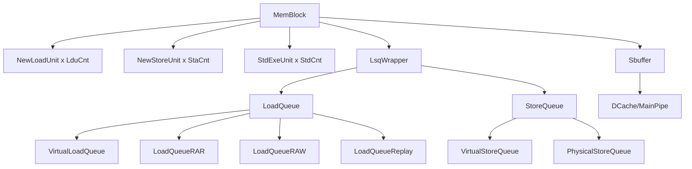
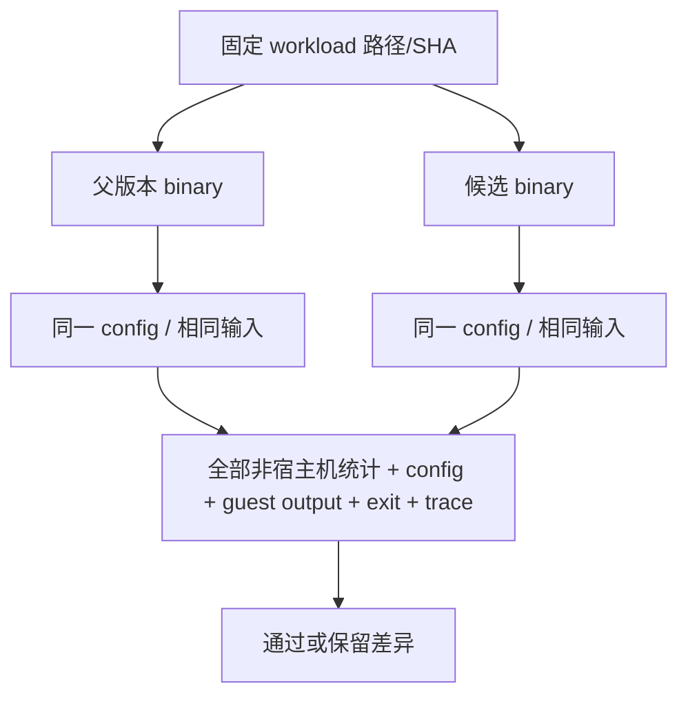

# RTL 责任对照与测试验证

## 1. 固定参考版本

RTL 参考为 XiangShan `kunminghu-v3`，commit 名称：

`18657f51ce1ed4acaffdceb38bb79ebae68b6af4`.

XS-GEM5 代码基线为官方 `OpenXiangShan/GEM5` 的 `xs-dev`：

`9c35c169c9b6acba4605f73861ef5d4ef2009a77`。

该提交的 Decode 统计已使用构造参数中确定的译码宽度，因此本轮不再应用旧 Decode 前置补丁。

本页只做职责和事件合同对照，不声明 C++ 与 RTL 逐周期等价。

## 2. RTL 模块结构



关键 RTL 文件名称：

- `src/main/scala/xiangshan/mem/MemBlock.scala`
- `src/main/scala/xiangshan/mem/pipeline/NewLoadUnit.scala`
- `src/main/scala/xiangshan/mem/lsqueue/LoadQueue.scala`
- `src/main/scala/xiangshan/mem/lsqueue/LoadQueueRAR.scala`
- `src/main/scala/xiangshan/mem/lsqueue/LoadQueueRAW.scala`
- `src/main/scala/xiangshan/mem/lsqueue/LoadQueueReplay.scala`
- `src/main/scala/xiangshan/mem/lsqueue/VirtualStoreQueue.scala`
- `src/main/scala/xiangshan/mem/lsqueue/NewStoreQueue.scala`
- `src/main/scala/xiangshan/mem/sbuffer/Sbuffer.scala`

## 3. XS-GEM5 与 RTL 的职责映射

|硬件问题|RTL 责任|XS-GEM5 对应|
|---|---|---|
|Load 地址/执行|NewLoadUnit stages|LSQUnit Load pipe、IEW|
|Store STA/STD|NewStoreUnit/StdExeUnit|Store pipe、SQ entry、IEW STD|
|逻辑 Load 队列|VirtualLoadQueue|per-thread LQ|
|逻辑 Store 队列|VirtualStoreQueue|per-thread SQ|
|物理 Store 窗口|PhysicalStoreQueue|physical SQ readiness/replay|
|Load 顺序|LoadQueueRAR/RAW|RAR/RAW queues、order checks|
|Replay|LoadQueueReplay/execution stage|DynInst cause、wait sets、`retryMem()`|
|committed write|Sbuffer|shared LSQ StoreBuffer|
|Cache request|DCache/MainPipe/MSHR|LSQ MainPipe model + gem5 cache|
|精确异常|ROB/redirect/fault state|Commit/interrupt/trap + LSQUnit squash|

## 4. 为什么不能一一等同

|差异|RTL|XS-GEM5|
|---|---|---|
|状态表示|寄存器/valid/ready/flush 网络|C++ object/pointer/event callback|
|处理时间|真实周期流水|离散 SimObject 事件|
|队列|multi-flag/circular hardware queues|C++ circular/containers|
|Cache|RTL DCache/MSHR/MainPipe|classic cache timing packets + modeled resources|
|Replay|硬件 cause 优先级和 pipeline|metadata + IQ sets + callbacks|
|Allocator|无 C++ heap|Replay scratch 有宿主分配语义|
|MDP|RTL predictor/依赖检查按硬件流水执行|StoreSet/PHAST 产生保守等待或 replay 信息|
|值预测|是否有对应 RTL 取决于目标配置|独立 `VPUnit`、direct-value candidate、commit feedback|
|SBuffer miss 容量|MainPipe/MSHR ACK 与 SBuffer inflight 有固定周期合同|S2 miss accepted 后可在软件模型中提前归还物理槽并保留请求快照|

因此“LSQUnit split 文件数”与 RTL 模块数不能直接对齐。

## 5. 事件合同

### Store

|事件|RTL 可观察条件|C++ 对应|
|---|---|---|
|SQ allocate|Store 进入虚拟/物理队列|`insertStore()`|
|STA ready|地址/翻译完成并发布到 SQ|`storeDoTranslate()`、`storeDoWriteSQ()`|
|STD ready|数据和 mask 完成|split STD 的 ISA/IEW 路径；未拆分 Store 在 `storeDoWriteSQ()` 同步就绪|
|architectural commit|ROB 授权|`commitStores()`|
|SBuffer accepted|entry/valid mask 接收|`offloadToStoreBuffer()`|
|Cache request|ready/valid 被接受|SBuffer 为 MainPipe S2 sendTimingReq；Load/直接 Store 另走 `trySendPacket()`|
|store hit accepted|请求沿 hit 响应路径完成|不提前释放物理 entry|
|store miss accepted|MSHR/Cache 接收 store miss|`release_sbuffer_miss_entry()` 可提前释放容量并保存快照|
|response|read/write response|`completeSbufferEvict()` 处理 snapshot 或旧模式物理 entry|

### Load

|事件|RTL 可观察条件|C++ 对应|
|---|---|---|
|LQ allocate|Load 获得逻辑队列项|`insertLoad()`|
|translation done|物理请求可生成|`loadDoTranslate()`|
|forward|mask/age/visible check|`checkStoreLoadForwardingRange()`|
|cache send|request accepted|`loadDoSendRequest()`/`sendPacketToCache()`|
|replay select|cause/priority|`loadSetReplay()`/IssueQueue set|
|data response|read response|`loadDoRecvData()`/`completeDataAccess()`|
|writeback|dest register write|`writebackReg()`|
|commit|ROB head|Commit|

## 6. 对照时应比较什么

优先比较事件：

- 同一指令进入/离开 LQ/SQ 的条件；
- Store 地址与数据 ready 的相对顺序；
- Load forwarding 的 mask 覆盖；
- RAR/RAW 等待与解除条件；
- Replay cause、prioritization 和 attempt count；
- SBuffer allocation/merge/vice/miss；
- miss accepted 与最终 response 是否被错误合并；
- direct-value prediction 的 applied feedback 和真实 Load 校验；
- PHAST distance 是否映射到实际更老 Store；
- Cache bank/set/MSHR 约束；
- fault/interrupt/squash 的架构边界。

不要直接比较：

- 源文件数量；
- DPRINTF 字符；
- C++ object 数；
- allocator 调用；
- 单次 host wall time 与 RTL cycle。

### RTL 高级机制对照边界

- PHAST/StoreSet 在 XS-GEM5 中属于依赖预测模型。应比较预测对象、启用条件和训练因果，不能只比较表项数或 hash 实现。
- direct-value predictor 的 Fetch predict、Commit update 和 squash 是软件对象接口。RTL 若没有同配置值预测器，只能做算法级对照。
- Memory Renaming 当前只完成 Store-Load Cache、Value File index 和 producer confidence 的基础设施；源码明确返回 `speculative=false`，因此不能把它与 RTL 的完整 Memory Renaming 数据通路声称等价。
- SBuffer `sbufferReleaseOnMiss` 参考 RTL “miss 被接收后 SBuffer 表项可释放、请求和 MSHR 继续存活”的资源寿命关系；周期、ACK 寄存和 Cache 内部实现仍由 local classic Cache 模型决定。
- TEA 是 gem5 O3 的性能事件归因器，使用 ROB/commit/squash 和 LSU 事件做统计，不宣称与 RTL performance counter 或流水事件一一对应。
- MLP predictor 使用 `cacheAccessDepth` 和 long-latency shift register 控制 Fetch；RTL 如无同配置 predictor，只能比较训练输入和控制目标。
- SMT DynamicBorrowing 属于 shared `LSQ` 软件 policy。本轮只验证拆分后容量/仲裁统计不变，不把 LQ/SQ 文件边界映射成 RTL 队列数量。

## 7. 回归测试结构



测试管理要求：

- 同一 A/B 必须使用完全相同绝对 workload 路径；
- 记录 source/binary/workload/reference SHA；
- opt 与 debug 都验证；
- 所有非宿主机 stats 比较，不按 IPC 单值近似；
- config、guest output、exit 和有效 trace 同步比较；
- timeout、negative control 和失败输出保留。

## 8. 21 项定向覆盖

|场景|主要覆盖|
|---|---|
|`store_cold`/`store_warm`|普通 Store、Cache cold/warm|
|`fs0`|同块 byte merge/forwarding|
|`fs1`|部分 forwarding 与 reschedule|
|`fs2`/`fs7`|page/access fault|
|`fs3`|LR/SC 成功与失败|
|`fs4`|wrong-path Store/fault/squash|
|`fs5`/`fs6`|physical SQ 与 SBuffer pressure|
|`fs8`|真实软件 interrupt|
|`fs9`/`fs10`|MDP/replay 路径；工具支持额外 fs10_deep，但它不在本 21 项中|
|`se0`/`se3`/`se4`|SE 访存、Replay 与资源压力|
|`vector*`|split handoff、mask 和跨边界行为|
|`se_smt`|最小 SMT 控制|
|`negative`|正例 checker 负向控制|

这些 case 验证特定行为存在，不单凭配置较小就宣称资源事件命中；coverage checker 读取真实 counters/trace。

## 9. 当前 PR 验证结果

|验证|实际结果|支持的结论与边界|
|---|---|---|
|纯 PR01 结构审计|95/95 定义字节/token 一致；头文件不变，TU 注册唯一|机械拆分结构证据，不是通用形式证明|
|官方对 PR01-only，opt 21 项|21/21；206,148 个非宿主统计值差异 0|独立验证拆分本身|
|最终官方对最终 PR01+PR02，opt 21 项|21/21；206,148 个非宿主统计值差异 0；配置、有效 Trace、guest 输出与退出一致|固定最终 opt 二进制已完成全矩阵|
|最终官方对最终 PR01+PR02，debug 21 项|21/21；206,148 个非宿主统计值差异 0；配置、有效 Trace、guest 输出与退出一致|固定最终 debug 二进制已完成全矩阵及覆盖检查|
|zeusmp 54833、mcf 1820，最终 opt|各 20M warmup＋20M ROI；49,492 个非宿主统计值差异 0；所有统计段、归一化 config 与精确 exit 一致，NEMU difftest 通过|两条固定切片、SimpleMemory；不包含完整 Trace，不是全量 SPEC|
|TEA/MLP/DynamicBorrowing 专项 SMT|8,542 个非宿主统计值差异 0，配置和有效 Trace 一致，特性计数非零|这几个最新功能的已执行路径保持|
|Replay 函数差分及局部 sanitizer|16,384 状态、49,152 轮；顺序、队列、统计、引用观察一致；ASan/UBSan 通过|受控桩，不是整个模拟器 sanitizer|
|Replay 固定批次的分配|20,000 轮：80,000→4，首轮后 0|宿主分配减少，不等于整机同比例加速|
|Clang fast 构建与同类型 A/B|官方与候选均构建成功；转发、压力、中断、Replay 四项非宿主统计/config/exit 全一致|关闭断言和 Trace 后的编译与运行检查；fast 不记录 Trace|
|GCC 单元测试|69 个测试程序；1,073 个用例完成，11 禁用、1 跳过，0 failure/error|全库单元测试补充，不等于专门覆盖每条 LSU 分支|
|仓库风格检查|三组 PR 涉及的代码/工具由 7 类 verifier 检查，无报告项|代码风格辅助检查，不代替语义验证|

专项 TEA samples 为 2,160，MLP long-latency true-negative 为 1,024，LQ/SQ donor 切换为 88/72。TEA、MLP、DynamicBorrowing、SBuffer 提前释放等原本属于上游，不是本次新增算法。Decode/ROB 最新设计保留在固定基线中。

六对宿主时间的均值为官方 6.674 秒、候选 6.640 秒，范围重叠，不能写成确定加速。代码拆分改善职责定位；Replay 仅量化了局部 allocator 收益。

## 10. 不把其他版本的结果记成本轮验证

旧工作目录中曾有 V23/V25/V26/V27、vstart 和 Store 异常前缀相关实验。它们没有作为本轮最新 xs-dev 的修改提交，也不能作为本轮通过证据。原 sbuffer-mshr-lifetime.md 中 2026-09-09、2026-09-16 的统计和旧 RTL 提交同样只属于其各自版本。

本轮只评价 LSQUnit 机械拆分、Replay 临时容量复用，以及当前六篇架构文档。SBuffer 提前释放、MSHR 合并、TEA、MLP 和物理 SQ 等属于固定上游基线中已有设计，文档解释它们不代表本次新增了这些功能。

## 11. 测试充分性与未证明范围

对 PR01 机械拆分：固定基线 95 个定义字节/token 一致，配合内部链接归属、构建注册和 opt/debug 编译，为机械搬移提供强结构证据；不是通用 C++ 语义等价的形式证明。纯 PR01 有独立 21 项 opt，最终组合候选有完整 opt/debug 各 21 项及两条 20M＋20M checkpoint。

对 PR02 Replay 存储：fixture 两个函数体的 token 与最新原版/候选对应，依赖和指令类型仍为受控桩，局部 sanitizer 不等于全模拟器 sanitizer；最终 opt/debug 整机 A/B 和 20M＋20M checkpoint 补充正常、Replay、SBuffer pressure 等证据。

对 PR03 文档：所有纯文本源码路径/行号和文档文件名已作一致性检查。图形、术语和跨文档描述由人工源码审计复核。

仍未证明：

- 所有 RVV mask、FOF、`vstart`、异常前缀组合；
- wrong-path 已发请求的所有迟到回包/slot 复用交错；
- 多个 pending Store 和设备中断组合；
- 所有 SMT/SpMT policy 组合及 HTM；已有最小 SMT 与 DynamicBorrowing 专项不能当作穷举；
- 完整多核 snoop/RVWMO；
- uncached/MMIO/非幂等写协议；
- RTL 和 C++ 的周期级等价。

## 12. 新增测试的步骤

1. 写出最小 guest 自检和负控；
2. 固定 exact binary image、config、reference 和 source SHA；
3. 先用 debug trace 检查事件目标是否实际命中；
4. 用 stats 检查对应计数器，不只依赖配置；
5. 跑 opt/debug 和多 dispatch 路径；
6. 与相同输入父版本比较全部非宿主 stats、config、output、exit 和 trace；
7. 保留 timeout、负控和失败；
8. 更新对应任务记录和测试矩阵；
9. 如果源码或 baseline 改变，重新生成全部证据。

## 13. 功能相同、模拟性能相同与宿主开销的区别

|指标层|检查什么|本轮结果怎样表述|
|---|---|---|
|功能|guest 自检、退出、NEMU 的架构结果|已测场景未发现差异，不是全 ISA 证明|
|模拟性能|simTicks、simInsts、队列占用、replay、cache 等统计|完整矩阵非宿主统计逐值一致|
|宿主开销|wall time、allocator、RSS|fixture 分配下降；整机 wall time 尚无显著加速证据|
|维护性|职责边界、源码定位、评审范围|主文件从 4,303 行变为 456 行；未量化维护工时|
|RTL 对照|事件职责与资源寿命|静态设计对照，不是动态逐周期等价|

宿主六对交替运行，官方均值 6.674 秒、候选 6.640 秒，约 -0.51%，范围重叠且有候选更慢的配对。不能写为确定提速。Replay 受控 20,000 轮分配 80,000→4、预热后 0，证明局部容量复用有效，不等于整机所有分配都消失。

## 14. 完整矩阵到底比较了哪些数据

run_suite 保存 binary/source/workload/reference 哈希、命令、生成配置、run.log、stats 和 trace。两侧读取同一固定 workload 绝对路径，避免 SE argv 路径影响用户栈。负控故意设置错误预期，必须被 checker 拒绝，不能把它当普通成功 guest。

完整官方 21 项的有效目录为 official-all21，组合候选为 candidate-all21，纯拆分为 candidate-pr01-full。official-full 保留早期配置尝试，其中 SE stats 不完整，不能用作完整 21 项重读入口。本次根据实际文件重新运行 coverage 和比较脚本，未重新启动 gem5。

compare_suite 比较各统计段的所有非宿主字段，排除的六项为 hostSeconds、hostTickRate、hostInstRate、hostOpRate、hostMemory、hostMemoryUsage。不是只比 IPC，也不把队列或异常统计挑出来忽略。

两侧源码和输出目录不同，config 只归一化相应目录路径。有效 trace 只对两个明确匹配的日志格式替换尚未组装的转发 data token：SQ forwarding 日志及 SBuffer forwarding 日志。tick、tid、sn、地址、事件行与真实写回值不移除。两侧原始 trace 及其哈希保留，因此只能说有效 trace 一致，不能说所有原始日志逐字节相同。

这两种日志在实际组装前读取临时 memData，不能用其打印值作为最终 Load 值。若其他字段有差异，比较工具不能用宽泛正则将其抹掉。实现见 `util/lsu_regression/compare_suite.py:1`。

### 14.1 checkpoint：20M 预热与 20M 测量

本轮 final-validation-20261031 使用固定最终 opt，在 zeusmp 54833、mcf 1820 上各跑 20M warmup＋20M ROI。NEMU difftest 启用，两侧均到预期 max instruction count；输入及二进制哈希前后未变。

新脚本逐段读取 stats，不再只保留最后出现的字段；两条切片所有统计段共 49,492 个非宿主统计值完全一致，同时比较归一化 config.ini 和精确退出 tick/reason。未记录 checkpoint 完整 Trace，不能声称其全部 Trace 一致。只覆盖两条固定切片、SimpleMemory，不等于全量 SPEC 或 DRAMsim3。

旧 run_checkpoint_ab.py 的 2M＋2M 记录保留为历史补充，其解析只保留最终字段，不能反过来赋予旧结果逐段/config 比较结论。新旧证据明确分开。

### 14.2 怎样在本机复核一条普通 Store

在候选根目录执行下列模板，先把占位参数替换为实际路径；output 必须是不存在的新目录，不覆盖原结果：

```bash
python3 util/lsu_regression/run_suite.py \
  --repo <候选源码根目录> \
  --gem5 <候选源码根目录>/build/RISCV/gem5.opt \
  --ref <与输入匹配的NEMU参考库> \
  --fixed-workloads <固定workload目录> \
  --cases store_cold store_warm \
  --output <新的运行目录> --jobs 1
python3 util/lsu_regression/check_coverage.py --run <新的运行目录>
```

reference 及固定 workload 应与原 manifest 对应，不能因为路径存在就认为版本匹配。普通 raw image 不使用 checkpoint 的恢复参数；SPEC 的 zstd 切片也不能误加 raw-cpt。查看 result.json 的实际启动命令、run.log 的退出原因和 m5out/config.ini，不以 shell returncode 单独判定访存正确。

看懂 Store 后，将 cases 换成 fs1、fs5/fs6、fs8、vector_pressure 分别探索 partial forwarding、容量压力、中断、split 交接。正式 A/B 两侧运行同一 workload 和配置，再执行 compare_suite；完整矩阵用 group full。实验未命中目标事件时，应先修正 workload/配置，再解释机制，不能直接据空统计得出“没有问题”。

## 15. 测试源码与最终二进制的对应关系

最终 opt SHA：`1478f57d1f229f0be8db1979d8e9f8be7dae1597f3755d992097643bf29c56c4`。

最终 debug SHA：`4ad11f84b278f0bd98126a7914f6803d4ebdd1334703e06b50c590e4dd51b194`。

2026-10-31 的新增实跑同时固定 source、binary、workload 和 NEMU reference 哈希；两个最终 SHA 均完成 21 项，不再仅依赖四项 smoke 或重建前的二进制。72 个 O3 源文件与候选一致，运行前后 binary/input 哈希未变。官方 xs-dev 在提交前再次核对为同一固定基线。

历史 PR01-only SHA 为 b6fbc9d535ca1558da6fbeaede090406dfbd1bb2f9ea8a6db6f69f2c35d789af；历史组合 opt SHA 为 ab4d546e2768055976523aa205a42fb8dbcd6db10407638bc6d456a891d492f4。保留历史记录，不将新结果倒填到旧日志。

本次新增实跑归档为 final-validation-20261031：manifest.json 固定二进制、源码及输入；opt-full21-comparison.json 和 debug-full21-comparison.json 保存逐项比较；checkpoint20m-ab.json 保存每个统计段、config 与 exit 对照；summary.json 保存总结果。pr-bundle/evidence 下同时提供这些比较摘要。原始命令、输出和各轮 stats/config 保留在独立实验归档，不混入源码 PR。宿主六对计时来自此前同源码组合候选，其二进制为历史组合 SHA；这次最终 SHA 复跑用于行为和模拟统计，没有重新做六对绑核宿主计时。长切片同时运行时的 wall time 不作为受控加速证据。

本次新增 gem5 实跑，没有新增动态 RTL 仿真。公开 PR 不提交机器特有的大日志和备份；管理员可结合独立证据包复核原始结果。

## 16. 按 sbuffer-mshr-lifetime.md 深度评审文档

原文的优点不是字数多，而是明确区分事件、生命周期、参数、复杂度和实验边界。本套文档逐项对照：

|原文的说明维度|本套对应位置|
|---|---|
|问题和设计动机|01 第 17—19 节；02 第 19 节|
|接受、释放、可见性等不同事件|02 第 7、18、19 节|
|独立数据快照和槽复用风险|02 第 19.4 节；03 第 20 节|
|合并、转发、重试条件|02 第 19.3—19.6、20、21 节|
|flush/fence/drain|02 第 10、19.7 节；03 第 18—20 节|
|参数及配置覆盖|01 第 20 节|
|复杂度和瓶颈因果链|01 第 19 节；02 第 19.7 节|
|实际源码入口|04 全篇，特别是第 20—23 节|
|实验流程、数据及未证明范围|05 第 7—15 节|
|RTL 异同与建模限制|05 第 2—6 节|

每个重点机制至少说明：它解决什么、输入来自谁、状态由谁保存、成功如何移交、失败如何等待/恢复、谁负责释放、用什么数据观察。关键词命中或行号存在，只能作结构检查，不能替代这些语义解释。

## 17. 文档范围与仍需独立研究的内容

六篇覆盖本固定版本中 LSU 主干和相邻接口：LQ/SQ、STA/STD、转发、SBuffer/vice、MSHR、MainPipe、Replay、异常中断、请求寿命、向量边界、MDP/值预测与源码入口。MMU 全部页表算法、Cache 一致性协议状态机、硬件全部信号以及任意向量异常组合仍需要专门资料和实验。

不能承诺读完六篇就掌握芯片访存系统的所有实现细节；可以要求读者能按现有源码跟完整条普通 Store/Load，说明关键阻塞与恢复机制，遇到扩展情形知道继续读哪个模块、哪些结论尚未验证。

准备提交的是六篇正式文档；本地测试大日志、备份、讨论记录和两篇代码修改汇报不混入此文档 PR。后者作为 PR01/PR02 的评审说明材料。

## 18. 将 SBuffer 合同具体对照到当前 RTL

本地固定 RTL 的 MainPipe.scala 在 `src/main/scala/xiangshan/cache/dcache/mainpipe/MainPipe.scala:950` 计算 mshr_handled_store_miss，寄存一拍后与正常 store hit 响应一起返回 ACK，并携带 miss 标记。该 ACK 表示 MSHR 已接收，不等于回填数据已经完成。

Sbuffer.scala 的 `src/main/scala/xiangshan/mem/sbuffer/Sbuffer.scala:721` 响应分支清除对应 inflight/valid；排空还要检查 sbuffer_empty 与 mshr_store_empty，见 `src/main/scala/xiangshan/mem/sbuffer/Sbuffer.scala:541`。因此“物理项可释放，但已接收 Store 尚未全部完成”在 RTL 也有明确接口区分。

同行合并窗口在 `src/main/scala/xiangshan/cache/dcache/mainpipe/MissQueue.scala:888`：Store 合并要求 store-origin 等条件及尚未跨过相应 refill 响应边界，并检查 block/alias 匹配。XS-GEM5 用 predecessor target 和 canMergeSbufferStore 检查对应资源寿命，没有逐信号复刻硬件流水。

软件在 S2 回调保存快照并归还容量，RTL 有下一拍 ACK、寄存器和固定端口；classic Cache 的 target 服务、实际回填与 fake refill credit 又是软件模型的边界。比较时应先对齐“请求接收”“容量释放”“最终写完成”事件，再研究周期差，而不能直接比较两个函数名或文件数量。

## 19. 文档覆盖与源码目录的验收方法

本套仍为六篇，详细机制放在对应章节，不要求读者在许多重复小文档间跳转。04 第 24 节逐文件列出明确范围内的源码：核心 O3、值预测、RISC-V 翻译/ISA/异常、classic Cache/MSHR、L2 wrapper、tag/index/way、预取、协议/内存对象、配置与回归，并区分哪些是可选或外围支持。第 25 节列全部 95 个拆分定义。

|验收内容|怎样检查|不能用什么替代|
|---|---|---|
|源码入口真实|项目内文件存在，行号指向当前候选的定义/分支|只复制旧版本文件名|
|核心文件无遗漏|完整列 O3 顶层源码与 LSQ 主干直接项目 include|声称所有递归依赖都属于 LSU|
|跨文件流程可追|普通 Store/Load 每一步有上游、状态、下游和失败 owner|只有名词列表或代码目录树|
|算法边界明确|区分 SQ/SBuffer partial、预测/实际冲突、容量/事务寿命|把理想硬件算法写成当前 C++ 行为|
|特殊路径诚实|列 SC/AMO/local/strict/vector/FOF/中断的差异和未验证组合|从普通读写测试外推全部机制|
|资料可以转交|GEM5 地址相对项目根；RTL 单独标识；正文无超链接和本机绝对目录|依赖作者服务器的个人路径|
|评审可归因|两个代码 PR 与文档 PR 各有范围，已有上游功能单独标明|把新增文档解释的机制都记成本次代码优化|

源码全景中的可选预取与替换等文件提供算法入口和作用，不取代每个算法的专项论文/源码研究。主干读懂后，若实际启用某扩展并需修改它，再补对应设计细节和实验；不需要为了形式上增加文档数而复制相同主线。

## 20. 机制说明与实验支撑不是同一张覆盖表

|机制|主要说明|本轮运行或审计支撑|剩余限制|
|---|---|---|---|
|LQ/SQ 与拆分|01 第 18 节，04 文件职责/定义归属|95 定义审计、21 项 A/B|非任意未来重构的自动证明|
|普通 Store/SBuffer|02 第 18—19 节|冷/热 Store、fs0/fs5/fs6、checkpoint|没有新增动态 RTL 验证|
|Load forwarding|02 第 20、24 节|fs0/fs1、SE 与 vector 场景的部分路径|未穷举所有字节/mask/跨行组合|
|Replay 与临时容量|03 第 16—17 节|函数差分、allocator、局部 sanitizer、整机 A/B|整机提速未显著，完整 simulator sanitizer 未做|
|bank/MainPipe/MSHR|01 第 24 节、02 第 19 节|相同配置的定向压力与统计一致|不能称所有几何与协议均验证|
|异常、中断、迟到响应|03 第 18—22 节|fault、wrong-path、软件中断等定向测试与源码审计|不穷举所有在途交错/设备/SMT|
|向量/FOF/vstart|02/03 的向量边界、04 的 ISA 目录|普通向量、mask、压力用例和源码分析|没有全 vstart/FOF/重启矩阵|
|MDP 与 PHAST|01 第 12、22 节|fs9/fs10 的相关等待路径|kmhv3 默认关闭 PHAST，不能声称完整 PHAST 性能矩阵|
|TEA/MLP/借用|01 第 16、25 节|专项 SMT smoke 的非零事件及 A/B 一致|非所有策略组合|
|值预测/Memory Renaming|01 第 12 节、04 值预测目录|固定源码与实现边界分析|未声称所有预测器配置有完整运行回归|
|预取/way/替换/L2 wrapper|01 第 24、26 节及 04 目录|接口和配置源码检查|未将所有可选算法计为本轮动态覆盖|

因此“说明里有介绍”不等于“本轮每个机制都新做过完整实验”；反过来，定向测试通过也不能代替读者理解状态机。管理员应同时检查源码事实、文档叙述和相应证据层级。

## 附：管理员复跑长切片的方法

在官方和候选各自的项目根目录运行同一模板，分别选择全新的输出目录。尖括号为需替换的参数；同一切片和 NEMU reference 必须在两侧指向同一文件，按 manifest 核对哈希。zstd checkpoint 不加 raw-cpt，不额外覆盖其内置 restorer。

```bash
build/RISCV/gem5.opt --outdir=<全新输出目录> \
  configs/example/kmhv3.py \
  --generic-rv-cpt=<固定的zstd切片> \
  --enable-difftest --difftest-ref-so=<匹配的NEMU参考库> \
  --warmup-insts-no-switch=20000000 --maxinsts=40000000 \
  --mem-type=SimpleMemory
```

分别使用 zeusmp/54833/_54833_0.008054_memory_.zstd 和 mcf/1820/_1820_0.005512_memory_.zstd，输入属于同一个固定 checkpoint 数据集。20M＋20M 表示预热阈值为 20M、总指令目标为 40M；宽提交边界可能使预热统计多出少数指令，因此实际段长以 stats.txt 的 simInsts 为准，两侧逐值比较，不人为截断或改写计数。记录启动命令、source/binary/input/reference SHA、运行前后 binary/input 哈希、config.ini、完整 stats.txt 和 run.log。不能仅凭 exit code 为零认定通过：还须确认 difftest 已启用、没有不匹配、按 max instruction count 正常退出，且两侧退出 tick/reason 相同。

统计按每次 Begin Simulation Statistics 分段比较，不把 warmup/ROI 的同名字段覆盖为最后一个值；只排除六个 host 字段。config 仅归一化源码/输出路径，其余配置必须一致。长切片未记录完整 Trace，报告不补称 Trace 已比较。Replay、异常和压力的细粒度 Trace 证据来自 21 项定向矩阵。

可转交附件中 final-validation-run_final_validation.py 保存本轮驱动，使用前把脚本顶部路径常量映射到自己的官方、候选、固定 workload、切片和 reference；不要复用原有输出目录。生产回归工具入口为 util/lsu_regression/run_suite.py、check_coverage.py、compare_suite.py；本轮原命令保存在独立归档的各运行目录。

补充构建命令如下，先后执行，避免同时初始化同一 SCons build 目录：

```bash
CC=clang CXX=clang++ scons build/RISCV/gem5.fast --linker=gold -j32
CC=gcc CXX=g++ scons build/RISCV/unittests.opt -j32 --unit-test
```

硬件、依赖及内存控制器配置改变后应重新验证。当前长切片固定 SimpleMemory；DRAMsim3、更多 SMT/向量/多核组合不能自动沿用本轮通过结论。

## 附：补充构建验证发现及处置

跨构建检查曾保留一项严格失败：同一候选的 opt 对 fast 在软件中断用例 fs8 上，只有 miscRegfileReads 为 20,022 对 20,010，其余统计、config、退出和 NEMU 检查一致。src/arch/riscv/interrupts.hh 的 getInterrupt()/getInterruptNO() 内有 assert(checkInterrupts())，该检查会通过 readMiscReg 增加统计，fast 去掉断言。官方 fast 对候选 fast 的同类型 A/B 再次检查全部字段一致，支持此差异属于基线已有的构建类型统计差异；没有扩大统计排除表，也没有修改中断代码。原严格失败结果与后续隔离实验分别保存。

单元测试首次与另一 SCons 进程同时使用新建 build/RISCV 目录，在生成目录时发生 File exists；停止并发初始化后串行重试通过，没有为此修改源码。该次基础设施失败日志保留，最终通过取自后续完整执行及 XML 结果。
