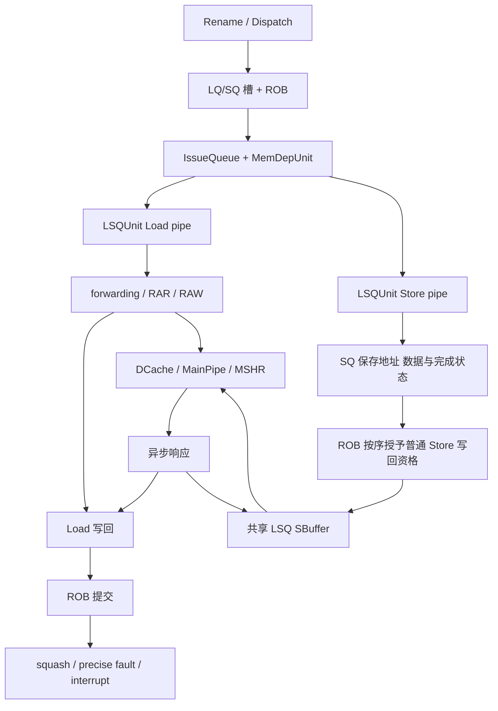

# XS-GEM5 LSU 架构与访存流程

本目录用 6 篇中文文档说明固定版本 XS-GEM5 的 LSU 主干设计、状态所有权、数据结构、算法、Store/Load 流程、SBuffer、Replay、异常恢复、依赖/值预测、关键源码和 RTL 对照。目标读者包括不熟悉 gem5 的计算机体系结构学习者、代码评审者和后续维护者。覆盖范围和开放边界明确列出，不声称穷尽整个 MMU、Cache 一致性协议或全部向量异常实现。

本文以官方 `OpenXiangShan/GEM5` 的 `xs-dev@9c35c169c9b6acba4605f73861ef5d4ef2009a77` 和本轮 split/replay 候选为事实来源。旧版 memory renaming、PHAST、SBuffer/MSHR 和值预测说明只用于确定主题与阅读格式；旧参数默认值、旧文件名和未合入的设计目标不会被直接沿用。

最新版本中的 TEA/MLP predictor、SMT LQ/SQ DynamicBorrowing、Decode fusion compaction 和 Hybrid ROB 保留在基线中。本轮只拆分 `lsq_unit.cc` 并复用 Replay scratch，不重写这些设计。

源码路径按本轮拆分并复用 Replay 容量后的实现定位。若阅读未拆分的官方基线，需把 LSQUnit 函数映射回原 lsq_unit.cc；不能直接把候选行号套到另一版本。六篇正式文档的文件清单见下表；代码修改过程、提交状态和内部评审记录单独维护，避免混入架构阅读主线。

## 文档数量与职责

只提交以下 6 篇，避免同内容重复：

|文件|解决的问题|
|---|---|
|`README.md`|术语、阅读顺序、总体地图和证据口径|
|`01-architecture-data-algorithms.md`|LSU 在 O3 中的位置、状态对象、StoreSet/PHAST、direct-value predictor、Composite 和 Memory Renaming 当前边界|
|`02-store-load-sbuffer-flows.md`|普通/split Store、Load、forwarding、SBuffer、Cache、miss accepted 和 drain 全流程|
|`03-replay-exception-recovery.md`|Replay、fault、interrupt、squash、迟到回包和恢复|
|`04-source-guide.md`|10 个 LSQUnit 文件、跨模块源码、PHAST、值预测和 Memory Renaming 入口|
|`05-rtl-and-validation.md`|RTL 责任对照、测试方法与测试边界|

## 推荐阅读顺序

第一次阅读建议按以下顺序：

1. 先读本页，理解 LQ、SQ、SBuffer、Replay 和 ROB 的关系。
2. 阅读 `01-architecture-data-algorithms.md`，建立状态所有权和数据流地图。
3. 阅读 `02-store-load-sbuffer-flows.md`，分别跟随一条 Store 和一条 Load 走完整流程。
4. 阅读 `03-replay-exception-recovery.md`，理解失败、重试、异常和恢复是不同事件。
5. 阅读 `04-source-guide.md`，把架构状态映射到具体 C++ 文件和函数。
6. 阅读 `05-rtl-and-validation.md`，理解 RTL 对照范围和现有测试能证明什么。

## 最小术语

|术语|通俗解释|严格含义|
|---|---|---|
|O3|gem5 的乱序 CPU 模型|Out-of-Order 模型；操作数与资源就绪后允许乱序执行，ROB 按程序顺序提交|
|LSU|CPU 的访存部门|连接后端执行、LQ/SQ、SBuffer、Cache 和提交边界的模块集合|
|LQ|Load 的待办表|逻辑 Load Queue，跟踪指令年龄、执行状态和完成边界|
|SQ|Store 的待办表|逻辑 Store Queue，跟踪地址、数据、mask、split 进度和提交授权|
|SBuffer|已提交 Store 的缓冲区|共享 Store Buffer，保存 Cache 事务完成前的字节、mask 和请求状态|
|Packet / Request|发往内存系统的运输单|gem5 传输对象和 LSQRequest 状态；可能比 LQ/SQ 槽存活更久|
|ROB|最终签收台|按程序顺序提交，处理精确 fault 和 interrupt|
|forwarding|从更老 Store 直接取数据|按地址、年龄、可见性和 byte mask 找到可用字节|
|RAR|Load 与 Load 的顺序等待|Read-after-Read 跟踪，常用于仍在解析中的地址关系|
|RAW|Store 与 Load 的顺序等待|Read-after-Write 跟踪，Load 等待更老 Store 的地址/前沿|
|Replay|稍后重试|资源、Cache 或顺序条件不满足时的重新发射，不是架构异常|
|MSHR|缺失请求登记表|Cache miss status holding register|
|MainPipe|建模的 Cache 资源流水|XS-GEM5 中约束 bank/set/MSHR 等资源的软件模型|
|difftest|与参考模型对答案|与 NEMU 比较架构结果，不是 RTL 周期对比|

## 总体地图

## 理解任何访存问题必须回答的五件事

1. **对象是谁**：指令、LQ/SQ entry、`LSQRequest`、Packet、SBuffer entry 还是 ROB entry？
2. **状态在哪里**：地址、数据、mask、fault、完成和提交授权分别由谁保存？
3. **年龄关系是什么**：谁更老，当前是否已提交、可见或已进入 Cache？
4. **是否真的拥有资源**：只是准备发送，还是已经插入 SBuffer/MainPipe/MSHR？
5. **谁负责释放**：本地槽释放、请求释放、Packet 回包、SBuffer 释放和 ROB 提交不是同一事件。

## 阅读约定

- 本文只使用纯文本文件名和“源码路径:行号”索引，不附带 Markdown 超链接或外部 URL。
- `C++ 文件` 是软件维护边界；一个文件不自动对应一个 RTL 硬件模块。
- `执行完成` 不等于 ROB 提交。
- `SQ 释放` 不等于 Store 已经写入 Cache。
- `Cache 回包` 不自动等于 Load 已成为架构结果。
- `Replay` 不是 fault。

## 证据等级

- **源码事实**：来自固定 commit 的实际状态字段、调用关系和分支。
- **动态验证**：来自固定 input、binary、config 和 trace 的实际运行。
- **RTL 对照**：固定 XiangShan RTL commit 的职责分析，不等同于周期级仿真。
- **开放问题**：当前测试没有覆盖的场景，会在第 3 和第 5 篇单独列出。

## 新人怎样按步骤读到能够解释设计

第一轮只读主线：01 第 17—18 节建立乱序与队列概念 → 02 第 18 节追普通 Store → 第 19 节弄清 SBuffer → 第 20—21 节比较三条 Load 数据路径。暂不要求记住所有预测器参数。

第二轮读失败：03 第 16—17 节追 Replay → 第 18—20 节追真实 fault、wrong-path 与迟到回包 → 第 21 节理解向量扩展边界。此时必须能说明“谁保留状态、哪个事件解锁、下次从哪里继续”。

第三轮对源码：按 04 第 23 节完成五次精读，每次画对象寿命/事件图，标出函数地址。再读 01 的 StoreSet/PHAST、值预测、TEA/MLP 与共享队列策略。最后用 05 的矩阵选择实验，不把成功运行当成全部机制验证。

## 判断是否真的读懂的十个问题

1. 一条普通 Store 在哪里计算地址、保存数据、取得 canWB、释放 SQ，最终写响应又由谁接收？
2. STA 和 STD 哪些状态独立、哪些必须汇合？逻辑 SQ 空闲为何不代表物理窗口可写？
3. 同线程未提交的更老 Store 为什么可以给 Load 转发，但不能任意对其他线程发布？
4. SQ 部分覆盖、SBuffer 部分覆盖、完整转发三者分别走什么路径？
5. 主项已有快照时后续同块 Store 放哪里，vice 是否计容量，何时转正？
6. miss 被接受、SBuffer 容量归还、最终响应三个事件分别释放什么？
7. pending 请求仍存在，为什么不能据此认定旧 MSHR 仍可合并？
8. Cache miss 早唤醒后数据还没来时，谁保留 Load、谁重新检查？
9. wrong-path fault 为什么不立即进 handler，squash 后旧 packet 为什么不能直接 delete owner？
10. 哪些结果证明架构功能、哪些证明模拟时序、哪些只证明宿主分配或 RTL 静态职责？

答案都应能在正文找到机制、状态和源码依据。能答对这些主干问题是继续优化前的基础；不是对所有微架构和异常交错的掌握证明。

## 完整文件目录与进一步专题的安排

04 第 24 节提供逐文件的源码全景目录，包含核心、相邻接口、配置/测试和明确标注的可选扩展。每条路径相对于 GEM5 根目录，写明功能、流程关系及启用边界，并核查核心 LSQ/LSQUnit/依赖预测文件的项目内直接 include 是否遗漏。表格包括其他 O3 共同模块，但不会把它们都称为 LSU 核心或本轮修改。

正式 PR 仍为六篇：不另增大量小文档。SBuffer 的详细专题放在 02 第 19 节；Load/Store 事件演练放在 02 第 18、24 节；Replay/异常在 03；bank/set/alias、队列共享和预取接口新增在 01 第 24—26 节；源码全景置于 04 后半部，初读主线时可以先跳过目录表。

若后续研究完整 MMU 两阶段翻译、某种预取器算法、Cache 一致性或特定 RVV 重启协议，再按模块建立专题并提供专项证据。当前不需要为已有主干重复造文档；也不把列出了可选文件等同于已经解释或验证该配置的全部行为。
