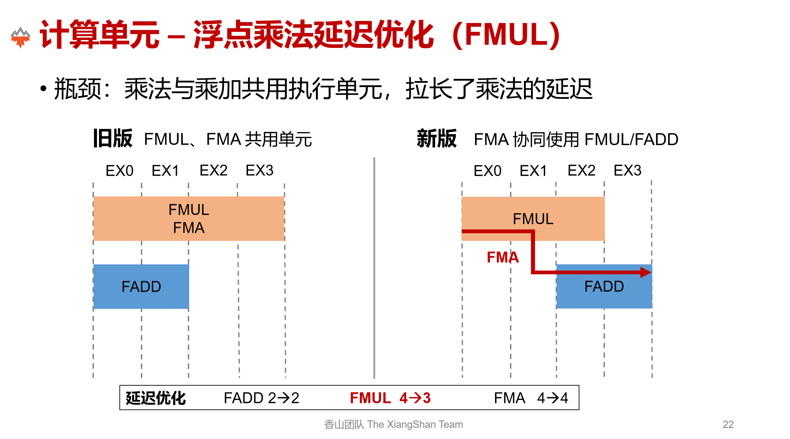
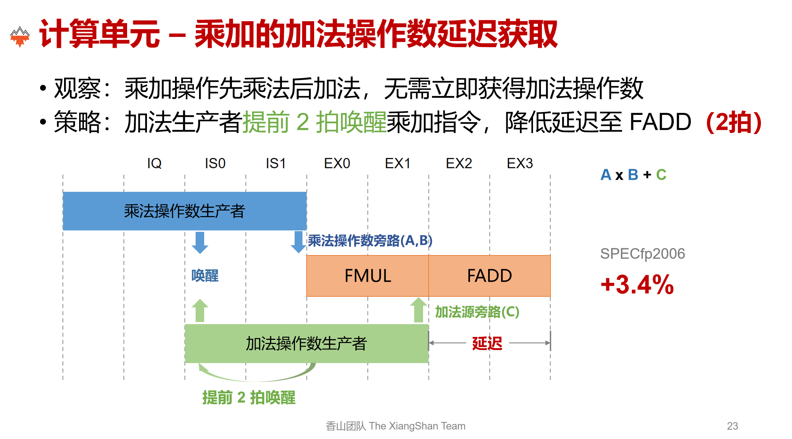
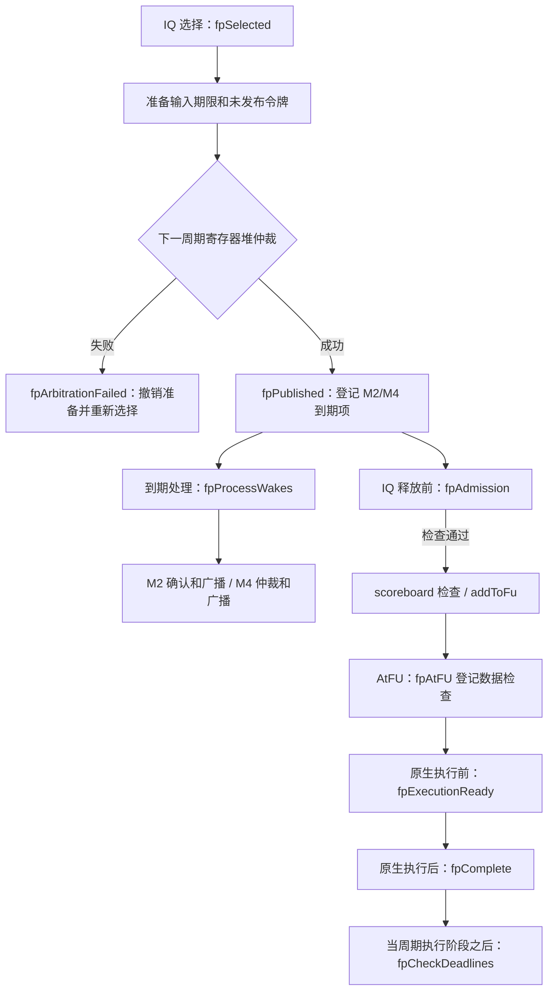

# 浮点推测唤醒设计

本文依据当前代码说明浮点推测唤醒的状态、时序和恢复责任。FMUL 表示浮点乘法，FMA 表示浮点融合乘加，IQ 表示发射队列，FU 表示功能单元。



改进：
1. FMUL的执行延迟从4拍降到3拍，FMA执行延迟还是4拍
2. FMA的等待唤醒时间降低，原来要等两个乘数和一个加数都提前两拍就绪（M2）才唤醒，现在只需要两个乘数提前两拍（M2），加数提前四拍（M4）进行唤醒，在乘法执行的2拍同时等待加法，乘法执行完后立即从旁路取到加法进行加法的2拍执行，所以FMA一共执行4拍。
注意：当前只实现了FMUL/FMA生产者到 FMA 加数源的M4唤醒，RTL还有一个load到FMA 加数源的M4唤醒本次未实现。（后端说这三类有M4就差不多能覆盖了）。

## 1. 设计目标与实现范围

机制的目标是根据生产者的预计完成时间，提前赋予消费者调度资格，并在后续阶段检查这份承诺是否仍然成立。提前唤醒不生成操作数数值；真实结果仍由原有指令执行逻辑产生。

生产者限定为 `FloatMultOp` 和 `FloatMultAccOp`，并排除向量指令。消费者由 `fpConsumer()` 判断：源寄存器必须是浮点寄存器，指令属于 `FloatAddOp`、`FloatCmpOp`、`FloatCvtOp`、`FloatMvOp`、`FloatMultOp`、`FloatMultAccOp`、`FloatDivOp`、`FloatMiscOp` 或 `FloatSqrtOp`，同时排除向量与访存指令。拆分 store 的数据微操作不能只靠 `isMemRef()` 排除，因此消费者还必须满足上述操作类型集合。

M2 服务这些消费者的普通输入；M4 只服务 FMA 的加数输入。加数通过“第三个浮点源操作数”识别，不假定它必然是原始源数组的固定下标。

原有普通唤醒仍服务其他依赖。浮点取消传播可以沿普通依赖继续影响消费者，例如 FMUL → FADD → store data，因此取消处理的覆盖范围大于创建浮点令牌的范围。本机制没有实现 load M4、全局浮点写回预约或整数转浮点共享写端口模型，也不表示与完整 RTL 后端逐周期等价。

| 实现位置 | 职责 |
|---|---|
| [fp_wakeup.hh](../../../src/cpu/o3/fp_wakeup.hh)、[fp_wakeup.cc](../../../src/cpu/o3/fp_wakeup.cc) | 身份、令牌、源绑定及状态转换；不调度模拟器事件，不读写寄存器数值 |
| [fp_wakeup_scheduler.cc](../../../src/cpu/o3/fp_wakeup_scheduler.cc) | 把状态层接入选择、广播、准入、数据检查、取消和回收 |
| [issue_queue.hh](../../../src/cpu/o3/issue_queue.hh)、[issue_queue.cc](../../../src/cpu/o3/issue_queue.cc) | 保存调度记录和到期队列；负责发射流程、端口预约及提交/冲刷挂钩 |
| [inst_queue.cc](../../../src/cpu/o3/inst_queue.cc)、[iew.cc](../../../src/cpu/o3/iew.cc) | AtFU、完成事件、原生执行、同周期数据检查和延后读取 |
| [FuncUnitConfig.py](../../../src/cpu/o3/FuncUnitConfig.py)、[kmhv3.py](../../../configs/example/kmhv3.py) | 配置执行延迟和是否启用浮点推测唤醒 |

## 2. 术语、状态与所有权

### 2.1 指令身份与调度尝试

`FpWakeIdentity = (tid, seq, attempt)` 标识一次调度尝试：`tid` 是线程号，`seq` 是动态指令序号，`attempt` 是调度尝试代次。取消后重试会增加 `fpWakeAttempt`；仅寄存器堆仲裁失败不会增加代次。

到期项、完成事件和待执行项保存创建时的代次。稍后处理时，保存的代次不会随指令重试而变化，因此可以识别过期工作。两个检查接口的含义不同：

- `fpAttemptCurrent()` 比较指令当前代次并检查指令未取消；关闭本机制时直接放行。调用者另外检查冲刷状态。
- `FpWakeupState::current()` 检查令牌未取消且仍占有该指令的最新代次索引。它不检查异常、承诺确认或真实数据。

`fpRecords` 使用同一 CPU 内的全局指令序号索引；状态层使用完整身份。拆分 store 的地址/数据微操作可能共享序号，所以取消普通依赖时还按指令对象去重，并核对记录是否属于该对象。

### 2.2 生产者令牌与源操作数绑定

`WakeToken` 是一次生产者执行的结果承诺，保存生产者身份、输出通道、M4 端点、预计时刻、状态标志，以及输入/消费者关系。`SourceBinding` 表示消费者的一个源操作数对某个令牌的依赖。

每个源操作数独立绑定，即使多个源读取同一物理寄存器，也不合并绑定。例如 FMA 的乘数与加数同时依赖同一结果时，乘数可等待 M2，加数可先接收 M4；消费者能否选择仍取决于所有源及资源条件。

| 状态或字段 | 准确含义 | 主要设置位置 |
|---|---|---|
| `published` | 生产者通过寄存器堆仲裁，承诺已发布 | `publish()`，由 `fpPublished()` 调用 |
| `SourceBinding::ready` | 该源获得推测调度资格 | `bind()`、`broadcastM2()` |
| `admitted` | 生产者通过释放 IQ 前的浮点准入检查 | `admit()` |
| `confirmed` | 生产者到达 M2 确认时刻，并通过输入复查 | `confirm()` |
| `m2Broadcast` | 状态层已记录 M2 广播，可供现有绑定更新和晚到消费者继承 | `broadcastM2()` |
| `dataReady` | 生产者真实执行产生有效结果 | `complete()`，由 `fpComplete()` 调用 |
| `faulted` | 令牌所在依赖链受到架构异常影响 | `fault()` |
| `canceled` | 令牌或绑定已被撤销 | 状态层/调度层取消处理 |
| `SourceBinding::selected` | 消费者被选择，该输入的数据期限已固定 | `select()` |
| `deadline` | 该源要求真实数据可用的时刻 | `select()` |

这些字段记录不同事实，不能合并为一个“就绪”位，也不是由每个接口强制逐级推进的单一状态机。例如，`complete()` 检查令牌当前有效、已经准入且未异常，但没有直接检查 `confirmed` 或当前时间；实际调用时机由调度层保证。

`usable(binding)` 只检查绑定和令牌存在、双方未取消且绑定的 `ready` 为真。它不检查 `faulted`、`confirmed` 或 `dataReady`。准入、承诺确认、真实执行和数据期限检查各自增加本阶段需要的条件。

### 2.3 引用关系与寄存器所有权

绑定通过 `shared_ptr` 持有生产者令牌；令牌的 `users` 和 `inputs` 使用弱引用，避免依赖关系形成循环所有权。`tokens` 持有各代次令牌；`latest` 用归零 `attempt` 后的 `(tid, seq)` 查找最新代次；`registers` 保存物理寄存器对应的令牌弱引用，用于晚到 M2 继承。调度层另有 `fpRegisters`，记录其物理寄存器结果所有者。

删除寄存器映射时必须比较预期令牌。物理寄存器已经分配给新生产者时，旧令牌的回收不能清除新映射。提交回收索引后，消费者仍可持有已经确认且真实完成的令牌；在无异常、未取消且没有替代代次的条件下，重试消费者可以重新绑定这份结果，不会因此恢复旧寄存器所有权。

## 3. 时间单位与 M2/M4 时序

### 3.1 时刻定义

令 `S` 为生产者被 IQ 选择的周期，`I` 为该 IQ 的发射流水级数，`L` 为 FU 配置执行延迟。`fpSelected()` 使用：

```text
预计 AtFU = S + I + 1
预计数据时刻 T = S + I + 1 + L - 1 = S + I + L
M2 = T - 2
M4 = T - 4
```

以上算式以 CPU 周期表示。状态层的时间参数使用调用者统一指定的单位；在 Scheduler 集成中，`m2Cycle`、`m4Cycle`、`dataCycle` 和 `deadline` 实际保存绝对 Tick，通过 `clockEdge()` 与 `clockPeriod()` 换算。M4 的晚读延迟传入 `2 * clockPeriod()`，不能解释成两个 Tick。

M2/M4 表示距离预计数据时刻还有两/四个周期，M4 早于 M2。时间表适用于当前两级浮点发射流水、流水化 FMUL 3 周期/FMA 4 周期且本次尝试正常推进的情况：

| 事件 | FMUL | FMA |
|---|---:|---:|
| IQ 选择 | `S` | `S` |
| 寄存器堆仲裁结果处理与发布（AtIssueArb） | `S+1` | `S+1` |
| 浮点准入检查、通过后释放 IQ | `S+2` | `S+2` |
| AtFU | `S+3` | `S+3` |
| M4 广播时刻 | `S+1` | `S+2` |
| M2 确认和广播时刻 | `S+3` | `S+4` |
| 预计真实结果产生时刻 | `S+5` | `S+6` |

FU 完成事件安排在 AtFU 后 `L-1` 个周期的时钟边沿前一 Tick。该事件将指令送入待执行队列；后续 `inst->execute()` 产生真实数值，`fpComplete()` 才设置 `dataReady`。因此不能把完成事件入队、IQ 释放、AtFU 和真实完成混为同一时刻。

### 3.2 普通读取与加数晚读

消费者被选择时，`select()` 为每个绑定固定数据期限：M2 输入在消费者 AtFU 时要求数据可用，M4 加数可晚两个 CPU 周期。`fpAtFU()` 再次调用 `select()` 时保留已有期限，不会把期限顺延。

以无资源冲突、消费者已经在 IQ 且其余输入就绪的依赖为例：

| 依赖 | 生产者到消费者的选择间隔 |
|---|---:|
| FMUL → 普通浮点输入 | 3 周期 |
| FMA → 普通浮点输入，包括 FMA 乘数 | 4 周期 |
| FMUL → FMA 加数 | 1 周期 |
| FMA → FMA 加数 | 2 周期 |

例如 FMUL 在周期 0 被选择，预计周期 5 产生数据；其 M4 在周期 1 唤醒 FMA 加数。若 FMA 当周期被选择，周期 4 到达 FU，加数期限是周期 6，能够覆盖上游周期 5 的真实完成。这一提前调度依赖于输入在期限前可用，并不要求 M4 广播时已经有数值。

如果消费者在收到 M4 后一直未被选择，后续 M2 会把其绑定切换为普通读取；已经被选择的绑定保留原路径及期限。晚到 IQ 的消费者只继承已经确认并广播过的 M2，不能补领过去的 M4。

## 4. 调度与执行流程

### 4.1 主要调用关系

下图展示正常尝试的调用关系；分支代表不同阶段的挂钩，不表示所有状态标志都由一个接口串行设置。



`fpPublished()` 和 `fpAtFU()` 登记的是 `multimap<Tick, ...>` 中的逻辑到期项，由每周期调用处理，不为每个条目创建新的 gem5 `Event`。原有 FU 完成事件和普通推测唤醒事件仍使用模拟器事件队列。

### 4.2 选择、发布与仲裁失败

`fpSelected()` 在选择阶段固定已有输入绑定的期限；对于 FMUL/FMA，还创建未发布令牌、关联上游绑定并记录目的物理寄存器所有权。下一周期 `scheduleInst()` 处理寄存器堆仲裁结果：成功后调用 `fpPublished()`，登记 M2/M4 到期项。

仲裁失败时，`fpArbitrationFailed()` 重置输入的 `selected/deadline`，撤销未发布输出及其寄存器映射；`scheduleInst()` 把指令重新放回就绪队列。这里没有增加 `attempt`，也没有发布可供消费者使用的输出承诺。

### 4.3 同周期顺序、准入与确认

在 IEW 的正常执行阶段，先处理到达 FU 的工作和原生执行，再调用 `fpCheckDeadlines()`、`finishFpDeferredReads()`，之后进行写回。随后 `Scheduler::issueAndSelect()` 先调用 `fpProcessWakes()`，再执行本周期 IQ 选择与释放检查。

`fpProcessWakes()` 提取到期条目，过滤过期、已异常和已冲刷的生产者；同周期先按指令序号处理 M2，再进行 M4 端点仲裁和广播。这样，上游 M2 确认及取消先于依赖它的 M4 广播和本周期准入。

`fpAdmission()` 检查上游绑定具备推测使用资格且已确认；生产者自身还调用 `admit()`。异常依赖等待原有精确异常恢复；其他无效依赖取消当前尝试并重新评估就绪状态。准入成功只表示浮点检查通过，之后还要通过 scoreboard 检查，`addToFu()` 才设置 `Issued` 并释放 IQ 容量。

到 M2 时，`confirm()` 要求令牌仍属于当前代次、已经准入、时间不早于 M2，并再次校验上游依赖。成功后 `broadcastM2()` 更新状态层绑定，`fpBroadcast()` 更新实际指令源的推测就绪位及就绪队列。M4 广播只绑定尚未发射的 FMA 加数。

### 4.4 真实执行与数据期限

`fpExecutionReady()` 在原生执行前检查绑定。取消或异常依赖使检查返回 false；其他被跟踪输入如果没有真实数据，则触发模型错误检查。它不负责将指令重新入队。

`fpComplete()` 在原生执行之后记录生产者结果：无异常时设置 `dataReady`，有架构异常时沿令牌依赖传播 `faulted`，不伪造结果。

`fpCheckDeadlines()` 在本周期原生执行之后检查到期输入，忽略已回收、旧代次或已冲刷/取消消费者。`checkData()` 的判定顺序是：

| 条件 | 返回状态 |
|---|---|
| 绑定不满足 `usable()` | `Canceled` |
| 上游令牌受异常影响 | `FaultPending` |
| 上游真实数据已可用 | `Ready` |
| 已选择且达到或超过期限，仍无数据 | `MissedDeadline` |
| 其他情况 | `Pending` |

调度层对 `FaultPending` 等待原有异常恢复；其余有效到期检查必须得到 `Ready`，否则触发模型错误检查。

FDIV 的输入分类还可能影响实际执行延迟。若被绑定输入预计在本周期产生结果但尚未真实执行，或受到异常影响，`fpNeedsDeferredRead()` 选择延后读取路径。`finishFpDeferredReads()` 在同一个 AtFU Tick 的原生执行阶段之后重新检查输入并完成分类，按原 AtFU 基准安排完成时间，不额外增加一个 CPU 周期。

### 4.5 调度函数索引

| 函数 | 职责或返回语义 |
|---|---|
| `fpIdentity` | 捕获当前线程、序号和尝试代次 |
| `fpProducer` / `fpConsumer` / `fpAddend` | 判断令牌生产者、消费者源和 FMA 加数 |
| `fpRecord` | 按需建立记录及源绑定槽，并更新峰值统计 |
| `fpAttemptCurrent` | 检查事件保存的代次是否仍适用 |
| `getOutputDistance` | 提供输出端口预约距离 |
| `fpSelected` / `fpArbitrationFailed` / `fpPublished` | 准备、撤销未发布准备、发布承诺 |
| `fpBound` | 查询绑定是否存在，不等于绑定可用或真实数据可用 |
| `fpInsert` | 为晚到 IQ 的消费者继承 M2 |
| `fpBroadcast` / `fpProcessWakes` | 建立实际源依赖并唤醒；按顺序处理到期项 |
| `fpAdmission` | IQ 释放前的浮点准入检查 |
| `fpAtFU` / `fpNeedsDeferredRead` | 登记输入期限检查；判断 FDIV 是否延后读取 |
| `fpExecutionReady` / `fpComplete` / `fpCheckDeadlines` | 检查真实输入、记录真实结果、核查数据期限 |
| `fpCancel` | 取消依赖链并返回是否需要调用者执行冲刷 |
| `fpForget` | 回收记录及仍属于该令牌的索引 |

## 5. 取消、异常与生命周期

### 5.1 取消与重试

状态层 `cancel()` 撤销令牌和依赖它的生产者，清除相关绑定的推测就绪状态；它不操作 IQ 或普通唤醒事件。调度层 `fpCancel()` 进一步沿令牌关系和普通依赖传播取消，撤销普通唤醒事件、源就绪位及相关状态，并增加受影响指令的尝试代次。

对于取消前仍满足 `usable()` 的上游绑定，重试尝试可建立新绑定；这不代表跳过之后的异常、确认或真实数据检查。尚未释放 IQ 的非流水指令还需要释放占用的端口；固定流水预约按原有位移机制过期。

`fpCancel(inst, recovering)` 的约定是：

- `recovering=false` 时，遇到已经 `isIssued()` 且尚未冲刷的工作会触发模型错误检查。
- `recovering=true` 表示调用者正在原有恢复流程中，允许处理已经释放 IQ 的工作。
- 返回 true 表示发现已释放且尚未冲刷的工作，需要调用者执行 squash fallback。返回 false 不表示没有发生取消。
- 函数本身不执行流水线冲刷，也不把已释放 IQ 的指令重新插回 IQ。

值预测失败的 `loadCancel()` 使用 `vpMisprediction` 传递恢复标志并累计上述返回值，由原有调用链处理冲刷。按线程执行的 `IssueQue::doSquash()` 对年轻指令调用 `fpCancel(..., true)`，然后 `fpForget()`。状态层的 `squash(tid, after_seq)` 是纯状态接口；当前生产调度链没有用它代替实际 IQ 冲刷。

### 5.2 当前 M2 确认失败的处理边界

当前 `fpProcessWakes()` 在 `broadcastM2()` 返回 false 时增加 `fpConfirmFailed`，然后调用 `fpCancel(event.inst)`。此处使用默认 `recovering=false`，且没有处理返回的冲刷请求。

因此，这条分支当前按普通取消处理，不能描述为“确认失败会自动走原有 squash fallback”。如果进入此分支的取消传播涉及已经发射且未冲刷的指令，就会触发 `fpCancel()` 中的相应检查。准入与 M2 确认之间可能存在时间间隔，文档中的 `admitted` 不能用来替代 `isIssued()` 判断。

### 5.3 架构异常与过期工作

生产者发生架构异常时，`fault()` 标记其令牌及令牌依赖链。准入和真实执行检查阻止相关年轻工作继续使用该结果，期限检查返回 `FaultPending`，最终由原有精确异常流程完成恢复。该状态不表示真实数据已产生，也不等价于本地取消重试。

取消后遗留的完成事件仍拥有各自的 `wbOutstanding` 计数责任：`processFUCompletion()` 先结算该事件的一次计数，再检查代次并丢弃过期工作。待执行项也检查代次，防止旧尝试进入原生执行。不能把过期事件简单描述为“无操作”，否则会遗漏计数回收。

### 5.4 提交回收与排空

提交和冲刷通过 `fpForget()` 回收调度记录、状态索引以及仍由该令牌拥有的寄存器映射。提交回收不调用取消，消费者持有的已完成令牌可以继续存活；旧记录被删除不等于旧结果失效。

`fpForget()` 不逐个删除所有唤醒/数据到期项。正常处理会过滤过期条目；`Scheduler::isDrained()` 在 IQ 指令列表与 `fpRecords` 全空后清除剩余的 `fpWakeDue` 和 `fpDataDue` 条目。上层排空还需要待执行队列、延后读取队列、未完成计数和其他流水线条件满足，不能仅以这两个到期队列为空判定 CPU 已排空。

## 6. 端口竞争与线程关系

### 6.1 输出预约与 M4 仲裁

输出端口复用 `portBusy` 预约，`getOutputDistance()` 当前返回修正后的执行延迟，FMUL/FMA 分别为 3/4。选择时检查对应预约位，仲裁成功后登记预约，随后随周期移位。这是资源冲突相位，不是从选择到真实数据产生的全部时间。

M4 端点由 `IQ id * 8 + port` 生成，当前与输出端口一一对应。同周期每个端点只选一个 M4 获胜者：FMA 优先于 FMUL，同类型优先较老序号；其他候选等待 M2。不同端点独立仲裁。

在当前固定时序下，同端点两个生产者若具有相同 M4 时刻，也具有相同预计数据时刻及相同输出预约冲突相位，因此正常选择通常已由端口预约排除这类冲突。M4 仲裁损失为零不能单独证明不存在资源竞争，也不能证明所有仲裁分支都已被测试。

### 6.2 SMT、SpMT 与多个 CPU

身份包含线程号，实际广播限制为同线程的年轻消费者，IQ 冲刷与提交也按线程处理。普通依赖取消核对线程关系，物理寄存器映射使用重命名后的索引。SMT 的硬件线程在同一 CPU 内共享 Scheduler；端点是否共享由 IQ/端口配置决定，仲裁键本身不按线程拆分。SpMT 的资源分区由其调度配置和原有分区逻辑决定。

不同 CPU 各自持有 Scheduler 和唤醒状态。当前 KMHV3 配置逐 CPU 开启本机制，没有根据 CPU 数量或 SMT/SpMT 模式关闭它。上述描述说明代码如何组织状态和资源，不等价于宣称任意线程、内存系统与工作负载组合均已验证通过。

## 7. 当前配置与统计

[FuncScheduler.py](../../../src/cpu/o3/FuncScheduler.py) 中通用 `Scheduler.enableFpSpecWakeup` 默认是 false；[kmhv3.py](../../../configs/example/kmhv3.py) 在选定普通或 SpMT Scheduler 后显式赋值 true。

原 `FP_ALU` 的 `FloatMult` 执行延迟统一为 3，所有复用该类的配置均使用这个值；`FP_MAC` 的 `FloatMultAcc` 为 4。该配置独立于推测唤醒参数；通过通用参数覆盖关闭唤醒不会恢复四周期 FMUL。

初始化时，启用本机制要求 FMUL/FMA 分别为三/四周期且均可流水化，支持上述浮点操作的 IQ 使用两级发射流水。向量 IQ 使用其自身配置，不因浮点唤醒而改为两级。

| 统计项 | 计数含义 |
|---|---|
| `fpM2Hits` | M2 创建源绑定或晚到继承的次数；不等于消费者指令数 |
| `fpM4Hits` | M4 创建加数源绑定的次数 |
| `fpM4ArbFailed` | 到期 M4 候选数减去获胜者数 |
| `fpConfirmFailed` | 调度准入或 M2 确认失败次数；不能仅按统计描述字符串理解为全部发生在 IQ 释放前 |
| `fpRetries` | 取消处理中尚未释放且未冲刷的指令被重置为可重试状态的次数；不表示已经成功重新执行 |
| `fpOutputConflicts` | 浮点生产者选择时观察到输出端口忙的次数 |
| `fpStatePeak` | 调度层 `fpRecords` 的最大记录数；与纯状态层 `peakSize()` 的令牌峰值不是同一对象 |

状态数量与在途指令、物理寄存器和依赖边相关。每周期处理到期队列，广播遍历相关 IQ 依赖边；取消沿受影响依赖传播。生产者提交、冲刷和排空负责回收。统计项用于解释行为，不能把唤醒命中增加直接等同于 IPC 提升。

## 8. 验证方法与结论边界

验证应覆盖三个层次：

1. **状态层**：准入和确认的区别、M2 继承、M4 晚读、同寄存器多源绑定、取消传播、重试代次、异常状态、寄存器复用与提交后结果持有。纯状态测试不能替代 IQ/IEW 调用顺序验证。
2. **流水线集成**：记录选择、AtIssueArb、IQ 释放、AtFU、M2/M4 和真实完成时刻，核对同周期上游确认、数据检查、旧事件计数回收及恢复入口。
3. **功能与配置**：核对运算结果、舍入和异常标志；分别检查默认配置、SMT/SpMT、取消/冲刷和架构异常，并注明实际使用的 CPU 数量、参考模型及内存配置。
