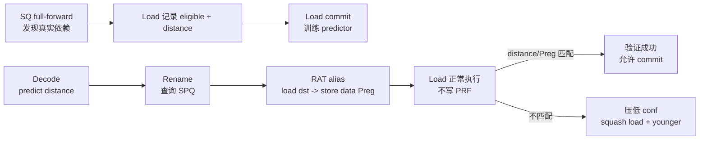

# Store-to-Load Memory Renaming 设计

## 1. 目标与范围

本文定义一种独立于值预测器的 store-to-load memory renaming 机制。机制预测
load 所依赖的 older store，在 rename 阶段把 load 的架构目的寄存器直接映射到
该 store 的数据物理寄存器，从而把稳定的内存依赖转换为寄存器依赖。

第一版只支持以下两种 8 Byte、单 store 完整覆盖的标量转发：

```text
sd  -> ld
fsd -> fld
```

第一版不支持：

- `sw/lw/lwu`、`sh/lh/lhu`、`sb/lb/lbu` 等需要截断或扩展的组合；
- 一个 load 由多个 store 共同覆盖的 forwarding；
- split/vector load/store；
- atomic、LR/SC、MMIO 和 strictly-ordered 访问；
- store-data rename mapping 携带 `IEOperand` 等尚未物化的值变换；
- 与 Value Predictor 共用预测结果、训练记录或恢复状态。

这里的预测对象是“哪个 older store 是该 load 的 producer”，不是 load 的数值。
即使某个错误 producer 恰好产生相同数值，也不能把该次预测视为正确的依赖预测。

## 2. 核心行为



机制分为三个相互独立但闭环的部分：

1. LSQ 在 SQ full-forward 时发现真实 store-load 依赖，load commit 时训练预测器。
2. Decode 预测 store distance，Rename 通过 SPQ 找到 store-data Preg 并执行 RAT alias。
3. Load 继续执行以验证 producer，但实际结果不写共享 Preg；失败时恢复并重放。

## 3. 第一版正确性条件

一次样本只有同时满足以下条件，才是可训练、可验证成功的 memory-renaming
依赖：

- load 从 SQ 而不是 Store Buffer 或 cache 获得 full-forward；
- forwarding 的全部 8 Byte 来自同一个 older store；
- load/store 起始地址和访问范围完全相同；
- 指令对是 `sd -> ld` 或 `fsd -> fld`；
- forwarding store 的 data source 是无 `IEOperand` 的直接 Preg 映射；
- 实际 producer distance 等于预测 distance；
- 实际 forwarding store 的数据 Preg 等于 load rename 时选择的预测 Preg；
- load 无 fault，且访问不属于第一版排除的类型。

同时检查 distance 和 Preg。distance 验证 producer 位置，Preg 验证 SPQ 选择和
store-data 映射一致。动态 store seqnum 和 PC 可以进一步验证模拟器实现，但不属于
第一版硬件判定条件。

## 4. Distance 定义

distance 是 memory-renaming predictor 唯一的 producer 预测载荷。它按程序顺序
中的 store 数量定义：

```text
distance = producer store 与 load 的 store 边界之间的 store 数量
```

采用 0-based 编码：

```text
distance = 0：最近的 older store
distance = 1：倒数第二个 older store
...
```

在 SQ full-forward 时，概念上的计算是：

```text
actualDistance = loadSqIterator - producerSqIterator - 1
```

在 Rename 查询 SPQ 时：

```text
target = SPQ[tail - 1 - predictedDistance]
```

不能把可回绕、可复用的物理数组下标直接作为 predictor distance。gem5 使用
VirtualSQ 的单调递增 CircularQueue iterator 计算实际逻辑距离。SPQ 查询不需要额外
ordinal，直接按当前窗口尾部的相对位置选择 producer。

### 4.1 SQ 与 SPQ 的顺序不变量

SQ 和 SPQ 的 store 顺序必须一致。因此所有经过 rename 的逻辑 store 都必须在 SPQ
窗口中占一个位置，包括当前不能用于 memory renaming 的 store。不能只把 `sd/fsd`
放入 SPQ，否则中间的 `sw`、vector store 或 atomic 会造成相对位置错位。SPQ 容量
淘汰可以移除最老位置；若预测 producer 已离开当前窗口，Rename 必须回退到普通
rename，而不能选择另一个 store。

split store 的地址/数据 uop 只能对应一个逻辑 SPQ entry，不能重复入队。

## 5. Predictor

Memory Rename Predictor 是独立预测器，不挂接现有 Value Predictor 的
`VPResult`、prediction record、训练或统计通路。

第一版采用 N 路组相连表。使用 load PC 的 hash 产生 set index 和 tag。

### 5.1 表项

```text
valid
loadTag
distance
confidence
useful
replacement state（如需要）
```

distance 是表项中唯一的 store producer 描述。表项不保存 producer store PC 或
producer seqnum。完整 load/store PC、动态 seqnum 和 hash 可以在 gem5 中额外记录，
用于 debug、trace 和离线分析，但不能参与第一版功能判断。

distance 位宽至少能够覆盖 VirtualSQ 的逻辑容量：

```text
distanceBits = ceil(log2(VSQEntries))
```

### 5.2 Decode lookup

Decode 对受支持的 `ld/fld` 查询 predictor。tag 命中且 confidence 达到阈值时，
在 DynInst 中记录：

```text
memRenamePredicted = true
predictedDistance
predictor provider/set/way handle
```

provider handle 用于定位后续可能需要压低的表项。它是预测器控制元数据，不是
producer 身份。执行失败时不能无条件修改 decode 时记录的 set/way，因为期间该 way
可能已被 commit 更新或替换。失败处理必须使用 load PC 重新 lookup，并且只在当前
tag 命中且当前 distance 仍等于 predicted distance 时压低 confidence。这样既不会
错误抑制无关的新表项，也不需要把 producer store PC 加入硬件状态。

### 5.3 Commit-only training

预测器的分配、distance 学习、useful 更新和正常 confidence 训练只能由已经 commit
的 load 触发。wrong-path 或被 squash 的 load 不能产生正常训练。

SQ full-forward 时，load 记录硬件必须保留到 commit 的训练信息：

```text
memRenameTrainEligible
actualStoreDistance
```

gem5 可以同时记录 actual store/load PC 和 seqnum，但这些字段只用于 debug。

commit 更新建议采用以下规则：

- 无匹配表项：按替换策略分配，写入 actual distance 和初始 confidence；
- 表项 distance 与 actual distance 相同：增加 confidence，并按策略增加 useful；
- 表项 distance 不同：降低旧模式 confidence；达到替换条件后学习新 distance；
- 没有 eligible SQ full-forward：不进行正向训练或新分配。

### 5.4 失败抑制不是正常训练

预测失败后，原 load 会被 squash，无法到达 commit。为防止重取后立即使用同一
高置信表项形成无限 squash，验证失败时允许执行阶段把 provider confidence 直接
压到不可预测区，例如：

```text
confidence = min(confidence, predictionThreshold - 1)
```

也可以配置为直接清零。这个动作只用于阻止立即重复预测，不分配表项、不修改
distance、不增加 useful，定义为恢复抑制而不是 predictor training。

被重放的 load 在低 confidence 下走普通 rename；如果它之后正常 commit 且再次从
SQ full-forward，则由该 committed 实例按正常规则重新训练正确 distance。

## 6. Store Preg Queue

SPQ 是每线程 FIFO，按 store 的 rename 顺序保存所有 renamed logical stores。

### 6.1 Entry

第一版 entry 包含：

```text
valid
storeDataPreg
storeSeqNum / 等价的流水线 age tag
```

`storeDataPreg` 是 store 数据源在 rename 后对应的物理寄存器。Preg 自身携带寄存器
类型，Rename 必须确认 load 目的寄存器类型与目标 Preg 类型一致：

- `ld` 只能 alias integer Preg；
- `fld` 只能 alias floating-point Preg。

当前 gem5 的 `VirtRegId` 还可能携带 constant-folding `IEOperand`。第一版 SPQ 的功能
payload 仍只有 Preg，不把该变换加入映射；如果实际 forwarding store 的 data source
带有 `IEOperand`，则 `actualPairEligible=false`，不能训练或验证成功。该 store 仍必须
在 SPQ 中占位，不能因为不支持变换而破坏 distance。对变换类型的完整建模留到后续
扩展。

store PC、opcode、地址、size 等信息不进入第一版 SPQ 硬件状态。gem5 可以把它们
作为 debug 字段记录。

### 6.2 入队与出队

- Store 源寄存器完成 rename 后，在程序顺序位置 push 一个 SPQ entry。
- 同一 rename bundle 中，older store 的 entry 必须先于 younger load 的查询可见。
- 每个逻辑 store 只 push 一次，split STA/STD 不重复 push。
- SPQ 满时先淘汰最老 entry，再加入新的 store，不阻塞 Rename。
- Store commit 时，若对应 entry 仍在 SPQ 中，则从头部移除。
- Squash 时删除所有比 squash boundary 年轻的尾部 entry。
- 已因容量淘汰的 entry 不因 commit 或 squash 恢复。
- seqnum/age tag 只用于 commit 和 squash 的窗口清理。

SPQ entry 本身不增加 Preg refcnt。Store commit 以前，正常程序顺序保证其数据源
Preg 存活；当 load 真正执行 RAT alias 时，现有 rename-map refcnt 逻辑会为新的
架构映射增加引用。

### 6.3 容量

SPQ 容量直接等于 VirtualSQ 的逻辑容量，并作为固定大小的滑动窗口。SPQ 满时淘汰
最老 entry，不新增 SPQ backpressure 或 rename stall。由于 SPQ 在 Rename 入队，而
VirtualSQ 在 Dispatch 入队，窗口可能淘汰仍位于 VirtualSQ 中的最老 store；这种
情况只降低 memory renaming 覆盖率，不影响 SQ 的程序正确性。

gem5 实现记录 occupancy/max-occupancy 和 eviction 次数。若预测 distance 超出当前
SPQ occupancy，计入 `spqDistanceOutOfRange` 并回退到普通 rename。该情况不代表
predictor 的 store distance 错误，因此不压低 confidence。

## 7. Rename 与 RAT Alias

Decode 只提供 predicted distance。真正的 producer 选择发生在 Rename：

1. 检查 `predictedDistance < SPQ occupancy`。
2. 按 `SPQ[size - 1 - predictedDistance]` 读取 SPQ entry。
3. 检查 entry valid，且 Preg 类型与 load destination 类型一致。
4. 使用现有 move-elimination 风格的 `rename(dest, bypassPreg)` 更新 RAT。

成功应用后，load 保存硬件关键状态：

```text
memRenameApplied
predictedDistance
predictedPreg
predictor provider handle
```

gem5 可附加 predicted store seqnum/PC 用于 debug，但恢复和成功判断不能依赖这些
调试字段。

RAT alias 复用现有物理寄存器 refcnt 和 rename history：

- predicted Preg 增加一个架构映射引用；
- load 不分配新 Preg；
- load commit 后 committed RAT 可以与 store-data source 共享 Preg；
- load squash 时 rename history 恢复旧映射并减少 predicted Preg refcnt；
- Preg 只有在所有共享映射释放后才回到 free list。

如果 SPQ 查询失败、distance 越界或 Preg 类型不匹配，load 回退到普通 rename，
分配新 Preg。该情况是 prediction offered-but-not-applied，不算执行验证失败，也不在
此时修改 confidence。第一版可以保留现有 free-register 准入检查，使 fallback 始终
可执行；之后再优化 memory-renamed load 的 Preg demand 计算。

## 8. 执行与验证

### 8.1 调度语义

memory-renamed load 仍然：

- 分配 LQ entry；
- 进入内存调度和 load pipeline；
- 执行地址翻译、地址计算和 SQ forwarding 检查；
- 等待验证完成后才能 commit。

但它不能作为 predicted Preg 的新 producer，也不能走普通 load PRF writeback：

- scheduler 不为它覆盖共享 Preg 的 producer 关系；
- scoreboard readiness 继承 predicted Preg 原 producer 的状态；
- younger consumers 直接依赖 predicted Preg；
- load 的真实结果只能进入验证临时路径，不能写入共享 Preg。

这需要独立的 `memRenameApplied` 控制，而不能把该 load 当作普通 eliminated move 或
Value-Predicted load 处理。

### 8.2 实际 forwarding metadata

SQ entry 或等价 forwarding metadata 必须能够提供实际 forwarding store 的
store-data Preg。即使 split-store 流程把原 store DynInst 的 data source 清除，
forwarding entry 仍需保留该 Preg，以完成硬件 Preg 比较。

当 load 从 SQ full-forward 时，LSQ 计算：

```text
actualDistance
actualStoreDataPreg
actualPairEligible
```

### 8.3 成功条件

memory-renamed load 验证成功要求：

```text
actualPairEligible
actualDistance == predictedDistance
actualStoreDataPreg == predictedPreg
load fault == NoFault
```

成功后：

- 不写 PRF；
- 标记 load 已执行、验证完成并允许进入 commit；
- 不通过 load 自己重新 wakeup predicted Preg 的 consumers；
- commit 时使用 actual distance 正常训练 predictor。

### 8.4 失败条件

以下情况都属于预测失败：

- 没有从 SQ full-forward；
- full-forward 来自不同 distance 的 store；
- actual store-data Preg 与 predicted Preg 不同；
- 不是第一版支持的 8 Byte 指令对或 exact coverage；
- 验证期间发现不能使用该预测的其他条件。

失败后：

1. 不写 predicted Preg。
2. 把 provider confidence 压到 prediction threshold 以下。
3. 发起包含该 load 本身及所有 younger instructions 的 squash。
4. Rename rollback 恢复 load destination 的旧 RAT 映射并减少 predicted Preg refcnt。
5. 从该 load PC 重取；低 confidence 保证重放实例走普通 Preg 分配。

必须 squash load 本身。只 squash younger instructions 会保留错误的 load destination
RAT alias，无法像当前拥有独立目的 Preg 的 LVP load 那样继续提交。

如果 load 发生 architectural fault，则不把该实例作为正确训练样本；由正常异常路径
恢复其 RAT 和 younger speculative state。

## 9. 硬件状态与调试状态边界

| 位置 | 第一版硬件/行为必需状态 | 仅 gem5 debug/stats |
| --- | --- | --- |
| Predictor entry | valid、load tag、distance、conf、useful、replacement | 完整 load PC、命中/替换原因日志 |
| Decode/Rename load | predicted flag、distance、provider handle、predicted Preg | predicted store PC/seqnum |
| Executing load | applied flag、predicted distance/Preg、train eligible、actual distance | actual producer PC/seqnum、地址 trace |
| SPQ entry | valid、store-data Preg、seqnum/age tag | store PC、opcode、地址和 size |
| SQ forwarding metadata | actual store-data Preg、actual distance、eligible result | forwarding store/load PC 和动态 seqnum |

完整 PC 和动态 seqnum 不参与第一版 producer prediction 或验证。seqnum/age tag 在 SPQ
中的用途是 speculative queue maintenance，而不是 predictor feature。

## 10. 与 Value Prediction 的边界

Memory renaming 必须拥有独立的：

- predictor object 和参数；
- prediction record/provider handle；
- DynInst flags 和 metadata；
- debug flags 和 stats；
- validation result；
- squash cause；
- commit training entry point。

不得复用 `vpResult`、`vpMisprediction` 或 Value Predictor 的 update API。可以复用
通用 hash、set/way、饱和计数器和替换算法实现，但不能共享状态或训练事件。

现有 EStride 的 set-associative table、PC hash、tag、confidence/useful 管理可以作为
实现参考或抽取通用 helper；EStride 的 value、stride、inflight-window 和 VP
update 语义不适用于本机制。

## 11. 参数与资源边界

建议第一版提供以下独立参数：

| 参数 | 含义 |
| --- | --- |
| `enableMemRename` | 总开关，默认 false |
| `memRenameEntries` | predictor 总 entry 数 |
| `memRenameWays` | predictor ways |
| `memRenameTagBits` | load PC tag 位数 |
| `memRenameConfBits` | confidence 位数 |
| `memRenameConfThreshold` | 允许预测的阈值 |
| `memRenameUsefulBits` | useful 位数 |

SPQ 容量直接来自 VirtualSQ 逻辑容量，不设置独立容量参数。

热路径复杂度必须有界：

- Decode predictor lookup：固定 ways 次 tag 比较；
- Rename SPQ lookup：O(1) 相对索引；
- SQ full-forward distance 计算：O(1) CircularQueue iterator 差值；
- Commit predictor update：固定 ways 次查找/替换；
- Squash SPQ：只从年轻端弹出被 squash 的 entries。

## 12. 统计与可观测性

至少需要以下独立 stats：

```text
predictorLookups
predictorTagHits
predictorConfident
predictionsOffered
spqLookupApplied
spqDistanceOutOfRange
spqPregClassMismatch
spqEvictions
intAliasesApplied
fpAliasesApplied
validationSuccess
validationFailNoSQForward
validationFailDistance
validationFailPreg
validationFailIneligiblePair
validationFailFault
failureConfidenceSuppressions
commitTrainAllocations
commitTrainMatches
commitTrainDistanceChanges
pregAllocationsSaved
spqOccupancy / spqMaxOccupancy
recoverySquashes
```

Debug trace 应能够打印 load PC/seqnum、predicted distance/Preg、actual distance/Preg、
provider set/way、confidence before/after 和 squash 原因。这些 trace 只解释行为，不
改变预测结果。

## 13. 预期代码边界

后续实现建议沿以下模块边界展开，但不复用仓库中现有不完整的 memory-renaming
实现：

- 独立 predictor：新增 O3 memory-rename predictor 类和 Python 参数；
- `DynInst`：保存 prediction、alias、training 和 validation metadata；
- Decode：执行 predictor lookup；
- Rename：维护 SPQ、选择 predicted Preg、复用 RAT alias/refcnt；
- IEW/LSQ：保留 store-data Preg，产生 actual distance/Preg，禁止预测 load 写 PRF；
- Commit：只对 committed eligible load 执行 predictor training，并在 store commit
  时维护 SPQ head；
- Squash/recovery：维护 SPQ tail，增加独立 memory-renaming squash cause。

### 13.1 可复用的现有基础设施

后续实现可以复用以下通用机制，但不能复用现有不完整 memory-renaming 状态：

- `SimpleRenameMap::rename(arch_reg, bypass_reg)`：已有 move-elimination alias 和 Preg
  refcnt 增加语义；
- `Rename::renameDestRegs()`：生成 rename history，并决定是否清除目标 Preg 的
  scoreboard ready 状态；
- `Rename::doSquash()`：回滚 RAT，并对被撤销的新映射减少 Preg refcnt；
- `Rename::removeFromHistory()`：commit 时释放旧映射，refcnt 归零后返回 free list；
- `LSQUnit::read()` 的 SQ full-forward 分支：发现实际 producer、coverage 和 forwarding
  结果；
- load writeback/完成路径：增加 memory-renamed load 的 no-PRF-write 和 validation
  分支。

其中 RAT alias/refcnt 可以直接沿用 move elimination 的基础设施，但 memory-renamed
load 不能被标记成 empty move：它仍需进入 LQ、执行访存并验证预测。

### 13.2 建议实现顺序

为避免一次同时修改 predictor、Rename、LSQ 和 recovery，建议按以下阶段实现，每一
阶段都保持 `enableMemRename=false` 时与基线一致：

1. 增加独立 predictor、DynInst 训练 metadata 和 commit-only training；此阶段只统计
   predicted/actual distance，不做 RAT alias。
2. 增加每线程 SPQ、store push/commit pop/squash rollback，并验证 SPQ distance 与
   SQ full-forward 计算的 actual distance 一致。
3. 在 Rename 查询 SPQ 并执行 Preg alias，先完成 refcnt、history 和 scoreboard
   不变量检查。
4. 增加 load no-PRF-write、distance/Preg 验证、失败 confidence suppression 和包含
   load 本身的 squash/replay。
5. 增加完整 stats、debug trace、定向测试和性能 A/B。

## 14. 验证计划与验收条件

### 14.1 最小功能测试

1. 重复 `sd -> ld`、distance 0：训练到阈值后 alias 成功，不分配/写入新 Preg。
2. 重复 `fsd -> fld`：验证 floating-point Preg alias 和 refcnt。
3. 中间插入 1 个和多个 store：验证 distance 1/N 的训练与 SPQ 查询。
4. 在 producer 与 load 之间制造 branch squash：验证 SPQ tail rollback。
5. 改变动态 store 顺序：触发 distance mismatch、confidence suppression 和 load replay。
6. 保持 distance 但改变 store-data Preg：触发 Preg mismatch。
7. 使用错误 distance 但相同 Preg：仍必须判定失败，避免退化为值预测。
8. `sw/lw/lwu`：第一版不得训练或成功应用 memory rename。
9. SPQ/SQ index wraparound：VirtualSQ iterator distance 仍保持正确。
10. Predictor hash collision：tag 和 replacement 行为正确。
11. SPQ target unavailable/class mismatch：普通 rename fallback，不触发错误恢复。
12. Load fault：不写共享 Preg、不产生 commit training，正常异常恢复。
13. Store data source 带 `IEOperand`：仍占 SPQ 位置，但不得训练或验证成功。
14. 预测后 provider way 被 commit 替换：失败抑制重新 lookup，不修改无关新表项。
15. SPQ 满时淘汰最老 entry：不阻塞 Rename，后续越界预测回退到普通 rename。
16. SPQ 发生头部淘汰后再 squash：只删除窗口内年轻 entry，不恢复已淘汰 entry。

### 14.2 核心不变量

- memory-renamed load 在任何成功或失败路径都不写共享 Preg；
- 失败恢复后 predicted Preg 内容保持不变；
- squash 后 RAT、Preg refcnt 和 SPQ occupancy 回到正确状态；
- predictor 的正常训练事件只来自 committed load；
- 不支持的 load/store 组合不能成为成功训练样本；
- 关闭 `enableMemRename` 时行为和基线完全一致；
- SPQ occupancy 不超过固定容量，满时每次 push 恰好淘汰一个最老 entry；

### 14.3 性能验证

对相同 workload 比较开关前后：

- IPC 和 load-use latency；
- SQ full-forward 数量及其中 eligible 比例；
- confident prediction 覆盖率、成功率和 recovery 次数；
- 节省的 Preg allocation 数量；
- SPQ occupancy；
- 因错误预测产生的 squash 成本。

性能收益必须来自更早建立的 store-data Preg 依赖，而不是跳过 load 验证、错误写回
共享 Preg 或复用 Value Predictor 的结果。

## 15. 后续扩展

第一版闭环稳定后，可以单独设计以下扩展：

- 为 `sw/lw/lwu`、`sh/lh/lhu`、`sb/lb/lbu` 增加 Preg value transform；
- 在映射中表达 `SignExtend`、`ZeroExtend` 和 byte extract；
- 支持同一 load PC 的多个 producer 模式或路径历史；
- 评估把 producer store PC/signature 加入硬件表项；
- 支持 partial/multi-store forwarding；
- 更细粒度的 selective replay，而不是 squash load 和所有 younger instructions；
- 评估独立 SPQ 容量参数及其他窗口替换策略。

这些扩展不能改变第一版的基本原则：producer prediction 与 value prediction 分离，
共享 Preg 不被预测 load 写回，正常 predictor training 只发生在 load commit。
