# TS-BOP 单 BOP Degree 研究与开发跟踪

> 最后更新：2026-11-20
> 当前阶段：阶段 3 功能实现、`idealkmhv3.py` 与 `kmhv3.py` 全套 A/B、架构级面积评估和参数求解准备已完成；下一步运行 24 小时 CI NSGA-II 参数求解，再回到 0.3c/1.0c 全套复验最优候选。
> 最终参数：`N2/R50/S20 + V2/P0 + Student 4+4 + SF2048 + degree 2 + 2% marginal + P8/E8 + RF128`。
> 完整 10 点静态 replay：local coverage 为 `76.08% / 72.70%`，local sent/demand 为 `1.595 / 1.527`（checkpoint-weighted / access-weighted）；coverage 与双 BOP 基本持平，发送量降低 `13.3% / 9.5%`。
> 已知上限：`gcc_200_5108` 仍比双 BOP 低 3.83 pp；该点作为单一学习域的已知风险保留，不再阻塞当前机制选择。
> 状态：独立 `CompoundBOP` 已按冻结机制接入 L2 composite；`idealkmhv3.py` 可用配置
> 选择，`kmhv3.py` 可通过 `system.l2_wrappers[0].prefetcher.use_compound_bop` 的 py 参数
> 切换。完整构建、C++ 单测、58 项 Python replay 单测和配置冒烟已通过；实现后 trace
> 对齐仍待完成。
> 阶段 3 全套结果：Compound 与双 BOP 的 SPEC06 0.3c Overall score/GHz 分别为
> `24.18755 / 24.18906`，差值 `-0.0063%`；按当前逻辑资源估算，BOP 子系统物理
> 面积预计减少 `25%--40%`，中心估计约 `30%`，该数字不是 RTL 综合结果。
> `kmhv3.py` 结果：0.3c / 1.0c Overall 分别为 `+0.0789% / +0.1237%`，BOP issued
> 分别降低 `5.40% / 7.38%`。已注册 16 点 `bop-key` 集合作为后续 SimPoint 加权求解输入。
> 阶段 3 确认调整：Student entry confidence 改为 VBOP/PBOP 子池分别选择 best/worst 并更新；阶段 2d 的全局 pool 更新结果保留为历史数据，需用新语义重新 replay。

## 1. 背景与目标

当前 L2 同时运行 TS-VBOP 和 TS-PBOP。两个独立 BOP 带来重复的 Teacher、Student、RR/filter 和请求缓冲资源，也提高了预取请求量和 L2 访存带宽压力。

目标是只保留 VBOP，把 PBOP offsets 合并回 VBOP offset list，并通过 Student degree 在一次访问上选择多个 offset，尽量恢复双 BOP 的覆盖率，同时保护 primary 请求的及时性。

本研究先回答三个问题：

1. degree 是否真正带来不重叠的额外模式覆盖，而不是只增加同一流上的 lookahead。
2. degree、额外 offset 选择策略和 coverage threshold 的初始参数应如何设置。
3. 在单 BOP、单周期有限发送带宽和有限 FIFO 下，覆盖率收益能否转化为及时预取。

## 2. 已确定的设计边界

- 只保留 VBOP；VBOP offset list 恢复为 VBOP/PBOP offsets 的并集。
- 当前 family-partition 最终选择将 pool 扩为
  `VBOP 4 + PBOP 4`，但把 Student filter 从 4096 降为 2048 entries，使 filter
  bit 总量保持 `4096*4 = 2048*8 = 16384 bits`。新增开销主要是 4 个 Student
  entry 的 offset/coverage/confidence 元数据。
- issue `degree=2`：每个 family 最多选择一个 offset，而不是发送 pool 中全部候选。
- primary offset 仍是当前覆盖率最高的 Student offset。
- 早期 merged 分支支持两种可配策略：
  - `raw_rank`：按各 offset 的独立覆盖率排序。
  - `greedy_marginal`：先选 primary，后续每次选择对尚未覆盖请求贡献最大的 offset。
- 当前 4+4 最终选择采用 family-independent：先从 VBOP/PBOP 子池各选独立
  coverage 最高者，再对第二名执行 marginal threshold。extra 用于扩大访问模式
  覆盖，不以同一流的更远 lookahead 为目标。
- extra 使用独立的非零 coverage threshold；primary 继续使用当前门控语义。extra threshold 以“占本 phase 全部可训练请求的新增覆盖率”为分母，而不是以剩余未覆盖请求为分母。
- Teacher 仍只有一套 score/pointer/phase；phase 结束时从历史 VBOP/PBOP family
  各取最高分 offset。VBOP 仅在 `score > 2` 时输出 winner，PBOP 仅在
  `score > 0` 时输出 winner，不恢复第二套 Teacher 状态。
- VBOP/PBOP 各维护一套 4-bit issue-confidence；一个 family 不通过资格时只能
  关闭自身发送，不能连带关闭另一个 family。
- Student entry confidence 也按 family 分离：VBOP 4-entry 子池和 PBOP 4-entry
  子池分别选择 best/worst 更新 confidence；Teacher winner 只在对应子池内替换。
- 请求缓冲拆成 Primary FIFO 和 Extra FIFO。extra 不得挤出 primary；出队采用 work-conserving 的偏置轮询。
- shared recent-address filter 必须位于 Primary/Extra FIFO 入队前。当前代码先写
  `PFRequestBuffer` 再查 filter，若直接复用会让已过滤请求通过 buffer 路径再次
  发送；容量扫描后由 256 entries 下调为 128 entries。

上述条目是原始“单 merged VBOP”目标的设计边界。阶段 2d 另增加一个架构
对照：共享 RR/history 和输出资源，但保留 VBOP/PBOP 两套异步 Teacher/Student
context。该对照用于判断需要恢复多少独立学习语义，不能称为单一学习域 BOP。

阶段 2d 冻结的最终机制与参数为：

```text
teacher_offset_count    = 109
teacher_tests_per_access= 2
teacher_round_max       = 50
teacher_score_max       = 20
teacher_family_bad_score= VBOP 2 / PBOP 0
teacher_family_pass     = family_best_score > family_bad_score
teacher_family_winners  = at most VBOP 1 + PBOP 1
issue_confidence        = two independent 4-bit counters, initial 0
issue_confidence_update = pass -1 / fail +2, saturating [0, 15]
issue_confidence_gate   = issue when family confidence < 14
student_pool            = VBOP 4 + PBOP 4
student_issue_degree    = 2
student_selection       = independent best per family
student_primary_threshold= 0
extra_coverage_threshold= 2% marginal coverage
student_filter          = 2048 entries, pairs_low9
VBOP student delay      = 300 cycles
PBOP student delay      = 0 cycles
primary_fifo / extra_fifo = 8 / 8
primary:extra arbiter   = 3:1, work-conserving
recent filter           = shared 128 entries, before both FIFOs
```

`round_max=16/25`、`score_max=16/31`、pool `2+2`、Student filter 4096、Extra FIFO 4、recent
filter `0/32/64/256` 均保留为 sensitivity。上述组合已实现为独立 `CompoundBOP`，
静态结果仍只作为实现后 closed-loop 验证的参考。`R50/S20` 允许 score threshold 提前结束；
baseline 中 `cactusADM_163`、`bwaves_13153` 和 `milc_30106` 的 average rounds 分别为
33.27、41.07 和 25.66，其余点主要由 round threshold 结束。

### 2.1 Primary / Extra 选择与阈值

当前 4+4 Student 严格分为 VBOP family 和 PBOP family，每个 phase 结束时按以下
顺序选择，最多输出两个 offset：

1. 在 VBOP 四个槽中选择独立 coverage 最高的 offset，在 PBOP 四个槽中也选择
   独立 coverage 最高的 offset。coverage 相同时依次用 confidence、较小绝对
   offset 等规则打破平局。
2. 两个 family winner 中，独立 coverage 排名更高的作为 primary；另一个作为
   extra 候选。如果当前 pool 只有一个 family，则只选择一个 primary。
3. primary coverage 为 `primary_hits / phase_train_count`。当前
   `student_cov_threshold=0`，因此只要 pool 非空，primary 不受正 coverage 阈值
   淘汰；最终发送受对应 family 的 issue-confidence、recent filter 和 FIFO 约束。
4. extra 不使用自身独立 coverage 直接过阈值，而计算相对 primary 的新增覆盖：

```text
extra_marginal = count(extra_hit && !primary_hit) / phase_train_count
```

只有 `extra_marginal >= 2%` 才选择 extra，否则本 phase 只发送 primary。分母始终
是本 phase 全部可训练请求，不是 primary 未覆盖请求的数量。

因此当前策略是“每个 family 先独立选最好，再用 marginal threshold 决定第二个
是否值得发送”，并不是在全部剩余 7 个 offset 中直接搜索 marginal coverage
最大的候选。

离线模型为 pool=8 统计 8-bit `hit_mask` 的 256 项直方图，以精确计算 union 和
marginal coverage。该结构不应直接照搬到硬件；当前只发送跨 family 的 degree-2
pair，实现时只需 8 个单 offset coverage counter 和最多 `4*4=16` 个跨 family
overlap counter。给定已选集合 `S`，候选 `i` 的新增覆盖为：

```text
marginal(i | S) = sum(hist[mask])
                  where (mask & S) == 0 and mask contains i
```

该方法可以精确计算 pool 内 offset 的 union/marginal coverage，不需要第二套 BOP。

### 2.2 Family winner 与独立 issue-confidence

每个共享 Teacher phase 结束时执行以下状态更新：

1. 在 72 个 VBOP offsets 中取最高分 offset，在 37 个 PBOP offsets 中取最高分
   offset；两个 family 使用同一 score table、测试指针和 phase 边界。
2. VBOP family 资格为 `vbop_best_score > 2`，PBOP family 资格为
   `pbop_best_score > 0`。比较是严格大于，因此最低有效 score 分别为 3 和 1。
3. 只有通过资格的 family winner 才注入对应的四槽 Student 子池；不通过不会清空
   该 family 已有 Student entries。
4. 每个 family 独立维护 4-bit 饱和 confidence。通过时减 1，不通过时加 2；
   confidence 小于 14 时允许该 family 发送，大于等于 14 时关闭该 family。
5. Student 完成跨 family degree-2 选择和 2% marginal 检查后，每个 offset 再按
   自身 family confidence 门控。若原 primary 被关闭而 extra 仍允许，extra 晋升为
   primary；若两个 family 都被关闭，本 access 不发送。
6. 当前 access 使用 phase 结束前的 confidence 做发送决策，phase 结束产生的新
   confidence 从下一 access 生效。这是最终静态 runner 和后续功能实现需要保持的
   同步状态机语义。

全局 best score 仍用于 `S20` 提前结束共享 Teacher phase，但不再用一个全局
issue-confidence 同时控制两个 family。这里的 family issue-confidence 也不同于
`StudentEntry.conf`：前者控制是否发送，后者只用于 Student entry 排序、平局处理和
淘汰。

## 3. 当前机制与主要风险

历史 TS-BOP 配置中：

| 项目 | VBOP | PBOP |
| --- | ---: | ---: |
| Teacher offsets | 72 | 37 |
| Student pool | 4 | 8 |
| Student coverage threshold | 0% | 5% |
| Student coverage delay | 300 cycles | 0 |

合并后共有 109 个唯一 offset。当前每个 access 连续测试两个 offset，
`round_max=50` 时一个完整 phase 最多需要 `109 * 50 = 5450` 次 offset test，
约对应 2725 个训练 access。它虽然移除了第二套 BOP，但 phase 内仍需遍历合并后的
完整 offset list；degree 只能补发多个 offset，不能消除 winner 更新时序差异。

当前代码状态：

- Student 每个 phase 只保存并发送一个 selected offset。
- `student_teacher_top_n > 1` 目前只告警，仍只注入 Teacher best offset。
- 每个 BOP 的 `PFRequestBuffer` 当前配置为 16 项 FIFO，满时覆盖最老请求。
- L2 当前优先发送 VBOP，再发送 PBOP；合并后需要显式区分 primary/extra 的资源竞争。
- BOP 当前在写入 `PFRequestBuffer` 后才检查 shared filter，合并实现需要调整该顺序，保证过滤发生在两个 FIFO 之前。
- 现有 `BOPTrainTrace` 只记录 RR lookup 命中的打分事件，不能作为完整 BOP 输入流，也不能还原全部 L2 demand access。
- 新增的 `L2AccessTrace`、`BOPInputTrace` 和 `ArchDBTraceMarker` 仅增加观测性，不改变 BOP 训练、选择或发送行为。

已有两个历史原型可作为离线对照，但不直接作为最终方案：

- `f6b02610bf`：把 PBOP offsets 合并到 VBOP，并停止调用 PBOP。
- `27cef9edb0`：按独立覆盖率发送 top-2 offset；没有消除 coverage overlap，且两个请求共用覆盖式 FIFO。

## 4. 评价口径

文档中的 coverage 分为五类，不能直接互换：

| 名称 | 计算方式 | 用途 |
| --- | --- | --- |
| Student phase estimated coverage | `offset phase filter/hash hit / phase train access` | Student primary 选择和历史敏感点筛选；`studentCovRatioPctDist::mean` 是各 phase 等权、整数百分比采样的均值，不是 cache useful coverage |
| Student marginal coverage | `尚未被已选集合覆盖、但被候选 offset 命中的 phase train access / phase train access` | `greedy_marginal` 选择 extra 和执行 extra threshold；分母始终是整个 phase |
| Address-match ideal coverage | `此前存在同 key accepted candidate 的 measurement demand / measurement demand` | 判断 Teacher/Student/degree 机制的地址覆盖潜力；key 为 `(context, secure, cache block)` |
| BOP-local sent coverage | `candidate 已离开 BOP 本地 FIFO 后才到达的匹配 demand / measurement demand` | 评估 recent filter、Primary/Extra FIFO、出口带宽和仲裁的影响 |
| Runtime first-hit coverage | `PfFirstHit && PfSource == HWP_BOP / measurement demand` | 原双 BOP 在 gem5 中真正形成及时 first useful hit 的实际覆盖率 |

Student estimated/marginal coverage 是 offset 选择的内部估计量；后面三类才是
以 demand 为对象的覆盖率。`raw_rank` 当前按独立 Student coverage 排序并执行
threshold，`greedy_marginal` 才按新增 coverage 排序并执行 threshold，因此相同
threshold 数值在两种策略下不是完全相同的语义。

当前 analyzer 通过 `L2AccessTrace` 与 VBOP、PBOP 两条 `BOPInputTrace` 的
inner join 构造输入。在现有双 BOP trace 中，每个记录到的 L2 demand 都有两条
BOP 输入，因此三种 demand coverage 使用相同 measurement demand 分母。实现
单 BOP 后重新采集 trace 时，需要把该查询改为适配单一 BOP 输入。

同一 demand access 最多计入一次覆盖。离线报告至少包含：

- `degree=1` primary ideal coverage。
- degree-N union ideal coverage。
- 每个 extra rank 的 marginal coverage，以及 marginal coverage / extra request。
- `raw_rank` 与 `greedy_marginal` 在相同请求数下的差异。
- 原双 BOP 的实际 HWP_BOP hit coverage、理想 coverage 和两者差值。
- primary/extra 生成量、重复地址、跨页过滤、FIFO drop、排队延迟和 late 比例。

Runtime first-hit 与 address-match ideal 的差定义为 ideal-to-actual gap。late
MSHR/PFQ 命中单独报告，不混入 timely first-hit coverage。

离线 ideal coverage 分两层：

1. **地址上界**：生成地址在之后出现 demand access 即认为覆盖，用于判断机制是否有覆盖潜力。
2. **资源约束结果**：加入每周期发送限制、Primary/Extra FIFO 和仲裁，并按时间顺序判断是否及时。

第二层按 candidate 实际离开本地 FIFO 的时刻重新匹配 demand。当前模型会把被
较早 demand 追上的 queued candidate 记为 FIFO late，但保留在本地 FIFO；它随后
发出时仍可能覆盖下一次同址 demand。因此 BOP-local sent coverage 在个别点可能
略高于 address-match coverage，它是“本地发送后的重新匹配结果”，不保证是第一层
的严格子集。父 PFQ 的 demand squash、cache snoop 和 cache 状态仍不在该模型内。

逐 checkpoint 的 coverage 先各自计算，再提供三种汇总口径：

```text
unweighted            = sum(checkpoint coverage) / checkpoint count
checkpoint-weighted   = sum(profile weight * checkpoint coverage) / sum(weight)
access-weighted       = sum(covered demand) / sum(measurement demand)
```

离线 replay 固定使用记录到的 BOP 输入流，因此是 open-loop 比较。新方案会改变 hit/miss、prefetch-on-prefetch-hit 和后续训练流，最终必须通过实现后的第二轮 trace 验证 closed-loop 差异。

## 5. 阶段 1：敏感 checkpoint

历史对照：

| 配置 | Actions run | Commit | Overall score/GHz |
| --- | --- | --- | ---: |
| TS-BOP 关闭 | `42751101157` | `14fcdbab131f` | 22.879580 |
| TS-BOP 开启 | `42751101141` | `6d7ee5602237` | 22.930199 |

本地归档：

```text
/nfs/home/share/gem5_ci/performance_data/spec06-rva23-novec-gcc16-0.3c/20261110_115357_14fcdbab_kmhv3_run2057
/nfs/home/share/gem5_ci/performance_data/spec06-rva23-novec-gcc16-0.3c/20261110_115131_6d7ee56022_kmhv3_run2058
```

总体变化为 `+0.221%`。两个 commit 之间只修改了 `Prefetcher.py`、`bop.cc` 和 `bop.hh`，但该对照同时包含 Student 机制和 VBOP/PBOP offset list 划分变化，因此只用于定位敏感点，不作为 degree 的因果结论。

从两个归档的 145/145 个配对 checkpoint 中读取最后一个 stats block。排序主指标为：

```text
weighted_abs_impact = checkpoint_weight * abs(IPC_ts_bop / IPC_base - 1)
```

再结合 VBOP/PBOP `studentCovRatioPctDist::mean`、生成量和正负收益保留最多 10 个 checkpoint，每个 workload 最多 2 个。这里的 VBOP/PBOP coverage 是 Student phase 内部估计值，不是 cache 实际 useful coverage。

| checkpoint | weight | IPC delta | VBOP/PBOP coverage | VBOP/PBOP generated | 选择目的 |
| --- | ---: | ---: | ---: | ---: | --- |
| `omnetpp_18492` | 0.313 | +5.79% | 41.2% / 51.8% | 0.49M / 0.49M | 高权重、明显收益 |
| `cactusADM_163` | 0.560 | -2.97% | 58.2% / 94.9% | 0.13M / 0.13M | 高权重、高覆盖、明显回退 |
| `mcf_12886` | 0.149 | -6.78% | 27.5% / 48.3% | 0 / 2.45M | 最大回退、PBOP 带宽压力 |
| `milc_28462` | 0.075 | +10.41% | 81.8% / 77.4% | 0.44M / 0.44M | 最大收益、双高覆盖 |
| `bwaves_13153` | 0.720 | +1.03% | 49.8% / 80.2% | 0.34M / 0.34M | 最高权重、双 BOP 活跃 |
| `astar_biglakes_6185` | 0.172 | +3.02% | 50.4% / 45.8% | 0.09M / 0.09M | 双覆盖接近、明显收益 |
| `leslie3d_18494` | 0.182 | +2.34% | 23.8% / 79.1% | 0.27M / 0.27M | PBOP 补充覆盖明显 |
| `mcf_6753` | 0.219 | +1.72% | 26.3% / 44.1% | 0.98M / 1.76M | 高流量、与 mcf 回退点对照 |
| `gcc_200_5108` | 0.143 | -2.26% | 36.2% / 51.6% | 0.13M / 0.13M | 中等覆盖、明显回退 |
| `milc_30106` | 0.085 | -3.71% | 84.8% / 79.1% | 0.36M / 0 | 双高覆盖但性能回退 |

该集合包含 6 个收益点和 4 个回退点，既用于验证覆盖率上限，也用于约束额外流量和 timely regression。

## 6. 阶段 2：Trace 与离线 Replay

### 6.1 Trace 需求

已新增 ArchDB L2 demand access trace，记录：

```text
AccessSeq, Tick, PAddr, VAddr, HasVAddr, PC, ContextId, Secure,
Result(hit/miss/late_mshr/late_pfq), HitOrLatePfSource,
WasPrefetched, FirstUsefulHit, TrainVBOP, TrainPBOP
```

另记录 BOP 实际输入事件，避免从 cache 结果反推训练流：

```text
AccessSeq, Tick, BOPKind, TrainAddr, CacheMiss, Late, PfSource
```

新 trace 还记录每个 BOP 输入执行前已经可见的 RR 写入总数：

```text
RRInsertCount
```

仅用 tick 无法在所有 checkpoint 上恢复 RR delay event 与同 tick L2
access 的事件队列先后关系。`RRInsertCount` 直接记录访问前的 RR 可见状态，
离线 replay 据此推进 delay queue；该字段只增强观测性，不改变 Teacher、
Student、RR 或预取发送行为。旧 trace 缺少该字段时仍使用原 tick 规则回放。

`AccessSeq` 用于处理同 tick 多访问并保证 replay 顺序。PAddr/VAddr 都保留，离线使用各 BOP 实际消费的 `TrainAddr`；不能只记录一个模糊的 address。

`ArchDBTraceMarker(Tick, AccessSeq, Event)` 在统计 reset 后记录 `MeasurementStart`。离线 replay 从 trace 起点预热全部状态，只用 `AccessSeq > marker.AccessSeq` 的访问评价测量段，避免同 tick 边界歧义。

Trace 写入使用 prepared statement，并放在单一 SQLite transaction 中，减少高流量逐条提交开销。

第一轮 trace 使用原始双 TS-BOP 配置，因为它同时提供原始 BOP 的实际 hit source 和可回放训练流。若 open-loop 偏差过大，再增加 BOP-off trace 作为 demand-stream 对照。

### 6.2 Replay 对照组

1. 原始 TS-PBOP + TS-VBOP。
2. 合并 VBOP，`degree=1`。
3. 合并 VBOP，`degree=2/3 + raw_rank`。
4. 合并 VBOP，`degree=2/3 + greedy_marginal`。

每个离线预取记录 scheme、rank、offset、地址、生成 tick、Primary/Extra 类别和过滤结果。匹配后续 demand 时按地址、context 和时间顺序去重，一个 demand 只归属最早的有效预取。

### 6.3 初始参数矩阵

| 参数 | 第一轮取值 | 初始关注点 |
| --- | --- | --- |
| `degree` | 1, 2, 3 | 重点比较 1 与 2；3 只看是否仍有稳定 marginal gain |
| extra policy | `raw_rank`, `greedy_marginal` | 期望 marginal 在相同流量下更高 |
| extra threshold | 0%, 2%, 5%, 10% | 0% 给上界；根据覆盖和流量共同选择实现候选 |
| `student_teacher_top_n` | 1, 2 | Teacher 算法不变，只比较多 winner 是否改善 pool 多样性 |
| Primary:Extra 仲裁 | unconstrained, 2:1, 3:1, 4:1 | 3:1 为初始实现候选 |
| FIFO | Primary 8 + Extra 4/8 | extra 不得覆盖或阻塞 primary |

研究主候选为 `degree=2 + greedy_marginal`。早期预设的 5% threshold
不是既定结论。最终 10 点结果支持 2% 作为初始值；`student_teacher_top_n`
保持 1，FIFO 暂定 Primary 8 + Extra 4，仲裁暂定 3:1。

### 6.4 Trace 校准状态

`omnetpp_18492` 的 10 万指令 pilot 已完成：

- `L2AccessTrace` 4,936 行，`BOPInputTrace` 9,872 行。
- 每个 L2 access 严格对应一条 VBOP 和一条 PBOP 输入；orphan、tick mismatch、训练地址 mismatch 均为 0。
- `MeasurementStart` 位于 `Tick=50,019,930`、`AccessSeq=2725`；前后分别有 2,725 和 2,211 条 L2 access。
- SQLite integrity check 为 `ok`，DB 为 692,224 bytes。
- replay 的 VBOP/PBOP `pfGenerated`、`throttledCount`、Student phase、Student issue 和 Teacher injection 在预热/测量两个区间共 20 项计数均与 gem5 stats 完全一致。
- pilot 测量段中，原双 BOP 地址上界 ideal coverage 为 16.33%，实际 `HWP_BOP` first-hit coverage 为 7.19%。该差值尚未加入 FIFO、发送时机和 cache 状态约束，不能直接解释为可实现收益。
- 合并 109-offset Teacher 在 4,936 次训练内尚未结束首个 phase，因此短 pilot 的 merged coverage 为 0；这验证了完整样本和 phase 预热的必要性，不是 degree 无效的结论。

离线工具位于 `util/ts_bop_degree/analyze.py`。

它已支持当前双 BOP、merged degree 1/2/3、`raw_rank`、
`greedy_marginal`、extra threshold、`student_teacher_top_n=1/2`、
Primary/Extra 独立 FIFO、work-conserving 偏置仲裁、FIFO drop、发送前被
demand 追上、排队延迟和 lead cycles。

10 个完整 trace 均已完成。每个样本 warmup/measurement 的 20 项 scalar
counter，以及 issued/selected/injected offset 分布，都与 gem5 精确一致。
`RRInsertCount` 已解决 `milc_30106` 和两个 mcf 样本的同 tick RR event
顺序歧义，最终校准状态为 10/10。

### 6.5 十点最终结果

以下加权值只代表选出的 10 个 BOP-sensitive checkpoint，不是全套 workload
性能估计。

#### 地址覆盖上界

| 方案 | checkpoint-weighted coverage | access-weighted coverage | generated/demand（access-weighted） |
| --- | ---: | ---: | ---: |
| 原双 BOP | 76.59% | 59.79% | 1.425 |
| merged degree 1 | 63.63% | 45.30% | 0.800 |
| degree 2 raw，threshold 5% | 71.42% | 56.00% | 1.599 |
| degree 2 greedy，threshold 2% | 73.04% | 56.75% | 1.598 |
| degree 2 greedy，threshold 5% | 72.70% | 55.96% | 1.533 |
| degree 3 greedy，threshold 2% | 77.04% | 62.32% | 2.285 |

逐 checkpoint 的地址 ideal coverage 如下。`D2-Dual` 为 degree-2 greedy 2%
相对原双 BOP 的差值；正数表示合并方案地址覆盖更高。

| checkpoint | weight | Dual | D1 | D2 raw 5% | D2 greedy 2% | D2 greedy 5% | D3 greedy 2% | D2-Dual |
| --- | ---: | ---: | ---: | ---: | ---: | ---: | ---: | ---: |
| `omnetpp_18492` | 0.313 | 62.14% | 41.39% | 47.59% | 51.86% | 51.86% | 56.36% | -10.28 pp |
| `cactusADM_163` | 0.560 | 98.01% | 96.97% | 98.41% | 98.42% | 98.42% | 98.82% | +0.42 pp |
| `mcf_12886` | 0.149 | 45.08% | 33.60% | 46.71% | 47.02% | 47.02% | 54.38% | +1.94 pp |
| `milc_28462` | 0.075 | 87.96% | 75.81% | 85.30% | 87.68% | 75.92% | 88.34% | -0.28 pp |
| `bwaves_13153` | 0.720 | 80.41% | 63.78% | 71.48% | 74.48% | 74.48% | 80.21% | -5.93 pp |
| `astar_biglakes_6185` | 0.172 | 67.83% | 42.83% | 64.48% | 66.30% | 66.30% | 69.21% | -1.53 pp |
| `leslie3d_18494` | 0.182 | 86.03% | 79.25% | 84.39% | 84.69% | 84.69% | 87.05% | -1.34 pp |
| `mcf_6753` | 0.219 | 54.16% | 32.86% | 45.07% | 44.84% | 44.84% | 51.30% | -9.32 pp |
| `gcc_200_5108` | 0.143 | 51.29% | 36.56% | 51.28% | 52.58% | 52.58% | 61.14% | +1.29 pp |
| `milc_30106` | 0.085 | 99.65% | 99.79% | 99.95% | 99.95% | 99.95% | 99.95% | +0.30 pp |

为了观察 degree 的子项贡献，下表把双 BOP union 按 replay 中最早有效 candidate
的来源做互斥归属。由于 VBOP 先于 PBOP 插入，`PBOP unique` 表示没有先被 VBOP
candidate 占有的覆盖，不等于 PBOP 单独运行时的 coverage。合并方案的 `extra
union gain` 使用 `D2 greedy 2% - D1`，避免 rank 归属顺序影响。

| checkpoint | Dual VBOP attributed | Dual PBOP unique | Dual union | Merged primary-only D1 | Extra union gain | Merged D2 union |
| --- | ---: | ---: | ---: | ---: | ---: | ---: |
| `omnetpp_18492` | 33.90% | 28.24% | 62.14% | 41.39% | +10.47 pp | 51.86% |
| `cactusADM_163` | 65.78% | 32.22% | 98.01% | 96.97% | +1.46 pp | 98.42% |
| `mcf_12886` | 0.01% | 45.07% | 45.08% | 33.60% | +13.42 pp | 47.02% |
| `milc_28462` | 74.76% | 13.20% | 87.96% | 75.81% | +11.87 pp | 87.68% |
| `bwaves_13153` | 51.18% | 29.23% | 80.41% | 63.78% | +10.70 pp | 74.48% |
| `astar_biglakes_6185` | 40.76% | 27.07% | 67.83% | 42.83% | +23.47 pp | 66.30% |
| `leslie3d_18494` | 56.31% | 29.72% | 86.03% | 79.25% | +5.44 pp | 84.69% |
| `mcf_6753` | 16.55% | 37.60% | 54.16% | 32.86% | +11.97 pp | 44.84% |
| `gcc_200_5108` | 16.44% | 34.86% | 51.29% | 36.56% | +16.02 pp | 52.58% |
| `milc_30106` | 99.65% | 0.00% | 99.65% | 99.79% | +0.16 pp | 99.95% |

degree 2 greedy 2% 相比 degree 1 增加 9.41 个百分点的 checkpoint-weighted
ideal coverage，说明 extra offset 确实能提供非重叠模式覆盖。degree 3 能达到
或超过双 BOP 地址上界，但请求量过高，不符合本研究的带宽目标。

#### BOP 局部资源约束

该模型把原双 BOP 建模为 VBOP/PBOP 各 16-entry FIFO、VBOP 严格优先、
总出口每周期一条；候选使用 256-entry pre-FIFO filter、Primary 8、Extra 4
和 3:1 work-conserving 仲裁。两者都不包含 CDP、父 PFQ、cache eviction
和 closed-loop 训练反馈。

| 方案 | coverage（checkpoint-weighted） | coverage（access-weighted） | sent/demand（checkpoint-weighted） | sent/demand（access-weighted） |
| --- | ---: | ---: | ---: | ---: |
| 双 BOP，P16/P16 strict | 76.49% | 59.68% | 1.843 | 1.409 |
| degree 2 greedy 2%，F256 P8/E4 3:1 | 72.84% | 56.65% | 1.434 | 1.403 |
| degree 2 greedy 3%，F256 P8/E4 3:1 | 72.81% | 56.58% | 1.433 | 1.401 |
| degree 2 greedy 5%，F256 P8/E4 3:1 | 72.50% | 55.86% | 1.423 | 1.378 |

下表把原双 BOP runtime first-hit、地址 ideal 和本地发送 coverage 放在同一行。
合并方案尚未实现，因此没有 runtime first-hit；`Local gap` 比较双方各自的本地
发送 coverage。

| checkpoint | Dual runtime first-hit | Dual address ideal | Dual local sent | D2 address ideal | D2 local sent | Local gap D2-Dual |
| --- | ---: | ---: | ---: | ---: | ---: | ---: |
| `omnetpp_18492` | 24.51% | 62.14% | 61.59% | 51.86% | 51.76% | -9.83 pp |
| `cactusADM_163` | 57.82% | 98.01% | 98.01% | 98.42% | 98.41% | +0.41 pp |
| `mcf_12886` | 28.49% | 45.08% | 45.08% | 47.02% | 47.01% | +1.93 pp |
| `milc_28462` | 38.46% | 87.96% | 86.61% | 87.68% | 87.68% | +1.08 pp |
| `bwaves_13153` | 21.62% | 80.41% | 80.41% | 74.48% | 74.40% | -6.01 pp |
| `astar_biglakes_6185` | 19.27% | 67.83% | 67.81% | 66.30% | 66.24% | -1.58 pp |
| `leslie3d_18494` | 22.04% | 86.03% | 85.98% | 84.69% | 83.33% | -2.66 pp |
| `mcf_6753` | 15.29% | 54.16% | 54.28% | 44.84% | 44.82% | -9.46 pp |
| `gcc_200_5108` | 4.25% | 51.29% | 51.07% | 52.58% | 51.48% | +0.41 pp |
| `milc_30106` | 91.26% | 99.65% | 99.65% | 99.95% | 99.95% | +0.30 pp |
| **checkpoint-weighted** | **31.25%** | **76.59%** | **76.49%** | **73.04%** | **72.84%** | **-3.64 pp** |
| **access-weighted** | **27.88%** | **59.79%** | **59.68%** | **56.75%** | **56.65%** | **-3.03 pp** |

逐点结果说明：

- degree-2 extra 对 10 个 checkpoint 都增加 union coverage，但合并方案仍在
  `omnetpp_18492`、`mcf_6753` 和 `bwaves_13153` 分别落后 10.28、9.32 和
  5.93 个百分点，extra 的收益没有补回单 Teacher/统一 Student 带来的损失。
- degree-2 在 `cactusADM_163`、`mcf_12886`、`gcc_200_5108` 和
  `milc_30106` 达到或超过双 BOP，说明机制不是所有模式上都存在固定上限。
- 5% threshold 在多数点与 2% 接近，但使 `milc_28462` 从 87.68% 降至
  75.92%，因此只看加权均值会掩盖明显的逐点退化。
- 本地 FIFO/filter/仲裁对多数点影响很小；候选在 `leslie3d_18494` 和
  `gcc_200_5108` 的本地发送覆盖分别比地址 ideal 低 1.36 和 1.10 个百分点，
  是需要保留逐点资源检查的两个样本。
- 原双 BOP 的 runtime first-hit 与 ideal 差距高度不均匀，尤其
  `gcc_200_5108`、`bwaves_13153` 和 `leslie3d_18494`。因此地址 ideal 只能用于
  筛选机制，不能直接替代实现后的实际 coverage。

主要结论：

- 2% 到 3% 只减少约 `0.002` 次 access-weighted sent/demand，却损失
  0.03 个百分点的加权覆盖；2% 更适合作为初始值。
- 5% 相比 2% 只降低约 1.8% 的 access-weighted 发送量，但
  `milc_28462` 覆盖从 87.68% 降至 75.92%，不够稳健。
- 2% 候选的 primary drop 为 0，extra drop 为 0.148%，FIFO late 为
  0.033%；Primary 8 + Extra 4 已足够。Extra 8 只增加约 0.04 个百分点覆盖。
- 256-entry pre-FIFO filter 把候选的 checkpoint-weighted sent/demand 从
  1.905 降到 1.434，覆盖只从 72.99% 降到 72.84%，因此是必要组成部分。
- 2:1、3:1、4:1 的覆盖差异很小；3:1 保留对 primary 的明确偏向，作为
  初始实现候选。
- `greedy_marginal` 总体优于 `raw_rank`，但不是逐点严格占优；例如
  `mcf_6753` 上低约 0.23 个百分点，因此两种策略继续保持可配。
- Teacher top-2 在 degree 2 greedy 5% 上只增加 0.24 个百分点的加权覆盖，
  且 `gcc_200_5108`、`astar_biglakes_6185` 分别回退 3.78 和 1.34 个百分点；
  默认保持 top-1，不改变 Teacher 学习逻辑。

#### 带宽反例与实际差值

- 候选的 checkpoint-weighted 发送量比双 BOP 低约 22%，但 access-weighted
  发送量只从 1.409 降到 1.403，几乎持平。两个 mcf trace 占本次 demand
  的 65.6%，因此 access-weighted 结果不能忽略。
- `mcf_12886` 是主要反例：候选从双 BOP 的 0.985 增至 1.446 sent/demand，
  同时覆盖增加 1.93 个百分点。是否接受这种 coverage/bandwidth 交换需要
  在阶段 3 review 前明确。
- 原双 BOP 的 gem5 runtime generated/demand 为 1.867（checkpoint-weighted）/
  1.425（access-weighted），issued/demand 为 1.430/1.096，access-weighted
  PFQ-full drop/demand 为 0.251。runtime issued 与局部 FIFO sent 位于不同
  流水级，不能直接比较。
- 原双 BOP 实际 `HWP_BOP` first-hit coverage 为 31.25%（checkpoint-weighted）
  和 27.88%（access-weighted），明显低于离线局部资源 ideal coverage。
  该 gap 说明 cache 状态、父 PFQ、淘汰、及时性和 closed-loop 反馈仍必须
  通过实现后的 trace 验证。

### 6.6 Degree-2 覆盖缺口归因

这里的 ideal coverage 不是所有 offset 的 oracle 上界；它仍包含 Teacher
学习、Student pool、offset 选择和 issue gate，只移除了 cache eviction 等
下游影响。当前 degree-2 greedy 2% 的地址 ideal coverage 为 73.04%，低于
双 BOP 的 76.59%，差 3.56 个百分点。

#### 可以排除的主要因素

| 对照 | coverage 影响 | 结论 |
| --- | ---: | --- |
| greedy threshold 0% -> 2% | -0.01 pp | threshold 不是缺口来源 |
| 候选局部资源损失减去双 BOP 局部资源损失 | -0.09 pp | FIFO/filter/仲裁不是主要来源 |
| degree 2 -> 3 | +4.00 pp | degree 限制能解释加权缺口，但流量代价很高 |

degree 3 的加权 ideal coverage 为 77.04%，可以超过双 BOP；但其
access-weighted accepted request 比双 BOP 高约 62%。此外，degree 3 仍在
`omnetpp_18492` 和 `mcf_6753` 上分别低 5.78 和 2.86 个百分点，因此不能
把问题简化为“degree 再加一即可”。

净缺口主要来自三个 checkpoint：`bwaves_13153`、`omnetpp_18492` 和
`mcf_6753` 分别贡献 1.63、1.23 和 0.78 个百分点，合计 3.64 个百分点；
其他 checkpoint 的超额覆盖抵消了其中一部分。

#### Degree、pool 和 top-N 对照

下表是上述三个主导缺口点的地址 ideal coverage。degree 4 只用于诊断，
违反 `degree < pool_size=4` 的设计约束，也不属于实现候选。

| checkpoint | 双 BOP | P4 D2 top-1 | P4 D3 | P4 D4 diagnostic | P8 D2 | P4 D2 top-2 | round_max=33 |
| --- | ---: | ---: | ---: | ---: | ---: | ---: | ---: |
| `omnetpp_18492` | 62.14% | 51.86% | 56.36% | 58.79% | 53.52% | 52.88% | 53.14% |
| `bwaves_13153` | 80.41% | 74.48% | 80.21% | 81.89% | 73.16% | 75.80% | 75.46% |
| `mcf_6753` | 54.16% | 44.84% | 51.30% | 55.39% | 44.91% | 44.82% | 31.06% |

结论：

- degree 是明显参数限制。发送当前 pool 内全部 4 个 offset 可以补回
  `bwaves` 和 `mcf_6753`，但请求量最高达到 4/demand，且 `omnetpp` 仍未
  达到双 BOP。
- pool 容量不是单独的主因。只把 pool 从 4 扩到 8/12 并不稳定改善，
  因为新增槽位仍依赖同一个全局 Teacher 提供候选，且陈旧候选会参与排序。
- top-2 只能给 `omnetpp`/`bwaves` 增加约 1.02/1.32 个百分点，对
  `mcf_6753` 基本无效，不能替代原来的两个独立 Teacher。
- 简单缩短 `round_max` 虽增加 phase 数量，但会降低 score/issue confidence；
  `mcf_6753` 明显回退。因此问题不是单纯把 phase 调短即可解决。

#### 单 Teacher 与统一 Student 语义

双 BOP 每个 access 并行训练两个 offset；合并后单 Teacher 每个 access 只
训练一个。若每个 phase 使用相同 round 数，合并 Teacher 的 phase 完成频率
相对双 Teacher 合计约为：

```text
(1 / 109) / (1 / 72 + 1 / 37) = 22.4%
```

实际 10 点 trace 中该比例约为 21.8%--24.9%。即使每个 merged phase 输出
top-2，候选更新机会的理论比例也只有约 44.8%，而且两个 winner 仍来自同一
全局排序，不能保证保留 small/large 两类互补模式。Student degree 只能发送
pool 中已经存在的 offset，不能恢复没有及时发现、注入或保留的候选。

具体表现为：

- `omnetpp_18492` 的双 BOP 长期组合是 VBOP `+40` 与 PBOP `+1/+2`；
  merged D2 保留了 `+40`，但 `+1/+2` 的测量段发送次数均为 0。
- `bwaves_13153` 的双 BOP 主要组合是 `+32` 与 `+2`；merged D2 对两者的
  测量段发送次数也均为 0，转而选择 `+8/+10/+5` 等 offset。
- `mcf_6753` 中双 BOP 的 `+1` 发送 1.72M 次，merged D2 只有 0.26M 次。

合并方案还统一继承了 VBOP 的 Student 语义，而原 PBOP 使用 pool=8、无
300-cycle Student coverage delay、不同 hash 和 `bad_score=1`。针对三个主导
缺口点的诊断结果为：

| checkpoint | merged 基线 | 去掉 Student delay | PBOP-style Student + P8 | `bad_score=1` | 双 BOP |
| --- | ---: | ---: | ---: | ---: | ---: |
| `omnetpp_18492` | 51.86% | 54.54% | 58.19% | 51.86% | 62.14% |
| `bwaves_13153` | 74.48% | 79.06% | 79.30% | 74.48% | 80.41% |
| `mcf_6753` | 44.84% | 46.64% | 46.74% | 59.45% | 54.16% |

`mcf_6753` 使用 `bad_score=1` 时 request/demand 同时从 1.313 增至 2.000，
说明统一 issue-confidence gate 确实压制了短 offset 模式，但直接放宽会带来
明显带宽代价。

#### 当前归因结论

当前缺口同时包含参数限制和机制限制：

1. **参数限制**：degree=2 限制了当前 pool 的 union coverage；统一使用
   VBOP-style delay 和 `bad_score=2` 也不利于原 PBOP 擅长的短 offset。
   pool=4 只有次要影响，单独扩容不能稳定改善。
2. **机制限制**：单 Teacher 串行扫描 109 个 offset、只产生全局 winner，
   再由单一 Student pool 和统一 issue gate 同时服务 small/large 模式，丢失了
   双 BOP 的并行学习、异步更新和不同 coverage/gating 语义。
3. **非主要因素**：2% threshold、Primary/Extra FIFO、3:1 仲裁和 filter
   只贡献很小的额外覆盖损失。

因此下一轮离线研究不应继续微调 threshold 或盲目增大 pool，而应保持
degree=2、pool=4，优先验证两个最小 Student 侧改动：

1. 对原 PBOP small-offset 候选使用立即 coverage 插入，对其他 offset 保持
   300-cycle delay；复用同一个 filter 和 delay queue，不恢复第二套 BOP。
2. 将 Student-selected extra 与 Teacher 的全局 issue-confidence gate 解耦，
   再配合 marginal threshold 或 phase-level traffic budget 控制流量。

Teacher 学习和打分逻辑保持不变；`student_teacher_top_n` 继续作为可配项，
但现有结果表明 top-2 不能单独解决覆盖缺口。

### 6.7 BOP 发送 offset 分布

本节所说的“发送 offset”采用 gem5 `issuedOffsetDist` 对齐的 replay
`issued_offset::*`：BOP 通过 issue gate 后，为当前 access 选择并生成的
offset 请求尝试。它位于 cross-page、recent filter、本地 FIFO、父 PFQ 和
cache 状态之前，因此更准确地说是 **BOP-selected candidate 分布**，不是
6.5 节的 BOP-local sent 分布。图中的 `requests/demand` 也不能与本地资源表的
`sent/demand` 直接互换。

原双 BOP 的 VBOP/PBOP 分布分别直接取各自 replay 结果。合并方案使用
degree-2 greedy 2% top-1；由于 degree 不改变 primary 选择，分项通过下式得到：

```text
merged primary = merged degree-1 issued distribution
merged extra   = merged degree-2 issued distribution - merged degree-1 distribution
```

10/10 个 checkpoint 上每个 offset 的差值都非负，且 primary/extra 总数分别
精确等于 degree-2 的 `generated_rank_0`/`generated_rank_1`。

#### 总体分布

下表中的家族占比以各自 stream 的发送尝试为分母。checkpoint-weighted 先在
每个 checkpoint 内归一化 offset 分布，再按 profile weight 加权；
access-weighted 则直接合并所有发送尝试。

| stream | req/demand CW | 原 VBOP 家族 CW | 原 PBOP 家族 CW | req/demand AW | 原 VBOP 家族 AW | 原 PBOP 家族 AW |
| --- | ---: | ---: | ---: | ---: | ---: | ---: |
| Dual VBOP | 0.904 | 100.0% | 0.0% | 0.494 | 100.0% | 0.0% |
| Dual PBOP | 0.963 | 0.0% | 100.0% | 0.932 | 0.0% | 100.0% |
| Dual combined | 1.867 | 47.6% | 52.4% | 1.425 | 34.6% | 65.4% |
| Merged primary | 0.956 | 26.9% | 73.1% | 0.800 | 34.8% | 65.2% |
| Merged extra | 0.955 | 20.0% | 80.0% | 0.798 | 35.6% | 64.4% |
| Merged D2 combined | 1.910 | 23.4% | 76.6% | 1.598 | 35.2% | 64.8% |

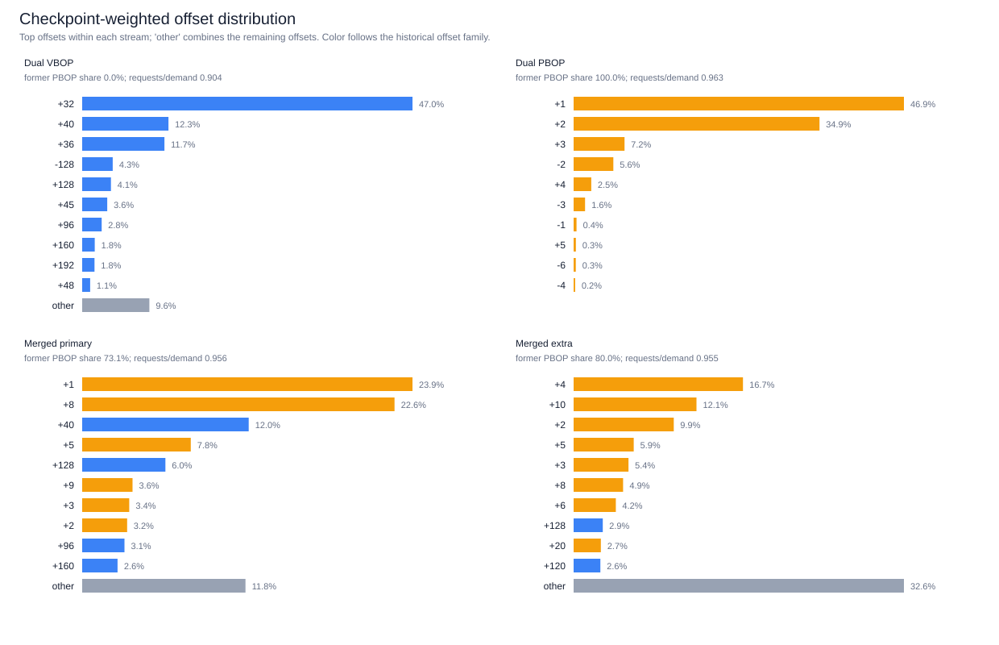

合并方案的 extra 并没有稳定承担“另一个历史 offset 家族”的覆盖任务。
checkpoint-weighted 下，primary 和 extra 分别有 73.1% 和 80.0% 的请求来自
原 PBOP offset；两者合并后仍有 76.6% 集中在该家族。候选生成量也没有下降：
merged D2 的 1.910 req/demand 略高于双 BOP 的 1.867。6.5 节观察到的本地发送量
下降主要来自 shared recent filter，而不是 degree-2 少生成请求。

#### 逐 checkpoint 家族分布

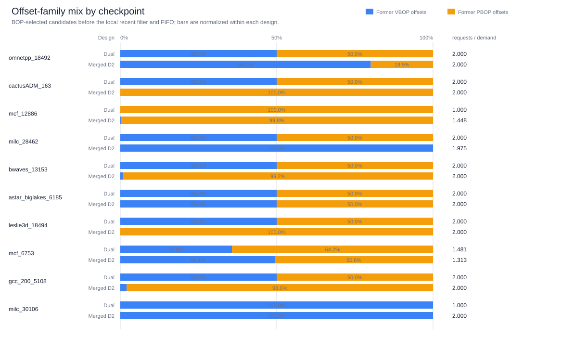

双 BOP 在两套机制均开启时天然同时产生 small/large 两类 offset；统一 Student
则没有家族多样性约束。10 个点中有 7 个点的 merged D2 请求约 98% 或更高地集中在
单一历史家族。该现象本身不必然导致覆盖下降，但当被丢失家族承担 unique
coverage 时，会直接形成 degree-2 缺口。

#### 三个主要缺口点

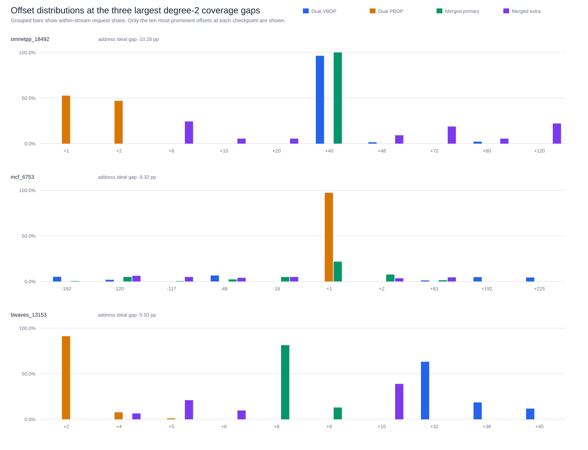

代表性分布如下，百分比均为各自 stream 内占比：

| checkpoint | 双 BOP 主导 offset | merged primary | merged extra | D2-Dual ideal coverage |
| --- | --- | --- | --- | ---: |
| `omnetpp_18492` | VBOP `+40` 96.35%；PBOP `+1/+2` 99.62% | `+40` 100% | `+8/+120/+72` 65.25%；`+1/+2` 为 0 | -10.28 pp |
| `bwaves_13153` | VBOP `+32` 63.15%；PBOP `+2` 91.17% | `+8` 81.37% | `+10/+5/+6` 69.64% | -5.93 pp |
| `mcf_6753` | PBOP `+1` 97.27%；VBOP 分布较分散 | `+1` 21.73% | 最大单项 `-120` 6.26% | -9.32 pp |
| `milc_28462` | VBOP `+160/+192` 98.37%；PBOP `+1` 93.66% | `+160` 87.59% | `+96/+225` 95.14% | -0.28 pp |

`omnetpp` 保留了 large `+40`，但 extra 没有恢复 small `+1/+2`；`bwaves`
的 primary 和 extra 都落入 small-offset 家族，原来的 `+32` 流消失；`mcf_6753`
虽然仍选择 `+1`，但 merged total 中 `+1` 只占 10.87%，分布明显扩散。
`milc_28462` 则说明“同一家族集中”只是风险信号：其 large offsets 已足够覆盖
主要需求，所以 ideal coverage 基本不变。

该结果进一步支持机制限制归因：degree 只能从当前 pool 中选择多个 offset，
但单 Teacher 注入、单 pool 保留和统一 Student 选择没有保证 small/large 模式
同时存在。下一步需要先统计每个 Student phase 的 pool 家族组成以及“另一家族
候选存在但未被选中”的比例，再区分问题主要发生在候选发现/保留，还是 extra
选择阶段。完整逐 offset 数据保存在
`images/ts_bop_offset_distribution.{json,csv}`。

### 6.8 Dual Student winner 注入 pilot

为了验证缺口是否主要来自 merged Teacher 无法稳定提供原 PBOP winner，先在
三个主导缺口点做反事实 replay：merged Teacher 仍决定 phase 边界、fallback
offset 和 issue-confidence gate；merged Student 仍使用 pool=4、degree=2、
greedy marginal 2%、VBOP-style hash/delay。唯一变化是在每个 merged phase
结束时，把当时双 BOP 中 VBOP/PBOP 的最新 Student winner 作为两个候选注入
merged Student pool，下一 phase 仍由 merged Student 重新统计、淘汰和选择。

这不是“直接发送双 BOP 的两个 offset”。后者会同时恢复双 Student 的选择和
异步时序，ideal coverage 按构造应接近双 BOP，不能单独证明 Teacher 供给是
根因。当前实验只替换候选来源，因而更适合隔离 winner supply 的贡献。

| checkpoint | 双 BOP | merged D2 基线 | dual winner 注入 | 相对基线 | 距双 BOP |
| --- | ---: | ---: | ---: | ---: | ---: |
| `omnetpp_18492` | 62.14% | 51.86% | 59.41% | +7.55 pp | -2.72 pp |
| `bwaves_13153` | 80.41% | 74.48% | 73.54% | -0.94 pp | -6.87 pp |
| `mcf_6753` | 54.16% | 44.84% | 45.06% | +0.22 pp | -9.10 pp |
| **三点 profile-weighted** | **71.25%** | **63.64%** | **65.03%** | **+1.39 pp** | **-6.22 pp** |

在这三个点上，“注入所有已选 winner”和“只注入通过各自 Student coverage
gate 的 winner”结果相同，因此该 pilot 的差异不是由双 BOP Student coverage
gate 是否允许 winner 引起。`omnetpp` 补回了原缺口的 73.5%，说明 winner
供给在该点确实是主因；但 `bwaves` 反而回退，`mcf_6753` 只补回 2.4%。

因此当前更准确的结论是：merged Teacher 的低更新频率和全局 winner 排序会
破坏互补候选的稳定供给，但它不是唯一限制。双 BOP winner 的有效性依赖各自
Student 的 phase 窗口、hash/delay、pool 保留、coverage gate 和异步更新时间；
把 winner 搬入统一 Student 后重新评价，不保证仍形成相同的 primary/extra
组合。单 BOP 当前丢失的是“双 Teacher + 双 Student 的独立学习域”，而不只是
某个 PBOP offset 没有进入 pool。

该结果目前是三个主导缺口点的 pilot。正式结论前需要把 oracle 固化进 analyzer
并扩展到 10 点，同时加入两个更强的分层对照：一是固定两个 pool 槽位保留最新
VBOP/PBOP winner，只让 merged Student 重新选择；二是直接强制发送两个 winner，
但仍经过统一 recent filter、Primary/Extra FIFO 和仲裁。两级差值可分别量化
pool 保留/Student 选择损失与异步 winner 时序损失。

### 6.9 分区 Student pool 静态模拟

本实验验证“一个家族一个 Student 子池、每家族选择一个 offset”的方案。它不是
双 BOP winner oracle：Teacher 仍是扫描 109 个 offsets 的单 merged Teacher，
训练、score 更新、issue gate 和 phase 边界均不变；只在每个 merged phase 结束时，
分别输出原 VBOP/PBOP offset 家族内 positive score 最高的一个 winner。

Student 侧比较：

- 严格分区：`2+2`、`1+3`、`3+1` 和扩容诊断 `3+3`。
- 弹性分区：pool=4 时每家族保底 1 槽、其余 2 槽共享；pool=6 时比较
  `1+1`/`2+2` 保底、其余槽共享。
- `independent`：每个家族各选独立 coverage 最高的 offset。
- `max-union`：枚举跨家族 pair，选择 Student hit-mask union 最大的一对。
- 所有方案均为 degree=2、extra marginal threshold=2%，并经过 shared 256-entry
  filter、Primary 8/Extra 4 FIFO 和 3:1 work-conserving 仲裁。

下表中 coverage 为 `ideal / local`；ideal 是地址匹配上界，local 是候选离开
BOP 本地资源后的匹配结果。

| checkpoint | 双 BOP | merged D2 | 严格 2+2 independent | 严格 2+2 max-union | 保底 1+1/T4 max-union | 严格 3+3 max-union |
| --- | ---: | ---: | ---: | ---: | ---: | ---: |
| `omnetpp_18492` | 62.14% / 61.59% | 51.86% / 51.76% | 56.02% / 55.67% | 55.86% / 55.54% | 55.75% / 55.49% | 56.15% / 55.84% |
| `cactusADM_163` | 98.01% / 98.01% | 98.42% / 98.41% | 98.23% / 98.21% | 98.29% / 98.26% | 98.25% / 98.22% | 98.06% / 98.04% |
| `mcf_12886` | 45.08% / 45.08% | 47.02% / 47.01% | 46.86% / 46.86% | 47.25% / 47.24% | 46.99% / 46.98% | 48.62% / 48.61% |
| `milc_28462` | 87.96% / 86.61% | 87.68% / 87.68% | 74.46% / 74.23% | 78.01% / 77.79% | 78.10% / 77.92% | 85.73% / 84.86% |
| `bwaves_13153` | 80.41% / 80.41% | 74.48% / 74.40% | 73.74% / 73.65% | 73.82% / 73.74% | 73.82% / 73.73% | 73.52% / 73.42% |
| `astar_biglakes_6185` | 67.83% / 67.81% | 66.30% / 66.24% | 66.74% / 66.63% | 66.77% / 66.68% | 65.92% / 65.83% | 66.53% / 66.42% |
| `leslie3d_18494` | 86.03% / 85.98% | 84.69% / 83.33% | 83.67% / 83.13% | 83.22% / 82.67% | 82.95% / 82.36% | 83.69% / 83.13% |
| `mcf_6753` | 54.16% / 54.28% | 44.84% / 44.82% | 44.58% / 44.57% | 44.49% / 44.48% | 42.68% / 42.67% | 45.94% / 45.92% |
| `gcc_200_5108` | 51.29% / 51.07% | 52.58% / 51.48% | 42.51% / 42.19% | 42.59% / 42.18% | 39.70% / 39.47% | 41.90% / 41.51% |
| `milc_30106` | 99.65% / 99.65% | 99.95% / 99.95% | 99.88% / 99.86% | 99.80% / 99.73% | 99.83% / 99.77% | 99.86% / 99.83% |

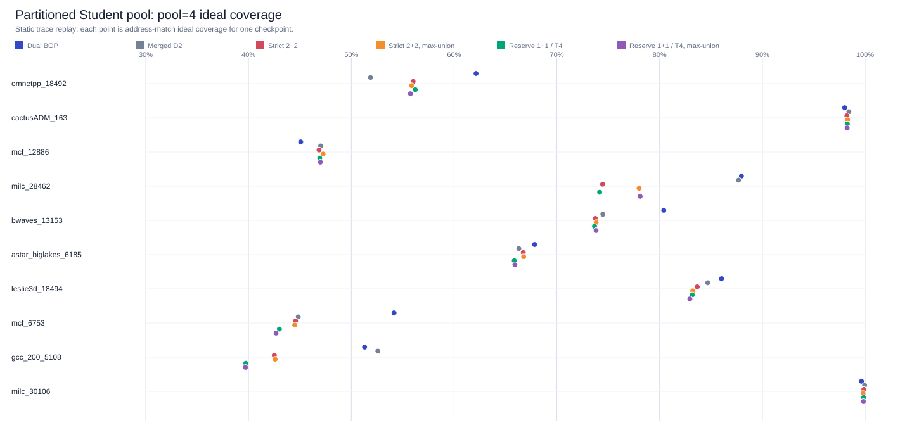

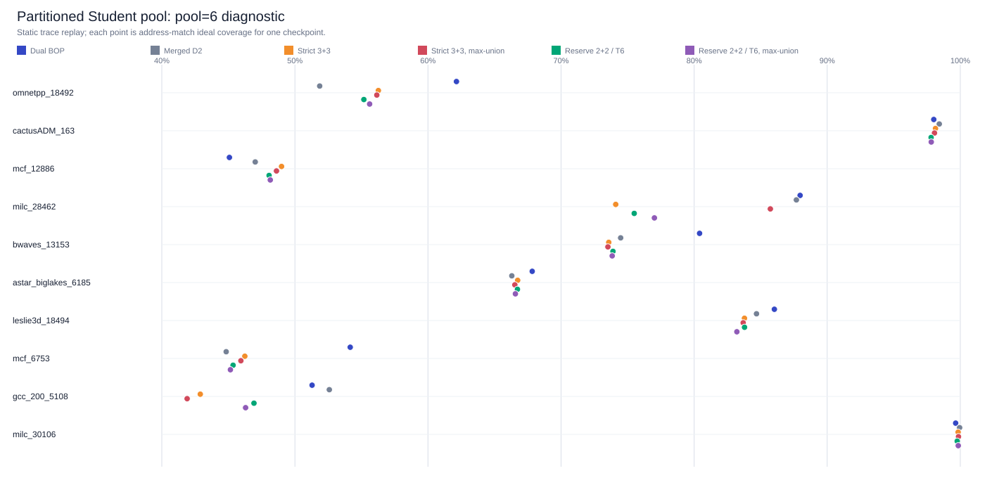

总体 coverage 和流量如下。`generated/demand` 位于 BOP-selected candidate 层，
`sent/demand` 位于本地 filter/FIFO/arbiter 之后。

| 方案 | ideal CW | local CW | generated/demand CW | sent/demand CW | ideal AW | local AW | sent/demand AW |
| --- | ---: | ---: | ---: | ---: | ---: | ---: | ---: |
| 原双 BOP | 76.59% | 76.49% | 1.867 | 1.843 | 59.79% | 59.68% | 1.409 |
| 原 merged D2 | 73.04% | 72.84% | 1.910 | 1.434 | 56.75% | 56.65% | 1.403 |
| 严格 2+2 independent | 72.28% | 72.14% | 1.900 | 1.727 | 55.75% | 55.67% | 1.465 |
| 严格 2+2 max-union | 72.39% | 72.25% | 1.908 | 1.757 | 56.09% | 56.00% | 1.510 |
| 保底 1+1/T4 max-union | 71.97% | 71.84% | 1.901 | 1.757 | 55.39% | 55.31% | 1.512 |
| 严格 3+3 max-union | 72.69% | 72.53% | 1.910 | 1.741 | 57.53% | 57.40% | 1.486 |
| 保底 2+2/T6 max-union | 72.53% | 72.37% | 1.910 | 1.731 | 56.59% | 56.50% | 1.473 |

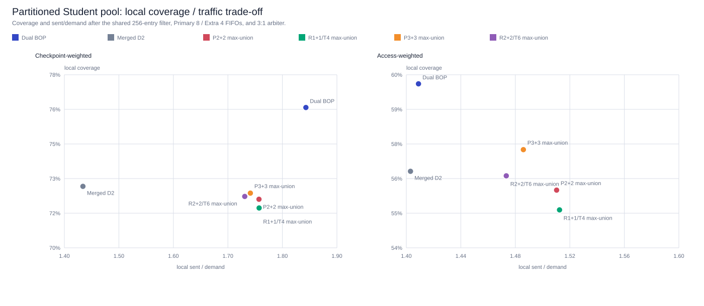

结论：

- pool=4 的目标方案没有改善总体结果。严格 `2+2 independent` 相对原 merged
  D2 的 ideal/local coverage 低 0.75/0.70 个百分点，本地 sent/demand 却从
  1.434 增至 1.727；`max-union` 只能把 ideal coverage 补回 0.11 个百分点。
- 弹性共享槽没有解决问题。pool=4 的 `1+1` 保底方案更低；不对称 `1+3`、
  `3+1` 的完整结果也都没有超过原 merged D2。
- pool=6 的最好方案是严格 `3+3 + max-union`。它在 access-weighted coverage
  上比 merged D2 高 0.78 个百分点，但 checkpoint-weighted ideal/local 仍低
  0.34/0.31 个百分点，且 sent/demand CW 高 21.4%，不是可接受的 Pareto 改善。
- `milc_28462` 是明显的参数限制点：严格 `2+2 max-union` 为 78.01%，扩到
  `3+3` 后为 85.73%，说明每家族候选容量和 pair union 选择都重要。
- `omnetpp_18492`、`bwaves_13153`、`mcf_6753` 是机制限制点。遍历本次全部
  14 个分区配置后，它们的最好 ideal coverage 仍分别比双 BOP 低 5.87、
  5.49、7.92 个百分点；单纯改 pool 大小、比例或 pair 选择无法补回。
- 分区使 primary/extra 更常产生不同地址，shared recent filter 能消除的重复
  下降，因此生成量与原 merged D2 接近时，本地实际发送量反而显著增加。

因此当前“单 merged Teacher + 每家族 winner + 分区 Student pool”不进入阶段 3。
它证明了 family diversity 在 `omnetpp` 等点有价值，但 winner 供给不是唯一问题；
单 Teacher 的更新频率、同步 phase、统一 Student coverage delay/hash/window 和
统一 issue-confidence gate 仍然存在。

完整数据保存在：

- `images/ts_bop_partitioned_pool_compare.json`：10 点、14 个分区配置的原始结果。
- `images/ts_bop_partitioned_pool_compare.csv`：逐 checkpoint coverage/traffic。
- `images/ts_bop_partitioned_pool_aggregate.csv`：两种加权口径的总体结果。

### 6.10 Teacher `round_max` / `score_max` 参数扫描

本实验只改变 merged VBOP Teacher 的 phase 结束参数，Student pool=4、degree=2、
`greedy_marginal`、2% threshold、shared 256-entry filter、P8/E4 FIFO 和 3:1
仲裁均保持不变。`score_max` 是强模式的提前结束条件；若本 phase 没有 offset
达到该分数，则由 `round_max` 超时结束。一个 offset 每轮最多加一分，因此二者
必须联合分析。

扫描包含 19 组粗扫、`round_max=50/55/60` 与 `score_max=16--24` 的细扫，
以及 `round_max=50, score_max=13--17` 的阈值补扫；全部覆盖 10 个 checkpoint，
同时计算 ideal coverage、local coverage 和 local sent/demand。

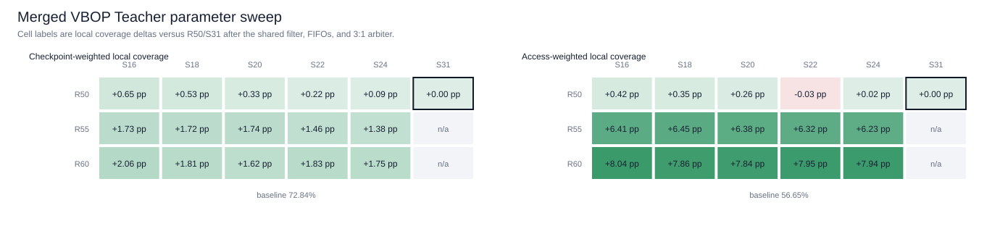

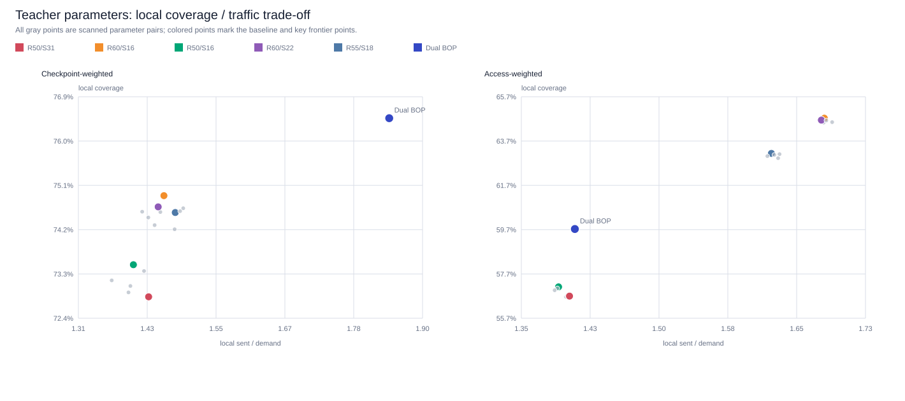

主要结果如下，数值均为 `checkpoint-weighted / access-weighted`：

| 配置 | ideal coverage | local coverage | local sent/demand | 定位 |
| --- | ---: | ---: | ---: | --- |
| 双 BOP | 76.59% / 59.79% | 76.49% / 59.68% | 1.843 / 1.409 | 目标参考 |
| R50/S31 | 73.04% / 56.75% | 72.84% / 56.65% | 1.434 / 1.403 | 当前 merged 基线 |
| **R50/S16** | **73.72% / 57.19%** | **73.50% / 57.07%** | **1.408 / 1.391** | 旧模型候选 |
| R50/S20 | 73.41% / 57.04% | 73.18% / 56.92% | 1.371 / 1.387 | 带宽偏置候选 |
| R55/S20 | 74.77% / 63.13% | 74.58% / 63.04% | 1.423 / 1.627 | mcf 流量开始突增 |
| R60/S16 | 75.13% / 64.81% | 74.90% / 64.69% | 1.460 / 1.682 | 高覆盖、高流量诊断 |
| R80/S31 | 75.79% / 66.69% | 75.51% / 66.54% | 1.451 / 1.794 | coverage 上界诊断 |

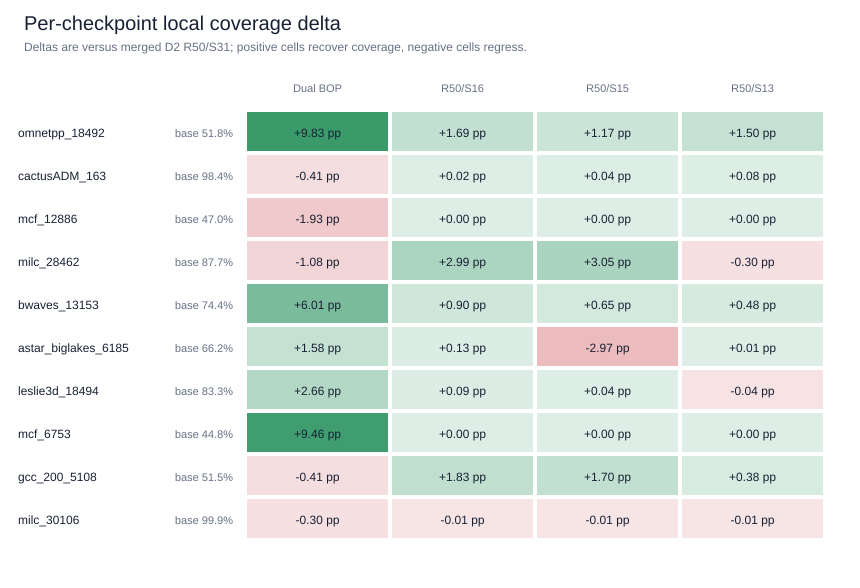

结论：

- 在该旧 single-pool merged 模型中，`R50/S16` 相对 `R50/S31` 的 local
  coverage 提高 0.655/0.418 个百分点，local sent/demand 同时降低
  0.026/0.012；当时将其作为后续候选。该结论已被 6.13 的 mixed-delay、4+4
  和完整 10 点联合扫描取代，当前默认值是 `R50/S20`。
- `R50/S20` coverage 收益较小，但 checkpoint-weighted sent/demand 降低
  0.063，保留为带宽偏置 sensitivity。更低阈值不是单调更好：S15 在
  `astar_biglakes_6185` 回退 2.97 个百分点，S14 在 `gcc_200_5108` 回退
  1.25 个百分点。
- R50/S16 的 BOP-selected generated/demand 几乎不变；local 发送量下降主要
  来自 shared recent filter 的过滤量增加。因此该带宽收益依赖“filter 位于
  Primary/Extra FIFO 之前”的既定实现约束。
- 增大 `round_max` 会让两个低分 mcf 的 Teacher 更常通过全局 issue-confidence
  gate。`mcf_12886` 的 issue-enabled phase 比例从 61.9% 增至 R55/R60 的
  70.1%/77.5%，`mcf_6753` 从 56.5% 增至 61.6%/65.0%；coverage 上升的同时
  access-weighted sent/demand 增至 1.627/1.682，均高于双 BOP 的 1.409。
  因此不提高 `round_max`。
- 参数优化不能替代机制优化。R50/S16 的 local coverage 仍比双 BOP 低
  2.99/2.61 个百分点，只补回原 local gap 的约 18%/14%；`omnetpp_18492`、
  `bwaves_13153` 和 `mcf_6753` 仍分别低 8.13、5.11 和 9.46 个百分点。
  两个 mcf 的 phase 从未达到 S16，故 score 调优对它们没有作用。

完整数据与图表保存在：

- `images/ts_bop_teacher_param_sweep.json`：19 组粗扫。
- `images/ts_bop_teacher_param_fine.json`：R50/R55/R60 细扫。
- `images/ts_bop_teacher_score_fine.json`：S13--S17 阈值补扫。
- `images/ts_bop_teacher_*_aggregate.csv`、
  `images/ts_bop_teacher_*_checkpoint.csv`：总体和逐点结果。

### 6.11 共享 RR 的异步双 context 静态模拟

本实验评估以下方案：物理上共享一套 RR/history、recent filter、Primary/Extra
FIFO 和出口仲裁；逻辑上保留 VBOP/PBOP 两套 Teacher pointer、score、phase、
issue-confidence 和 Student 状态。每个 demand access 分别测试一个 VBOP offset
和一个 PBOP offset，因此仍需完成两次 RR lookup/test。两类 phase 独立结束：
VBOP 结束只更新 VBOP Student，PBOP 结束只更新 PBOP Student。

目标配置为总 Student pool=4 的 `VBOP 2 + PBOP 2`：VBOP 每次最多产生一条
primary，PBOP 每次最多产生一条 extra；PBOP Student coverage 立即生效，VBOP
保留 300-cycle delay。输出统一经过 shared 256-entry recent filter、Primary 8 /
Extra 4 FIFO 和 3:1 work-conserving 仲裁。该实验使用原双 BOP 的 R50/S31 参数，
以便隔离共享资源和 pool 压缩本身的影响。

#### 回放校准与 phase 时序

`VBOP 4 + PBOP 8` 保留原 Student 容量。10/10 个 checkpoint 上，它与原双 BOP
逐项复现：ideal coverage、Teacher/Student phase 数、winner、Student selected
offset 和 issued offset 分布全部一致。这说明共享 RR/history 本身没有引入学习
误差。所有 pool 配置的 VBOP/PBOP Teacher phase 数和 winner stream 也都与原双
BOP 一致；后续差异来自 Student pool 压缩或 shared filter/FIFO，而不是 Teacher
供给或 replay 实现偏差。

两类 phase 天然不同步：测量段共有 1,828 个 VBOP phase、3,547 个 PBOP phase，
只有 43 次在同一 access 结束。除去每个 checkpoint 的首个区间后，平均 phase
间隔约为 VBOP 3,609 accesses、PBOP 1,854 accesses。因而不应强制统一结束时间：
等待 VBOP 会把 PBOP 更新频率近似减半；跟随 PBOP 则会在 VBOP 扫描完成前清空
其 score/Student epoch。

#### Coverage 与流量

以下数值均为 `checkpoint-weighted / access-weighted`。ideal coverage 是
BOP-selected candidate 的地址匹配上界；local coverage 是经过 shared filter、
FIFO 和仲裁后离开本地资源的 candidate 对后续 demand 的覆盖。

| 方案 | ideal coverage | local coverage | local sent/demand |
| --- | ---: | ---: | ---: |
| 原双 BOP | 76.59% / 59.79% | 76.49% / 59.68% | 1.843 / 1.409 |
| 原 merged D2 | 73.04% / 56.75% | 72.84% / 56.65% | 1.434 / 1.403 |
| **异步 2+2** | **75.89% / 59.47%** | **75.66% / 59.36%** | **1.702 / 1.344** |
| 异步 2+2，PBOP 也 delay | 72.77% / 57.91% | 72.58% / 57.83% | 1.671 / 1.345 |
| 异步 2+8 | 76.53% / 59.78% | 76.17% / 59.58% | 1.704 / 1.341 |
| 异步 3+3 | 76.27% / 59.64% | 75.98% / 59.49% | 1.703 / 1.344 |
| 异步 4+2 | 75.97% / 59.49% | 75.73% / 59.38% | 1.699 / 1.343 |
| 异步 4+8 | 76.59% / 59.79% | 76.23% / 59.58% | 1.701 / 1.340 |

异步 2+2 的 local coverage 比双 BOP 低 0.824/0.323 个百分点，但比原 merged
D2 高 2.821/2.709 个百分点；local sent/demand 比双 BOP 低 7.65%/4.61%。
不过它的 BOP-selected generated/demand 与双 BOP 完全相同，均为
1.867/1.425；发送量下降来自共享 recent filter/FIFO 消除重复，不是两个 context
少生成了候选。因此该方案降低的是 BOP 本地出口流量，而不是前端候选生成活动。

逐 checkpoint 的 local coverage 如下：

| checkpoint | Dual local | Merged D2 local | Async 2+2 local | 2+2 - Dual | Async 2+8 local |
| --- | ---: | ---: | ---: | ---: | ---: |
| `omnetpp_18492` | 61.59% | 51.76% | 60.65% | -0.94 pp | 61.32% |
| `cactusADM_163` | 98.01% | 98.41% | 97.86% | -0.15 pp | 97.86% |
| `mcf_12886` | 45.08% | 47.01% | 45.08% | -0.00 pp | 45.08% |
| `milc_28462` | 86.61% | 87.68% | 85.71% | -0.89 pp | 86.69% |
| `bwaves_13153` | 80.41% | 74.40% | 80.18% | -0.23 pp | 80.18% |
| `astar_biglakes_6185` | 67.81% | 66.24% | 66.21% | -1.60 pp | 67.21% |
| `leslie3d_18494` | 85.98% | 83.33% | 84.09% | -1.89 pp | 85.07% |
| `mcf_6753` | 54.28% | 44.82% | 54.47% | +0.19 pp | 54.25% |
| `gcc_200_5108` | 51.07% | 51.48% | 44.18% | -6.88 pp | 49.46% |
| `milc_30106` | 99.65% | 99.95% | 99.84% | +0.19 pp | 99.84% |

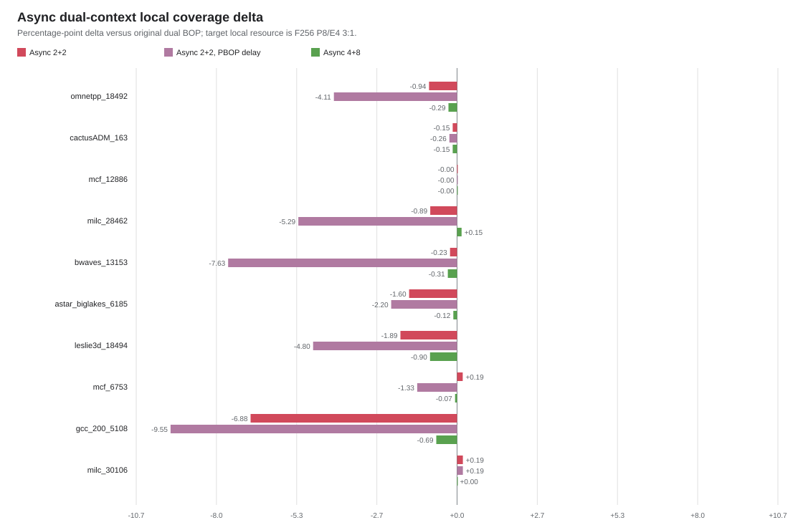

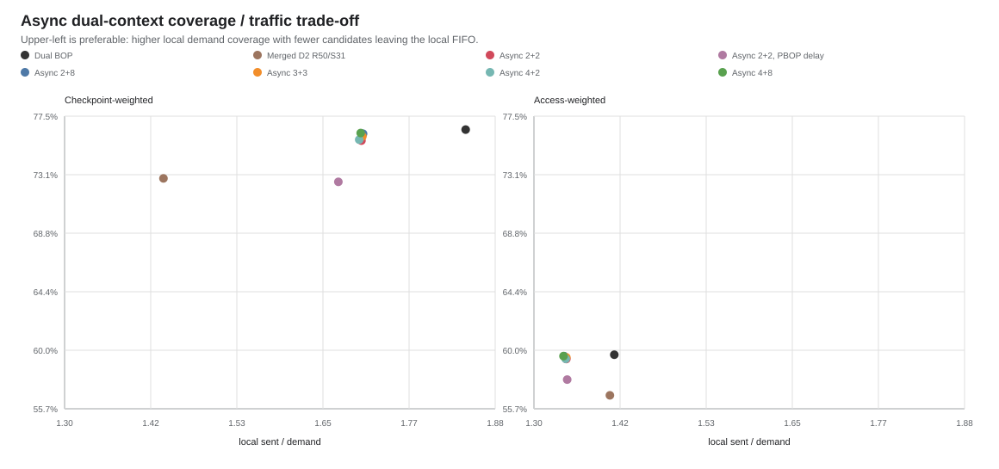

#### 缺口归因与架构判断

- PBOP 的立即 coverage 语义必须保留。给 PBOP 也加 300-cycle delay 会使
  2+2 local coverage 再降低 3.077/1.530 个百分点。
- 剩余 pool 压缩损失主要来自 PBOP。`2+8` 与 `4+8` 的 local coverage 只差
  0.053/0.005 个百分点；`4+2` 相对 `4+8` 则低 0.492/0.206 个百分点。
- `gcc_200_5108` 是 2+2 的主要风险点。把 PBOP pool 从 2 恢复到 8 后，local
  gap 从 -6.88 pp 缩小到 -1.60 pp，说明该点需要同时保留多个 PBOP winner；
  其余点的 2+2 gap 均不超过 1.89 pp。
- `4+8` 的 ideal coverage 与双 BOP 完全相同，证明两个异步 context 可以在共享
  RR 上保持原学习结果；其 local coverage 仍低 0.260/0.103 个百分点，来自
  shared filter/FIFO 的发送时序，而不是 Teacher/Student 学习。

因此该方案的准确名称应是“共享物理资源的异步双 BOP context”，不是单一
Teacher/Student 学习域。它可能节省一套 RR/history、recent filter 和输出队列，
但仍保留两套 score/pointer/phase/issue-confidence/Student 状态，并要求每个
access 完成两个 offset test。是否值得实现取决于共享 RR 的面积占比、两次 lookup
的端口/时序代价，以及 `2+2` 在 `gcc` 上的风险是否能用少量 PBOP 槽位补回。

完整数据保存在：

- `images/ts_bop_async_dual_context.json`：10 点原始结果、控制流校准和 phase 统计。
- `images/ts_bop_async_dual_context_{aggregate,checkpoint}.csv`：总体和逐点表格。
- `images/ts_bop_async_dual_context_{checkpoint_delta,tradeoff}.svg`：图表。

### 6.12 单 merged Teacher multi-test 快速 pilot

该实验回到面积更小的原分区方案，只保留一套 merged Teacher 和一套 Student
coverage filter/phase：

- Teacher 在同一个 109-offset score table 上学习，每个 access 连续测试 `N` 个
  offset；phase 结束时分别输出 VBOP family 和 PBOP family 中 positive score
  最高的一个 winner。
- Student pool 严格分为 `VBOP 2 + PBOP 2`，每个 family 独立选一个 offset，
  但四个槽共享同一个 coverage filter、phase train count 和清空时机。
- VBOP-family prediction 继续经过 300-cycle Student delay queue；PBOP-family
  prediction 立即写入同一个 coverage filter。hash、filter 容量和 issue gate
  仍沿用 merged VBOP，未复制 PBOP Student evaluator。
- 输出仍经过 shared 256-entry filter、P8/E4 FIFO 和 3:1 仲裁。

为了快速筛选，只选取 `omnetpp_18492`、`bwaves_13153` 和 `gcc_200_5108`。
每个 trace 完整回放原 measurement marker 之前的 warmup，marker 后最多评价
200,000 个 demand；`gcc` trace 剩余 134,056 个 demand，因此使用全部剩余段。
这些结果只用于判断参数趋势，不能替代 10 点最终结果。

#### 三点汇总

数值为 `checkpoint-weighted / access-weighted`，coverage 均为 local coverage。

| 方案 | local coverage | local sent/demand |
| --- | ---: | ---: |
| 双 BOP | 71.32% / 65.55% | 1.969 / 1.971 |
| 原 merged D2 | 64.75% / 59.36% | 1.491 / 1.611 |
| 旧分区 2+2，全部 delay，N1/R50/S31 | 64.85% / 58.81% | 1.803 / 1.818 |
| mixed delay，N1/R50/S31 | 69.27% / 63.13% | 1.813 / 1.821 |
| mixed delay，N2/R50/S31 | 69.48% / 63.15% | 1.817 / 1.832 |
| **mixed delay，N2/R25/S31** | **71.31% / 64.61%** | **1.813 / 1.833** |
| mixed delay，N4/R50/S31 | 69.44% / 62.80% | 1.813 / 1.830 |
| mixed delay，N4/R25/S31 | 72.23% / 64.75% | 1.760 / 1.798 |
| mixed delay，N4/R13/S31 | 67.96% / 60.78% | 1.530 / 1.527 |

PBOP-family offset 改为立即 coverage 后，N1/R50 相对旧分区方案提高
4.42/4.33 个百分点；三个点分别提高 4.46、4.51 和 3.84 个百分点。这说明之前
分区方案失败的一项重要原因是把 PBOP winner 强制套用了 VBOP delay 语义。

#### 逐 checkpoint

| checkpoint | 双 BOP | 旧分区全 delay | mixed N1/R50/S31 | mixed N2/R25/S31 | mixed N4/R25/S31 |
| --- | ---: | ---: | ---: | ---: | ---: |
| `omnetpp_18492` | 60.96% | 55.19% | 59.65% | **61.07%** | 58.99% |
| `bwaves_13153` | 79.86% | 73.56% | 78.08% | **80.88%** | **83.28%** |
| `gcc_200_5108` | 51.07% | 42.19% | **46.04%** | 45.62% | 45.70% |

#### 与当前最终参数的口径对齐

旧的 `71.31% / 64.61%` 只对应上述 3 点 pilot，且参数是
`N2/R25/S31 + Student 2+2 + SF4096 + P8/E4 + RF256`。把当前最终参数
`N2/R50/S20 + 4+4 + SF2048 + P8/E8 + RF128` 限制到同样 3 点后，结果为：

| 数据范围与配置 | local coverage | local sent/demand |
| --- | ---: | ---: |
| 旧 3 点 pilot，N2/R25/S31 | 71.31% / 64.61% | 1.813 / 1.833 |
| 当前参数，同样 3 点 | 71.14% / 64.82% | 1.894 / 1.893 |
| 当前参数，完整 10 点 | 74.48% / 70.54% | 1.573 / 1.511 |

因此两组数字不矛盾：同样 3 点下当前参数与旧 pilot 基本一致；完整 10 点结果
下降主要来自新增的两个 `mcf` checkpoint，而不是参数或 replay 口径漂移。

#### 初步判断

- 只提高 `N`、保持 R50 几乎没有收益。N2/R50 相对 N1/R50 只增加
  0.21/0.02 个百分点，N4/R50 反而在 access-weighted coverage 上降低
  0.33 个百分点。多测试必须配合更短 phase 才能转化为适应速度。
- 在该三点 pilot 中，N2/R25 是最平衡的参数。它在 `omnetpp` 和 `bwaves` 分别比双 BOP
  高 0.11 和 1.02 个百分点，三点 checkpoint-weighted coverage 与双 BOP
  基本相同；但 access-weighted 仍低 0.94 个百分点。该 pilot 保持 S31，因此
  在 R25 下 score threshold 实际不可达，phase 均由 round_max 结束；S16/S20
  仍需作为后续提前结束 sensitivity。
- N4/R25 的总体 checkpoint-weighted coverage 更高，但收益主要来自 `bwaves`
  的 +3.42 pp；它在 `omnetpp` 低 1.97 pp，并要求每 access 四次 RR test，当前
  不优先于 N2/R25。
- N4/R13 过于激进。`omnetpp`/`gcc` 的 issue-enabled phase 比例降到
  67.9%/75.7%，虽然 sent/demand 降低，但 coverage 明显回退。
- 所有 multi-test 配置在 `gcc` 上都约低 5.4--6.0 pp。增加 Teacher test 或缩短
  round 无法修复，因此当时把问题指向 Student 侧而不是 Teacher family winner
  供给频率，并优先怀疑 PBOP 子池只有两个槽、winner 淘汰和选择稳定性。

该三点 pilot 的下一步已由 6.13 完成。完整 10 点结果表明：R25 在两个 mcf 上
使 best score 接近 `bad_score`，大量 phase 被全局 issue-confidence gate 关闭；
扩大到 4+4 也没有修复 `gcc`。因此不再继续 PBOP-only pool 扫描；当轮实测
coverage/traffic Pareto 候选收敛为 `N2/R50/S20`，并作为当前最终参数，见 6.14。

原始 pilot 数据保存在
`images/ts_bop_merged_multi_test_pilot.json`。

### 6.13 参数收敛：S20、4+4、E8 和 128-entry recent filter

本轮按用户建议同时扫描 Teacher score、Student pool/filter、Extra FIFO 和
recent filter。所有结果仍为静态 trace replay，没有修改 `src/` 中的 BOP 功能。
10 点确认对每个 checkpoint 完整回放 measurement marker 前的 warmup，并在 marker
后最多统计 200,000 个 demand；短 trace 使用全部剩余 demand。

#### Teacher cadence 和 score

下表固定 Student=`4+4`、Student filter=2048、P8/E8、recent filter=256；数值为
`checkpoint-weighted / access-weighted`。

| Teacher | local coverage | local sent/demand | 结论 |
| --- | ---: | ---: | --- |
| 双 BOP | 75.99% / 72.61% | 1.839 / 1.687 | 参考 |
| N2/R25/S16 | 70.30% / 62.20% | 1.385 / 1.244 | phase 过短，拒绝 |
| N2/R50/S16 | 73.84% / 68.26% | 1.524 / 1.475 | `milc_28462` 过早结束 |
| **N2/R50/S20** | **74.40% / 70.44%** | **1.535 / 1.488** | score 默认候选 |
| N2/R50/S31 | 73.83% / 70.14% | 1.544 / 1.524 | 更新偏慢 |

- R25 在 `mcf_12886/mcf_6753` 的 average best score 只有 1.82/1.93，低于或接近
  `bad_score=2`；issue-enabled phase 只有 20.5%/21.9%，coverage 分别降到
  3.22%/16.26%。因此不能根据最初三点 pilot 断言 R25 能保持双 BOP coverage；
  R25 不作为最终参数，保留完整 10 点上更稳健的 R50/S20。
- S16 在 `milc_28462` 上过早改变 phase/winner cadence，local coverage 只有
  64.37%，而双 BOP/S20 分别为 85.49%/85.99%。
- S20 在总体 coverage 和发送量上优于 S16/S31。S31 在 `gcc_200_5108` 略高于
  S20，但不足以抵消 S20 在 `milc_28462`、`bwaves` 等点的收益。
- N4/R50 只把两个 mcf 的 coverage 从 46.53/32.82% 提高到 47.52/35.89%，却把
  `gcc` 从 50.16% 降到 46.66%，并把每 access RR test 从 2 增至 4。因此保留 N2。

#### Student pool、filter 和 FIFO

以下为六个代表点的 sensitivity，数值仍为 `checkpoint-weighted / access-weighted`：

| 配置 | local coverage | local sent/demand |
| --- | ---: | ---: |
| 2+2, Student filter 2048, E8, RF128 | 74.99% / 78.19% | 1.822 / 1.653 |
| **4+4, Student filter 2048, E8, RF128** | **75.31% / 78.52%** | **1.816 / 1.652** |
| 4+4, Student filter 4096, E8, RF128 | 75.30% / 78.39% | 1.814 / 1.677 |
| 4+4, Student filter 2048, E4, RF128 | 75.25% / 78.48% | 1.811 / 1.650 |

`4+4` 相对 `2+2` 提高 0.32/0.33 个百分点且没有增加发送量。Student filter
从 4096 减为 2048 没有总体 coverage 损失；结合 pool bit width 从 4 增到 8，
两种配置的 filter bit 总量相同。E8 相对 E4 只增加 0.06/0.04 个百分点，但可
基本消除 extra FIFO overwrite，因此按用户建议选择 E8。

#### Recent filter

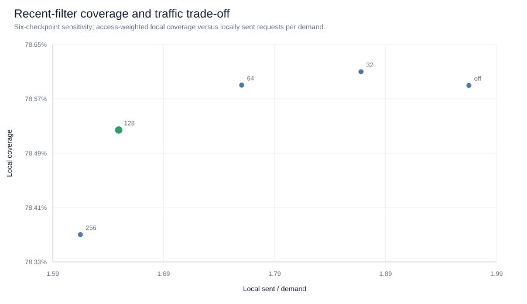

六点 sensitivity 如下：

| recent filter | local coverage | local sent/demand |
| ---: | ---: | ---: |
| 关闭 | 75.37% / 78.59% | 1.984 / 1.968 |
| 32 | 75.38% / 78.61% | 1.920 / 1.871 |
| 64 | 75.36% / 78.59% | 1.871 / 1.763 |
| **128** | **75.31% / 78.52%** | **1.816 / 1.652** |
| 256 | 75.19% / 78.37% | 1.753 / 1.618 |

关闭 filter 相对 RF128 只增加 0.06/0.07 个百分点 coverage，但发送量增加
9.2%/19.1%。RF32/RF64 的 coverage 增益同样很小，而流量明显上升。RF256
继续降低发送量，但容量翻倍且 coverage 因抑制较长距离的重新预取而略低。
因此 RF128 是当前面积、coverage 和流量的折中点。

#### R50/S20 的最终 10 点参考结果

把 recent filter 改为 128 后，完整 10 点截断结果为：

| 方案 | ideal coverage | local coverage | local sent/demand |
| --- | ---: | ---: | ---: |
| 双 BOP | 76.04% / 72.81% | 75.99% / 72.61% | 1.839 / 1.687 |
| N2/R50/S20, 2+2 | 74.19% / 70.12% | 74.15% / 69.99% | 1.583 / 1.514 |
| **N2/R50/S20, 4+4** | **74.55% / 70.71%** | **74.48% / 70.54%** | **1.573 / 1.511** |

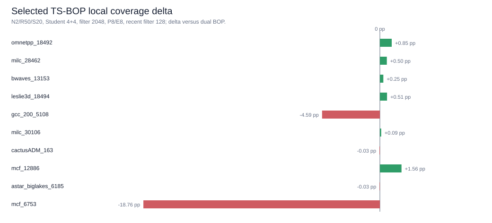

该轮实测 R50/S20 参数相对双 BOP：

- local coverage 低 1.51/2.07 个百分点；
- local sent/demand 降低 14.5%/10.4%；
- `omnetpp`、`milc_28462`、`bwaves`、`leslie3d` 和 `mcf_12886` 已达到或超过双 BOP；
- `mcf_6753` 仍低 18.76 个百分点，`gcc_200_5108` 仍低 4.59 个百分点。

`4+4` 不能证明 gcc 缺口由 pool 容量导致：在最终参数下，gcc 的 4+4 相对 2+2
反而低 0.05 个百分点。mcf/gcc 的剩余问题已转向统一 Teacher phase、family
winner 时序和全局 `bad_score`/issue-confidence 语义，不应继续通过增大 pool、
FIFO 或关闭 recent filter 来掩盖。

原始数据与图表：

- `images/ts_bop_r50_s20_selected_10pt.json`
- `images/ts_bop_r50_s20_selected_10pt.csv`
- `images/ts_bop_r50_s20_selected_checkpoint_delta.svg`
- `images/ts_bop_r50_s20_resource_sweep.json`
- `images/ts_bop_recent_filter_tradeoff.svg`
- `util/ts_bop_degree/parameter_sweep.py`
- `util/ts_bop_degree/parameter_sweep_report.py`

### 6.14 参数主体选择（family gate 前）

family gate 研究之前确定的参数主体为：

```text
N2/R50/S20 + Student 4+4 + Student filter 2048
+ Primary/Extra FIFO 8+8 + recent filter 128
```

该组合已有完整 10 点静态结果：相对双 BOP，local coverage 低
1.51/2.07 pp，local sent/demand 降低 14.5%/10.4%。它确定了最终方案的 N/R/S、
Student 和输出资源参数；后续只增加 family qualification/confidence。baseline 的
最大单点缺口是 `mcf_6753`：其 local coverage 为 32.85%，低于双 BOP 的 51.61%，
且只有 51.4% Teacher phase 通过全局 `bad_score=2` issue 条件；6.15 对该缺口做进一步归因。

### 6.15 mcf_6753 family-specific bad_score / confidence A/B

按用户建议保持最终参数不变，只把 family winner 资格设为 VBOP
`score > 2`、PBOP `score > 0`，并比较 winner 过滤与 issue-confidence 的作用域。
所有方案均使用完整 warmup 和 200,000 个 measurement demand。

| 方案 | local coverage | local sent/demand | 相对 baseline coverage |
| --- | ---: | ---: | ---: |
| 双 BOP | 51.61% | 1.426 | +18.76 pp |
| R50/S20 baseline，全局 bad_score/confidence | 32.85% | 0.900 | 参考 |
| 只按 V2/P0 过滤 family winner，仍用全局 confidence | 33.45% | 0.899 | +0.60 pp |
| V2/P0，任一 family 通过即维持共享 confidence | 55.75% | 1.990 | +22.90 pp |
| **V2/P0，family 独立 confidence** | **52.11%** | **1.432** | **+19.26 pp** |

关键结果：

- 74 个 measurement phase 中，PBOP family best score 平均 2.46，74/74 phase
  都满足 `score > 0`；VBOP family best score 平均 2.30，只有 31/74 phase
  满足 `score > 2`。
- 只改变输入 Student pool 的 winner 资格几乎不能解决问题，因为原全局
  issue-confidence 仍会同时关闭两个 family。
- 共享 confidence 改为 OR 语义能恢复 coverage，但几乎每个 demand 都发送两条，
  local sent/demand 达到 1.990，比双 BOP 高 39.6%，不符合降带宽目标。
- family 独立 confidence 使 PBOP offset 持续发送、VBOP 只在自身 gate 允许时发送，
  local coverage 比双 BOP 高 0.50 pp，local sent/demand 只高 0.46%；在该切片上
  基本恢复了双 BOP 的 coverage/traffic 点。
- separate 方案仍共享一套 Teacher score table/pointer/phase、Student filter/pool
  和输出资源；新增的核心状态是 family qualification 和两套小型 confidence 状态，
  不等同于恢复两套完整 BOP。

因此，V2/P0 必须同时用于 winner 注入资格和 family-specific issue gate，不能只
过滤 Student 输入。最终机制固定为 `PBOP bad_score=0 + VBOP bad_score=2 + family
独立 confidence`；共享 OR confidence 因流量过高不保留。完整跨点结果见 6.16。

原始数据保存在
`images/ts_bop_mcf6753_family_bad_score.json`。

### 6.16 最终机制的完整 10 点静态评估

正式 runner 使用完整 warmup，并对每点使用全部可用 measurement demand、最多
200,000 条；窗口与前述 R50/S20 和双 BOP 参考完全一致。比较对象为原双 BOP、
使用全局 confidence 的 merged baseline，以及最终 V2/P0 family 独立 confidence。

| 方案 | ideal coverage | local coverage | local sent/demand |
| --- | ---: | ---: | ---: |
| 双 BOP | 76.04% / 72.81% | 75.99% / 72.61% | 1.839 / 1.687 |
| merged baseline，全局 confidence | 74.55% / 70.71% | 74.48% / 70.54% | 1.573 / 1.511 |
| **最终 V2/P0 family confidence** | **76.14% / 72.85%** | **76.08% / 72.70%** | **1.595 / 1.527** |

表内均为 `checkpoint-weighted / access-weighted`。最终方案相对双 BOP 的 local
coverage 为 `+0.088/+0.095 pp`，可视为静态口径基本持平；local sent/demand
降低 `13.3%/9.5%`。相对 merged baseline，local coverage 提高
`1.60/2.16 pp`，发送量只增加 `1.4%/1.0%`。

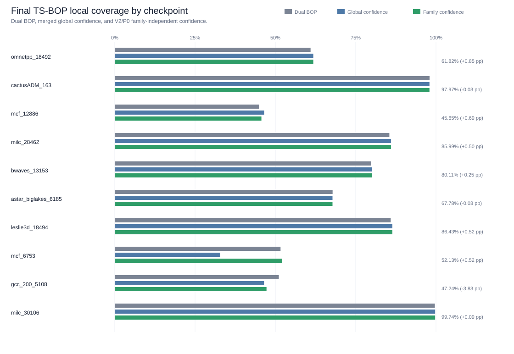

| checkpoint | 双 BOP local | 全局 conf local | 最终 local | 最终-双 BOP | 双 BOP/最终 sent | V/P pass |
| --- | ---: | ---: | ---: | ---: | ---: | ---: |
| `omnetpp_18492` | 60.96% | 61.82% | 61.82% | +0.85 pp | 1.979 / 1.884 | 97.3% / 100% |
| `cactusADM_163` | 98.01% | 97.97% | 97.97% | -0.03 pp | 1.985 / 1.100 | 97.2% / 100% |
| `mcf_12886` | 44.96% | 46.53% | 45.65% | +0.69 pp | 0.986 / 1.000 | 0% / 100% |
| `milc_28462` | 85.49% | 85.99% | 85.99% | +0.50 pp | 1.994 / 1.471 | 100% / 100% |
| `bwaves_13153` | 79.86% | 80.11% | 80.11% | +0.25 pp | 1.965 / 1.897 | 100% / 100% |
| `astar_biglakes_6185` | 67.81% | 67.78% | 67.78% | -0.03 pp | 1.964 / 1.995 | 100% / 100% |
| `leslie3d_18494` | 85.91% | 86.42% | 86.43% | +0.52 pp | 1.955 / 1.827 | 86.3% / 100% |
| `mcf_6753` | 51.61% | 32.85% | 52.13% | +0.52 pp | 1.426 / 1.432 | 41.9% / 100% |
| `gcc_200_5108` | 51.07% | 46.48% | 47.24% | **-3.83 pp** | 1.969 / 1.884 | 94.0% / 100% |
| `milc_30106` | 99.65% | 99.74% | 99.74% | +0.09 pp | 1.000 / 1.006 | 100% / 55.2% |

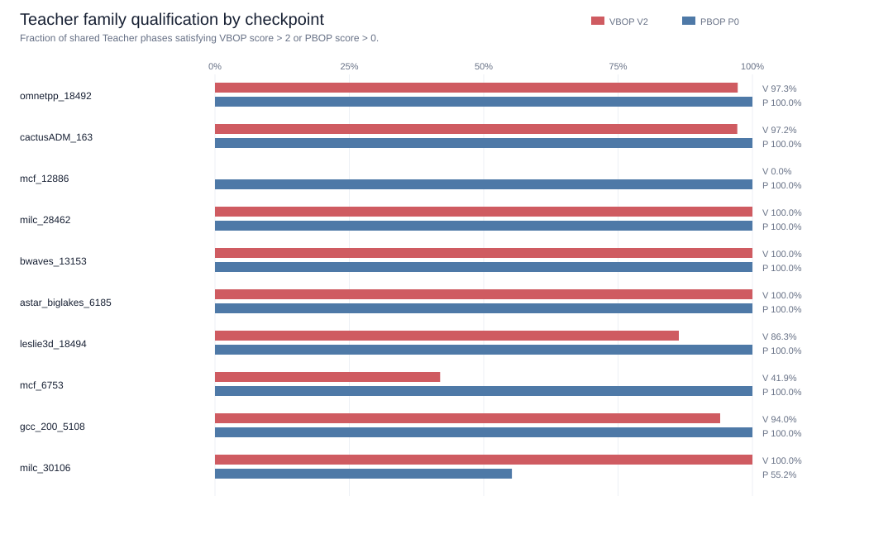

逐点结论：

- `mcf_6753` 的缺口由全局 gate 导致。PBOP 74/74 phase 通过，VBOP 31/74
  phase 通过；独立 gate 恢复 coverage，同时只在 VBOP 可信时发送第二条请求。
- `mcf_12886` 的 VBOP 0/73 phase 通过，最终方案等价于只保留 PBOP 发送；coverage
  比 merged baseline 低 0.88 pp，但仍比双 BOP 高 0.69 pp，sent/demand 从
  baseline 的 1.373 降到 1.000。
- `gcc_200_5108` 的 V/P pass 已达到 94%/100%，family gate 只比 baseline 恢复
  0.76 pp，仍比双 BOP 低 3.83 pp。这说明剩余缺口不是 confidence 参数限制，主要是
  共享 Teacher phase、winner 更新时间和单一 Student 学习窗口的机制上限。
- 其余 7 点与双 BOP 的最大负向差值仅 0.03 pp；family gate 在资格长期通过时不会
  改变 baseline 行为，在一侧不稳定时只抑制对应 family。

6.15 的一次性诊断报告 local coverage 为 52.11%；正式可复现 runner 精确复现其
ideal coverage `52.1025%` 和 sent/demand `1.432375`，local coverage 为 52.13%。
两者相差 0.018 pp；候选数和 sent/demand 完全一致，微差异只出现在旧临时脚本的
local resource replay。最终结论和后续实现统一以本节正式 runner 为准。

原始数据与报告产物：

- `images/ts_bop_family_confidence_selected_10pt.json`
- `images/ts_bop_family_confidence_selected_10pt.csv`
- `images/ts_bop_family_confidence_checkpoint_coverage.svg`
- `images/ts_bop_family_confidence_qualification.svg`
- `util/ts_bop_degree/family_confidence.py`
- `util/ts_bop_degree/family_confidence_report.py`

## 7. 后续研究与阶段 3 门槛

阶段 2 已确认：

- degree 2 相对 degree 1 在 10 个 checkpoint 上都提供额外 union coverage。
- `greedy_marginal` 的总体覆盖优于 `raw_rank`，2% threshold 比 5% 稳健。
- Primary 8 / Extra 8 配合 3:1 work-conserving 仲裁可以隔离 extra，且基本消除
  extra FIFO overwrite；E8 相对 E4 的 coverage 收益只有 0.06/0.04 pp。
- degree 3 和 Teacher top-2 的收益不足以覆盖流量或稳定性代价，不作为默认值。
- merged Teacher 每家族输出一个 winner、再用严格/弹性分区保护候选，不能形成
  总体 coverage/带宽 Pareto 改善；pool=4 目标方案和 pool=6 诊断均不进入实现。
- 完整 10 点联合扫描中，R50/S20 是当前最终参数：R25 在 `mcf` 上
  phase 过短，S16 在 `milc_28462` 上过早结束；N4 的 mcf 收益不足以抵消 gcc
  回退和双倍 RR test 数量。
- Student 从 2+2 扩为 4+4、filter 从 4096 减为 2048 entries，可保持 filter
  bit 总量为 16384 bits，并提高 0.32/0.33 pp local coverage；额外开销是 4 个
  Student entry 的元数据和更宽的更新逻辑。
- 关闭 recent filter 相对 RF128 只增加 0.06/0.07 pp coverage，却增加
  9.2%/19.1% local sent/demand；当前选择 128 entries，而不是 256 或关闭。
- 未加 family gate 的 merged baseline 为 `N2/R50/S20 + 4+4 + SF2048 + P8/E8 + RF128`；
  相对双 BOP 的 local coverage 低 1.51/2.07 pp，但发送量降低 14.5%/10.4%。
- 共享 RR 的异步双 context 能恢复大部分双 BOP coverage：总 pool=4 的 `2+2`
  local coverage 只低 0.824/0.323 个百分点，并降低 7.65%/4.61% 的本地发送量。
- 两个 context 必须异步结束；统一 phase 会改变原 VBOP/PBOP 的学习窗口。
- `2+2` 的主要剩余风险是 `gcc_200_5108` 和 PBOP pool 容量。恢复 PBOP pool
  后缺口显著缩小，而扩大 VBOP pool 的总体收益很小。
- 异步方案的 generated/demand 与双 BOP 相同，并保留两套逻辑学习状态和每
  access 两次 offset test；它是资源共享方案，不是严格的单 BOP 方案。
- `mcf_6753` 的缺口已定位到全局 issue gate：V2/P0 + family 独立 confidence
  把 local coverage 从 32.85% 恢复到 52.13%，local sent/demand 为 1.432，均与
  双 BOP 的 51.61%/1.426 接近。
- 最终机制的完整 10 点 local coverage 为 76.08%/72.70%，相对双 BOP 为
  +0.088/+0.095 pp；local sent/demand 降低 13.3%/9.5%。
- `gcc_200_5108` 在最终机制下仍低 3.83 pp；V/P pass 为 94%/100%，说明该缺口
  不是 family confidence 参数造成，而是共享 phase/winner/Student 时序的机制上限。

阶段 2d 已结束，机制与参数冻结。下一步进入阶段 3：

1. 在功能代码中实现单 merged Teacher、V2/P0 winner qualification、两套 4-bit
   family confidence、4+4 Student、degree-2 选择和 P8/E8 输出路径。
2. 把离线 256-bin hit-mask 精确模型映射为 8 个 individual counters 和最多 16 个
   cross-family overlap counters，并检查同周期更新冲突、端口数和关键路径。
3. 增加 family best score、qualification、confidence、selected offset、primary/extra
   enqueue/dequeue/drop/late/useful 等实现计数器。
4. `gcc_200_5108` 的 3.83 pp 缺口作为后续优化项继续记录 winner/驻留/淘汰时间线，
   但不再阻塞当前已选机制的首次实现。

阶段 3 实现后，重新采集同一组 trace，并比较：

- 离线预测与实际 coverage 的差值。
- primary/extra 实际生成、入队、出队、drop、late 和 useful。
- 选中 offset、marginal coverage 和 Teacher 注入分布。
- 选定 checkpoint 的 IPC，以及最终全套性能和带宽变化。

## 8. 进度

| 阶段 | 状态 | 产物 |
| --- | --- | --- |
| 0. 方案边界 | 完成 | 单 merged Teacher、family winner、4+4 Student、degree/marginal/threshold、Primary/Extra FIFO 方向 |
| 1. 敏感点筛选 | 完成 | 10 个 checkpoint，覆盖收益点、回退点和高流量点 |
| 2a. Trace 基础设施 | 完成 | L2AccessTrace + BOPInputTrace + RRInsertCount + MeasurementStart marker |
| 2b. 离线 replay/参数扫描 | 完成 | 10/10 精确校准；degree/threshold/top-N/FIFO/filter/仲裁最终汇总；58 个分析单测通过 |
| 2c. 覆盖缺口归因 | 完成 | 逐 checkpoint coverage、offset 分布图、degree/pool/top-N/phase frequency/Student delay/hash/bad-score 对照 |
| 2d. 最小机制优化 | 完成 | V2/P0 + family 独立 confidence 完成 10 点 replay；coverage 与双 BOP 持平并降低发送量 |
| 3. 功能实现与整体评估 | 完成 | 独立 CompoundBOP、family winner/gate、4+4 Student、P8/E8/RF128 已接入；idealkmhv3 0.3c 和 kmhv3 0.3c/1.0c A/B 与架构级面积估算已完成 |
| 3b. CI 参数求解准备 | 完成 | 注册 16 点 SimPoint 加权集合与 `CompoundBOPKeyNsga2ScoreSearch`；目标、关键参数域、24 小时预算及 16x16 并发已固定 |
| 4. 实现后验证 | 部分完成 | 3 个真实 checkpoint 的 IPC/流量 A/B 已完成；同 checkpoint trace 与 coverage 对齐待运行 |

### 8.1 阶段 3 实现结果

- 新增独立 `CompoundBOP : Queued`，旧 `BOP` 和默认 `kmhv3.py` 路径保持不变；
  L2 wrapper 通过 `use_compound_bop` 在旧双 BOP 与新实现之间切换。
- Teacher 扫描表只由 `vbop_offsets` 和 `pbop_offsets` 派生，不保留第三份
  `teacher_offsets` 参数；VBOP 最小 offset 之前的历史优先前缀保持原顺序，
  其余 VBOP/PBOP offset 合并后按数值升序扫描，以保持现有 tie-break 行为。
- 冷启动使用共享 Teacher global best fallback，严格要求 score `> 2`，并继续经过
  fallback offset 所属 family 的独立 issue-confidence gate。
- Student entry confidence 在 VBOP/PBOP 四槽子池内分别选择 best/worst 更新，
  Teacher 的两个 family winner 也只在对应子池中查重和替换。
- Primary/Extra 使用两个 8-entry 覆盖式 FIFO、共享 RF128 和 3:1
  work-conserving 仲裁；请求统一使用 `HWP_BOP` source。
- `gem5.opt`、`gem5.fast`、完整 `unittests.opt --unit-test`、58 项 Python replay 单测、
  `py_compile`、`git diff --check` 和 CompoundBOP 配置冒烟均已通过。

### 8.2 阶段 3 全套 SPEC06 性能与面积评估

2026-11-19 在同一提交 `7bc7b6264a08570228885d2971d21ede485a39b0` 上完成
`spec06-rva23-novec-gcc16-0.3c` 全套测试。两组均使用 `idealkmhv3.py`，只切换
`--ideal-l2-bop-mode={dual,compound}`，因此该结果直接比较旧双 BOP 与当前
CompoundBOP：

| 配置 | Actions run | 归档目录 |
| --- | --- | --- |
| CompoundBOP | [44461746571](https://github.com/OpenXiangShan/GEM5/actions/runs/44461746571) | `/nfs/home/share/gem5_ci/performance_data/spec06-rva23-novec-gcc16-0.3c/20261119_134000_7bc7b626_idealkmhv3_run2266` |
| 双 BOP | [44461746803](https://github.com/OpenXiangShan/GEM5/actions/runs/44461746803) | `/nfs/home/share/gem5_ci/performance_data/spec06-rva23-novec-gcc16-0.3c/20261119_132021_7bc7b6264a_idealkmhv3_run2267` |

| 配置 | INT score/GHz | FP score/GHz | Overall score/GHz | Overall @ 3 GHz |
| --- | ---: | ---: | ---: | ---: |
| 双 BOP | 23.648103 | 24.578351 | 24.189063 | 72.567188 |
| CompoundBOP | 23.637200 | 24.583728 | 24.187549 | 72.562646 |
| Compound 相对双 BOP | -0.0461% | +0.0219% | **-0.0063%** | **-0.0063%** |

Overall 差值只有 `-0.0063%`，当前精度下可以视为全套性能基本持平。INT 有很小的
下降，FP 有很小的上升，未观察到 CompoundBOP 导致的整体性性能损失。按 workload
汇总，较大的正向变化为 `milc +0.807%`、`bwaves +0.503%`、`wrf +0.203%` 和
`gcc +0.154%`；较大的负向变化为 `zeusmp -0.499%`、`omnetpp -0.333%`、
`GemsFDTD -0.248%` 和 `gobmk -0.207%`。这些正负变化说明共享机制改变了具体
workload 的训练和及时性，但整体收益与回退基本抵消。

面积只能在当前阶段做架构级估算。下表比较的是预期硬件逻辑状态，不是 C++ 对象的
内存占用；RR 按两路 bank、12-bit tag 加 valid 估算，Student filter 只计算实际
使用的 hit-mask 位：

| 主要资源 | 双 BOP | CompoundBOP | 资源变化 |
| --- | ---: | ---: | ---: |
| RR banks | `2 BOP * 2 * 256 * (12+1)` bit | `1 BOP * 2 * 256 * (12+1)` bit | -50% |
| Student coverage filter | `4096*4 + 2048*8 = 32768` bit | `2048*8 = 16384` bit | -50% |
| Teacher score | `(72+37)*5 = 545` bit | `109*5 = 545` bit | 持平 |
| Student pool | `4+8 = 12` entries | `4+4 = 8` entries | -33% entries |
| RR delay queue | `2*16` entries | `1*16` entries | -50% entries |
| BOP 本地输出 FIFO | `16+16` entries | `8+8` entries | -50% entries |

CompoundBOP 额外需要 16 个 cross-family overlap counter、RF128、Primary/Extra
仲裁和两套很小的 family confidence/gate 状态。综合这些新增逻辑后，当前判断是：

- 只看主要存储状态，预计减少约 `40%--50%`。
- 计入 RF128、每次 access 两次 RR lookup 的端口代价以及新增控制逻辑后，BOP
  子系统物理面积预计减少约 `25%--40%`，中心估计约 `30%`。
- 如果共享 RR 为满足吞吐必须复制或实现代价较高的双读口，收益可能只有
  `20%--30%`；如果两次 lookup 能流水/分时且 recent filter 使用紧凑实现，则可能
  接近 `35%--40%`。

这里的比例只针对双 BOP 到 CompoundBOP 的局部子系统，不能外推为整个 L2 或整个
core 的面积变化。最终数字需要在确定 RF128 结构、RR 端口方案和 counter 位宽后，
通过 RTL 综合、SRAM compiler、时序收敛和布局布线确认。

### 8.3 kmhv3 全套验证与参数求解集合

2026-11-19 在同一提交 `5694f904113bcfef4e71fc91f72daa0997e9c9f2` 上完成
`kmhv3.py` 的 0.3c 和 1.0c 全套测试。四组运行都只通过 py 参数切换
`system.l2_wrappers[0].prefetcher.use_compound_bop`，没有增加命令行模式参数：

| 覆盖率 | 配置 | Actions run | 归档目录 |
| --- | --- | --- | --- |
| 0.3c | 双 BOP | [44481902345](https://github.com/OpenXiangShan/GEM5/actions/runs/44481902345) | `20261119_155255_5694f90411_kmhv3_run2279` |
| 0.3c | CompoundBOP | [44481907978](https://github.com/OpenXiangShan/GEM5/actions/runs/44481907978) | `20261119_155240_5694f90411_kmhv3_run2280` |
| 1.0c | 双 BOP | [44494377934](https://github.com/OpenXiangShan/GEM5/actions/runs/44494377934) | `20261119_171857_5694f90411_kmhv3_run2283` |
| 1.0c | CompoundBOP | [44494384544](https://github.com/OpenXiangShan/GEM5/actions/runs/44494384544) | `20261119_171851_5694f90411_kmhv3_run2284` |

| 覆盖率 | 配置 | INT score/GHz | FP score/GHz | Overall score/GHz |
| --- | --- | ---: | ---: | ---: |
| 0.3c | 双 BOP | 21.757512 | 23.795835 | 22.930199 |
| 0.3c | CompoundBOP | 21.755400 | 23.829525 | 22.948302 |
| 0.3c | Compound 相对双 BOP | -0.0097% | +0.1416% | **+0.0789%** |
| 1.0c | 双 BOP | 20.152007 | 23.209799 | 21.891923 |
| 1.0c | CompoundBOP | 20.117445 | 23.287014 | 21.919012 |
| 1.0c | Compound 相对双 BOP | -0.1715% | +0.3327% | **+0.1237%** |

| 覆盖率 | BOP issued | BOP useful | BOP late | useful / issued | late / issued |
| --- | ---: | ---: | ---: | ---: | ---: |
| 0.3c Compound 相对双 BOP | -5.40% | -2.38% | -7.70% | 18.11% -> 18.68% | - |
| 1.0c Compound 相对双 BOP | -7.38% | -8.59% | -9.34% | 17.56% -> 17.33% | 63.90% -> 62.54% |

因此当前结论仍是“性能基本持平、小幅偏正，同时稳定减少 BOP issued 和 late”，
而不是 CompoundBOP 对所有 workload 都有普遍加速。收益和回退集中在少数切片，
适合继续做有针对性的参数求解。

参数求解集合使用以下三个筛选指标：

```text
current_weighted_impact = SimPoint weight * abs(IPC_compound / IPC_dual - 1)
historical_bop_impact   = SimPoint weight * abs(IPC_bop_on / IPC_bop_off - 1)
weighted_bop_intensity  = SimPoint weight * dual_bop_issued_per_kinst
```

最终集合保留阶段 1 的 10 个历史敏感点，并从当前 0.3c 增加 6 个 Compound/Dual
差异、高权重或高 BOP 流量点，共 16 个：

```text
omnetpp_18492          cactusADM_163          mcf_12886
mcf_6753               milc_28462             milc_30106
bwaves_13153           astar_biglakes_6185    leslie3d_18494
gcc_200_5108           gcc_166_800            gobmk_trevorc_883
wrf_9169               GemsFDTD_43464         soplex_pds-50_9466
perlbench_diffmail_2097
```

代表性点包括：`cactusADM_163` 的 Compound/Dual IPC 为 `+3.192%`，
`gcc_166_800` 为 `-4.079%`，`milc_28462` 的历史 BOP on/off 为 `+10.406%`，
两个 mcf 点的双 BOP issued 强度分别达到 `88.03/102.39 per kinst`，而
`bwaves_13153` 的 SimPoint 权重为 `0.720160`。完整选点数据保存在
`configs/solver_profiles/compound_bop_key_slices/selection.csv`。

该集合使用原始 SimPoint 权重，在每个 workload 内对保留切片重新归一化，再对集合中
实际出现的 SPEC benchmark 做几何平均。用现有结果回放评分得到：

| 对比 | INT | FP | Overall |
| --- | ---: | ---: | ---: |
| CompoundBOP 相对双 BOP | -0.0371% | +0.0311% | **-0.00038%** |
| 历史 BOP on 相对 off | +0.7242% | +0.9982% | **+0.8716%** |

这说明集合对当前 Compound/Dual 默认值几乎完全平衡，不会天然奖励其中一方；同时它把
历史 BOP 开关影响从全套的 `+0.221%` 放大到 `+0.872%`，对 BOP 参数更敏感。
求解入口已注册为 `spec06-rva23-novec-gcc16-bop-key`，对应文件为：

- `configs/solver_profiles/compound_bop_key_slices/checkpoints.lst`
- `configs/solver_profiles/compound_bop_key_slices/weights.json`
- `configs/solver_profiles/compound_bop_key_slices/selection.csv`

正式求解 spec 为
`configs/solver_specs/compound_bop_key_nsga2_score_search.py:CompoundBOPKeyNsga2ScoreSearch`。
搜索使用 `kmhv3.py`，并通过现有 py 参数
`system.l2_wrappers[0].prefetcher.use_compound_bop=True` 固定启用 CompoundBOP，
不增加新的配置命令行选项。求解配置为：

| 项目 | 配置 |
| --- | --- |
| 目标 | 最大化 `Estimated overall score per GHz` |
| 算法 | NSGA-II，单目标使用相同候选生成与保留框架 |
| 工作负载 | `spec06-rva23-novec-gcc16-bop-key`，16 个切片按 SimPoint 方式评分 |
| 时间预算 | 24 小时 |
| 试验上限 | 4096，仅作为保险上限，不设置 `no_improve_trials` 提前结束 |
| 并发 | `max_parallel_trials=16`，`max_parallel_workloads=16` |
| 面积 | 不作为目标，也不设约束 |

关键搜索参数如下；Teacher phase 和 Student slots 使用成对语义变量，避免独立搜索
产生无意义组合：

| 语义参数 | 搜索域 | 当前默认值 |
| --- | --- | --- |
| `teacher_tests_per_access` | `1, 2, 4` | `2` |
| `teacher_phase=[round_max, score_max]` | `round={25,33,50,55,60}`，`score={16,20,24,31}`，且 `score<=round` | `[50,20]` |
| `teacher_vbop_bad_score` | `1, 2, 3` | `2` |
| `teacher_pbop_bad_score` | `0, 1, 2` | `0` |
| `student_extra_marginal_threshold_pct` | `0, 1, 2, 3, 5` | `2` |
| `issue_confidence_threshold` | `10, 12, 14, 15` | `14` |
| `recent_filter_entries` | `64, 128, 256` | `128` |
| `student_slots=[VBOP,PBOP]` | `[2,2], [4,4], [4,8], [8,4]` | `[4,4]` |
| `issue_confidence_pass_decrement` | `1, 2` | `1` |
| `issue_confidence_fail_increment` | `1, 2, 3` | `2` |

该域共有 `738720` 个合法参数组合，另加一个不覆盖参数的当前默认配置基线。
offset 表、RR/tag/delay、Student filter/hash、FIFO 和 arbiter 保持当前冻结设计；这些项
不属于本轮已确认的关键算法参数，混入会显著稀释 24 小时内对关键参数的采样密度。

这个集合是“参数辨识集合”，不是全套代表集。求解完成后仍必须回到 0.3c 或 1.0c
全套复验，避免只优化这些敏感点。

### 8.4 阶段 4 真实 checkpoint IPC A/B

2026-11-19 使用新构建的 `build/RISCV/gem5.fast` 和 `idealkmhv3.py`，在相同
checkpoint、CPU/cache 配置和 NEMU REF 下只切换
`--ideal-l2-bop-mode={dual,compound}`。每个任务使用
`--warmup-insts-no-switch=20000000 --maxinsts=40000000`，下表均取统计清零后的
第二个 block；六个任务的 measurement `simInsts` 均约为 20M，且 difftest 正常结束。

| checkpoint | dual IPC | compound IPC | IPC delta | HWP_BOP issued delta | HWP_BOP useful delta | HWP_BOP late delta | L2 data miss delta |
| --- | ---: | ---: | ---: | ---: | ---: | ---: | ---: |
| `bwaves_13153` | 3.258169 | 3.274571 | +0.503% | -12.918% | +7.718% | -24.029% | -2.445% |
| `mcf_6753` | 0.748672 | 0.747137 | -0.205% | -0.545% | +3.840% | -3.689% | -0.098% |
| `gcc_200_5108` | 2.201955 | 2.203859 | +0.086% | +2.037% | -5.241% | -3.202% | +2.207% |

- 三点等权 IPC 几何平均 delta 为 **+0.128%**。三个等长 measurement 窗口直接汇总时，
  HWP_BOP issued 为 -2.214%，useful 为 +4.494%，late 为 -7.940%，L2 data miss
  为 -0.175%。该汇总只描述这三个有意挑选的敏感点，不代表 SPEC 全套结果。
- `bwaves_13153` 是当前最明确的正向点：Compound 减少实际发送和 late，同时降低
  L2 data miss，最终 IPC 提升约 0.50%。
- `mcf_6753` 的 useful/late 方向改善且 L2 data miss 基本持平，但 IPC 仍回退
  0.205%。这说明 family gate 修复消除了明显流量问题后，closed-loop 时序、cache
  干扰或关键 miss 的及时性仍需用实现后 trace 继续定位。
- `gcc_200_5108` IPC 基本持平，但 useful 下降、L2 data miss 上升，与离线 replay
  已记录的 coverage 风险一致；该点不能仅凭 IPC 持平视为问题已关闭。
- Compound 的 Primary/Extra generated、RF128 filter、enqueue/dequeue、overwrite、
  local/downstream late 和 first-useful 详细计数，以及双 BOP 对照原始计数，保存在
  `docs/design-docs/images/ts_bop_checkpoint_ipc_ab.csv`。其中 Primary/Extra useful
  是按 `isPfFirstHit()` 做的角色归因，不应与父预取器可能包含重复命中的
  `pfUseful_srcs::HWP_BOP` 直接相加比较。
- 本次输出目录为 `/tmp/ts_bop_checkpoint_ab_20261119/full`。下一步仍需对相同
  checkpoint 重新采集实现后 trace，检查 actual coverage、winner/offset 时间线和
  Primary/Extra 的及时性。

## 9. 已知风险

- 合并 offset list 使 Teacher phase 变长，可能降低模式切换时的适应速度。
- 只看无限未来地址匹配会高估过早预取，必须同时报告资源约束结果。
- 原始 trace 驱动的新方案 replay 是 open-loop，无法完全复现预取改变 hit/miss、训练流和 cache 状态的反馈。
- 当前资源模型只覆盖 BOP 局部 FIFO/filter/仲裁，不包含 CDP、父 PFQ、cache eviction 和内存系统竞争。
- 10 个点是有意选择的 BOP-sensitive 集合；checkpoint-weighted 和 access-weighted 结果都不能直接外推为全套性能。
- 16 点 `bop-key` 集合也是定向敏感集合，不代表完整 SPEC06 分布；单切片 workload
  在 workload 内会归一化为权重 1，只有 mcf/milc 的两个保留点会按相对 SimPoint
  权重互相加权。它适合参数辨识，但最终候选必须回到全套验证。
- 4+4、SF2048、E8 和 RF128 使用完整 10 个敏感 checkpoint 或六点 sensitivity
  支持；R50/S20 已完成完整 10 点回放。
- 固定 coverage threshold 在不同 checkpoint 上的流量控制效果差异很大；
  参数选择必须同时检查逐点退化和 extra request efficiency。
- R50/S20 最终参数的 local sent/demand 收益依赖 shared recent filter；实现时若过滤
  顺序、hash 或容量不同，带宽收益可能不能复现。
- 最终机制必须彻底移除“一个全局 issue-confidence 同时关闭两个 family”的发送
  语义；若功能实现仍在外层保留旧 global gate，会重新引入 `mcf_6753` 回退。
- `PBOP bad_score=0` 在多数点使 PBOP phase 全部通过，但完整 10 点 sent/demand
  仍比双 BOP 低 13.3%/9.5%；实现后仍需用实际 useful/late/bandwidth 检查 closed-loop
  反馈，不能只依赖静态流量。
- `gcc_200_5108` 仍比双 BOP 低 3.83 pp，是当前最大单点 coverage 风险；其高 family
  pass rate 表明继续调 bad_score/confidence 不太可能解决问题。
- 异步双 context 的 BOP-selected generated/demand 也没有下降；其本地流量收益
  同样依赖 shared filter，不能等同于 Teacher/Student 动态功耗同比下降。
- N2 当前静态模型假定每个 access 可以连续完成两次 RR lookup/test。若实际
  单端口无法满足吞吐，需要双端口、两拍流水或输入队列，可能抵消面积和及时性收益。
- 阶段 3 的 `25%--40%` 面积降幅只基于逻辑状态和结构数量，不是 RTL 综合结果；
  RR 双读口或表复制、RF128 的具体实现、counter 位宽、SRAM compiler、布线和时序
  优化都可能改变最终面积，其中 RR 表复制会使结果更接近估算区间下限。
- 4+4 + SF2048 只保持 Student filter bit 数不变，并不代表 Student 总面积不变；
  还需计入 4 个 entry 元数据、8-bit mask 更新和跨 family overlap counters。
- 离线 replay 用 256-bin 8-bit hit-mask 直方图精确算 union；硬件候选应改为 8 个
  individual counter 和最多 16 个 pair-overlap counter，二者的更新冲突与近似
  误差尚未验证。
- ArchDB 使用内存 SQLite 并在退出时整体保存；完整 mcf trace 约 0.5--0.7 GiB，完整参数矩阵峰值内存约 9.3 GiB，后续批量运行需保留资源余量。
- HWP_BOP source 不能区分 PBOP/VBOP 的实际 useful hit；原方案的分项实际覆盖只能结合生成 trace 推断，合并方案实现前只能报告静态 ideal/local coverage，不能报告新机制的 runtime first-hit coverage。

## 10. 代码入口

- `src/mem/cache/prefetch/bop.cc`：Teacher/Student 学习、coverage 与 offset 选择。
- `src/mem/cache/prefetch/Prefetcher.py`：VBOP/PBOP 参数与 offset list。
- `src/mem/cache/prefetch/l2_composite_with_worker.cc`：双 BOP 调用和 L2 发送仲裁。
- `src/mem/cache/prefetch/queued.hh`：现有覆盖式 `PFRequestBuffer`。
- `src/sim/arch_db.{hh,cc}`、`configs/common/xiangshan.py`：ArchDB 表和写入接口。
- `util/ts_bop_degree/analyze.py`：trace replay、参数扫描、ideal coverage 与 stats 对齐检查。
- `util/ts_bop_degree/summarize.py`：10 点汇总、双权重口径、runtime traffic 与局部资源对比。
- `util/ts_bop_degree/offset_distribution.py`：双 BOP 与 merged primary/extra offset 分布、家族占比和 SVG/CSV/JSON 图表。
- `util/ts_bop_degree/partitioned_pool.py`：merged Teacher family winner、严格/弹性家族分区和 cross-family pair replay。
- `util/ts_bop_degree/partitioned_pool_report.py`：分区方案逐点/总体 CSV 和 coverage/traffic SVG。
- `util/ts_bop_degree/teacher_param_sweep.py`：Teacher `round_max`/`score_max` 并行 replay、phase 统计与 offset 分布。
- `util/ts_bop_degree/teacher_param_report.py`：参数扫描 CSV、coverage/phase 热图和 bandwidth trade-off 图。
- `util/ts_bop_degree/async_dual_context.py`：共享 RR、异步双 Teacher/Student context 和分区 pool 静态回放。
- `util/ts_bop_degree/async_dual_context_report.py`：异步方案总体/逐点 CSV 和 coverage/traffic SVG。
- `util/ts_bop_degree/merged_multi_test.py`：单 merged Teacher、多 offset test、family 分区 Student、mixed delay 和最终 family-confidence replay 类。
- `util/ts_bop_degree/family_confidence.py`：冻结参数下的双 BOP、global confidence 和最终 family confidence 完整 10 点回放。
- `util/ts_bop_degree/family_confidence_report.py`：最终逐点 CSV、coverage 和 family qualification 图。
- `util/ts_bop_degree/parameter_sweep.py`：N/R/S、Student pool/filter、FIFO 和 recent-filter 联合静态扫描。
- `util/ts_bop_degree/parameter_sweep_report.py`：最终逐点 CSV、coverage delta 和 recent-filter trade-off 图。
- `util/ts_bop_degree/checkpoints.json`：当前 10 个 checkpoint、权重和结果目录。
- `configs/solver_profiles/compound_bop_key_slices/`：16 点参数求解集合、SimPoint 权重和选点依据。
- `configs/solver_specs/compound_bop_key_nsga2_score_search.py`：24 小时 CompoundBOP NSGA-II 单目标求解配置。
- `util/xs_scripts/perf_benchmarks.py`：注册 `spec06-rva23-novec-gcc16-bop-key` 的 CI benchmark 入口。
