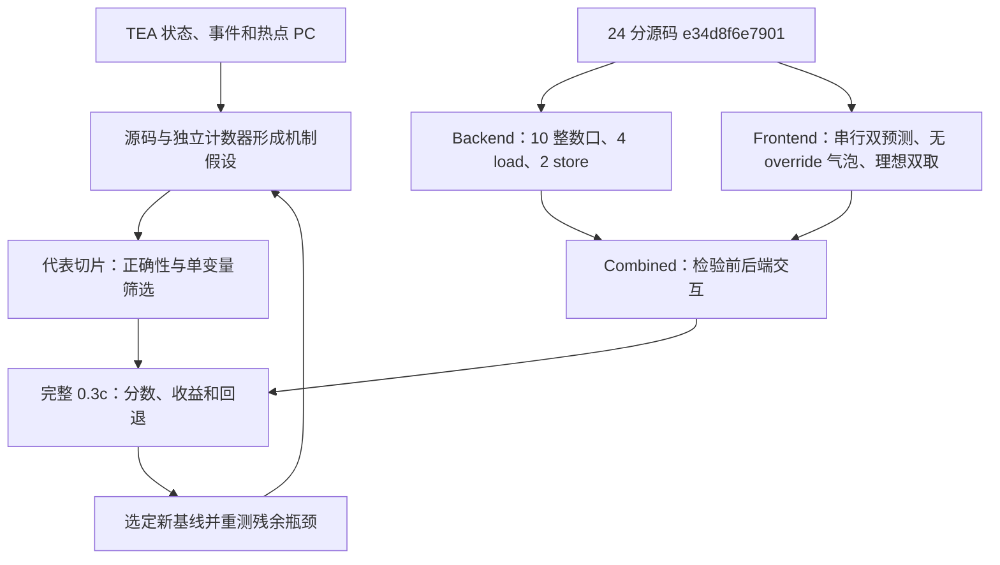

# TEA 驱动的性能上限探索

目标：在固定 **SPEC06 GCC16 RVA23 novec 0.3c、145 个切片**上，探索 INT **26–28/GHz**。当前已实现宽后端、串行双预测和理想双取探针。原24分配置换用0.3c JSON重算为**26.72579/GHz**，作为本轮同点集基线；新增配置的完整CI仍在运行。

## 阅读入口

| 报告 | 要回答的问题 | 当前证据 |
| --- | --- | --- |
| [第零轮：统一点集与基线](round-00.md) | 历史 24 分配置换到 0.3c 后是多少分？ | 两组均145点完整；26.72579→26.87533（+0.56%） |
| [第一轮：实现与代表点验证](round-01.md) | 宽后端与理想前端是否有效、能否正确运行？ | 完整INT26.72579→27.94319（+4.56%）；前端与组合CI运行中 |
| [第二轮：缓存并发探针](round-02.md) | 4 load扩宽后，缓存MSHR是否成为限制？ | L1、L2及组合三个局部受控实验；正式ROI TEA采集中 |
| [第三轮：TEA残余诊断](round-03-tea.md) | 组合后还受哪些依赖链限制？ | 20M预热+2M窗口，四状态/九事件守恒与ELF热点映射 |
| [第四轮：独立4load](round-04-fourload.md) | 原12宽下，第4个load口有什么收益？ | CoreMark与8组代表点通过；两组完整0.3c已创建 |
| [探索计划](plan.md) | 哪些约束允许放松，什么证据才能纳入基线？ | 固定点集与测量规则 |
| [实验清单](runs.json) | 每个结果具体运行了哪份代码与参数？ | 完整 dispatch 输入、被测 SHA 与 Actions 链接 |

报告使用 Markdown。定量图以相对路径插入 `figures/` 下的图片，流程使用 Mermaid；共享时保留整个目录即可。每轮保留配置、原始数据与审查入口，最终整体报告在完整结果和后续探索结束后补齐。

## 方法与本轮实验

资源增加和时序放松均可作为上限探针。TEA 热点和事件次数用于选择实验，收益由完整加权测量确认；同一事件可重复发生，不能直接等同于可移除的周期。

## 复核入口

- 局部 IPC：[data/local-probes.csv](data/local-probes.csv)。这些约 1M、无预热窗口用于筛选方向，不能作为 SPEC 得分。
- 计数器原值与口径：[data/local-counters.json](data/local-counters.json)。包括实际提交量、CPU width、单位与 stats 描述。
- 独立审查：[首次审查](review-initial.md)、[定向复核](review-followup-b.md)。动态验证结果和已修复问题见第一轮报告。
- 正确性脚本：[`upperbound_smoke.py`](../../../util/xs_scripts/upperbound_smoke.py)；取指微测：[`riscv-upperbound-fetch`](../../../tests/test-progs/riscv-upperbound-fetch/README.md)。

最新方向：保留原12宽与整数拓扑，独立评估第4个load口；原16宽大窗口整包作为上限参照。验证进度见[探索计划](plan.md)。
