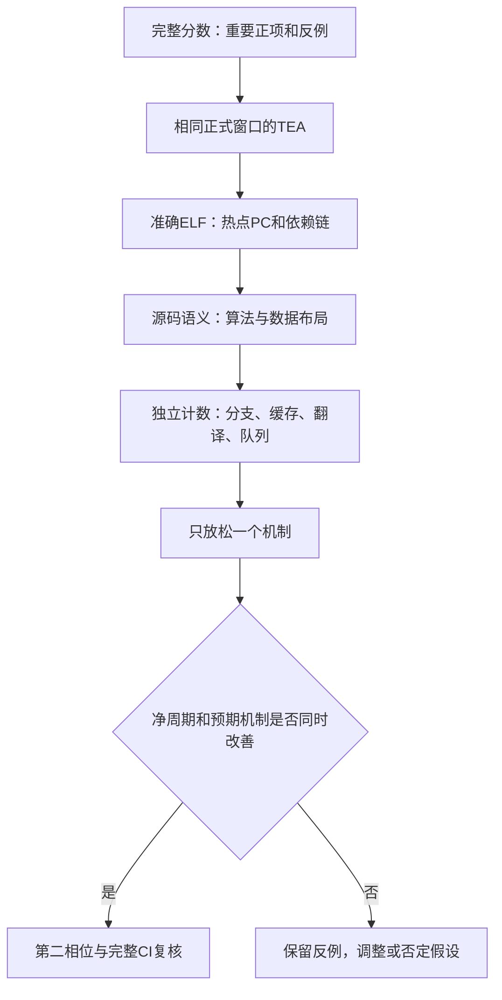

# 下一轮自动化性能探索：怎样从证据选择实验

本轮把12宽组合从26.73推到30.21，并用完整CI分离双供给和去override气泡。后续保持12宽，以这一组合为分析基线；目的仍是寻找性能上限，不按RTL面积筛选。完整分数与最终判断见[主报告](report.md)。

资源优先级按最新讨论：先看LSU内部entries。L2/L3总容量默认保持当前规模，MSHR和bank可以单轴放宽；若有明确容量或预取污染证据，总容量也可以扩大作诊断，帮助区分预取器问题，不把扩cache作为默认动作。

## 1. 先决定比较的是什么

同一实验固定profile、checkpoint、ELF、REF、源码和实际INI。0.3c用于本轮筛选；历史1c只作参照，新增1c数值只能标为估算。每个候选都有单独标识、完整命令和变更轴，不能只记录可移动分支名。

先看完整加权benchmark的正负变化，再选重要切片深入分析。不能用某个热点的TEA权重乘上总分，直接计算“优化后可得多少分”：权重包含Computing、事件可重叠，真正可改善的依赖尚未通过干预确认。

## 2. 让采样窗口成为硬验收条件

单核不切换CPU时，`maxinsts`包含预热。20M预热＋20M测量需设40M总上限；20M预热＋2M诊断需设22M。验收同时检查：

- INI中的预热阈值和总退出上限；日志中确有预热dump/reset。
- 两个完整统计块，首块约20M，最后一块是预期ROI；保留批提交造成的实际指令数。
- 正常maxinst退出、difftest和相关配置正确；正常退出本身不能证明已完成预热。
- TEA样本、互斥状态、CSV权重与特殊PSV守恒；另做同参数关闭TEA的周期/关键计数对照。
- 与已有相同CI比较时，窗口长度和相位一致；先核对周期与提交数，再解释差异。

本轮旧本地2M消融没有执行完预热，现仅保留为冷启动探针；[纠正审计](data/local-window-correction-audit.md)和[完整CI窗口复核](data/full-ci-window-audit.md)分别记录影响与未受影响范围。

## 3. 从热点走到可以证伪的假设

源码帮助解释算法，实际ELF决定指令与依赖。无应用DWARF时，结构和语义可以匹配，单个PC到一行源码仍需保留不确定性。当前10月构建目录不能替代8月profile的精确ELF，详见[溯源](deep-dive/source-provenance.md)。

每个程序至少检查当前组合Top 5 PC、基线Top 5的变化，以及各事件的热点；再向前看地址/数据生产者，向后看消费者、分支与退役。最高总权重可能只是频繁执行或程序固有依赖，不必然有硬件可消除空间。排名较低的PC若有明确可改变的阻塞机制，反而可能是更好的候选。

每项先区分“已观察到的负担”和“可验证的余量”：算术/分支必需工作、无法提前产生的串行地址、已被预测隐藏的加载链，与资源不足、错误恢复或预取干扰分别讨论。只有干预支持后才能提高优化优先级，不把Top 1的权重当收益上限。

计数器需先查定义：mcf的DTLB initial miss可以因重试重复计数；walker busy cycles不是CPU停顿；缓存累计service ticks可以重叠；`idealOverrideBubblesSaved`是被清零的名义等待量，不是净省下的CPU周期。

## 4. 三个方向可以并行，组合实验放在后面

| 方向 | 当前线索 | 首个有区分力的实验 | 需要同时出现的证据 |
| --- | --- | --- | --- |
| mcf：翻译与指针链 | 两条先取指针、再解引用的load链；PTW请求多，initial miss不等于唯一失败请求 | 在最终12宽背景只扩大L1 DTLB容量；若不改善，再按证据选择PTW或数据服务轴 | 净CPI、实际PTW/翻译延迟、热点链归因的变化一致；不能只看lookup数下降 |
| perlbench：连续控制流供给 | 完整benchmark双供给+22.05%，去气泡+0.34%；存在间接分发和字符扫描 | 先保持正常override比较供给；再按新热点选间接目标预测或单一供给约束 | 对应供给/恢复或目标错误改善，并转化为净周期；不能只看入队数量 |
| astar：保留负例 | 完整benchmark双供给−1.58%；容量改善；rivers有邻居标记load与分支 | 固定供给，只改变一项窗口资源；或固定后端做预测/取指单轴 | 区分错误次数、解析等待、依赖和资源拥塞；不因回退直接认定预测准确率下降 |

表中实验是待验证候选，不是已经证实的优化。每个方向独立保存命令和结果，复用相同基线；局部支持后才做完整CI。组合阶段使用“有无A×有无B”的受控对照，报告条件收益，不能把单项百分比直接相加。

## 5. 怎样保留、否定与交付

一个候选的记录应回答：改了什么、针对哪条依赖、预期哪个独立指标变化、实际净周期怎样、在哪些点无效或回退。单点成功只证明该点；完整加权结果才决定是否进入下一轮基线。

负结果同样保留。本轮L2 MSHR扩容的冷窗口回退、astar双供给的完整子项回退、libquantum容量组的小幅回退都用于约束解释，不删去不符合直觉的点。

少数CI慢点可先冻结共同完成集合，但四侧使用相同点集、每个输入均有覆盖、coverage一致，且列出遗漏与原始权重。全量到齐后替换暂定结论，不能把单侧部分分数直接除以完整基线。

人阅读的主报告只保留决策、关键条件收益、原因和缺口；每程序专题保留PC/汇编、计数定义和反证；机器数据保留配置、hash、原值和审计。这样下一次可以继续探索，也可以检查某个判断是否有足够证据。
