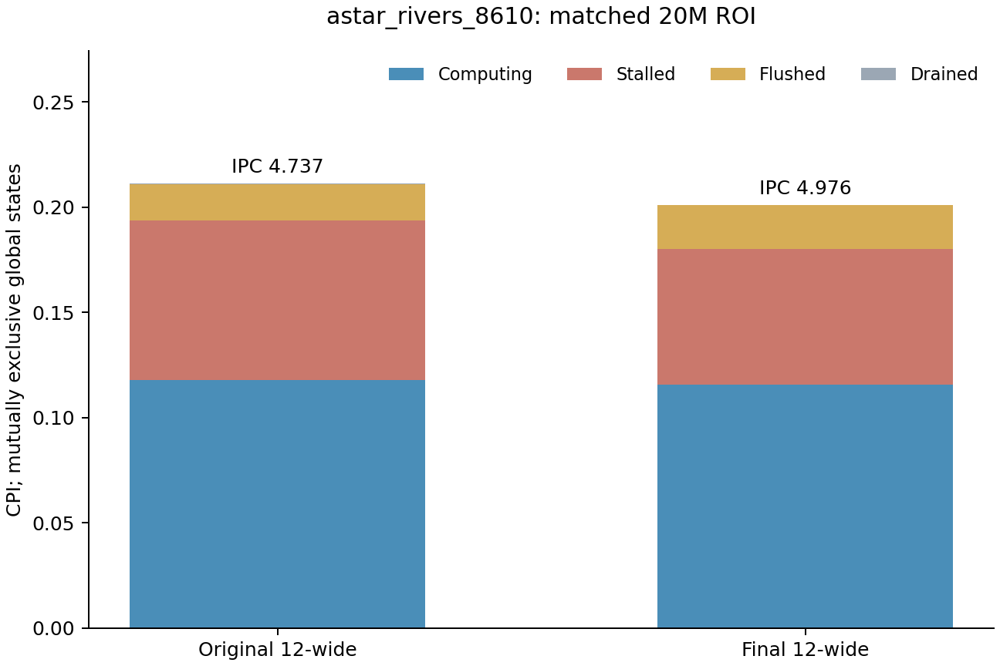
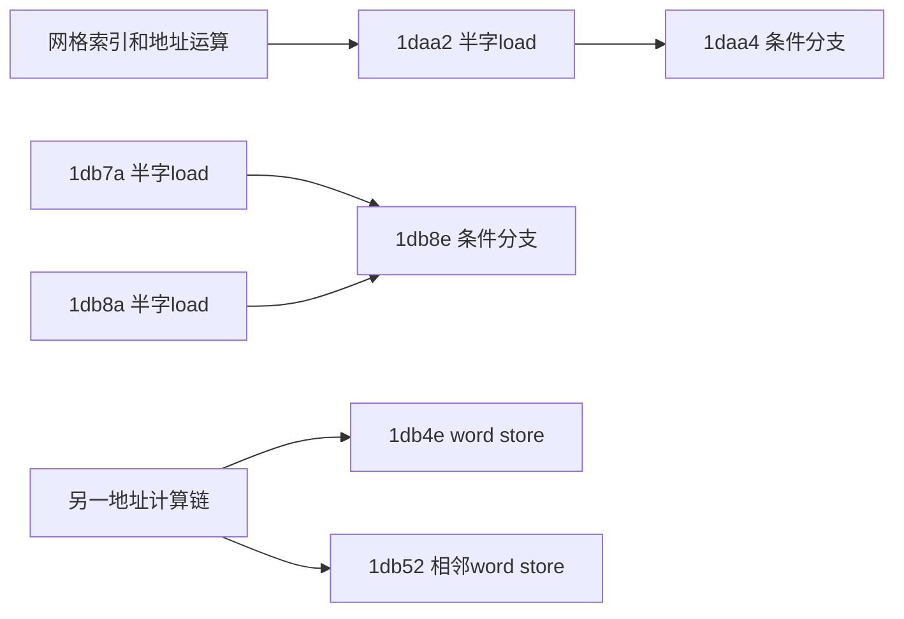

# astar：保留供给回退，扩大到真实Top 5再验证LSU压力

完整0.3c中，理想前端使astar子项回退0.76%；保持正常override的双供给对照回退1.58%。加入4load和七项容量后，最终组合相对原基线提高6.45%。这说明更强供给与后端承接能力需要配合，不能把总体正收益外推到每个程序。

本文固定`astar_rivers_8610`。两侧正式TEA与原容量背景的RAWQ单轴均已完成；大窗口背景RAWQ矩阵补点仍在运行，不使用预热块填充正式结论。精确`astar_rivers.elf`已与该profile rootfs的`spec/astar`逐字节hash核对一致。[ELF溯源](../data/astar-elf-provenance.json)

## 1. 回退没有伴随更多提交分支错误

| 正式CI末20M | 原12宽基线 | 理想前端 | 理想前端＋4load | 再加七项容量 |
| --- | ---: | ---: | ---: | ---: |
| IPC | 4.73706 | 4.64588 | 4.75646 | 4.97594 |
| 提交分支错误 | 48,222 | 47,746 | 47,530 | 47,426 |
| RAWReplay事件 | 2,040 | 23,374 | 78,831 | 441 |
| RAWQ满周期 | 2,399 | 11,818 | 36,968 | 2,383 |
| L1D ReadReq miss | 206,072 | 204,725 | 215,267 | 226,617 |

理想前端略减少分支错误和L1D miss，IPC却下降；最终组合miss更多，IPC反而提高。单个次数变化不能解释净性能，也不支持将回退简单归给预测准确率下降或cache全面恶化。

RAW队列压力随供给和load带宽上升，扩窗组合中明显下降，值得单独检验。七项容量同时改变，尚不能把改善归于RAWQ；满周期与replay也有重叠和重复计数，不能相加成CPU损失。[完整计数与定义](astar-ci-residual-notes.md)

## 2. 正式配对和当前Top 5

两侧20M预热＋20M正式测量、核心计数与对应CI逐值匹配，TEA守恒通过。原基线IPC4.73706，最终组合4.97594，本点提高5.04%；完整astar子项增益为6.45%，不能混用。

总CPI0.211101→0.200967，其中Stalled降低0.010799 CPI，Flushed却增加0.003233 CPI。端点同时包含前端、4load与七项容量变化，不能据状态或PC差额把净收益分配给某一个机制。

| 当前Top 5 | 总归因CPI：基线→组合 | 生产者/消费者及判断边界 |
| --- | ---: | --- |
| `0x1db4e sw s3,0(a2)` | 0.016529→0.019757 | `ld→sh3add`形成地址，旁边还有offset 4的store；可能是频繁必要写入或生产者等待，不能直接推导store带宽瓶颈 |
| `0x1db8e bne a7,a6,...` | 0.012218→0.013223 | 消费`1db7a/1db8a`的半字加载；当前FL_MB为0.010403 CPI，需分别分析outcome与解析时间 |
| `0x1daa4 beq a1,a4,...` | 0.009389→0.009999 | 消费`1daa2`，当前FL_MB为0.008747 CPI；不能仅凭源代码认定可预测或不可预测 |
| `0x1daa2 lhu a1,0(a5)` | 0.019971→0.009381 | 索引/地址→半字load→分支；权重大幅下降，但没有PC×状态字段，不能把该差额全归为消除停顿 |
| `0x1db3a lw a2,16(a5)` | 0.004729→0.009314 | 与邻近load值比较，后续另有地址生成和store链；是否为关键依赖或必要重复工作需动态证据 |

五条均位于 **`way2obj::createway`的LTO clone**。此前选取的`wayobj::makebound2 / 0x1c1dc`并非此窗口Top 5，已降级；基线最高的`1daa2`在当前排第4，`1db3a`进入前5，不能沿用旧排名。总权重包含Computing和其它状态，不等于可优化空间。

实际`Way2_.cpp`的网格标记、邻居扩展与路径回溯提供结构语义；LTO符号覆盖多个内联阶段，无应用DWARF，仍不能把单PC武断指定到某行或变量。[正式配对、全部事件与源码边界](astar-formal-tea-paired.md)

## 3. 事件视角补充总排名

两条分支`1db8e`、`1daa4`是FL_MB主热点；`1db8a`是ST_L1主热点，`1daa2`在ST_TLB中突出。它们可能指向预测恢复、load到branch解析、翻译和LSU等待的不同机制。事件可重叠，没有PC×四状态联合字段，不能将这些标签相加或给每条指令分配互斥停顿。

原容量背景的RAWQ56→128已完成：RAWReplay78,831→0、满周期36,968→0，IPC仅提高0.3636%。这说明消除大量重放不自动带来相同比例提速；不能把0.36%作为七项容量组合的独立贡献，也不能证明RAWQ在大窗口背景不必要。[单轴结果](astar-rawq-ablation-analysis.md)

当前正在补齐“其它六项容量×RAWQ容量”的第四格：固定最终大窗口，只将RAWQ128改回56。它检验不同窗口中的条件效果，而不是继续盲目扩队列；结果回来前不预填收益。[两轴矩阵](residual-hypotheses.md)

后续优先LSU内部entries；MSHR和bank在具体服务/冲突证据支持时也可单轴放宽。L2/L3总容量默认维持，容量或预取污染证据明显时再扩容量作诊断。当前不依据Top 1或某个replay计数直接扩cache。
