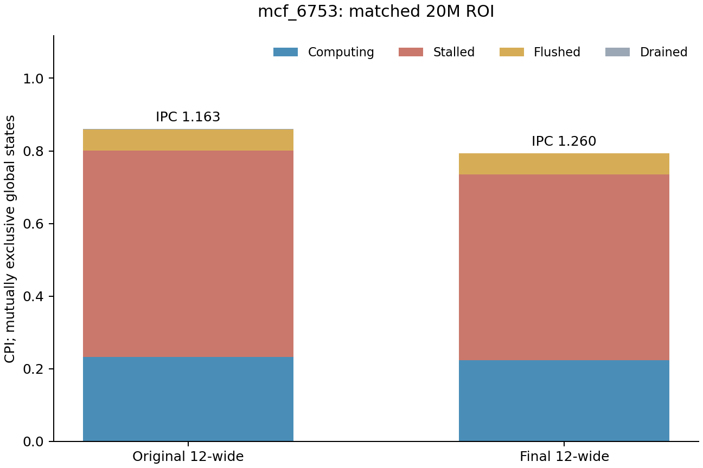
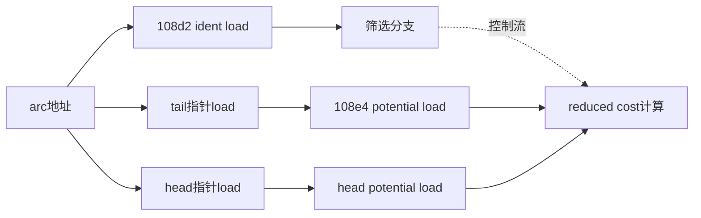

# mcf：把arc扫描、树刷新与翻译计数分开

完整0.3c中，mcf的理想前端子项提高3.53%，最终12宽组合提高8.64%，小于perlbench的前端收益。它更适合研究访存链如何被执行窗口、翻译和预取承接，不能仅沿前端供给继续增加资源。

本文固定`mcf_6753`。两侧正式TEA均已验收，20M预热＋20M测量，IPC1.16301→1.26031，本点提高8.37%；完整mcf子项提高8.64%，两者不可混用。核心及全部共有非主机数值与各自CI末块一致，L1 DTLB单轴仍在运行。

## 1. 当前Top 5覆盖arc扫描与树刷新

旧短窗口曾把注意力集中在`tail->potential`，新正式配对同时显示arc筛选和树刷新。所有PC来自精确profile ELF的`main`内LTO代码；源码语义来自布局和指令结构匹配，未确认单行对应。

总CPI0.859839→0.793458，Stalled从0.567694降到0.510876。端点同时改变前端、4load与容量，不能把CPI变化分给某一个资源。

| 当前Top 5 | 总归因CPI：基线→组合 | 事件线索（当前，可重叠） | 依赖链与可优化性边界 |
| --- | ---: | --- | --- |
| `0x10ff0 ld a0,0(a0)` | 0.074465→0.071793 | ST_L1 0.070838、ST_TLB 0.060925 | node→basic_arc→cost；地址依赖是真实程序工作，翻译或服务等待的可隐藏部分需验证 |
| `0x108e4 ld t6,0(t6)` | 0.062048→0.069614 | ST_L1 0.067333、ST_TLB 0.029182 | arc→tail→potential；权重上升不等于它使组合变慢，两条potential链的动态并行度待查 |
| `0x108d2 lw t4,24(a5)` | 0.121640→0.066731 | ST_L1 0.065946、ST_TLB 0.045997、ST_LLC 0.063066 | arc.ident→筛选分支；扫描必要，访问能否提前或隐藏等待需轨迹/干预 |
| `0x10fd4 ld a0,0(a0)` | 0.050335→0.050012 | ST_L1 0.047727、ST_TLB 0.020719 | 另一入口的basic_arc→cost；权重几乎不变不证明它不可优化或一定是瓶颈 |
| `0x10fee ld a2,0(a4)` | 0.034577→0.034688 | ST_TLB仅约0.000015 | node→pred→potential；显式事件很少，高总权重不足以支持访存扩容 |

当前前五约占全部样本36.91%，含Computing，不是可省下的36.91%时间。基线第一的arc.ident已排第三，树刷新cost成为当前第一；不能只围绕旧Top 1优化。[正式配对和各事件Top 5](mcf-formal-tea-paired.md)

## 2. 静态依赖不是同一种限制

arc扫描的语义候选是`pbeampp.c`中的筛选与reduced cost计算：

ident决定控制路径，但并不直接生成tail/head地址；预测正确时，硬件可能提前执行后续工作，不能把控制边误画成必然串行地址边。两个potential load则确有各自的指针地址生产者。

树刷新对应`mcfutil.c`中node、pred和basic_arc的遍历结构，近似语义为`pred potential ± basic_arc cost`。这些链可能受真实指针依赖限制；扩大entry只能增加可见并发，不能让尚未产生的地址提前变得已知。需要请求时序和单轴结果确认可隐藏部分。

## 3. 从事件看出两类候选

当前组合ST_L1、ST_TLB、ST_LLC分别0.432056、0.282073、0.065302 CPI，事件不可相加。ST_LLC几乎集中在arc.ident加载，而树刷新链更突出ST_TLB。两类行为应分开研究预取覆盖/及时性与翻译/窗口，不把所有load看成同一种cache问题。

更大的DTLB也不是由高ST_TLB直接推导的正确答案。已有CI中，理想前端使initial DTLB lookup miss约增六倍，但PTW实际内存请求、替换与replay并没有同比增加；队列重试可能重复计数。[计数定义与反例](mcf-translation-counter-notes.md)

正在运行的单轴是在最终12宽组合中只把L1 DTLB48→512。需要同时检查净CPI、实际PTW工作、替换/translation replay和服务等待；若仅lookup计数下降，不能称容量瓶颈已解决。512是启用压缩后的槽数，不等同于固定512个4KiB页面。

## 4. 下一步选择条件

- 对arc扫描，先确认真实地址序列和预取的覆盖、及时性、无用请求；有服务/并发证据时可单轴放宽MSHR或bank，而非从LLC标签直接认定总容量不足。
- 对树刷新，区分地址产生的固有串行性、翻译服务和LSU entry是否限制其它可并行节点。优先内部entries及已启动的DTLB反证。
- 总容量保持现有规模作为默认；若有明确容量或预取污染证据，也可以扩大L2/L3容量作诊断，观察收益是否提示预取器策略问题。

当前已完成端点配对，DTLB单轴仍待验收。基线OFF已匹配，组合OFF仍在执行；不把这些证据扩大为普遍观察等价，也不把Top 5权重转换成预测得分。
