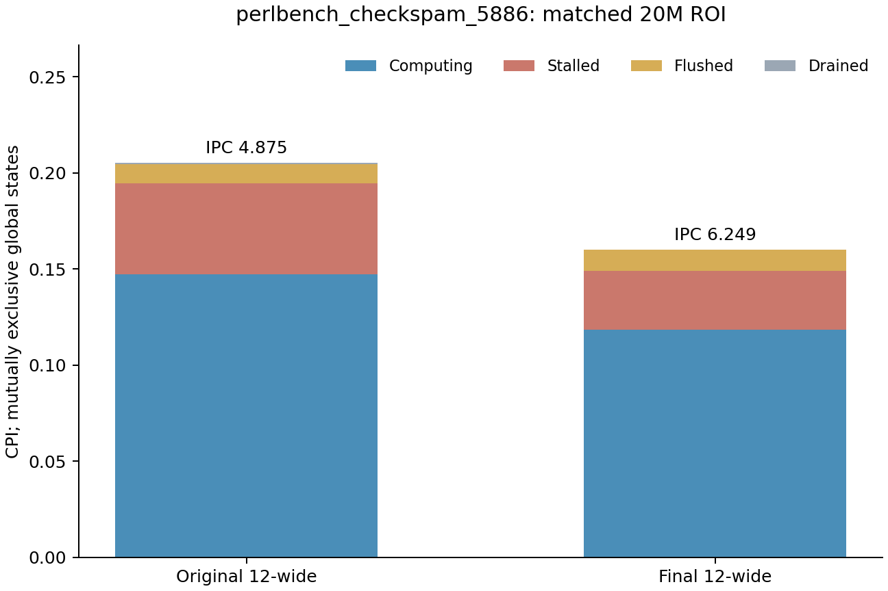
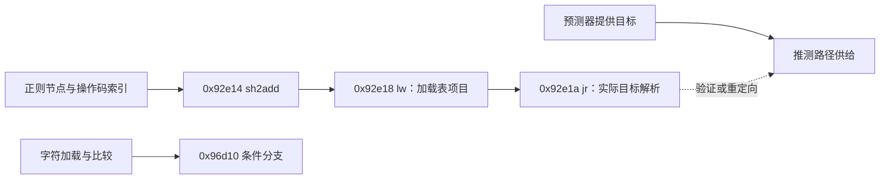

# perlbench：先改善连续供给，再区分分支与解释器访存

完整0.3c中，perlbench的理想前端子项提高23.36%，最终12宽组合提高27.70%。在保持原12宽后端的A/B/C对照中，双供给带来22.05%，去override气泡再带来0.34%。这一程序支持先研究连续供给，不能把整包收益主要归于去气泡。

本文的机制窗口固定`perlbench_checkspam_5886`。下表来自完整CI的最后20M；其它perlbench输入仍由完整benchmark结果覆盖，不能把这一切片当作全部perlbench。

## 1. 正式窗口支持供给解释

| 同一12宽、ROB352、3load后端 | A：单供给、正常气泡 | B：双供给、正常气泡 | C：双供给、零气泡 |
| --- | ---: | ---: | ---: |
| IPC | 4.9212 | 5.9762 | 5.9947 |
| 相邻条件收益 | — | +21.44% | +0.31% |
| 预测器分类错误事件/千指令 | 1.1304 | 1.0870 | 1.1074 |
| decode未用槽数 | 13,888,795 | 933,915 | 730,372 |
| 第二预测成功入队 | 0 | 1,763,605 | 1,776,365 |
| 双取成功次数 | 0 | 1,765,888 | 1,799,215 |

A→B的IPC提高远大于错误次数的变化，第二预测与双取均实际激活，decode空槽明显减少。B→C错误事件略增，IPC仍提高。这些配对证据支持供给能力的价值，不能用“错误少了”概括收益。

A→B同时改变预测和取指两个开关，因此还不能把净收益分别分给第二预测或双取。decode槽数、入队和双取事件也不能直接转换为CPU净周期。`commitOverrideBubbleNum`按提交预测来源计算，C中仍非零，不能据此判断C实际保留了override气泡。精确定义和完整数据见[正式CI计数笔记](perlbench-ci-residual-notes.md)。

## 2. 正式TEA配对：当前Top 5不等于五个优化机会

两侧均已完成20M预热＋20M正式测量。基线IPC4.87505，最终12宽组合6.24886，本点提高28.18%；这不是整个perlbench的加权增益。两侧的周期、提交及全部共有非主机数值字段均与对应CI末块一致，difftest与TEA守恒通过。[逐值核对](../data/perlbench-tea-ci-numeric-audit.json)

| 互斥状态CPI | 原12宽基线 | 最终12宽组合 |
| --- | ---: | ---: |
| Computing | 0.147203 | 0.118646 |
| Stalled | 0.047534 | 0.030495 |
| Flushed | 0.009725 | 0.010863 |
| Drained | 0.000664 | 0.000025 |

Computing仅表示该周期有提交，不表示12宽都得到充分供给。Drained很小也不否定供给优化：ROB未完全排空时，缺少足够可提交工作仍可能限制IPC。组合整体更快，Flushed CPI却略增，说明错误数量、恢复等待和净速度需分别判断。

下表按**当前组合**Top 5排序，同时保留基线值和生产者/消费者链。总权重含Computing，事件可重叠；差额不能分配成单项硬件收益。

| 当前排名、PC与功能 | 总归因CPI：基线→组合 | 主要事件线索 | 优化空间判断 |
| --- | ---: | --- | --- |
| 1，`0x92e18` S_regmatch，`lw a5,0(a5)` | 0.013938→0.009849 | ST_L1约0.00000091→0.00000049 | opcode→表地址→load→间接跳转；可能主要反映频繁解释执行，缺乏据此扩cache的证据 |
| 2，`0x96d10` S_find_byclass，条件分支 | 0.004402→0.005189 | FL_MB 0.003844→0.004661 | 字符加载/范围运算→分支；先查实际outcome、历史和解析等待，不能从源码认定可预测或不可预测 |
| 3，`0x92f36` S_regmatch，字符load | 0.004732→0.003511 | ST_L1 0.000101→0.000032 | 指针→字符→比较；字符判断可能是必要串行工作，当前访存事件很小，尚无明确资源扩容依据 |
| 4，`0x9bafa` Perl_runops_standard，函数指针load | 0.003641→0.003067 | ST_L1 0.002403、ST_TLB 0.001010、ST_LLC 0.002186（组合） | PL_op→函数指针→jalr；指针链是客观约束，等待是否能被翻译/LSU/预取隐藏需要干预，事件不可相加 |
| 5，`0x9667a` S_regtry，状态store | 0.002070→0.001647 | ST_TLB约0.00000305（组合） | 地址load和sub→store；可能只是频繁的必要状态更新，缺乏作为首要内存优化点的证据 |

基线Top 5中的`0x92dfc`在当前组合排第6，状态store进入前5。不能沿用基线排名指定最终残余。排名第一的load也没有因此成为第一项优化：排名第二的恢复事件和第四项的访存事件更有区分力。

总权重以外，事件热点还把视野引向`0x262cc`、`0x262d2`：其hash entry指针→键检查链不在上述总权重Top 5，但在ST_TLB/ST_LLC中突出。应结合实际地址、请求延迟和预取覆盖再选实验，不仅盯着正则分发的Top 1。[Top 5及各事件原值](perlbench-formal-tea-paired.json)

## 3. 回到实际指令和源码语义

精确profile ELF显示以下静态依赖：

`regexec.c`中的节点循环与`switch(OP(scan))`和上述分发结构相符；`S_find_byclass`包含字符类扫描。这里确认的是函数、指令与依赖结构；无应用DWARF，且当前构建树不是已确认的8月源码快照，不能把某PC指定为精确C源码行。[实际源码映射](actual-source-hotspot-map.md)、[溯源边界](source-provenance.md)

表加载→间接跳转的静态链也不证明它必然在关键路径：正确的目标预测可能隐藏等待。应分别研究`0x96d10`的方向/恢复、`0x9bafa`的数据服务，以及供给时序能否持续提供后续工作。

## 4. 后续判断

1. 优先辨别字符分类分支`0x96d10`的方向与恢复机制，以及解释器/hash链的真实数据/翻译等待。高权重的必要工作不自动成为扩容理由；排名较低但机制可验证的PC也应保留。
2. 若需分别评估第二预测和双取，保持正常override与相同后端，做合法的两轴对照；完整A/B结果不能代替两个开关各自的净效果。
3. 优先使用LSU内部entry单轴，或有证据的MSHR/bank对照。L2/L3总容量默认维持，有明确容量或预取污染证据再扩大作诊断。旧PC日志可能含预热，不能与本表ROI权重直接混算。

当前证据支持供给优先，但尚不支持把剩余收益归给某个预测器或cache参数。[正式配对及九事件](perlbench-formal-tea-paired.md)、[可复现汇总](../data/final-tea-perlbench_checkspam_5886.md)保存原值；同二进制TEA OFF对照仍在执行，不将已有一致性检查扩大为普遍观察等价证明。
