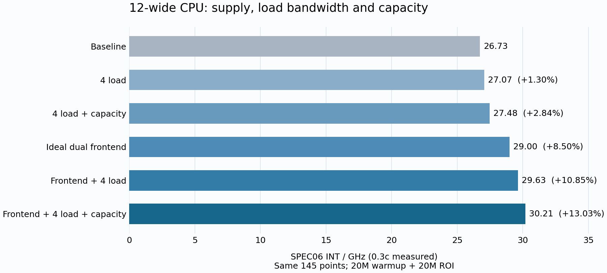

# GEM5 12宽性能上限探索：决策与阶段结果

2026年10月28日。本文总结关键选择、收益和原因；参数、计数器与验证记录保留在[逐轮报告](./README.md)中。后续配置最高12宽，旧16宽实验只作参照。

## 测试口径：以0.3c实测，新配置的1c仅为估算

**本轮正式性能评价统一使用0.3c。总分表和完整benchmark收益均为0.3c实测；新增配置没有运行1.0c，文中的新增1c分数都是估算。** 代表点机制实验另行标明测量窗口。

0.3c选取145个代表切片，历史1.0c使用1094个切片；每个切片都采用20M预热＋20M正式测量。两者差别在采样点及其加权覆盖，0.3c运行更快，但绝对分数可能明显偏离1.0c，尤其是astar。

同一份历史基线统计，使用1.0c权重得到**24.37分**，换用0.3c点集与权重得到**26.73分**。这2.36分属于采样差异，不是优化收益，不能记入本轮提升。

新配置的1c仅按相对收益粗估：`1c估算 ≈ 24.37 ×（新配置0.3c分数 / 0.3c基线26.73）`。例如理想双前端在0.3c提升8.50%，据此外推1c约26.4分；它不能替代完整1.0c测试。后续判断以同一0.3c口径下的实测增益为主。[采样差异验证](round-00.md)

## 1. 当前结论：优先改善前端供给

**保持同一个12宽后端，单独开启理想双前端，SPEC06 INT从26.73提高到29.00分/GHz，提升8.50%。** 相比之下，单独增加第4个load口提升1.30%，再扩大窗口与LSU容量后累计提升2.84%。目前最值得继续推进的是前端供给，以及它与后端容量的配合。

| 配置 | INT/GHz | 对原基线提升 | 当前判断 |
| --- | ---: | ---: | --- |
| 原12宽基线 | 26.73 | — | 固定比较起点 |
| 仅增加4load | 27.07 | +1.30% | 有收益，单项幅度有限 |
| 4load＋容量扩容 | 27.48 | +2.84% | 容量能进一步改善并发 |
| 仅理想双前端 | **29.00** | **+8.50%** | 当前主要收益方向 |
| 理想双前端＋4load | 运行中 | 尚未定论 | 检验供给与load带宽交互 |
| 理想双前端＋4load＋容量扩容 | 运行中 | 尚未定论 | 本轮最重要的组合验证 |

已出分四组均完成相同145个0.3c切片。仅理想双前端一组保留原ROB、PRF、LSU和3load/2store，比较中没有扩大后端。这里的“双前端”包含双预测、双取、理想指令供给和去override气泡；各子项在下面分开讨论。

按报告开头的外推方法，理想双前端约对应1c **26.4分（估算）**。该数值不是新配置的1c实测。

## 2. 决策一：不再扩宽，先让现有12宽得到连续供给

原24分配置已经是12宽。本轮曾测16宽后端整包，随后按约束回到12宽：保留现有整数拓扑，独立研究前端、4load和容量，避免把多项资源变化混成“扩宽收益”。

理想前端的完整收益集中在以下程序：

| benchmark | INT子项提升 |
| --- | ---: |
| perlbench | +23.36% |
| xalancbmk | +14.27% |
| gcc | +13.59% |
| sjeng | +13.52% |
| gobmk | +12.19% |

这些结果支持改善控制流片段的连续供给：同一周期能继续预测并取得下一个片段，减少taken边界和预测阶段等待造成的供给断点。perlbench代表点的分支错误数量接近，而IPC明显提高，也支持供给时序的解释。

收益并不普遍：mcf只提高3.53%，astar回退0.76%。因此前端是当前主要方向，但访存依赖和资源窗口仍需单独处理。[完整前端结果](data/r1-front-latest-frontend-score.csv)

## 3. 决策二：把双供给带宽与去override气泡分开记账

去掉全部override气泡是理想上限条件，不能等同于已经实现了某种ahead pipeline。为辨认两者贡献，固定同一个12宽后端和理想ITLB/Icache供给，比较三档：

| 档位 | 预测/取指带宽 | override气泡 |
| --- | --- | --- |
| A | 单预测、单取 | 保留 |
| B | 双预测、双取 | 保留 |
| C | 双预测、双取 | 清除 |

在perlbench代表窗口中，**A→B提高12.8%，B→C再提高2.25%**。这说明该窗口中，双供给带宽本身已有明显价值；去气泡属于额外收益。libquantum代表点则变化很小，不能用这两个窗口直接拆分整个SPEC的8.50%。

这些窗口采用20M预热＋2M正式测量。三档的完整0.3c对照正在补齐，届时分别报告带宽收益和去气泡收益；主线仍可使用C档探索上限。现有ahead结构能否覆盖这些等待，需要另行验证。[带宽与气泡对照](round-07-override.md)

## 4. 决策三：保留4load方向，在12宽内研究容量配合

单独4load的完整INT增益为1.30%，主要正项包括h264ref、mcf和astar。继续扩大ROB、寄存器、LQ/SQ等容量后，相对4load配置再提高约1.51%，累计增益达到2.84%；h264ref、astar、mcf分别提高7.10%、5.86%、5.70%。

原因假设是：更多load管线需要足够的在途窗口，才能把潜在并发转成进展。局部对照也支持这一点——astar单加4load略退，在扩大窗口后，第4个load口又带来约4.1%的条件收益。完整数据尚未把容量组收益拆给某个单独队列。

**当前决定：保持12宽，继续验证“前端供给＋4load＋容量”的组合。** 单项收益不能直接相加；前期已观察到前后端相互限制，组合可能改变每项的边际收益。[4load对照](round-04-fourload.md)、[容量对照](round-05-window.md)

## 5. TEA怎样决定下一步

TEA在这里用于选择值得验证的依赖链。mcf在原组合探针中改善后，仍以访存停滞为主，热点集中在先取指针、再解引用的load链；下一步应继续区分地址依赖、翻译与缓存服务。

反例同样进入决策：mcf代表点扩大L1 MSHR只提高约2.35%，单独扩大L2 MSHR却退化约15.5%，同时下游拥塞增加。因此不沿着“队列越大越快”直接扩大全部资源。TEA热点、replay和阻塞次数用于提出假设，最终由配对净周期和完整加权分数决定是否保留。[TEA残余分析](round-03-tea.md)、[缓存并发反例](round-02.md)

## 6. 接下来的两个判断

1. **12宽组合能保留多少增益？** 等待理想双前端＋4load、再加容量两组结果，选择同样12宽约束下最有效的组合。
2. **保留正常override气泡后还剩多少收益？** 用A/B/C完整对照区分双供给带宽和零气泡上限，再判断ahead方向的研究价值。

测量统一采用SPEC06 GCC16 RVA23 novec 0.3c、20M预热＋20M正式窗口，difftest开启。已出分结果完成逐点检查；上述局部分析均明确限定窗口。精确源码、CI、参数、完整计数器和审计见[实验索引](runs.json)与[逐轮记录](README.md)。
