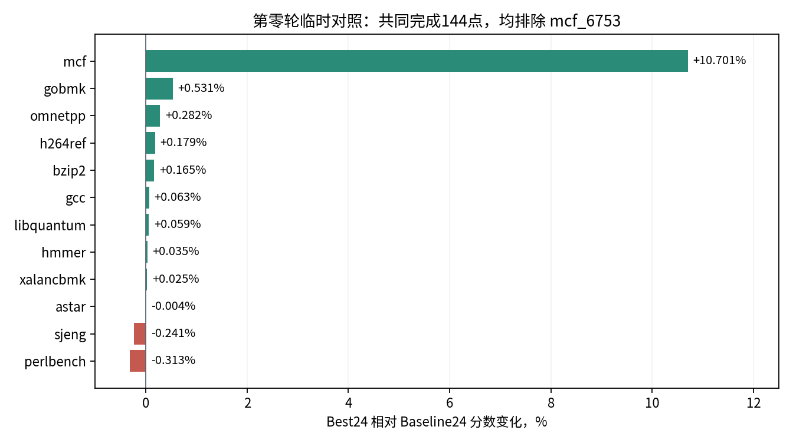
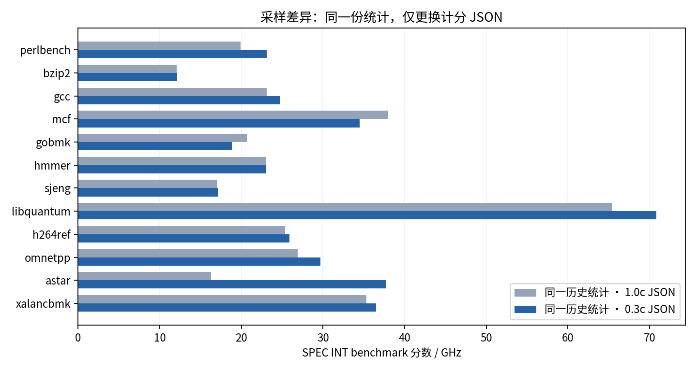

# 第零轮 固定0.3c点集和24分基线

**原24分配置在完整0.3c点集上为INT 26.72579/GHz，高资源配置为26.87533（+0.5595%）。** 同一份历史1.0c统计换用0.3c JSON，可以逐值复现这个分数，属于已知采样差异。后续继续固定0.3c，以这个分数评价新增配置。

## 配置与当前结果

共同源码为`e34d8f6e7901b34fbd6111cfa5615136aaeefaf1`，配置`kmhv3.py`。REF相同，固定到`d30fff1ece9e-gem5-r3-multi16g-zfa-cbo/normal-dedup`。

| 对照 | Actions | 配置变化 | 当前点集 | INT/GHz | FP/GHz |
| --- | --- | --- | --- | ---: | ---: |
| Baseline24 | [40638589458](https://github.com/OpenXiangShan/GEM5/actions/runs/40638589458) | 原24.36957配置，额外参数为空 | 完整145点 | **26.72579** | 24.95097 |
| Best24 | [40638592517](https://github.com/OpenXiangShan/GEM5/actions/runs/40638592517) | TAGE16、4个FP IQ各32项、L2 data bank4 | 完整145点 | **26.87533** | 25.18871 |
| Baseline24共同集 | 同上 | 同上 | 冻结共同完成144点 | 26.62292 | 24.95097 |
| Best24共同集 | [40638592517](https://github.com/OpenXiangShan/GEM5/actions/runs/40638592517) | TAGE16、4个FP IQ各32项、L2 data bank4 | 同一144点 | **26.86682** | 25.18871 |

分数由本地标准`gem5_data_proc`工具重算。共同集在2026-10-28 14:18:19冻结，排除当时尚未在Best24完成的`mcf_6753`；不将共同集与145点直接相减计算优化收益。具体名单见[共同点快照](data/r0-common-snapshot.json)。其后两组均补齐145点，Actions成功；本地重算的INT/FP/overall与归档score.txt一致。

## 高资源配置的收益与提前估分



完整145点上，Best24的INT提升**0.5595%**，mcf提升**6.0970%**。保留提前估分的快照作为对照：相同144点时，INT提升**0.9161%**。主要来自mcf（+10.7011%）；其余INT中gobmk为+0.5307%、omnetpp为+0.2816%，perlbench为−0.3132%、sjeng为−0.2406%。这是TAGE规模、FP IQ容量与L2 bank三项组合的条件效果，尚不能将mcf收益单独归给某一项。

遗漏的`mcf_6753`原始权重为0.218742；mcf在完整0.3c中的权重和为0.368177，因此当前mcf只保留约40.59%的选定权重。两侧采用同一子集以便提前比较，仍覆盖55/55输入。标准工具对每个输入保留的SimPoint权重归一化，`coverage`列保留原始权重和；0.3c完整时该列通常也不是1。完整基线补入慢点后，INT从26.62292变为26.72579，说明遗漏方向需要实际核验。

## 已知的1.0c与0.3c差异



| 同一历史run1618统计 | 选中切片 | INT/GHz | FP/GHz | Overall/GHz |
| --- | ---: | ---: | ---: | ---: |
| 使用1.0c JSON | 1094 | 24.36957 | 24.15304 | 24.24240 |
| 使用0.3c JSON | 145 | 26.72579 | 24.95097 | 25.67062 |

INT差距为+2.35622分（+9.6687%）。astar从16.27860变为37.71678，占INT对数涨幅约75.87%；该差异按用户确认作为已知背景，后续继续使用0.3c。

历史run1618与本轮Baseline24的145个同名切片，最后完整stats block的提交量和周期全部逐值相同；完整INI只存在DRAM文件的runner绝对路径差别，归档DRAM JSON内容相同。同一历史CSV分别套两份JSON重算后，0.3c各benchmark分数与本轮结果逐值相同。因此本次分差可由采样与权重变化复现，不能记作新优化增益。以后复用已有1.0c归档即可建立0.3c基线，无需重复仿真。

重算示例：在`gem5_data_proc`目录下，对同一份历史1094点CSV分别调用以下命令；脚本按JSON选择点并在每个输入内归一化权重。先创建输出目录。

```sh
mkdir -p /tmp/reweight-1c /tmp/reweight-03c
python3 -m simpoint_cpt.compute_weighted \
  -r final.csv -j checkpoints_all.json \
  --out-dir /tmp/reweight-1c --score /tmp/reweight-1c/score.csv
python3 -m simpoint_cpt.compute_weighted \
  -r final.csv -j checkpoints_cov0.3.json \
  --out-dir /tmp/reweight-03c --score /tmp/reweight-03c/score.csv
```

## 证据与下一步

两组cluster与checkpoint列表定义相同145点；cluster SHA256为`1e8e850e94dba6f7903c0e28c3ff365b54b380221dc4deaf63e7d72f3596f5b7`，列表SHA256为`b8b50365f0b80348946149f037f68bb60eef18e2e62a515be8e56e8aab26ed7d`。

共同144对切片均正常maxinsts退出、exit status 0、difftest开启，最后ROI提交量为19,999,989–20,000,011；两侧补齐点也核验通过，[高资源最后一点记录](data/r0-best-final-point.json)保留了ROI、正常退出与difftest开关。跨配置差异限于预期TAGE、FP IQ与L2 bank，以及DRAM runner路径。没有独立核验runner实际DRAM文件哈希，该缺口保留在记录中。

- [基线完整分数](data/r0-full-baseline24-score.csv)、[共同集基线](data/r0-common-baseline24-score.csv)、[共同集高资源](data/r0-common-best24-score.csv)、[高资源完整分数](data/r0-full-best24-score.csv)。
- [历史1.0c重算](data/historical-1c-score.csv)、[历史0.3c重算](data/historical-03c-score.csv)、[输入CSV哈希与处理日志位置](data/reweight-provenance.json)。
- [共同点逐项审计](data/r0-provisional-audit.json)、[145点历史对照审计](data/r0-sampling-audit.json)。

下一轮比较Backend、Frontend、Combined；允许先用共同完成点估分，随后补齐。是否采用高资源配置，取决于新增配置上的条件收益与回退。
