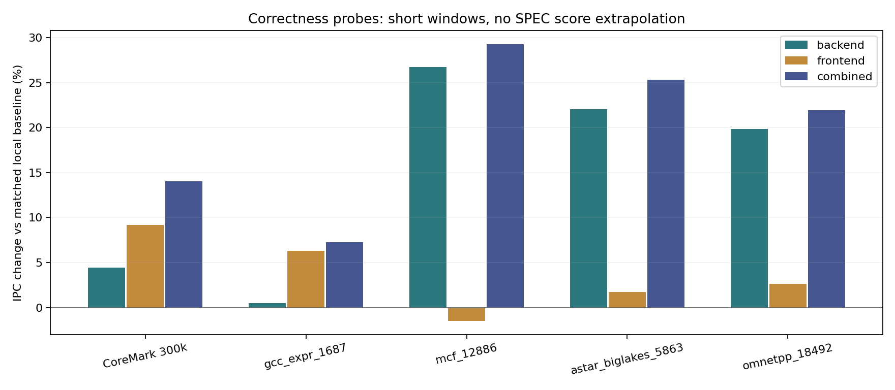
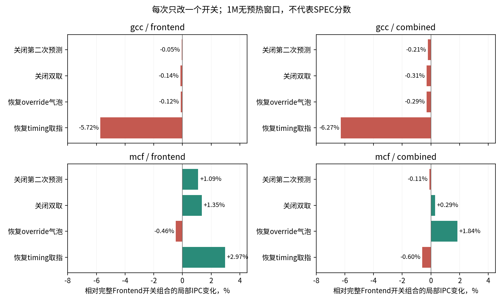

# 第一轮 探针实现与代表点验证

本轮在已测量的24分源码 e34d8f6e7901 上，实现了单线程宽后端、串行双预测、理想指令供给与双取。代表点组合中，后端与前端共同放松有明显正向信号；宽后端完整0.3c INT已测得27.94319（+4.5552%）；前端与组合仍在运行。

## 配置与行为

| 探针 | 配置变化 | 建模范围 |
| --- | --- | --- |
| Backend | --upperbound-backend；SpMT拓扑但enableSpMT=false；10整数输出口、4 ld、2 STA/2 STD；IQ32、ROB640、IntRF512、FpRF384、LQ256、SQ128，decode/rename/commit16 | 无线程归属，取消RF端口仲裁；10是整数端口，不是所有类型合计发射上限 |
| Predict2 | idealPredictionsPerCycle=2，idealNoOverrideBubbles=true | 每CPU周期只推进一次tick；第一项独立FTQ快照与PC/RAS/history更新完成后再次预测；与PairTAGE、SMT双线程组合互斥 |
| Fetch2 | idealInstructionFetch=true，enableTwoFetch=true | 用Execute functional翻译读取实际指令；理想ITLB/Icache无等待，最多消费两项FTQ，可跨向后或远跳目标；不使用REF未来控制流 |
| Frontend | Predict2 + Fetch2 | 预测带宽、override latency和指令供给共同放松，后续需消融三者 |
| Combined | Backend + Frontend | 用于检验前后端瓶颈交互 |

原始默认开关全部关闭，保留原timing取指与每周期一次预测路径。ABTB ahead状态和S3 fast training会随每次虚拟预测推进两次，是本轮明确接受的理想化条件。

## 宽后端完整INT结果

宽后端run1669已补齐145/145点，0 abort，归档INT为**27.94319/GHz**；基线为26.72579，提升**4.5552%**。0.3c所选12个INT benchmark的89个切片全部完整；[补齐审计](data/r1-backend-int-complete-audit.json)与[此前140点审计](data/r1-backend-provisional-audit.json)覆盖了完整INT点集。下方保留早期估分过程，避免混淆不同覆盖范围。

按相同比例外推历史1.0c基线24.36957，约为25.48；这只是估计，尚无新配置完整1.0c统计支持。用户已调整后续方向为保留原12宽、单独增加第4个load口，当前16宽与资源扩容整包作为已测量上限参照。

完整145点分数：[基线](data/r0-full-baseline24-score.csv)、[宽后端](data/r1-full-backend-score.csv)。宽后端FP为27.75762、overall为27.83426；INT/FP/overall与归档score.txt一致。

## 正式ROI的提前估分：共同140点

2026-10-28 14:34:44冻结Baseline24与Backend共同完成的140点。此时omnetpp_18492尚未完成，整个omnetpp输入缺失；另外遗漏bzip2_combined_5764、bzip2_source_3760、mcf_6753、soplex_pds-50_7893。两侧均仅按相同点集计分，**以下是11个有效INT benchmark的子集几何均值，不能作为完整12个INT的SPEC得分**。

| 同一共同子集 | 基线 | 宽后端 | 相对变化 |
| --- | ---: | ---: | ---: |
| 11个INT benchmark几何均值/GHz | 26.53547 | 27.81948 | **+4.8389%** |
| 17个FP benchmark几何均值/GHz | 24.99127 | 27.81419 | +11.2956% |

同子集INT中，mcf为+11.9171%、astar为+10.8254%、h264ref为+10.0307%、libquantum为+9.0264%、gcc为+1.9366%；perlbench为−2.9716%，bzip2为−0.0516%。这些是正式约20M ROI的早期信号，需要在剩余点及前端/组合对照中保留回退并继续检验。

分数见[对应子集基线](data/r1-provisional-baseline24-score.csv)、[宽后端](data/r1-provisional-backend-score.csv)；[冻结名单与各输入权重覆盖](data/r1-backend-provisional-snapshot.json)保留遗漏详情。缺失行在标准score CSV中为NaN，工具对有效benchmark作几何平均，因此本节明确标出有效benchmark数。

## 局部结果

| 输入 | Baseline IPC | Backend IPC | Frontend IPC | Combined IPC | 组合相对基线 |
| --- | --- | --- | --- | --- | --- |
| CoreMark 300k | 1.557988 | 1.627383 | 1.701037 | 1.776562 | +14.029% |
| gcc_expr_1687 | 2.113776 | 2.123489 | 2.246737 | 2.267512 | +7.273% |
| mcf_12886 | 0.765291 | 0.969840 | 0.753957 | 0.989290 | +29.270% |
| astar_biglakes_5863 | 3.432317 | 4.188556 | 3.491296 | 4.301561 | +25.325% |
| omnetpp_18492 | 0.684971 | 0.820740 | 0.702907 | 0.835355 | +21.955% |

CoreMark为300k提交指令；四个SPEC代表点为约1M提交指令，无本轮正式20M预热。各变体到达同一个maxinsts阈值，实际退出提交量会有最多十余条的超额，增量使用真实insts/cycles。上表不能替代benchmark加权结果，也不能推算26–28目标已经实现。

mcf中仅打开前端反而略退，宽后端与组合明显改善；这支持继续区分窗口/LSU并发与前端资源的交互。gcc本点的后端单独改善较小，前端较有效。完整点集将确认这些方向是否能迁移到其他相位。

## 计数器支持什么判断

以下均取各自最后完整stats block，并按真实提交指令归一化。完整原值、单位和描述见[data/local-counters.json](data/local-counters.json)。

| 观测 | Baseline | Backend | Frontend | Combined | 可审核的解释 |
| --- | ---: | ---: | ---: | ---: | --- |
| mcf DCache自身miss/千指令 | 322.78 | 315.27 | 320.81 | 320.46 | 后端增益未伴随大幅miss减少；应检查并发和重叠 |
| mcf 平均miss延迟，千tick/次 | 15.1 | 19.3 | 15.9 | 19.4 | 更高IPC可与更高排队延迟并存，不能用延迟均值单独排序 |
| mcf cache blocked replay/千指令 | 5.43 | 392.16 | 5.09 | 419.35 | 更大窗口同时增加重试活动；这是事件，不能视为停顿周期 |
| gcc ROBFull事件/千指令 | 2.094 | 0 | 4.508 | 0.055 | 理想前端增加窗口压力，宽后端缓解；尚未分离ROB与其他资源贡献 |
| omnetpp ROBFull事件/千指令 | 423.95 | 0.79 | 449.48 | 1.01 | 支持继续研究窗口容量，不能据此把全部收益归于ROB |

mcf的第二预测入队/千指令，Frontend为42.35、Combined为59.70；双取成功分别为35.76、5.27。组合IPC提升时双取次数反而较少，说明“使用次数越多就越快”不足以解释结果。随后完成了下面的单变量消融。

统计口径需要保留三点：`branchClassCountsTotal`在当前源码中仅于mispred时递增，尽管描述写“总分支”，本报告按分支错误使用；`iew.*StallReason`是槽位口径，Baseline/Frontend宽度12、Backend/Combined宽度16，不能直接跨组当成同口径周期；`fsqEmpty=0`也不能排除其他前端供给瓶颈。缓存命中与服务行为采用缓存自身统计，避免把LVP修改后的CPU访问深度当作真实缓存层级。

## 前端单变量消融

| 程序 / 背景 | 全开 IPC | 关闭第二预测 | 关闭双取 | 恢复override气泡 | 恢复timing取指 |
| --- | ---: | ---: | ---: | ---: | ---: |
| gcc / frontend | 2.246737 | -0.051% | -0.137% | -0.122% | -5.719% |
| gcc / combined | 2.267512 | -0.214% | -0.309% | -0.295% | -6.272% |
| mcf / frontend | 0.753957 | +1.094% | +1.347% | -0.459% | +2.970% |
| mcf / combined | 0.989290 | -0.109% | +0.287% | +1.842% | -0.602% |

每次只恢复一个限制，其余开关保持Frontend或Combined全开。百分比相对各自背景的control；gcc_expr_1687和mcf_12886仍为约1M、无预热窗口。共20组均正常达到maxinsts、difftest启用且未报错；前12组经独立核对完整config，仅目标参数发生变化，四组control精确复现此前周期与提交量。

gcc本点的额外预测、双取和override放松分别撤回时，IPC损失均不足0.4%；恢复timing取指则下降5.72%或6.27%。本点Frontend整包的主要敏感项是理想供给路径，不能把约6%的总增益写成“2taken收益”。`idealInstructionFetch=False`同时恢复ITLB/Icache请求响应、普通fetch buffer时序与原双取范围约束，尚不能将差额单独归因于Icache miss。

mcf体现条件交互：Frontend背景下关闭双取改善1.35%，恢复timing取指改善2.97%；Combined背景下关闭双取改善0.29%，恢复override气泡改善1.84%，而关闭第二预测略退0.11%。更早供给和更多推测活动不保证净收益。下一步结合正式ROI的分支错误、load并发与队列压力复核，再选择完整点集的消融，不将这些百分比相加。

原始汇总见[data/frontend-ablations.json](data/frontend-ablations.json)和[data/frontend-timing-ablations.json](data/frontend-timing-ablations.json)；前12组配置、文件哈希和日志审计见[data/frontend-ablation-audit.json](data/frontend-ablation-audit.json)。哈希证实使用文件的一致性；记录的Git HEAD本身不能单独证明二进制构建来源，正式CI采用固定被测SHA。

## 正确性与激活证据

- gem5.opt构建通过；修改区域style、Python语法和git diff检查通过。
- CoreMark六个模式正常退出，difftest启用、未报不一致；后端两个模式的首轮验证器因把IQ参数名当作INI对象路径而失败，修正验证器后重跑通过，模拟本身未失败。
- 四个checkpoint × baseline/backend/frontend/combined，共16个约1M窗口均通过正确性和激活检查。
- Combined CoreMark中，第二预测成功入队75,853项，双取成功72,878次；真实配置有4个独立load IQ、enableSpMT=false。
- Sv39与Sv48裸机回归均到达success m5_exit，difftest未报错；检查X-only、NX、非canonical别名、页末RVC、跨页32位指令的cause/PC/tval，并复用训练后的间接跳转检验错误NX预测后的恢复。
- 独立Astra Review发现functional Execute缺少canonical地址检查；修正有效satp/vsatp模式下的检查，并用上述回归验证。原始审查与定向复核分别保存在review-initial.md、review-followup-b.md。
- 正确性证据限于这些用例；没有声称覆盖全部H扩展、trace、SMT或全部ISA边界。idealInstructionFetch显式拒绝trace与多线程组合。

## 待完成

0.3c基线完整145点已重算为26.72579；与高资源配置的共同144点对照见[第零轮](round-00.md)。已在被测SHA `515eb0cd1cf97280ddbd600ee42a9c92e722b7ab` 上触发 [Backend](https://github.com/OpenXiangShan/GEM5/actions/runs/40641366302)、[Frontend](https://github.com/OpenXiangShan/GEM5/actions/runs/40641369657)、[Combined](https://github.com/OpenXiangShan/GEM5/actions/runs/40641372749) 完整对照，目前仅已创建/运行，未取得最终分数。后续保留每个benchmark的收益与回退，在组合配置上重新用TEA/计数器定位剩余瓶颈。最终26–28目标及整体报告尚未完成。

原始局部数据见[data/local-probes.csv](data/local-probes.csv)；命令、完整stats、config与日志位于 /tmp/tea-upperbound-20261028 下对应目录。标准可重复验证入口为 util/xs_scripts/upperbound_smoke.py。最后增补的构造参数保护只拒绝trace组合，普通FS测试路径不变。
