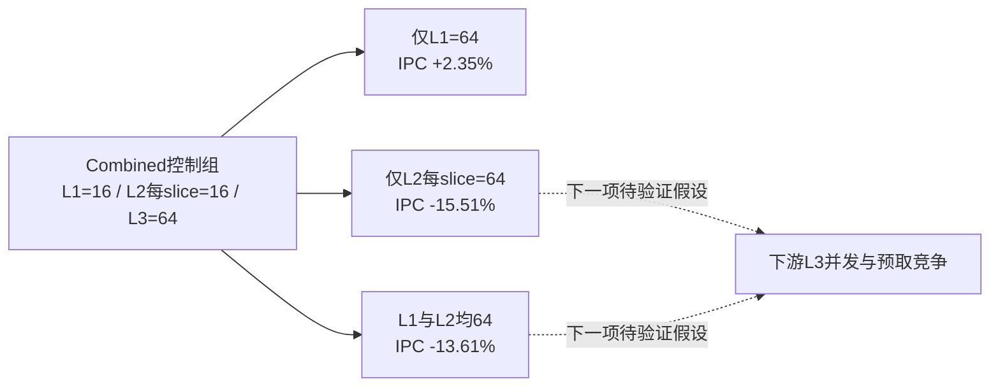

# 第二轮 从4 load的重试压力追到缓存并发

**mcf短窗口中，L1D MSHR从16增到64使IPC提高2.35%；仅扩大L2 MSHR反而退化15.51%。** 这轮验证资源约束的位置，尚未取得这些参数的完整SPEC得分。

## 从计数器形成假设

第一轮在同一个mcf_12886切片中观察到：宽后端提高IPC，同时`CacheBlockedReplay`显著上升。查验实际INI后，Baseline、Backend和Combined的L1D均为16个MSHR，每个L2 slice也为16个MSHR。L1 tag read ports为100、LSQ cacheLoadPorts为200，L1 loadTagReadFails为0，当前证据优先指向并发容量。

请求链为LSQ `sendTimingReq`进入L1D；请求未能发送、且没有更具体原因时标记`CacheBlockedReplay`，后续等待cache retry或LSQ端口释放。replay可以重复发生，不能按次数换算损失周期。

## 控制实验

固定同一二进制、同一checkpoint、Combined全部CPU参数。每项只改变列出的MSHR，L3维持64。全部组的最后统计块均为1,000,015条提交指令、无预热，difftest开启并正常maxinsts退出。

| 配置 | IPC | L1无MSHR周期 | CacheBlockedReplay事件 | L2四slice无MSHR周期合计 | L3无MSHR周期 | L3 demand miss平均tick |
| --- | ---: | ---: | ---: | ---: | ---: | ---: |
| 控制16/16/64 | 0.989290 | 268,838 | 419,358 | 21,558 | 0 | 91,645 |
| L1=64 | 1.012492 | 0 | 7,589 | 51,384 | 0 | 92,670 |
| L2每slice=64 | 0.835813 | 244,613 | 378,112 | 0 | 206,792 | 159,732 |
| L1=64、L2每slice=64 | 0.854661 | 0 | 6,137 | 11 | 226,096 | 161,290 |

L1扩容消除了该窗口的L1无MSHR阻塞，大幅减少replay，但净IPC只提高2.35%。这个差别说明大量事件与其他执行活动重叠，不能把被移除的blocked周期全部算作CPU可节省周期。L2各slice的周期还可相互重叠，表中的合计只是拥塞活动量。

L2扩容消除L2无MSHR阻塞的同时，L3出现更多无MSHR周期，平均服务延迟增加，平均MSHR占用由27.72上升到40.41/64。DRAM读带宽反而从19.36降至16.19 GB/s；这支持研究下游拥塞的候选方向，尚不能证明某条排队链造成退化，也不能证明DRAM饱和。统计窗口和请求构成也影响带宽。

## 下一步与复核入口

下一项有区分力的实验是独立扩大L3并发容量，或控制预取负载，观察上游扩容的回退是否消失；随后在正式ROI与共同点集上检验，不能将本轮短窗口百分比外推成SPEC收益。gcc/mcf的Baseline与Combined TEA采集已完成，见[第三轮](round-03-tea.md)：恢复后前2M冷启动窗口，原20M＋2M标注已纠正；只作局部机制探针，详见[窗口审计](data/local-window-correction-audit.md)。

- 参数：`--param=system.cpu[0].dcache.mshrs=64`；L2分别对`system.l2_wrappers[0].slices[0..3].inner_cache.mshrs`设置64。
- 原值、每slice统计、延迟与请求构成见[data/memory-ablation-analysis.json](data/memory-ablation-analysis.json)。
- 命令、配置、日志、stats和validation位于`/tmp/tea-upperbound-20261028/memory-ablations/`；runner验证进程返回0，独立分析读取了正常退出日志，但日志本身未单列进程返回码。
- CPU请求及重试链：[`lsq_unit.cc`](../../../src/cpu/o3/lsq_unit.cc)、[`lsq.cc`](../../../src/cpu/o3/lsq.cc)、[`inst_queue.cc`](../../../src/cpu/o3/inst_queue.cc)。
