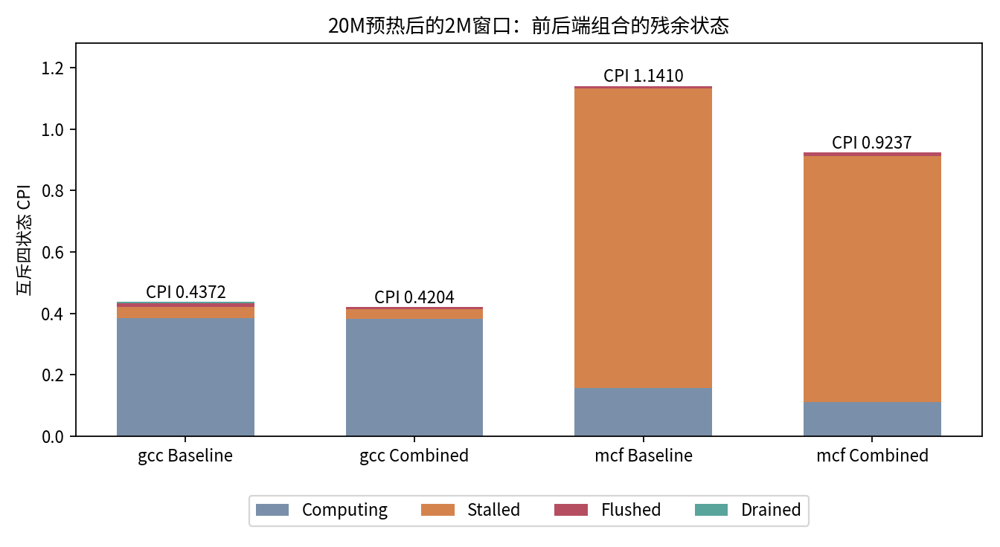

# 第三轮 用TEA复查组合后的残余瓶颈

**正式预热后的短窗口中，Combined使gcc IPC提高3.98%、mcf提高23.52%。** gcc的前端Drained几乎消失，mcf仍以Stalled为主。此处是同切片20M预热后的约2M诊断窗口，不是新的SPEC得分。

## 配置、口径与验证

固定相同checkpoint、二进制和normal-dedup REF，比较Baseline与原Combined整包；后者包含16宽、大窗口、4 load和理想前端。用户后续改为保留12宽、独立研究4 load，这两组TEA仍作为已有整包的残余诊断保存。

启用`--enable-tea --tea-sample-period=1`。四组均正常maxinsts退出、difftest开启，CPU周期等于TEA samples、四状态之和等于samples、提交数等于committedByThread；CSV的总权重、特殊PSV和九事件权重与stats逐项匹配。采集脚本验证进程返回0，未额外运行本窗口关闭TEA的周期等价性对照。

## 全局四状态与事件



| 输入 | Baseline IPC | Combined IPC | 相对变化 | 主要残余 |
| --- | ---: | ---: | ---: | --- |
| gcc_expr_1687 | 2.287485 | 2.378516 | +3.98% | Computing 0.382455 CPI；Stalled 0.030901 |
| mcf_12886 | 0.876413 | 1.082549 | +23.52% | Stalled 0.800561 CPI；Computing 0.111114 |

Computing只表示当周期有提交，不能解释成满宽吞吐或没有优化空间。gcc Combined中它占总周期约91%，提示仅看“无提交停顿”会漏掉低提交率的依赖链；应再看IPC、依赖、FU和窗口活动。gcc的Drained CPI由0.004541降至0.000012，前端供给已在这项理想化条件下充分放松。

mcf的Stalled CPI从0.977287降至0.800561；Flushed却由0.006575增至0.012050。Combined的ST_L1、ST_TLB、ST_LLC事件归因CPI分别为0.810726、0.692117、0.622937。**事件可重叠，且PC权重包含Computing，不能相加成停顿分解。**

## 回到PC与实际指令

使用同一profile目录中的ELF作反汇编，并记录ELF SHA256；此处没有额外核对完整checkpoint构建manifest。mcf主要热点位于LTO后的`main`：

```text
0x108d2: lw  t4,24(a5)   # 条件判定使用的数据
0x108da: ld  t6,8(a5)    # 取得后续访问地址
0x108de: ld  t5,16(a5)   # 取得另一后续访问地址
0x108e4: ld  t6,0(t6)    # 地址依赖load
0x108e8: ld  t5,0(t5)    # 地址依赖load
0x108ec: sub a3,a3,t6
0x108f0: add a3,a3,t5
0x108f2: bgez a3,0x108be
```

| PC | 指令 | Baseline总归因CPI | Combined总归因CPI | 解释边界 |
| --- | --- | ---: | ---: | --- |
| mcf 0x108e4 | ld t6,0(t6) | 0.627659 | 0.505555 | 仍是最大的地址依赖访存候选，不代表可移除0.5056周期 |
| mcf 0x108d2 | lw t4,24(a5) | 0.216328 | 0.144367 | 负载结果影响后续控制流，需结合分支/访存链 |
| mcf 0x108e8 | ld t5,0(t5) | 0.158257 | 0.163230 | 另一条依赖链归因略增；总窗口更快不要求每个PC都下降 |
| gcc 0x97944 | cselib_invalidate_regno中的lw | 0.000885 | 0.000002 | 原归因同时含DR_L1/DR_TLB等标签，不能拆成独立损失 |

mcf 0x108e4的ST_TLB归因仍为0.401216 CPI，说明地址依赖链、数据翻译并发与load服务值得继续研究；没有据此认定增大TLB一定有效。配合[第二轮MSHR干预](round-02.md)，下一步应在相同正式窗口分别放松翻译/缓存并发或控制预取，观察热点及整体IPC是否按假设改变。

## 数据与复用

- [gcc摘要与热点事件](data/tea-gcc_expr_1687.json)、[mcf摘要与热点事件](data/tea-mcf_12886.json)。
- 原始CSV：[gcc基线](data/tea-gcc_expr_1687-baseline.csv)、[gcc组合](data/tea-gcc_expr_1687-combined.csv)、[mcf基线](data/tea-mcf_12886-baseline.csv)、[mcf组合](data/tea-mcf_12886-combined.csv)。
- [单窗口汇总脚本](scripts/summarize_tea.py)复用了旧报告的CSV/PSV守恒与ELF映射方法，去掉旧1094点、版本与配置硬编码。以`--baseline <运行目录> --candidate <运行目录> --name <切片> --elf <ELF> --output <输出目录>`生成JSON和Markdown。
- 当前CSV没有PC×四状态联合字段。脚本在全局展示四状态，在PC上只展示总归因和事件，避免生成不存在的联合统计。
- 正确LVP会修改CPU提交侧的cacheAccessDepth分类；后续缓存判断仍使用缓存自身miss、服务tick和队列统计，不能将这项分类直接当真实缓存层级。
