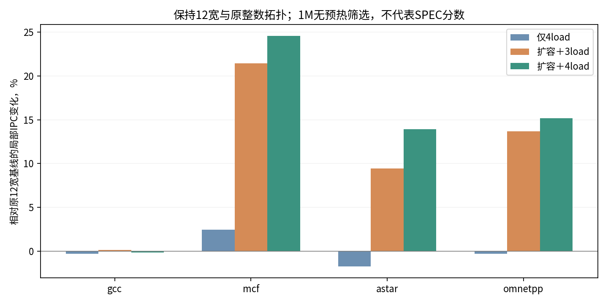

# 第五轮 保持12宽，分离窗口容量与第4个load口

**局部筛选支持继续扩大窗口，而不是继续扩展整数发射拓扑。** 相同12宽与原整数FU下，mcf/astar/omnetpp在容量扩容与4load组合中提高约24.6%/13.9%/15.2%；完整145点现已确认：4load＋容量的INT为27.48358，相对原基线提升2.8354%，相对仅4load再提升约1.51%。

## 只改变容量组

这轮不改变decode/rename/commit/物理寄存器释放宽度，全部仍为12；原整数FU、IQ延迟、FP/向量IQ和缓存MSHR保持。容量组只有以下七项：

| 参数 | 原值 | 扩容值 |
| --- | ---: | ---: |
| numROBEntries | 352 | 640 |
| numPhysIntRegs | 224 | 512 |
| numPhysFloatRegs | 256 | 384 |
| LQEntries | 120 | 256 |
| SQEntries | 64 | 128 |
| RARQEntries | 96 | 192 |
| RAWQEntries | 56 | 128 |

比较原3load、仅4load、扩容但仍3load、扩容再4load。第4个load口同时增加16项独立IQ容量，与[第四轮](round-04-fourload.md)相同；不能解释为仅改变端口数而容量完全相同。

## 局部对照

| 输入 | 原12宽 IPC | 仅4load | 扩容＋3load | 扩容＋4load | 扩容背景下4load的条件收益 |
| --- | ---: | ---: | ---: | ---: | ---: |
| gcc | 2.113776 | 2.108090 | 2.116926 | 2.110724 | -0.293% |
| mcf | 0.765291 | 0.783939 | 0.929257 | 0.953241 | +2.581% |
| astar | 3.432317 | 3.372999 | 3.755963 | 3.910811 | +4.123% |
| omnetpp | 0.684971 | 0.682913 | 0.778711 | 0.788858 | +1.303% |

新增8组均在同checkpoint取得约1M正式提交指令、无预热窗口，difftest开启、正常maxinsts/进程返回0。实际INI确认12宽、原9个整数IssuePort对象、原IQ容量、L1D MSHR16不变；根据变体准确激活3或4条load pipe。原值与计数器见[data/window-local-probes.json](data/window-local-probes.json)。

astar的4load单独略退，但在扩容背景下改善4.12%；mcf、omnetpp的条件收益分别为2.58%、1.30%。gcc在这些配置中的变化很小且有回退。因此端口收益依赖可见并发和窗口压力，这轮没有把扩容组收益单独归于ROB或LQ。

## 完整点集结果

代码仍为`36584adaf67da1e848d7b3a61d5ab18e84b2c12e`，通过CLI覆盖七项容量即可，无新增C++或配置逻辑。新增两组与第四轮形成“有无扩容×有无理想前端”的对照，全部保持12宽与原整数拓扑：

- [12宽＋4load＋容量扩容](https://github.com/OpenXiangShan/GEM5/actions/runs/40648078898)。
- [12宽＋4load＋容量扩容＋理想前端](https://github.com/OpenXiangShan/GEM5/actions/runs/40648104599)。

两组均已完成145点并通过CI。带理想前端时，4load的29.62660扩大容量后达到30.20846，条件收益1.9640%；相对原26.72579基线累计提高13.0311%。提交与全部参数见[runs.json](runs.json)。

| 完整INT子项 | 容量扩容相对理想前端＋4load的条件收益 |
| --- | ---: |
| astar | +5.135% |
| hmmer | +3.729% |
| mcf | +3.597% |
| omnetpp | +2.711% |
| h264ref | +2.702% |
| libquantum | −0.031% |

当前证据支持保留容量组，但没有将七项资源的收益独立分解；不能把组合收益全部归给ROB或LQ。

完整分数见[data/r5-fourload-window-full-score.csv](data/r5-fourload-window-full-score.csv)，逐点验证见[data/r4-r5-complete-audit.json](data/r4-r5-complete-audit.json)。

带理想前端的完整分数见[data/r5-front-full-score.csv](data/r5-front-full-score.csv)，全部145点的20M ROI、difftest、12宽与原整数FU审计见[data/r5-r7-audit.json](data/r5-r7-audit.json)。
