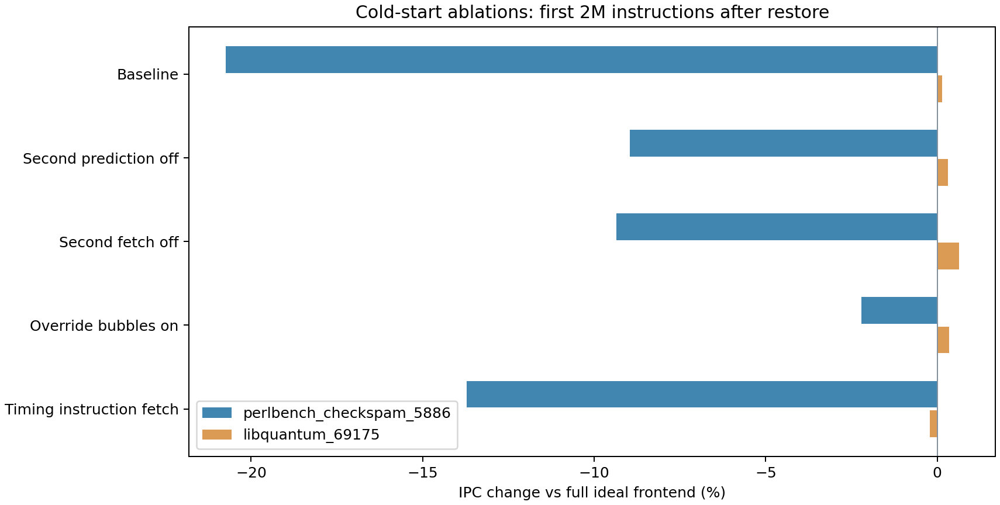

# 第六轮 前端开关的冷启动消融（窗口标注已更正）

**perlbench冷启动代表点中，串行第二预测和双取均有明显净效果；libquantum代表点中则几乎没有。** 本轮原先误标为正式预热窗口；实际maxinsts仅2M，在20M预热阈值前退出，以下全部是恢复后前2M探针，不能作为预热后ROI证据。[纠正审计](data/local-window-correction-audit.md)

## 为什么补这轮

完整benchmark的早期对照显示perlbench前端整包提升23.36%，而此前gcc/mcf短窗口中第二预测的单项变化不足1.1%。不能用一个程序或相位代表整个前端。这里选择perlbench_checkspam_5886和libquantum_69175，均为固定0.3c点集中的切片，观察恢复后前约2M提交指令。

保持原12宽、原整数拓扑、ROB352和3load。比较Baseline、Frontend全开，并在Frontend背景分别只关第二次预测、只关双取、恢复override气泡、恢复timing取指。总计12组，difftest、正常maxinsts、返回0和配置核验通过；先前“正式窗口通过”的判断已撤回。

## 开关的条件效果

| 切片 | 原基线 IPC | Frontend IPC | 前端整包收益 | 关第二预测 | 关双取 | 恢复override气泡 | 恢复timing取指 |
| --- | ---: | ---: | ---: | ---: | ---: | ---: | ---: |
| perlbench_checkspam_5886 | 3.527673 | 4.450973 | +26.173% | -8.958% | -9.347% | -2.202% | -13.709% |
| libquantum_69175 | 5.817895 | 5.809664 | -0.141% | +0.316% | +0.634% | +0.353% | -0.216% |

四个消融百分比均相对同切片Frontend全开组；不是相对Baseline。关闭单项会改变推测、训练和资源竞争时序，不能把这些百分比相加来还原整包收益。

perlbench中，关闭第二预测和双取分别使IPC下降8.96%和9.35%，证明这两项在本窗口有实质净效果。它们并不等同：predict1仍可消费既有FTQ中的两项，fetch1仍会进行第二次预测并入队。Frontend全开实际第二预测入队264,987项、双取成功237,553次；两项分别关闭时对应计数为0。

恢复timing取指的回退为13.71%，但该切换同时恢复ITLB/Icache等待、普通fetch buffer时序和原双取范围限制，不能只归因于Icache miss。恢复override气泡回退2.20%。Frontend分支错误为2.4195/千指令，Baseline为2.3995/千指令：速度提升不要求错误次数下降。

libquantum此点前端整包为−0.141%，与整个benchmark早期+4.21%不同；关第二预测、关双取、恢复override气泡均略有改善。这说明应保留多相位与完整加权确认，不能根据一个切片取消某项功能。其原宽后端组合的完整benchmark增益+43.30%，还需结合窗口/资源背景检验条件交互。

## 复核与后续

- [12组原始计数与IPC](data/formal-frontend-ablations.json)、[原配置/哈希审计](data/formal-front-ablation-audit.json)；原审计中正式窗口结论由[纠正审计](data/local-window-correction-audit.json)取代。
- 每组最后完整统计块为2,000,000–2,000,006条指令；binary/checkpoint哈希与当前文件一致。四种消融完整INI相对Frontend均只有目标参数一项改变；记录的Git HEAD本身不单独证明二进制构建来源。
- 原始命令、完整INI、stats和日志在`/tmp/tea-upperbound-20261028/formal-frontend-ablations/`。REF路径固定为同一normal-dedup版本。
- 后续先完成已有的0.3c全套前端、12宽4load与容量对照，再选择是否进行完整点集的单项消融。当前结果仍不是这些开关的完整SPEC分数。
