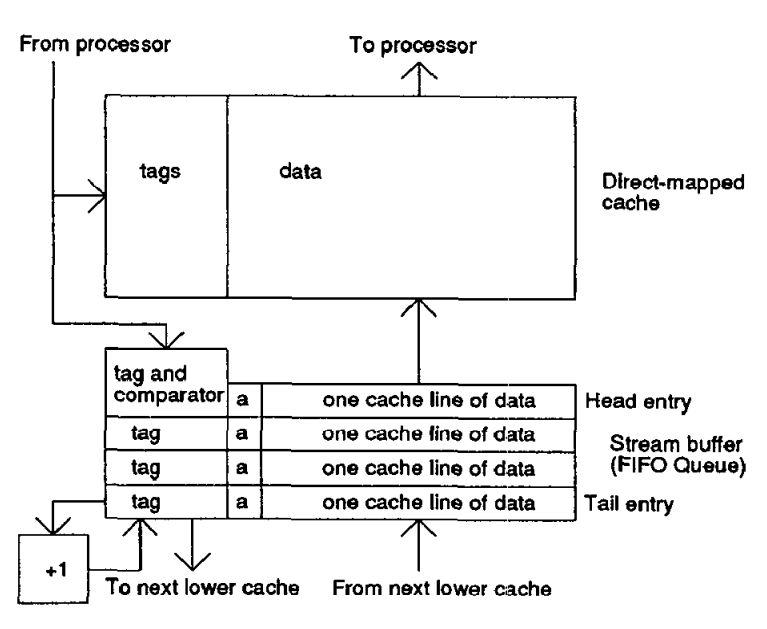
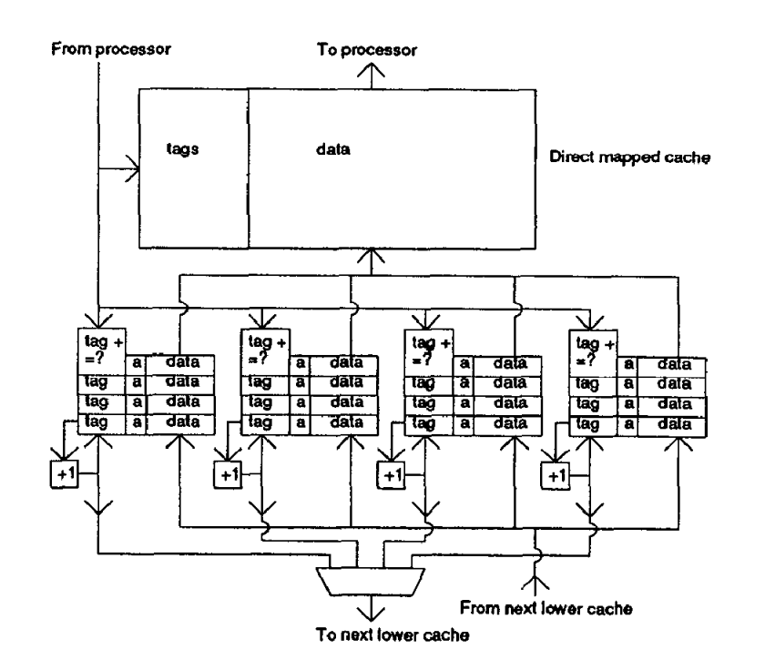
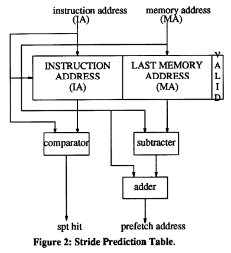
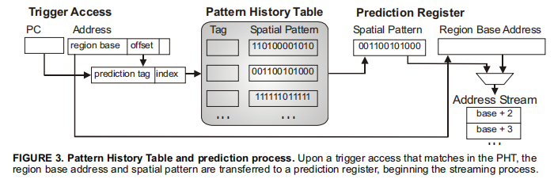
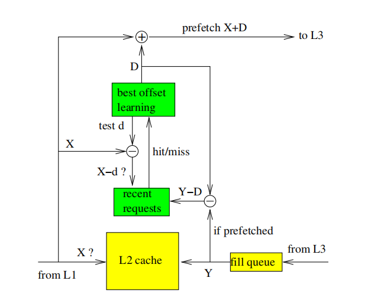
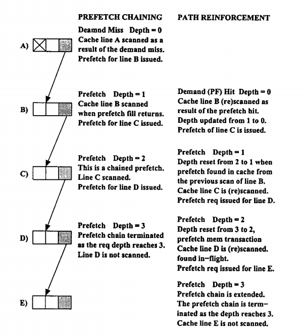
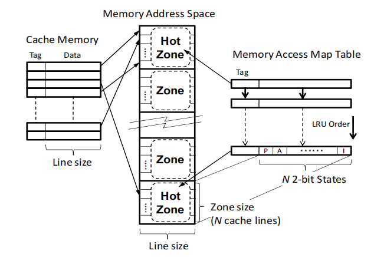

# 预取算法简介

## 1. 概述

硬件数据预取利用程序访存的规律，在需求访问发生前请求相应数据，以重叠计算与访存延迟。不同方案的主要区别，在于从哪里提取规律，以及如何表示和使用这些规律。Stream 利用地址连续性，Stride 利用同一访存指令的地址增量，SMS 学习区域内重复的访问布局，BOP 选择当前阶段的共同地址偏移，AMPM 从 Access Map 中识别空间步长，CDP 则直接从数据内容中寻找后继地址。

预取收益同时受覆盖率、准确率和及时性影响。覆盖率反映原本的需求缺失有多少得到覆盖，准确率反映预取数据有多少被实际使用，及时性则决定预取是否足够提前。预测正确但到达过晚，只能隐藏部分延迟；提前过多又可能使数据在使用前被驱逐。无用请求还会消耗带宽、占用请求队列，并可能挤出有用数据，造成缓存污染。

预取度与预取距离是两个不同参数：前者表示一次触发产生多少请求，后者表示预取位置领先需求多远。提高预取度主要增加请求数量，增大距离主要增加提前量，两者都需要结合带宽和缓存容量选择。各论文的缓存层次、工作负载和统计口径不同，下面以机制分析为主，不对跨论文的性能数字进行排名。

文中地址序列除特别注明外均以缓存行为单位，区域偏移也按缓存行计。

## 2. Stream

Stream 适用于连续扫描等顺序访问。Jouppi 提出的 Stream Buffer 在缓存缺失后沿递增地址预取后续缓存行，并将数据保存在独立 FIFO 中；需求依次消费这些数据时，缓冲区继续向后补充，形成领先于需求访问的取数窗口。

每个缓冲项包含地址标签、可用位和一行数据。请求发出后先记录标签，数据返回时再置可用位。访问需求若在缓存中缺失、但命中已经就绪的队首，就可以从缓冲区取得数据并装入缓存，随后移出队首、补取新的后继行。

例如，从行 100 开始连续访问，缓冲区提前请求 101、102、103；使用 101 后补取 104，使用 102 后补取 105。与每次只请求紧邻下一行相比，多个缓冲项提供了更大的提前量。

<table>
  <tr>
    <td align="center">
      
      <br>图 1：顺序 Stream Buffer
    </td>
    <td align="center">
      
      <br>图 2：四路 Stream Buffer
    </td>
  </tr>
</table>

数据访问经常由多个流交错组成，如 `100,900,101,901,102,902`。单个缓冲区会在两个流之间反复切换，多路 Stream Buffer 则为不同流分别保留窗口。原文的四路设计在需求缺失且未命中任何 Buffer 时，替换最近最少命中的一个 Buffer。

Stream Buffer 不需要长期训练，顺序取数和 FIFO 管理也较简单；尚未使用的预取数据留在独立缓冲区，减少了提前插入主缓存带来的污染。其效果取决于顺序流能持续多久：短流、频繁跳跃和过多交错流会浪费已发出的请求，稀疏大步长访问与不规则指针访问也难以覆盖。因此，它更适合长数组扫描和较连续的数据处理。这里讨论的是 Jouppi 的顺序缓冲设计，后续带方向检测和训练状态机的 Stream 预取器在结构上有所扩展。

## 3. Stride

Stride 面向固定步长的循环访存。全局地址序列可能被多条指令打乱，但单条指令仍可能按等差序列访问数据。Fu 等人的方案以访存指令地址 IA 区分历史，用 Stride Prediction Table（SPT）记录该指令上一次的有效数据地址 MA，并据此预测下一次地址。

基本 SPT 包含 IA、MA 和有效位 V。某条指令首次出现时分配表项；再次执行时，计算当前地址与上次地址之差：

```text
stride = MA_cur - MA_prev
MA_prefetch = MA_cur + stride
```

若步长非零且满足启动条件，就尝试预取预测地址所在的缓存块，随后更新 MA。原文比较了三种启动条件：仅在需求缺失时预取的 `pf_miss`、仅在需求命中时预取的 `pf_hit`，以及两种情况都允许的 `pf_all`。

<p align="center">
  
  <br>图 3：Stride Prediction Table
</p>

以字节地址为例，指令 P 依次访问 `0x1000、0x1080、0x1100`，步长为 128 B；在访问 `0x1080` 时，就可预测 `0x1100`。另一条指令 Q 即使穿插访问 `0x8000、0x7FC0、0x7F80`，也不会破坏 P 的历史，因为两者按 IA 分别记录。

Stride 用很少的状态即可覆盖规则数组和矩阵循环。其限制主要来自单个 PC 的步长稳定性：外层循环切换、同一指令交替访问多个对象，或执行顺序变化，都可能使最近一次差值失去代表性。
## 4. SMS

SMS（Spatial Memory Streaming）针对重复出现的区域内访问布局。例如，处理不同数据库页时，程序可能总是读取页头、索引和若干记录。这些位置既不连续，也没有统一步长，但在不同页中的相对偏移可以重复。SMS 将这种空间相关性表示为位图，并利用触发访问的上下文预测后续会使用的缓存行集合。

SMS 将地址空间划分为固定大小的区域，每个区域包含多条缓存行。一个 generation 从首次触发访问开始，到该 generation 中任一已访问块被 L1 驱逐或失效为止。这种划分使同一 generation 中的块曾经同时驻留于缓存，避免将相隔很久的访问无条件合并。

训练状态由 Filter Table（FT）和 Accumulation Table（AT）维护。首次访问一个区域时，FT 记录区域标签、触发 PC 和触发偏移；重复访问同一块不会晋升，只有出现第二个不同块，才将表项转入 AT 并累积访问位图。generation 结束后，单块 FT 项直接丢弃，AT 中的多块模式写入 Pattern History Table（PHT）。FT 因而过滤掉了只有触发访问、没有其他块可预测的 generation。

PHT 使用触发 PC 与区域内偏移的组合关联历史模式。它保存的是代码相关的相对布局，而非某个数据区域的完整地址。新区域发生触发访问时，若对应上下文命中 PHT，就将该区域基址与历史位图结合，逐步生成预取请求。

<p align="center">
  
  <br>图 4：FT 与 AT 记录当前 generation 的访问
</p>

<p align="center">
  
  <br>图 5：PHT 将历史布局用于新区域
</p>

例如，区域 A 由 PC=P 对偏移 0 的访问触发，随后又访问偏移 2、5，generation 结束后形成 `PHT[(P,0)]={0,2,5}`。同一指令以后触发区域 B 的偏移 0 时，即可预取 B+2、B+5。B 可以是从未访问过的新区域，后续访问顺序也可以是 0、5、2，因为模式记录的是集合。

SMS 能表达不等间隔的稀疏布局，并在一次触发后预测多个目标，适合数据结构布局重复的数据库、服务器和部分科学程序。它需要先获得可复用的历史模式，效果依赖触发上下文是否稳定；同一键对应多种布局时可能会发生混淆。区域大小、FT/AT 替换和 PHT 容量也影响模式完整性与覆盖率。

## 5. BOP

BOP（Best-Offset Hardware Prefetching）将下一行预取推广为固定偏移预取：访问行 X 时请求 X+D。偏移 D 由运行时学习决定，不必等于相邻需求访问的地址差；较大的 D 可以跨过多个未来访问，为取数留下更长时间。BOP 不按 PC 建表，也不显式识别各条流，而是为当前阶段选择一个共同偏移。

例如，64 B 行下，96 B 字节步长会形成行号序列 `0,1,3,4,6,7,...`，相邻行差交替为 1、2。偏移 D=3 可以建立 `0→3、1→4、3→6、4→7` 的对应关系，覆盖一个周期后的目标。固定偏移因而可以覆盖一些逐次差值不固定的行访问模式。

BOP 包含当前偏移 D、候选偏移列表、评分表和 Recent Requests（RR）表。符合条件的 L2 读访问——缺失或预取命中——使用 D 发出至多一个页内预取请求，同时轮流测试候选 d。每次访问只测试一个候选，检查 X−d 是否命中 RR；命中则加分。多轮测试结束后，得分最高的候选成为新的 D。

RR 的更新时机体现了 BOP 对及时性的考虑。预取行 Y 完成并插入 L2 时，将 Y−D 写入 RR。在 D 稳定时，这对应触发该次预取的基地址。若访问 X 时，X−d 已在 RR 中，说明从该基地址触发的预取已有时间完成；若当初采用 d，请求的就是当前 X。在取数延迟相近的条件下，这为 d 能及时覆盖 X 提供了依据。

<p align="center">
  
  <br>图 6：BOP 结构
</p>

BOP 的结构紧凑，适合长规则流和存在共同周期偏移的访问。它学习的是有用的领先偏移，与 Stride 学习某个 PC 的局部增量有不同的侧重点。

## 6. CDP

CDP（Content-Directed Data Prefetching）面向链表、树和对象图等不规则访问。这类结构的后继地址往往存放在当前节点中，无法仅用连续性或固定增量预测。CDP 在数据返回时扫描内容，将其中可能是虚拟地址的值作为候选指针，再请求对应缓存行。

论文采用虚拟地址匹配启发式：比较候选值与触发请求有效地址的高位，利用同一数据结构中的地址往往处于相近范围的特征；对高位全 0 或全 1 的范围增加过滤，并结合对齐限制和扫描步长减少误判。候选经过地址翻译及请求检查后进入 L2 请求路径。它不依赖程序类型信息，识别结果也只是可能的指针。

预取返回的数据同样被扫描，因此可以形成递归链。若 A 中保存 B 的地址，B 中保存 C 的地址，A 返回后请求 B，B 返回后再请求 C。需求请求深度初始为 0，后续预取逐跳增加深度，达到阈值后停止继续扩展，以限制错误推测。

<p align="center">
  
  <br>图 7：预取链与 path reinforcement
</p>

固定深度会使有效链也停在阈值处。为此，CDP 引入 path reinforcement：需求命中已经预取的节点时，将其深度降低，并重新扫描，使更浅的请求沿已有链传播，继续向前扩展。例如，深度上限为 3 时，最初从 A 推进至 B、C、D；需求访问 B 后，B 成为新的非推测起点，重新扫描便有机会把窗口延伸至 E。

CDP 无需先训练同一地址转移，便可发现不规则目标，适合包含可识别指针的动态结构。不过，普通整数或随机数据可能被误判，递归还会放大无用请求；压缩、编码或跨较大地址范围的真实引用也可能漏掉。它仍然依赖前一节点返回才能知道下一节点地址，因此纯串行链中的逐跳延迟并未消失。

## 7. AMPM

AMPM（Access Map Pattern Matching）针对空间关系较稳定、但访问到达顺序容易变化的情况。乱序执行、循环展开和多指令交错会扰乱逐次地址差，AMPM 则按区域记录哪些缓存行已经访问，再从空间位置关系中识别步长。它不记录 PC，也不保存历史访问的时间顺序。

地址空间被划分为 Zone，每个活跃 Zone 的访问状态记录在一张 Memory Access Map 中，这些 Access Map 由 Memory Access Map Table 管理。每行有三种状态：Init 表示尚未记录访问或预取，Prefetch 表示已发出预取请求，Access 表示已观察到实际访问。需求访问将对应位置设为 Access；对 Init 行发出预取后设为 Prefetch。这些状态反映访问历史，不保证数据已经返回或仍驻留缓存。

在论文的硬件设计中，发往 L2 的实际请求触发 Access Map 查找。当前 Zone 与前后相邻 Zone 的 Access Map 拼接后，匹配器分别生成高、低地址方向的候选。当前访问 t，若 t−s、t−2s 均为 Access，则 t+s 是候选；低地址方向对称处理。候选必须仍为 Init，避免对已访问或已请求的行重复预取。

<p align="center">
  
  <br>图 8：AMPM 结构
</p>

例如，已有位置 1、3、4 被访问，当前访问位置 5。步长 1 的证据是 3、4、5，可预测 6；步长 2 的证据是 1、3、5，可预测 7。若预取度允许，先请求较近的 6，再请求 7。此前 1、3、4 的到达顺序不影响这一次匹配，只要当前 Access Map 状态相同；不同顺序仍可能改变更早的预测时机及 Access Map 替换。

AMPM 还能利用 Init→Prefetch、Prefetch→Access 等状态转换估算请求数和有用性，调整预取度。由于 Prefetch 在请求发出时就设置，这些计数不能直接当作真实缓存命中或及时性统计。

AMPM 可在一个区域内识别多个空间步长，对指令交错和执行顺序变化较稳健，适合局部空间关系明显的程序。其匹配能力受窗口和模式形状限制，不能表达任意稀疏布局；混合访问也可能偶然形成错误的等差证据。

## 参考文献

[1] Norman P. Jouppi. *Improving Direct-Mapped Cache Performance by the Addition of a Small Fully-Associative Cache and Prefetch Buffers.* ISCA, 1990. 

[2] John W. C. Fu, Janak H. Patel, Bob L. Janssens. *Stride Directed Prefetching in Scalar Processors.* 1992, pp. 102–110.

[3] Stephen Somogyi, Thomas F. Wenisch, Anastassia Ailamaki, Babak Falsafi, Andreas Moshovos. *Spatial Memory Streaming.* ISCA, 2006.

[4] Pierre Michaud. *Best-Offset Hardware Prefetching.* HPCA, 2016.

[5] Robert Cooksey, Stephan Jourdan, Dirk Grunwald. *A Stateless, Content-Directed Data Prefetching Mechanism.* ASPLOS, 2002.

[6] Yasuo Ishii, Mary Inaba, Kei Hiraki. *Access Map Pattern Matching for High Performance Data Cache Prefetch.* Journal of Instruction-Level Parallelism, Vol. 13, 2011, pp. 1–24.

[7] Santhosh Srinath, Onur Mutlu, Hyesoon Kim, Yale N. Patt. *Feedback Directed Prefetching: Improving the Performance and Bandwidth-Efficiency of Hardware Prefetchers.* HPCA, 2007.
