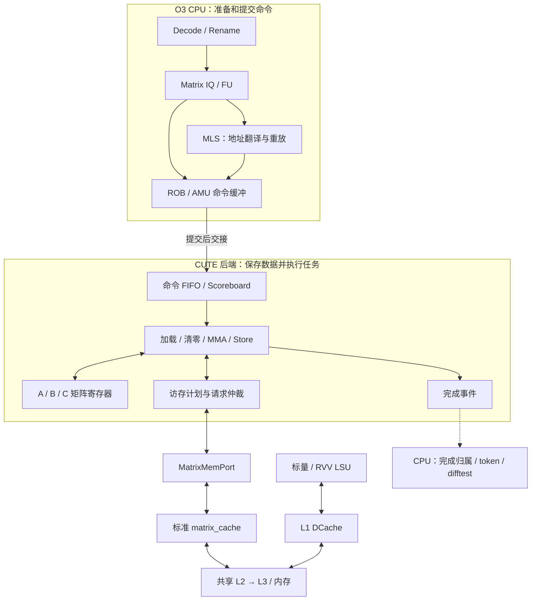

# Matrix 快速开始

Matrix 扩展在 RISC-V O3 CPU 中接入异步 CUTE 后端，访存通过专用端口和标准 Cache
进入共享 L2；开启 difftest 时，由 GEM5 加载外部 NEMU 共享库检查结果。

## 编译 GEM5

在当前 Matrix 分支的仓库根目录执行，依赖安装参考
[仓库快速开始](../quick_start.md)：

```bash
scons build/RISCV_MATRIX/gem5.opt --default=RISCV \
    --enable-matrix --gold-linker -j64
```

普通 RISC-V 构建默认关闭 Matrix。上面的命令使用独立目录构建 Matrix 版本，
后续增量构建也需要保留 `--enable-matrix`；运行时使用
`configs/example/kmhv2_matrix.py` 启用专用 CPU 配置。

| 构建与入口 | 使用方式 |
|---|---|
| `build/RISCV/gem5.opt` | 默认不编入 Matrix，沿用普通 CPU 配置和普通 NEMU REF。 |
| `build/RISCV_MATRIX/gem5.opt` + `kmhv2_matrix.py` | 编入并启用 Matrix，创建专用调度队列、后端和 Cache。 |
| `build/RISCV_MATRIX/gem5.opt` + `kmhv2.py --matrix` | 通过公共入口启用同一套 Matrix 配置。 |

## 准备 NEMU

源码地址：[OpenXiangShan/NEMU](https://github.com/OpenXiangShan/NEMU)。
安装 NEMU 配置工具所需的依赖，再编译带 Matrix 的 difftest 共享库：

```bash
sudo apt install flex bison
git clone https://github.com/OpenXiangShan/NEMU.git NEMU
cd NEMU
export NEMU_HOME="$PWD"

cp configs/riscv64-gem5-ref_defconfig configs/riscv64-gem5-matrix-ref_defconfig
cat >> configs/riscv64-gem5-matrix-ref_defconfig <<'EOF'
CONFIG_RV_AME=y
CONFIG_RV_AME_TLEN=65536
CONFIG_RV_AME_TRLEN=512
CONFIG_RV_AME_MLEN=32
CONFIG_RV_AME_MSYNC_32=y
CONFIG_DIFFTEST_AMU_CTRL=y
CONFIG_TVAL_EX_II=y
EOF
make riscv64-gem5-matrix-ref_defconfig
make -j32
export GCBV_REF_SO="$NEMU_HOME/build/riscv64-nemu-interpreter-so"
```

## 运行命令

替换下列镜像和 NEMU 路径，GEM5 命令在仓库根目录执行。示例使用平坦的 `.bin`
镜像和 `SimpleMemory`，无需额外安装 DRAMsim3；`--mem-size` 按工作负载需要调整。
这里的 `--raw-cpt` 用于平坦镜像，运行 GCPT checkpoint 切片时应去掉。

### GEM5 独立运行

```bash
./build/RISCV_MATRIX/gem5.opt -d m5out/matrix-standalone \
    configs/example/kmhv2_matrix.py \
    --raw-cpt --generic-rv-cpt=/absolute/path/to/matrix-workload.bin \
    --mem-type=SimpleMemory --mem-size=512MB --warmup-insts-no-switch=0 \
    --disable-difftest
```

### GEM5 + NEMU difftest

```bash
# 指向支持 Matrix 的 NEMU 参考模型
export GCBV_REF_SO=/absolute/path/to/riscv64-nemu-interpreter-so
./build/RISCV_MATRIX/gem5.opt -d m5out/matrix-difftest \
    configs/example/kmhv2_matrix.py \
    --raw-cpt --generic-rv-cpt=/absolute/path/to/matrix-workload.bin \
    --mem-type=SimpleMemory --mem-size=512MB --warmup-insts-no-switch=0 \
    --enable-difftest --difftest-ref-so="$GCBV_REF_SO"
```

运行日志和统计保存在 `-d` 指定的目录中。检查程序自己的结果输出，以及 difftest
运行结束时的 `MatrixDiff` 汇总：已提交的后台任务应完成并检查，`pendingChecks`、
`pendingOwners`、`pendingMemory` 应为 0。程序数值自检与 difftest 结果应分别确认。

需要使用 DRAMsim3 时，先按[仓库快速开始](../quick_start.md)编译其依赖，再重编 GEM5，
并在命令中选择相应内存模型。性能对比必须保持镜像、CPU 配置、内存模型及其参数一致。

默认构建使用普通 NEMU REF；Matrix 构建的 difftest 需要匹配 Matrix CSR 布局的 REF，
即使该二进制运行时未开启 Matrix 后端也一样。

### Matrix CSR 地址兼容性

XSAI RTL 和 Matrix NEMU REF 使用下表中的 guest 地址。M/N/K 由
`msettile*` 更新，通过 CSR 指令只读。`msync` 返回同步 token 的数量。

| CSR 地址 | 读取值 |
|---|---|
| `0xCC1`、`0xCC2`、`0xCC3` | `tlenb`、`trlenb`、`alenb` |
| `0xCC4`、`0xCC5`、`0xCC6` | `mtilem`、`mtilen`、`mtilek` |
| `0xCC7` | `msync` |

旧 AME LLVM 汇编器把 `mtok`、`xmtilem`、`xmtilen`、`xmtilek` 依次编码到
`0xCC4–0xCC7`，并把 `xmisa` 编码到 `0xCC0`。前四个地址在 XSAI 上读取不同值，
访问 `0xCC0` 会触发非法指令异常。使用这些名字的程序需要更新汇编器地址表，
或按上表使用数字地址后重新编译。可用不同的 M/N/K 值和 `tile-csr` 回归检查工具链。

## 修改文件与作用

Matrix 扩展分为 O3 命令侧、CUTE 矩阵后端和共享内存三部分。O3 准备指令参数、
处理地址翻译和精确异常；CUTE 后端保存矩阵数据，执行加载、乘加和存储任务。
CPU 持有后端对象，并在模拟过程中推进它。

`--enable-matrix` 决定是否编入扩展，运行入口决定是否创建 Matrix 资源。
启用时，`MatrixXiangshanCore` 只负责 Python 配置和 Cache 接线，实际执行仍沿用
原有 C++ O3 CPU；普通 CPU 配置不创建 Matrix 后端或专用 Cache。

### 整体架构



实线表示命令交接或数据访问，虚线表示后台完成后的通知。阅读时可以沿三条路径理解：

1. **命令路径**：指令译码后进入 O3 调度。基址、步长和 M/N/K 等参数通过寄存器依赖
   取得；Matrix 访存由 MLS（Matrix Load/Store Unit）调用 CPU MMU 完成页翻译，
   保存本次请求使用的配置和页映射。请求在写回时留存在 AMU 命令缓冲，提交后再按序
   交给有空位的后端 FIFO。
2. **数据路径**：后端根据寄存器依赖和资源状态安排任务。加载把内存数据写入矩阵寄存器，
   MMA 执行矩阵乘加并更新累加器，Store 将结果写回内存。A/B 保存乘法输入，C 保存
   累加结果；这些矩阵实值保存在后端寄存器文件中，M/N/K 等参数则使用 O3 重命名机制。
3. **完成路径**：加载、计算或存储真正完成后，后端向 CPU 返回完成事件。CPU 根据指令
   序号找到对应任务，处理结果检查和同步 token。`mrelease` 完成后更新 token，
   `macquire` 等待 token 达到要求，软件据此确认后台任务已经完成。

O3 中的请求准备、ROB 提交和后台数据完成是三个不同的时点。Matrix 命令可以先提交，
随后由后端继续执行；软件通过同步指令等待所需结果。

### Matrix Cache 与 L2 接线

`matrix_cache` 是专供 Matrix 访存使用的标准 GEM5 Cache，当前配置为 1 KiB、2 路组相联，
有 16 个 MSHR，用于跟踪尚未完成的 Cache miss。启用 `--matrix` 后，
`MatrixXiangshanCore._sync_matrix_cached_port()` 创建它，把 `matrix_mem_port` 接到其
`cpu_side`，再把 `mem_side` 加入 `_cached_ports`。随后现有的缓存配置把这些端口接到
L1→L2 总线。[Cache 创建与端口登记](../../configs/common/MatrixConfig.py#L90) ·
[总线接线](../../configs/common/CacheConfig.py#L380)

```text
Matrix       → MatrixMemPort → matrix_cache ─┐
标量 / RVV   → L1 DCache ────────────────────┴→ L1→L2 总线 → 共享 L2
```

Matrix 请求绕过 CPU 的 L1 DCache 和它的 MSHR。后端按对齐的 64B 缓存行生成请求，
经端口发出 `ReadReq` 或带 byte enable 的 `WriteReq`。读命中 `matrix_cache` 时可以直接
返回，需要下一级服务时才经过共享 L2 的普通入口。[64B 访问计划](../../src/matrix/MemoryLoader.hh#L185) ·
[端口发包](../../src/cpu/o3/matrix_cpu.cc#L902)

这层 Cache 复用 GEM5 原有的一致性协议。例如，CPU 刚写过一条线，最新数据还在
L1 DCache 中，此时 Matrix 要改同一条线的另 12B。若 `matrix_cache` 缺少该行或其写权限，
它用 `ReadExReq` 取得最新数据和写权限，或在已有共享副本时用 `UpgradeReq` 升级权限，
随后按掩码只更新这 12B。Cache 同时负责响应其他 Cache 的一致性探测、处理重试和写回。
这样 Matrix 端口只需提供普通读写请求。跨 CPU 与 Matrix 后端交接数据时，软件仍需使用
相应的内存屏障和 Matrix 同步指令。[标准 Cache 的缺失请求处理](../../src/mem/cache/cache.cc#L531)

### 代码入口

以下按职责列出主要文件，路径均相对仓库根目录。

| 模块 | 代码入口 | 负责什么 |
|---|---|---|
| 运行配置 | [kmhv2_matrix.py](../../configs/example/kmhv2_matrix.py)、[MatrixConfig.py](../../configs/common/MatrixConfig.py) | 选择 Python 配置子类 `MatrixXiangshanCore`，配置功能单元、调度队列，并创建和连接专用 Cache；沿用原有 C++ O3 CPU。 |
| 指令定义 | [matrix/decode.isa](../../src/arch/riscv/isa/matrix/decode.isa)、[matrix/formats.isa](../../src/arch/riscv/isa/matrix/formats.isa)、[matrix.hh](../../src/arch/riscv/matrix.hh) | 定义 Matrix 编码、操作数、执行语义和静态指令信息。 |
| 架构状态 | [matrix_isa.cc](../../src/arch/riscv/matrix_isa.cc) | 处理 Matrix CSR、配置、同步 token 和 ISA checkpoint 状态。 |
| O3 命令侧 | [matrix_pipeline.cc](../../src/cpu/o3/matrix_pipeline.cc)、[mls_unit.cc](../../src/cpu/o3/mls_unit.cc) | 接入分派和执行，准备请求，处理访存翻译、重放与 squash，通过 ROB/AMU 在提交后交接命令。 |
| 任务执行 | [CUTETOP.hh](../../src/matrix/CUTETOP.hh)、[CUTETOP.cc](../../src/matrix/CUTETOP.cc)、[MatrixTypes.hh](../../src/matrix/MatrixTypes.hh) | 定义请求和完成事件；实现 `DetailedCuteBackend`，推进命令队列、加载、清零、乘加和存储任务。 |
| 矩阵数据与依赖 | [MRegFile.hh](../../src/matrix/MRegFile.hh)、[Scoreboard.hh](../../src/matrix/Scoreboard.hh) | 保存矩阵实值，管理寄存器读写资源，以及任务间的读写依赖。 |
| 数据搬运 | [MemoryLoader.hh](../../src/matrix/MemoryLoader.hh)、[LocalMMUModel.hh](../../src/matrix/LocalMMUModel.hh) | 根据已冻结的页映射生成缓存行访问计划，管理请求仲裁、未完成访存和返回数据。地址翻译由 O3 MLS 完成。 |
| CPU 与后端连接 | [matrix_cpu.cc](../../src/cpu/o3/matrix_cpu.cc)、[matrix_cpu_state.hh](../../src/cpu/o3/matrix_cpu_state.hh)、[BaseO3CPU.py](../../src/cpu/o3/BaseO3CPU.py) | 创建和推进后端，提供内存端口及必要参数，跟踪完成任务，并配合外部 NEMU 检查 Matrix 结果；Cache 接线在专用 Python 子类中完成。 |

初次阅读可以先看运行配置和上面的架构图，再从 `matrix_pipeline.cc` 跟踪一条命令如何
进入 `CUTETOP.cc`；需要了解数据搬运时看 `MemoryLoader.hh` 和 `LocalMMUModel.hh`，
需要了解完成通知与 difftest 时看 `matrix_cpu.cc`。
